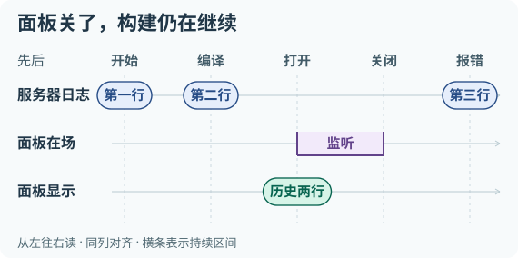

# 00｜等下一行日志的时候

你刚点了一次「开始构建」，想知道刚改的代码能不能跑起来。任务详情里有个日志面板，打开时只有短短两行。

```text
09:41:02  开始构建
09:41:03  正在编译
```

如果你写过展示列表的页面，这个面板的前半段就很熟悉。向服务器要这次任务的历史记录，等请求回来，把两行文字依次画出来。到这里，请求已经完成了。可你多半还会盯着最后一行看一会儿。编译通过了吗？如果失败，报错在哪个文件？你打开面板真正想看的那一行，可能还没有产生。

这本书要做的实时控制台，就从这片空白开始。

## 已经写好的两行，和即将到来的一行

设想你来接手这个面板。手里已经有一份日志数组，想只看出错的行，可以用熟悉的 `filter` 筛一遍。上面两行都没报错，筛完得到空数组。过了几秒，服务器又写下一行「错误：找不到入口文件」。刚才的筛选早已执行完，页面要怎样才能显示这条错误？

一个朴素的做法是记住读到了哪里，让面板每隔一会儿问一次服务器，有新行就交给显示函数。另一种做法是保持连接，每当服务器送来一行，就调用同一个函数。不论采用哪一种，你都可以把显示规则写成一句话：每来一行就看看它是否报错，符合条件才画出来。这样，哪怕两行之间隔了十秒，这条规则仍然适用。

把陆续收到的这些值按先后看成一个序列，就是本书里常说的**流**。RxJS 是一个 JavaScript 库，它让我们能用代码描述这样的序列，以及收到值后要怎样处理。书里会用到的 `Observable` 可以描述“每次有新行，就把它交给关心它的人”。面板要接收这些行时，会带着自己的处理函数去**订阅**它。这样，同一行日志怎么到达、到达后怎么显示，就可以分开讨论了。

## 谁决定下一行什么时候交给面板？

读历史时可以写 `for (const line of history)`。循环每走一轮，就向迭代器要一个结果。迭代器可以交出下一行，也可以告诉循环已经读完。这叫**拉取**。读到「正在编译」就跳出循环，下一行也就没人再向它要了。

换成正在构建的任务。面板打开时先交出自己的处理函数，等日志源有了下一行，由源调用这个函数。这叫**推送**。两边的角色恰好调转了。迭代器的 `next()` 是读者向源要值；稍后你会在 Rx 代码里见到的 `next(line)` 是源把值递给读者。即使源在订阅的一瞬间就把缓存中的两行都递过来，这仍然是推送。判断的依据是**谁发起每一次交付**，两行之间隔多久都可以。

那给 socket 登记一个回调够不够？如果唯一的需求是「每来一行就画出来」，一个监听器加上对应的移除方法就够用。现在给面板加个选项：「只看第一条错误，看到了就停止读取。」从数组读，循环可以在符合条件时退出。从连接读，若回调只做一次 `return`，退出的只是这次调用；下一行到达时源还会再调用它。相同的显示需求，换一种来源，停止的办法就变了。

Rx 把这两端各自需要的动作约定下来。源可以逐条交值，可以报告读完或失败；读者可以结束自己的订阅。筛错误这条规则本身也能接收行、向下游交行，于是可以在它后面接上「取第一条」。等第一条错误通过，取值规则已经知道自己的工作完成了，它可以沿订阅关系释放上游。面板只管显示收到的那一行。源若持有专用定时器，仍要提供真正的清理动作；下一章会用计数器检查这一点。

## 从「收到后做什么」走到「画面依赖什么」

给日志面板加一个小功能：勾选「只看错误」。如果你正在写事件回调，很可能会在收到日志时读一次复选框，再决定要不要把新行贴到屏幕上。先试两个动作：已经有一条普通行时勾选，它该消失；不再收到任何消息，随后取消勾选，它又该回来。只在新行到达时检查复选框，这两步都不会发生。

可以在勾选回调里也补一段重画代码。写到这里不妨先离开两个回调，把想要的**关系**单独写成一个普通函数。函数的输入是一份保留的日志和当前勾选状态，输出是此刻应该显示的行。

```ts
type Line = { text: string; level: 'info' | 'error' }

function visible(lines: Line[], onlyErrors: boolean) {
  return onlyErrors ? lines.filter(line => line.level === 'error') : lines
}
```

现在沿两条时间线走一遍。列表是「开始编译」，开关是关，画面就是「开始编译」。勾选时，给函数**同一份列表和新开关**，结果是空。随后收到错误，给它**新列表和同一个开关**，结果只有那条错误。取消勾选，两条都回来。这里有两个设计决定：普通行仍要保存在原列表里；任一输入变化都足以要求一幅新画面。如果为了少画一行，干脆在接收时扔掉普通行，最后一步就没有数据可以恢复它了。

这也是“声明式”在这个例子里的具体含义。计算部分写清画面与输入之间的关系，接线部分写清什么变化会让这次计算重新发生。把普通函数放在那里，JavaScript 自己不会追踪参数并重新调用它；稍后第 7 章会用两路输入共同驱动它。多加一个「复制画面」按钮，再问它是否也要在日志更新时自动复制。答案若是“只有人按时才复制”，就给它单独的触发入口。**计算用到同一份数据，触发计算的理由仍可以不同。**

如果日志是一份从磁盘读完就不再变的文件，页面也没有开关，直接调用一次 `visible` 已经表达了整个需求。等输入有了各自的寿命，用户又能在等待期间操作，才需要把这些变化之间的关系也写进程序。这会是后面选择 Rx 时反复用到的判断。

**读图 · 面板关了，构建仍在继续**

从左向右是事情发生的先后，沿着虚线向下读是同一刻各处发生的事。圆角标记表示一个事件，横条两端标出面板从打开到关闭的区间。后面带毫秒或帧数的图以标注为准。

[](../figures/book-00.svg)

打开时先读已有的两行。沿着第三行向下看，此时监听区间已经结束；若把关闭移到报错之后，这一行也能交给面板。

## 面板关掉以后

现在把时钟拨回到「正在编译」刚出现的时候。这次你没等结果，随手关了面板。隔壁同事还开着同一项任务的页面，他理应能看到后来那条报错。构建属于服务器，关面板只表示你这边看完了。

再站到写代码的人的位置想一层。假如刚才是你的面板启动了定时查询，关掉它以后，谁来撤掉那只定时器？假如同一页上还有一个错误计数器，它也在等那条报错，关面板时又该留下哪部分工作？“我看完了”“这项任务跑完了”“这一页再也没人需要日志了”，在界面简单时很容易被写进同一个关闭函数。加上第二个读日志的地方，这三个时刻就可能相隔很久。

后面的控制台会沿着这些差别一点点长出来。先让一个面板可靠地打开和关闭，再让列表和计数器一起读日志；等用户可以切换任务，还得决定旧任务迟到的消息该去哪里。到了网络和测试章节，我们会把这些先后顺序重演一遍，检查程序在慢一拍、断一次线时会做什么。

第 1 章先把场景缩小到一块面板和一只专供它使用的定时器。你已经知道用户为什么要打开它，也知道用户随时可能离开。现在可以接手这个关闭按钮了。屏幕上的字停住以后，你会到哪里看一眼，才敢说它确实关好了？

[第 1 章｜关掉面板，为什么日志还在打印？](01.md)
