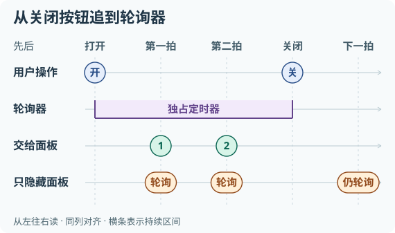

# 01｜关掉面板，为什么日志还在打印？

上一章用的 `fromEvent` 会在面板关掉时撤下监听器。现在换一个只能轮询的构建服务，每隔一会儿得去问一次有没有新行。定时器是我们开的，RxJS 从哪里拿到它的编号？

## 把关闭按钮接到定时器

本章的 JavaScript 示例可以保存为项目根目录的 `.mjs` 文件，用 Node 运行。打开面板的函数拿得到定时器编号，关窗的那段代码却在外面。让打开函数返回一个闭包，就能把这只定时器的开关带出来。下面的轮询器每 100 毫秒报一个行号，代替真正的网络读取。

```js
function start(show) {
  let line = 0
  const timer = setInterval(() => show(++line), 100)
  return () => clearInterval(timer)
}
const stop = start(n => console.log(n))
setTimeout(stop, 250)  // 模拟用户关闭面板
```

把轮询器交给 RxJS，可以沿用这个闭包。保留 `start`，将末尾两行换成下面的代码。传给 `new Observable` 的函数负责接通定时器；它的返回值告诉 RxJS 怎么关掉这只定时器。

```js
import { Observable } from 'rxjs'

const lines = new Observable(sink => {
  const stop = start(n => sink.next(n))
  return stop
})
const observer = {
  next(n) { console.log('收到第', n, '行') },
  error(err) { console.log('读取失败', err.message) },
  complete() { console.log('日志已读完') }
}
const panel = lines.subscribe(observer)
setTimeout(() => panel.unsubscribe(), 250)
```

构造 `lines` 时，RxJS 保存传进去的函数。面板订阅时，RxJS 才调用它，把一个 `Subscriber` 传给来源，代码里叫 `sink`。定时器的第一拍调用 `sink.next(1)`，RxJS 便把 1 交给 `observer.next`。只处理值时可以把这个回调单独传给 subscribe。订阅函数返回的 `stop` 则被登记为清理动作，最后由 `panel.unsubscribe()` 调到它。[7.8.2 的 subscribe 实现](https://github.com/ReactiveX/rxjs/blob/7.8.2/src/internal/Observable.ts#L204-L231)

这里的两次 `return` 各有接收人。来源写 `return stop`，RxJS 就把这个函数收进本次订阅，等退出时调用。若误写成 `return stop()`，JavaScript 会当场清掉刚开的定时器，连第一拍也等不到。外层的 `lines.subscribe(observer)` 返回给面板的则是订阅句柄；面板只需知道怎样退出，连定时器的编号都不用保存。

主窗和侧栏若分别订阅 `lines`，会有两次 `start` 调用。各自的 `line` 从零开始，各自持有一个关闭句柄（Subscription）。关主窗时交还的是主窗那一个，侧栏还能继续读。

[](../figures/book-01.svg)

根目录的 `npm run lab -- 01` 记录两个数：定时器实际醒了几次（`ticks`），面板收到了哪些行（`rows`）。三次运行都读了两行，分别在第二行后完成、报错、关窗。

| 谁结束这次读取 | 面板该显示什么 | 实验观测 |
|---|---|---|
| 源调 `sink.complete()` | 两行都已读完 | 收到 complete，ticks 停在 2 |
| 源调 `sink.error(Error('offline'))` | 读取失败 | 收到 offline，ticks 停在 2 |
| 用户调 `panel.unsubscribe()` | 直接离开 | 没有结束通知，ticks 停在 2 |

三行的 `ticks` 都停在 2，因为 complete、error 和主动退订最终都会调用 `stop`。回调收到的消息却不同：前两种由来源报告读取结果，关窗只表示面板不想再读。如果关窗也触发 complete，报告页就可能把半份日志标成「已全部载入」。若要在三种情形下都统计退出次数，可以用 `finalize`；让定时器停下来的仍然是 `clearInterval`。

## 首行预览为什么读完了整份历史

控制台的预览只显示第一行。轮询时，在第一个 `next` 里调 `panel.unsubscribe()` 来得及。预览若命中本地缓存，三条记录都已经在内存里了。一调用 `subscribe`，源就可以在同一调用栈里解码、交付、继续循环。第一条到达时，`subscribe` 还没返回，面板手里也就还没有可用的 `panel`。

让预览在订阅以前就声明「取一条」。`take(1)` 把第一条交给预览，随即完成预览并解除它对上游的订阅。下面两次打开都只显示 10，`decoded` 记的是预览为此实际解码了几行。

```ts
import { Observable, take } from 'rxjs'

function preview(stopWhenClosed: boolean) {
  let decoded = 0
  const shown: number[] = []
  const cache$ = new Observable<number>(sink => {
    for (const raw of ['10', '20', '30']) {
      if (stopWhenClosed && sink.closed) break
      decoded++
      sink.next(JSON.parse(raw))
    }
    sink.complete()
  })
  cache$.pipe(take(1)).subscribe(value => shown.push(value))
  return { decoded, shown }
}

console.log(preview(false), preview(true))
// { decoded: 3, shown: [10] }   { decoded: 1, shown: [10] }
```

`sink.next(10)` 返回时，`take(1)` 已经取够。此时 JavaScript 的 `for` 循环正要处理 `'20'`。没有 `break`，它就会再解析两次，尽管结果再也送不到面板。下一轮解码前检查 `sink.closed`，就能省下后两次解析。完成的是这次首行预览，构建仍然可以产生新的日志。

<details>
<summary>另一个容易看错的完成时刻：日志已经交给写盘回调</summary>

<a id="给-next-加上-async来源会等我写完吗"></a>

面板要把 A、B 写入文件。给 `next` 加上 `async`，再在 `complete` 里显示「都已保存」，这个顺序可靠吗？把写盘换成一次微任务等待即可看到问题。这里的 `of` 会依次送出 A、B，随即完成。

```ts
import { of } from 'rxjs'

of('A', 'B').subscribe({
  async next(line) {
    console.log('开始', line)
    await Promise.resolve()
    console.log('写完', line)
  },
  complete() { console.log('来源结束') }
})
```

实际顺序是「开始 A、开始 B、来源结束、写完 A、写完 B」。第一个回调运行到 await 就返回 Promise，源随即调用第二个回调。`next` 的返回值没有参与来源的完成判断。如果手里只有一个数组，逐行 `await write(line)` 的循环能等到写完。实时到达的行怎样逐笔等待，第 6 章再接这段工作。

</details>

关窗会丢掉这次订阅，缓存里的行却还在。重新打开以后，面板还要能读出旧行、接住新的预览点击。[第 2 章 · 打开面板时有哪些数据](02.md)

<a id="发散练习"></a>

<details>
<summary>配套练习 · 谁负责停掉一次读取</summary>

<a id="transfer-a"></a>

[唱片店里的播客试听席](../练习/01.md#transfer-a)

<a id="transfer-b"></a>

[双指作画时，把哪一笔交给印章机](../练习/01.md#transfer-b)

<a id="transfer-c"></a>

[暗房冲印中途缺了一只夹子](../练习/01.md#transfer-c)

</details>

## 章末附录 · 本章 RxJS API 速查

<details>
<summary>多个资源由谁关闭</summary>

现在让一个面板拥有两个资源。能关闭就满足 `Unsubscribable`；如果还承诺可读取布尔值 `closed`，才满足 `SubscriptionLike`。源返回的 `TeardownLogic` 可以是清理函数、有 `unsubscribe` 的对象、一个 `Subscription` 或 void。直接返回计时器编号不能让 RxJS 知道该怎样释放它。可以这样移交所有权：

```ts
import { Subscription } from 'rxjs'

const panel = new Subscription(() => console.log('关闭面板'))
const stream = new Subscription(() => console.log('停止读取'))
panel.add(stream)
panel.remove(stream)
panel.unsubscribe()    // 此时只打印「关闭面板」
stream.unsubscribe()   // 接管它的一方负责「停止读取」
```

去掉 `remove`，父订阅关闭时子订阅也会关闭。重复退订没有第二次效果。对已关闭的订阅 `add` 一个新的清理函数，它会立即执行；`Subscription.EMPTY` 是一个已经关闭的订阅。某个清理函数抛错时，还应尝试关闭其余资源。实验安排 socket、file 两个清理动作抛错，末尾的 tail 仍执行，调用 `unsubscribe` 的一方收到 `UnsubscriptionError`，按 `errors` 数组能找到两个原始错误。清理失败与源通过 `error` 报告读取失败有不同的观测位置。

若每次打开 SDK 都会分配独立票号，把票保存在本次订阅的局部常量里。实验的 closeMain 先开主窗（票 1），再开侧栏（票 2）。若清理时查全局最新票号，关主窗反会注销侧栏。两种实现都剩一张票，只有再推一行给侧栏才能辨认。

</details>

<details>
<summary>同步完成以后才拿到清理函数</summary>

老 SDK 会先交付缓存、报告完成，然后才返回会话句柄。仍然在订阅函数末尾返回闭包。RxJS 把清理加到一个已经关闭的订阅时会立即执行。实验里完整顺序为 acquire、title、end、return ticket、release。若 SDK 在交回句柄之前就抛错，外层拿不到资源，须由持有句柄的一侧清理。

</details>

<details>
<summary>旧接口和观察者的类型</summary>

向外暴露面板接口时，可以用 `Observer<T>` 要求使用者明确给出 `next`、`error`、`complete` 三个处理函数。只想显示一行时，`lines.subscribe(n => …)` 或 `lines.subscribe({next(n) { … }})` 都成立。`NextObserver<T>`、`ErrorObserver<T>`、`CompletionObserver<T>` 各要求同名的那个通知处理函数（完成对应 `complete`），其余两个可选，也都允许可选的 `closed` 字段。`PartialObserver<T>` 是这三种形状的联合。因此 `{ complete() {} }` 可以作 `PartialObserver<number>`，`{}` 不行。`subscribe` 的参数实际更宽，是 `Partial<Observer<T>>`，所以直接传 `{}` 编译得过。若源可能失败，请给实际面板提供错误处理，否则未处理错误会由 RxJS 报给宿主。

`Subscriber<T>` 同时具备观察者和订阅的能力。自己写源时使用构造器送来的 `sink` 就能访问 `sink.closed`、`sink.unsubscribe()` 和三种通知。编号源的 `sink.next('2')` 会被编译器拒绝。旧代码用 `new Subscriber(observer)` 或 `Subscriber.create(next, error, complete)` 手造接收端，这两个入口均已弃用。把回调对象交给 `subscribe`，保留它的返回值就能控制这次执行。

实验把 `Observable.create(fn).subscribe(next, error, complete)` 改为 `new Observable(fn).subscribe({ next, error, complete })`，两边都得到值 1 和完成标记 0。多位置回调形式已弃用，单独传一个 next 函数仍有效。整理老管道时，也会看到弃用的 `source`、`operator`、`lift`。旧链通过这些内部接线信息描述上游与转换。新代码保存显式的源，向 `source.pipe(op)` 传入接收源并返回新源的函数。第 3 章会自己写这样的函数。`pipe()` 保留原源，1 至 9 段有逐段类型推导，超过九段的兜底重载返回 `Observable<unknown>`，可把长链拆成有类型的子链。

如果面板只读一次有限历史，`await source.forEach(render)` 逐行执行 render，完成时兑现 void，源或 render 抛错时拒绝。它不交回关闭开关，持续监听仍应保留订阅。旧 `forEach(render, PromiseCtor)` 改用默认 Promise。已弃用的 `toPromise()`（也可传 Promise 构造器）在完成时交出最后一个值，空源则兑现 undefined。需要保留这两个行为，可以用 `lastValueFrom(source, { defaultValue: undefined })`；省略默认值时空源会拒绝。只取第一行则用 `firstValueFrom`，退出时机也随之提前。

</details>

<details>
<summary>本章 API 与成员表</summary>

关掉日志面板时，对照 subscribe、unsubscribe 和 finalize。屏幕停止更新后，还要看注册在这一次订阅上的定时器是否已经释放。

**接入来源与订阅**

| API | 用法 |
|---|---|
| [`Observable`](../RxJS-7.8.2-API清单.md#api-114) | 描述一次可订阅的执行，可以交付零个或多个值，随后完成、报错或继续等待。 |
| [`Observer`](../RxJS-7.8.2-API清单.md#api-124) | 接收 next、error、complete 三种通知的对象类型。 |
| [`PartialObserver`](../RxJS-7.8.2-API清单.md#api-132) | 只要求提供至少一种通知处理函数的观察者类型。 |
| [`NextObserver`](../RxJS-7.8.2-API清单.md#api-107) | 要求提供 next 的观察者类型，可只处理值。 |
| [`ErrorObserver`](../RxJS-7.8.2-API清单.md#api-57) | 要求提供 error 的观察者类型，可只处理失败。 |
| [`CompletionObserver`](../RxJS-7.8.2-API清单.md#api-27) | 要求提供 complete 的观察者类型，可只处理正常结束。 |
| [`Subscriber`](../RxJS-7.8.2-API清单.md#api-179) | 源用它交付通知，并通过 closed 检查下游是否已经退出。 |
| [`Subscription`](../RxJS-7.8.2-API清单.md#api-180) | 一次执行的句柄，可集中登记清理动作并用 unsubscribe 释放。 |
| [`SubscriptionLike`](../RxJS-7.8.2-API清单.md#api-181) | 描述具有 closed 和 unsubscribe 的最小订阅接口。 |
| [`Unsubscribable`](../RxJS-7.8.2-API清单.md#api-213) | 表示可以调用 unsubscribe 释放的资源。 |
| [`TeardownLogic`](../RxJS-7.8.2-API清单.md#api-193) | 订阅函数可返回的清理逻辑，例如函数、订阅句柄或 void。 |
| [`UnsubscriptionError`](../RxJS-7.8.2-API清单.md#api-214) | 多项清理中有失败时汇总异常，可从 errors 读取各项原因。 |
| [`finalize`](../RxJS-7.8.2-API清单.md#api-66) | 在完成、出错或退订时执行收尾逻辑，适合释放资源或核对清理次数。 |
| [`using`](../RxJS-7.8.2-API清单.md#api-215) | 为一次面板订阅申请资源并登记回收，正常完成、失败、主动关闭都要归还。 |
| [`of`](../RxJS-7.8.2-API清单.md#api-125) | 同步依次发出 A 和 B，随后完成。异步 next 回调尚未写完时，来源就可能已经结束。 |

**变换、筛选与累计**

| API | 用法 |
|---|---|
| [`pipe`](../RxJS-7.8.2-API清单.md#api-134) | 按从左到右的顺序组合操作；流的 pipe 方法把这些操作应用到当前来源。 |
| [`take`](../RxJS-7.8.2-API清单.md#api-187) | 只交付前 n 项，取够后完成并退出上游。 |
| [`firstValueFrom`](../RxJS-7.8.2-API清单.md#api-70) | 返回 Promise，拿到首值就兑现并退订；空完成时用配置的默认值或拒绝。 |
| [`lastValueFrom`](../RxJS-7.8.2-API清单.md#api-90) | 返回 Promise，正常完成时用末值兑现；空完成时用配置的默认值或拒绝。 |

**时间与调度**

| API | 用法 |
|---|---|
| [`timer`](../RxJS-7.8.2-API清单.md#api-206) | 等到指定时刻或延时后发 0；给第二个周期参数可继续递增发值。 |

**组合来源与在途工作**

| API | 用法 |
|---|---|
| [`concatMap`](../RxJS-7.8.2-API清单.md#api-30) | 逐个启动内部流，上一条正常完成后才处理下一项排队输入。 |

**方法、属性与测试助手**

| 成员 | 用法 |
|---|---|
| `subscribe()` | 登记观察者、接入一次执行，返回控制该次订阅的句柄。 |
| `next(value)` | 交付一个值；Subject 会把这次通知发给当前观察者。 |
| `error()` | 以错误终止当前序列并释放订阅资源。 |
| `complete()` | 通知正常结束，随后释放资源；主动退订不会给观察者补发 complete。 |
| `unsubscribe()` | 主动结束本次订阅并触发清理；不能据此判断远端写入是否成功。 |
| `closed` | 读取订阅是否已关闭，可用于让同步生产循环尽早退出。 |
| `add()` | 把子订阅或清理函数挂到父订阅；父订阅已关闭时会立即执行清理。 |
| `remove()` | 将清理项移出父订阅，移除本身不会调用它。 |
| `Subscription.EMPTY` | 一个已经关闭的空订阅，可用作无需清理的句柄。 |
| `UnsubscriptionError.errors` | 保存本轮退订收集到的各项清理异常。 |
| `Subscriber.create` | 旧的订阅者工厂；普通观察者对象可直接传给 subscribe。 |
| `Observable.create` | 旧的手写来源工厂；可用 new Observable 注册订阅及清理逻辑。 |
| `lift()` | 旧接口，按 Operator 构建派生流；自定义操作可优先组合已有操作符。 |
| `Observable.source` | 旧 lift 链上指向上游的内部字段。 |
| `Observable.operator` | 旧 lift 链上关联的操作对象。 |
| `forEach()` | 逐项调用回调，返回表示遍历结束的 Promise；不会等待每个回调返回的 Promise。 |
| `toPromise()` | 旧转换方法，正常完成时兑现末值；空完成可能兑现 undefined。 |

</details>

[本章实验](../labs/01.ts) · [目录](../README.md) · [下一章](02.md)
