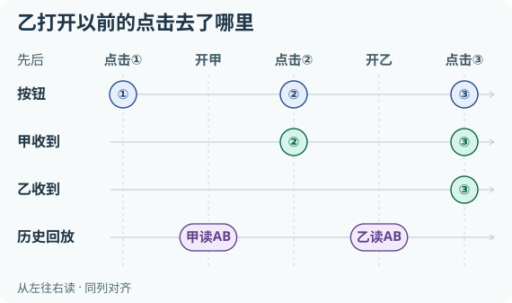

# 02｜让同一个面板读懂不同来源

重开构建面板，应该还能读到关窗前的「正在编译」。可要是在面板挂载前就按过预览按钮，打开后却不会凭空多出一次预览。两次订阅外观看起来很像，究竟能收到什么，要看另一端有没有把数据留下来。

## 一份历史，两种交付方式

`from(input)` 和 `of(...values)` 都能创建 Observable，区别在于**一项值是什么**。`from` 适配输入已有的读取方式：数组能逐个取元素，Promise 只能兑现一次。`of` 直接把每个实参当作一项交付。日志库交来含 A、B 的数组，同一个数组可以逐行追加，也可以整份替换界面上的表。

```ts
import { from, of } from 'rxjs'

const history = ['A', 'B']
const rows$ = from(history)
rows$.subscribe(row => console.log('行', row))       // 行 A，再行 B
of(history).subscribe(batch => console.log('批', batch)) // 一批 ['A','B']
```

因此 `from(Promise.resolve(history))` 也只会交付一次，值是完整的数组：RxJS 等 Promise 兑现，不会继续把兑现的数组拆开。空历史能让这个区别直接反映在屏幕上。`of([])` 会调用一次显示函数，参数是空数组，界面可以清掉旧表；`from([])` 一次也不调用它，直接 complete。若面板还画着上一任务的两行，选错接口就可能把旧行留在屏幕上。

7.8.2 的 `of` 实现很短：它把参数收集成数组，再把这个**参数数组**交给 from。所以 `of(history)` 读到的是参数数组里的唯一一项 history。[of](https://github.com/ReactiveX/rxjs/blob/7.8.2/src/internal/observable/of.ts#L80-L83) · [from 对输入的适配](https://github.com/ReactiveX/rxjs/blob/7.8.2/src/internal/observable/innerFrom.ts#L16-L37)

预览按钮没有保存历史。主窗和侧栏各订阅一次 `fromEvent`，就各自登记一个监听器。代码里用甲、乙表示这两块面板。

```ts
import { fromEvent } from 'rxjs'

const button = new EventTarget()
const clicks = fromEvent(button, 'click')
const click = () => button.dispatchEvent(new Event('click'))

click()                                      // ①
const a = clicks.subscribe(() => console.log('甲'))
click()                                      // ②
const b = clicks.subscribe(() => console.log('乙'))
click()                                      // ③
a.unsubscribe()
b.unsubscribe()
```

① 发生时按钮已经存在，监听器却还是零个。② 只有甲能听见。到了③，两份订阅各自登记的监听器都在，一次点击先打印甲，再打印乙。把 `a.unsubscribe()` 提前到③之前重跑，③就只打印乙。图里同一列的两格来自同一次点击。

回头看行数组，甲、乙各自订阅 `rows$` 时，`from` 都会为这次读取从头遍历；变量名末尾的 `$` 是一些项目用来标记 Observable 的习惯。教程后面会遇到「冷」和「热」这两个词。一份订阅单独启动的读取，比如第 1 章的轮询器，叫冷源；按钮这类独立于订阅就能产生事件的来源叫热源。每人都装了一个监听器，按钮仍然只有一个。至于晚到的人能不能补读旧值，还得看来源有没有保存并重放它们。

[](../figures/book-02.svg)

<a id="从调用者的座位看应该返回哪一种东西"></a>

如果要把 `readHistory(task)` 写成公共接口，先看调用方会接几次结果。只交一份网络快照，`Promise<Row[]>` 就够了。若要求先画有 3 行的本地缓存，再以有 4 行的网络快照校准，一次 Promise 只能兑现一次；用 `Observable<Row[]>` 就可以交两次。第二次到来时应把三行替换成四行。若把两份快照直接拆开追加，屏幕会出现七行。

## 第二次打开，读的是谁的进度？

导出按钮复用了预览面板的历史源。历史用数组时一直正常；换成逐行读取的生成器以后，打开预览能看见 A、B，再按导出，文件却是空的。用两行字符串就能复现。

```js
import { from, defer } from 'rxjs'

function* archive() { yield 'A'; yield 'B' }
const cursor = archive()
const stored = from(cursor)

stored.subscribe(row => console.log('预览', row))
stored.subscribe(row => console.log('导出', row))
```

第一次订阅让 `from` 向 cursor 逐次取值，读到 B 以后还要再取一次，才知道结束。第二次拿到的 cursor 仍然停在结束位置。要让导出也从 A 开始，得在第二个读者进来时再调用一次 `archive()`。这正是 `defer(factory)` 的作用：它接收一个无参函数，每次订阅都调用一次，再按 from 的规则接入返回的输入。这里函数负责取得新游标。

```js
const reopened = defer(() => archive())
reopened.subscribe(row => console.log('预览', row))
reopened.subscribe(row => console.log('导出', row))
```

两份输出现在各有 A、B。工厂可以直接返回生成器，`defer` 会按可迭代对象的规则去读它。若把工厂写成 `() => cursor`，函数虽然执行了两次，交回的却是同一个已经读尽的游标，第二份仍然为空。能从头导出的原因是第二次执行了 `archive()`，拿到一份新的读取进度。

归档若要通过请求重开，区别就在于谁启动了那次请求。这里给每次调用编个号，这样便看得出预览和导出读的是不是同一份响应。

```js
let started = 0
const request = () => Promise.resolve(++started)
const cached = from(request())
const onOpen = defer(request)
console.log('尚未订阅', started)        // 1
cached.subscribe(console.log)         // 1
cached.subscribe(console.log)         // 1
onOpen.subscribe(console.log)         // 2
onOpen.subscribe(console.log)         // 3
```

`from(request())` 得先算出参数才能调用 from，两个观察者等的是同一笔请求。`defer(request)` 则接收函数本身，预览、导出分别启动一笔。两种做法都有用：打开同一个请求结果时可以复用；要求每次刷新都问服务器时才应重新启动。关闭面板可以阻止该订阅再写界面，已经启动的原生 Promise 仍会运行。

<details>
<summary>导出的是打开抽屉时的版本，还是确认时的版本？</summary>

导出同样需要说清是哪一刻的历史。打开抽屉时是 [A,B]，确认之前追加 C。若用户点的是「导出刚才预览的内容」，在打开时复制字符串数组即可。把 `slice()` 放进确认时才执行的工厂，导出的会是三行。对可变对象行，复制数组只固定了哪些对象入选；连文字也要固定，就在打开时一并取出 id、text，保存成新的记录。

</details>

## 历史和实时之间少了第 3 行

打开任务时取快照，服务端当时有 1、2。快照在路上时写入第 3 行，面板收到快照才开始监听；随后第 4 行到达。数组会给出 1、2，监听器只知道 4。两段各自都正确，屏幕上却成了 1、2、4。

这次缺的那行，普通按钮式的接口已无从补发。成品的实时接口允许面板报上最后读到的行号，请求「2 之后」。服务端先补 3，再交付 4；补读与继续监听之间也得接得上。这个约定依赖同一任务内稳定、递增的编号。运行 `npm run lab -- 02`，在 `openLog(false)` 与 `openLog(true)` 的两条断言里能看到完整的区别。[本章实验](../labs/02.ts)

历史补齐后，写过的每一行都有了来处。接下来的麻烦在显示这一端：新消息里还夹着维持连接的心跳，把它当日志会在列表里多画一行。历史回放和预览按钮要共用同一套识别规则。[第 3 章 · 让日志进入列表](03.md)

<details>
<summary>回看前面学过的用法</summary>

<a id="practice-1"></a>

**1.** 把第 1 章的定时源换成事件监听器；挂载、卸载两次，记录启动次数、清理次数，证明卸载后不再收消息。

</details>

<a id="发散练习"></a>

<details>
<summary>配套练习 · 第二位读者从哪里开始</summary>

<a id="transfer-a"></a>

[把魔术师的一副牌分给两桌](../练习/02.md#transfer-a)

<a id="transfer-b"></a>

[朗读课上，谁说完才轮到下一位](../练习/02.md#transfer-b)

<a id="transfer-c"></a>

[排字铺的字模纸带](../练习/02.md#transfer-c)

</details>

## 章末附录 · 本章 RxJS API 速查

<details>
<summary>给自定义 SDK 配上注销函数</summary>

旧 SDK 让你调用 `lookup(id, done)`。一次查询结束时，它调用 `done(id, text)`。`bindCallback(lookup)` 得到一个新函数，传入 id 后返回可订阅的查询。订阅同一个查询对象两次，只执行一次 SDK 调用，两人都得到同一份结果。再次调用新函数会创建另一份查询对象。done 没有结果参数就发送 undefined，一个参数发该值，多个参数组成数组，随后完成。Node 风格 `done(err, value)` 要用 `bindNodeCallback`，它先取出错误槽；非 null/undefined 走 error，否则按相同规则处理剩余参数。实验里同一个读取函数用 true 得到 A，用 false 得到 offline。两种绑定函数均有结果选择函数重载，可将多个结果投影为一个值，也可传调度器安排订阅和交付。单次结果的缓存并不为 SDK 增加取消能力。

现在换成 `sdk.listen(handler)`，注册一次，handler 会持续收到日志；注销必须提交注册时返回的票号。此时需要让「注册」和「收一条」成为两件事：

```ts
import { fromEventPattern } from 'rxjs'

declare const sdk: {
  listen(h: (s: string) => void): number
  unlisten(ticket: number): void
}
const live = fromEventPattern<string>(
  h => sdk.listen(h),
  (_h, ticket) => sdk.unlisten(ticket),
)
```

这里的声明描述现有 SDK 的形状；实验用 Map 实现了一个可直接运行的版本。`fromEventPattern` 给注销函数传回原 handler 和注册返回值，每次通知发出一个值。多个回调参数默认组成数组，也可用第三个参数选择输出形状。实验在票号 17 上交付 A、B，退订后票号表长度为 0。若 SDK 只有单次 done，使用上面的查询适配器；若 SDK 通过多次回调推送，必须保留真正的注销路径。

</details>

<details>
<summary>接入旧输入协议与调度器</summary>

`from` 按输入协议读取；给数组会逐元素同步发送，读尽就完成。再次订阅会重新遍历当时的数组。`of` 则把参数逐个原样交付，同步完成。`of('A', 'B')` 有两个值，`of(null)` 和 `of(undefined)` 各有一个值，`of()` 是零个值，推断成 `Observable<never>`。旧的无参 `of<string>()` 只改变声明类型，现在让空源自行推断即可。需要构造连续行号时，`range(2)` 给 0、1，`range(7, 2)` 给 7、8，第二个参数数的是个数。游标按倍数递增时，先写一个 for 循环：从 1 开始，小于 5 时发出，再乘 2。把三部分依次放入 `generate({ initialState: 1, condition: n => n < 5, iterate: n => n * 2 })` 得 1、2、4。增加 `resultSelector: n => 'offset-' + n` 只改变输出，下一轮判断仍用数字。省略条件会持续生成；默认同步执行时，无界循环会占住调用线程。

实验还核对旧的 `generate(initial, condition, iterate[, resultSelector][, scheduler])` 与对象参数。可选的 `scheduler` 放入选项对象来指定调度。调度决定工作何时执行，这里可以先用有限输入比较迁移前后的交付顺序：`from(input, s)` 改 `scheduled(input, s)`，`of(a, b, s)` 改 `scheduled([a, b], s)`（只有调度器时用空数组）。`range(start, count, s)` 的推荐写法是 `range(start, count).pipe(observeOn(s))`。对有限行号检查值和完成，同时有界面时序要求时还需另查相对时刻。

`EMPTY` 立即 complete，适合表示**逐行发送**的历史源没有任何行；`NEVER` 既不发送也不终止，适合模拟连接保持打开但无人写日志；`throwError(() => new Error('bad row'))` 一订阅就 error。三者都能让行数保持 0。把完成、错误处理和 `closed` 一起观察，才区分空态、等待和失败。实验显式关闭 NEVER。注意成品的历史接口交付的是**一份数组快照**：零行应发 `of([])`，这样下游仍会启动一次实时监听；若返回 EMPTY，一次快照都没到，下游不会启动监听。两个版本屏幕一样空，连接数不同。

旧 `throwError(err)` 迁成 `throwError(() => err)` 保留同一对象；在工厂内 new 才会每次产生不同错误。旧调度器末参同时推迟工厂调用和错误交付。`observeOn(s)` 只推迟交付；若订阅后、调度前退订，工厂已经执行。要保留工厂也可在执行前取消的行为，改用 `throwError(factory).pipe(subscribeOn(s))`。实验分别数这三种写法的工厂调用次数。

把对外接口设成 `load(input: ObservableInput<string>)`，就承诺能读一行行字符串。除了 Observable、PromiseLike、ArrayLike，`from` 也接受可迭代集合、异步迭代器、互操作对象和 `ReadableStreamLike`。实验依次读出 chunk、async、set、slot、native。读取器的 `getReader()` 返回能 `read()` 和 `releaseLock()` 的对象，read 的异步结果以 done 区分「值」和「已尽」。只给 `getReader: () => ({})` 不够；实验断言读完归还了锁。配置值有时允许延迟算出，`FactoryOrValue<string>` 接受字符串或无参返回字符串的函数。实验中的 resolveTitle 必须自己判断并调用，返回数字的工厂无法通过类型检查。

最容易踩坑的是手写的 `{ subscribe(observer) { … } }`。若它接收 `Partial<Observer<T>>` 并交回可退订对象，它符合 `Subscribable<T>`，但仅此还不符合 `ObservableInput<T>`。`InteropObservable<T>` 需要一个以 `Symbol.observable` 为键的方法，调用后交出这个 Subscribable。7.8.2 的运行时键在环境缺少该符号时回退到字符串 `'@@observable'`；实验的 bridge 兼容两种环境。旧类型 `ObservableLike` 可直接更名为 `InteropObservable`；旧导出 `observable` 是上述实际键，迁移代码可在加载 RxJS 前安装相应符号 polyfill，并使用 `Symbol.observable`。旧联合 `SubscribableOrPromise` 能接受裸 subscribe 对象，迁成 `ObservableInput` 时要补上协议适配，或用 `new Observable(s => legacy.subscribe(s))` 桥接。实验把裸对象直接传给 from 作为编译反例。

`isObservable(x)` 用来识别 RxJS Observable 或具有其 lift/subscribe 形状的对象。实验中裸对象和 bridge 都返回 false，`from(bridge)` 返回的源才是 true。这解释了为什么不能用这个检查来决定历史数组或 SDK 桥是否能接入。到此面板已经能收到多种来源的值；下一章将历史和实时输入交给同一段解析逻辑。

</details>

<details>
<summary>本章 API 与成员表</summary>

同一份历史可以遍历两次，按钮只把点击交给当时在场的人。查创建函数时，先问实际读取发生在构造时还是订阅时。

**接入来源与订阅**

| API | 用法 |
|---|---|
| [`Observable`](../RxJS-7.8.2-API清单.md#api-114) | 描述一次可订阅的执行，可以交付零个或多个值，随后完成、报错或继续等待。 |
| [`Observer`](../RxJS-7.8.2-API清单.md#api-124) | 接收 next、error、complete 三种通知的对象类型。 |
| [`Subscriber`](../RxJS-7.8.2-API清单.md#api-179) | 源用它交付通知，并通过 closed 检查下游是否已经退出。 |
| [`Subscription`](../RxJS-7.8.2-API清单.md#api-180) | 一次执行的句柄，可集中登记清理动作并用 unsubscribe 释放。 |
| [`finalize`](../RxJS-7.8.2-API清单.md#api-66) | 在完成、出错或退订时执行收尾逻辑，适合释放资源或核对清理次数。 |
| [`EMPTY`](../RxJS-7.8.2-API清单.md#api-53) | 不交付任何值，订阅后立即正常完成。 |
| [`NEVER`](../RxJS-7.8.2-API清单.md#api-105) | 保持沉默，既不发值也不自行结束。 |
| [`of`](../RxJS-7.8.2-API清单.md#api-125) | of(history) 将历史数组当作一份快照交付；of() 则直接完成。 |
| [`from`](../RxJS-7.8.2-API清单.md#api-73) | 把历史数组逐行发送；若传入兑现为数组的 Promise，则一次交出整份数组。 |
| [`fromEvent`](../RxJS-7.8.2-API清单.md#api-74) | 订阅时为事件目标注册监听，退订时移除，用于按钮和键盘等输入。 |
| [`fromEventPattern`](../RxJS-7.8.2-API清单.md#api-75) | 用一对注册与注销函数，把自定义监听协议接成流。 |
| [`bindCallback`](../RxJS-7.8.2-API清单.md#api-14) | 把一次性回调函数包装为返回 Observable 的函数；回调的结果交付给订阅者。 |
| [`bindNodeCallback`](../RxJS-7.8.2-API清单.md#api-15) | 适配首参数为错误的 Node 风格回调，将失败送入 error 通道。 |
| [`defer`](../RxJS-7.8.2-API清单.md#api-44) | 每次订阅才调用工厂，适合重新创建请求或读取当时的状态。 |
| [`iif`](../RxJS-7.8.2-API清单.md#api-84) | 订阅时检查条件，再订阅两个候选来源中的一个。 |
| [`generate`](../RxJS-7.8.2-API清单.md#api-76) | 从初始状态开始，按条件、迭代函数和投影生成一串值。 |
| [`range`](../RxJS-7.8.2-API清单.md#api-144) | 从起始数开始连续发指定个数的整数。 |
| [`throwError`](../RxJS-7.8.2-API清单.md#api-197) | 订阅时以错误终止，常用工厂提供这次执行的异常。 |
| [`isObservable`](../RxJS-7.8.2-API清单.md#api-88) | 检查运行时的值是否具有 RxJS 可识别的 Observable 形态。 |
| [`observable`](../RxJS-7.8.2-API清单.md#api-113) | RxJS 用于查找可观察对象互操作方法的键。 |
| [`ObservableInput`](../RxJS-7.8.2-API清单.md#api-115) | 可以被 RxJS 接作来源的输入类型，涵盖流、Promise、可迭代对象等。 |
| [`ObservableLike`](../RxJS-7.8.2-API清单.md#api-117) | InteropObservable 的旧类型名，通过互操作键提供可订阅对象。 |
| [`InteropObservable`](../RxJS-7.8.2-API清单.md#api-85) | 声明互操作方法可返回一个带 subscribe 的对象。 |
| [`Subscribable`](../RxJS-7.8.2-API清单.md#api-176) | 只要求能够接收观察者并返回退订句柄的接口。 |
| [`SubscribableOrPromise`](../RxJS-7.8.2-API清单.md#api-177) | 旧类型，用于表示可订阅或 Promise 等异步输入；新代码可查看 ObservableInput。 |
| [`ReadableStreamLike`](../RxJS-7.8.2-API清单.md#api-145) | 带 getReader 的可读流形态，RxJS 可据此逐次读取。 |
| [`FactoryOrValue`](../RxJS-7.8.2-API清单.md#api-63) | 表示可以直接给值，也可以给一个返回该值的无参工厂。 |

**变换、筛选与累计**

| API | 用法 |
|---|---|
| [`pipe`](../RxJS-7.8.2-API清单.md#api-134) | 按从左到右的顺序组合操作；流的 pipe 方法把这些操作应用到当前来源。 |
| [`take`](../RxJS-7.8.2-API清单.md#api-187) | 只交付前 n 项，取够后完成并退出上游。 |

**时间与调度**

| API | 用法 |
|---|---|
| [`scheduled`](../RxJS-7.8.2-API清单.md#api-158) | 用指定调度器安排对输入的消费及交付。 |
| [`subscribeOn`](../RxJS-7.8.2-API清单.md#api-178) | 调度订阅来源的动作，可能让取消发生在工厂启动之前。 |
| [`observeOn`](../RxJS-7.8.2-API清单.md#api-123) | 调度向下游交付通知的动作，上游仍可立即开始工作。 |
| [`queueScheduler`](../RxJS-7.8.2-API清单.md#api-141) | 零延迟工作按队列同步执行，嵌套调度排到当前动作之后。 |
| [`VirtualTimeScheduler`](../RxJS-7.8.2-API清单.md#api-219) | 用逻辑帧替代宿主时间，调用 flush 推进已排定动作。 |

**组合来源与在途工作**

| API | 用法 |
|---|---|
| [`concat`](../RxJS-7.8.2-API清单.md#api-28) | 依次订阅多个来源，上一条正常完成才进入下一条。 |

**共享、批次与分组**

| API | 用法 |
|---|---|
| [`Subject`](../RxJS-7.8.2-API清单.md#api-174) | 既能接收通知，也能把通知同步广播给当前观察者。 |

**方法、属性与测试助手**

| 成员 | 用法 |
|---|---|
| `Observable.forEach()` | 逐项处理历史行，返回的 Promise 在本次遍历完成时兑现。 |
| `subscribe()` | 登记观察者、接入一次执行，返回控制该次订阅的句柄。 |
| `next(value)` | 交付一个值；Subject 会把这次通知发给当前观察者。 |
| `error()` | 以错误终止当前序列并释放订阅资源。 |
| `complete()` | 通知正常结束，随后释放资源；主动退订不会给观察者补发 complete。 |
| `unsubscribe()` | 主动结束本次订阅并触发清理；不能据此判断远端写入是否成功。 |
| `closed` | 读取订阅是否已关闭，可用于让同步生产循环尽早退出。 |
| `add()` | 把子订阅或清理函数挂到父订阅；父订阅已关闭时会立即执行清理。 |
| `flush()` | 推进虚拟时钟并执行待办动作；在 run 内可提前结算已安排的断言。 |
| `Symbol.observable` | 互操作方法的键，适配对象可通过它提供可订阅来源。 |

</details>

[上一章](01.md) · [本章实验](../labs/02.ts) · [目录](../README.md) · [下一章](03.md)
