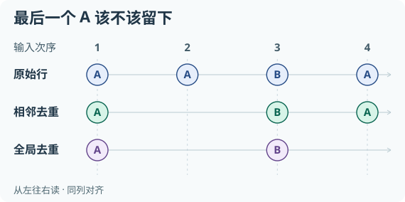

# 03｜把原始消息变成可读的日志

历史回放与预览按钮现在都能把消息送进面板。它们用同一种格式：`row:A` 是正文为 A 的日志，`ping` 是连接还活着的信号。两个入口共用一个列表。要显示 `row:A`，取正文只需一行 JavaScript。

```js
function textOf(raw) {
  return raw.slice(4)
}
console.log(textOf('row:A'))  // A
```

历史里有两行时，同一个函数得调用两次。RxJS 把接收一个 Observable、返回另一个 Observable 的函数叫作**可管道化操作符（pipeable operator）**。先看 `map(project)`：这里的 `project` 是处理**单个值**的函数，每来一项，map 就把它的返回值交给下游。本节代码可依次放在项目根目录的一个 `.mjs` 文件里运行。

```js
import { from, map, filter } from 'rxjs'

const history = from(['row:A', 'row:B'])
const toText = map(textOf)
const titles = history.pipe(toText)
titles.subscribe(text => console.log(text))  // A，然后 B
```

这几行里有两个不同的函数。`textOf(raw)` 收一个字符串，返回正文；`toText(source)` 收一个**流**，返回处理后的流。在 TypeScript 里，后一个函数的类型叫 `OperatorFunction<T, R>`，意思是 `(source: Observable<T>) => Observable<R>`。`map(textOf)` 先把逐项处理办法配好，返回的就是这个函数。于是同一份 `toText` 既能给历史用，也能给按钮用。[7.8.2 的 map 签名与实现](https://github.com/ReactiveX/rxjs/blob/7.8.2/src/internal/operators/map.ts#L45-L58)

`history.pipe(toText)` 做的就是 `toText(history)`。如果再接一步，`source.pipe(f, g)` 相当于 `g(f(source))`，从左到右可以照着值经过的次序读。到这里还没有解析任何字符串。订阅 `titles` 后，map 才订阅 history；A 来一次便调用一次 textOf，无须等 B 到齐。

## 列表里多出来的空行

回放中间若夹了一次心跳，输入就成了 `['row:A', 'ping', 'row:B']`，刚才的代码会在 A、B 之间多印一个空行。字符串 `'ping'` 的前四个字符被切掉，剩下空串，`map` 照样交了出来。这里需要一种可以跳过输入的操作。先辨认开头，再取正文：

```js
const frames = from(['row:A', 'ping', 'row:', 'row:B'])
const isRow = raw => raw.startsWith('row:')

function rowTexts(source) {
  return source.pipe(filter(isRow), toText)
}
frames.pipe(rowTexts).subscribe({
  next: text => console.log(JSON.stringify(text)),
  complete: () => console.log('历史读完')
})
// "A"、""、"B"，最后打印「历史读完」
```

跟着 `'row:A'` 走一遍。数组先送出这个字符串，`isRow` 返回 true，`textOf` 就拿到原字符串，切出 A，交给列表打印。等这几次调用返回，数组才送出 `'ping'`。这次 `isRow` 返回 false，`textOf` 连调用的机会都没有。换成按钮时也能逐项这样处理，哪怕下一项要等到明天。

`rowTexts` 就是一个自己写的操作符。它用 `return source.pipe(...)` 把新序列交还给调用者。若在函数里直接 `return source.subscribe(...)`，代码会立即开始读取，返回的是只能管理这次读取的 Subscription；列表连下一步 `.pipe(take(1))` 都接不上。把订阅留给列表，调用者就能继续组合。

早期 RxJS 还有一种写法：先导入补丁，给 `Observable.prototype` 添上 `map`，各处便可以写 `source.map(...)`。麻烦在于，一个模块可能恰好借用了另一个模块装好的方法；把那处导入删掉，这边也会坏。RxJS 5.5 引入了可以单独导入的操作符。本例里 `map` 的来处就写在使用它的文件顶部，你自己写的 `rowTexts` 也能接进同一个 `pipe`，无须给 Observable 类加方法。[RxJS 5.5 随包发布的设计说明](https://app.unpkg.com/%40reactivex/rxjs%405.5.6/files/doc/lettable-operators.md)

这里的 `'row:'` 是一行合法的空日志。若先切掉前缀，再用 `filter(Boolean)` 丢空串，心跳和空日志都会消失。把判断放在还看得见前缀的位置，`filter` 就能只拒绝心跳；`map` 到这时才有理由对每一项切掉四个字符。

预览按钮给的是事件对象，原始字符串放在 `detail` 里。取出它，剩下的事和读历史一样。

```js
import { fromEvent } from 'rxjs'

const button = new EventTarget()
const clicks = fromEvent(button, 'preview')
const rawClicks = clicks.pipe(map(event => event.detail))
const panel = rawClicks.pipe(rowTexts).subscribe(text => console.log('预览', text))
button.dispatchEvent(new CustomEvent('preview', { detail: 'row:C' }))  // 预览 C
panel.unsubscribe()
button.dispatchEvent(new CustomEvent('preview', { detail: 'row:D' }))  // 无输出
```

订阅从列表往上接到 `fromEvent`，按钮通知则从另一头往下走：事件对象 → detail → 通过筛选的原文 → 正文 C。沿用内置操作符还保留了整条链的退出行为。数组读尽时，filter 和 map 会把上游的 complete 传到下游；按钮仍开着时，面板调用 unsubscribe，会沿订阅关系释放各段，最后移除事件监听器。所以下一次按钮送出的 D 不会进入解析。

不过，这个判断也会跳过 `oops`。面板能安全忽略心跳，遇到无法识别的原文却应当报错。解析函数可以把两种认识的消息标出来，其余的交给错误回调。

```js
function parse(raw) {
  if (raw === 'ping') return { kind: 'ping' }
  if (raw.startsWith('row:')) return { kind: 'row', text: textOf(raw) }
  throw Error('无法解析 ' + raw)
}
function rowsFrom(source) {
  return source.pipe(map(parse), filter(frame => frame.kind === 'row'))
}
rowsFrom(from(['row:A', 'oops', 'row:B'])).subscribe({
  next: row => console.log(row.text),
  error: err => console.log(err.message)
})
```

第一个字符串变成行对象，列表显示 A。第二个让解析函数抛错，`map` 将异常转成 error；filter 把 error 转发给订阅者，这次读取随即清理，B 没有显示的机会。来源自己报错时，map、filter 同样会把错误传下来。[操作符接收者如何转交通知](https://github.com/ReactiveX/rxjs/blob/7.8.2/src/internal/operators/OperatorSubscriber.ts#L61-L103)

若诊断窗口还想看到 B，可把格式不符的原文也做成一种普通记录，在筛选之前记下它；实验的 `diagnostic` 分支就这样处理。运行 `npm run lab -- 03`，可以对照两种读法。

<details>
<summary>在实验的 TypeScript 版本里找到同一段代码</summary>

实验给行对象取名 Row，把“行或心跳”记作 Frame。谓词 `(f: Frame): f is Row => f.kind === 'row'` 仍然只做一次字符串比较，返回类型告诉编译器，通过之后就能读 text。实验也把两步组合命名为 `parsed = pipe(map(parse), filter(isRow))`，这样可以写 `frames.pipe(parsed)`。其作用和上面的 `rowsFrom(frames)` 相同。[实验源码](../labs/03.ts)

</details>

## 同一行文字又出现了

解析后，面板接连收到 A、A、B、A。状态栏要记录“又变回了 A”，所以最后的 A 有用；如果是给搜索框列出出现过的词，同一个 A 只需占一个位置。

| 输入 | 状态变化栏，记着上次放行的文本 | 词目栏，记着全部见过的文本 |
|---|---|---|
| 第一个 A | 写 A，记 A | 写 A，集合里有 A |
| 第二个 A | 跳过，仍记 A | 已有 A，跳过 |
| B | 写 B，改记 B | 写 B，集合里有 A、B |
| 又来 A | 上次是 B，写 A | 已有 A，跳过 |

[](../figures/book-03.svg)

```ts
import { distinct, distinctUntilKeyChanged } from 'rxjs'

const rows = rowsFrom(from(['row:A', 'row:A', 'row:B', 'row:A']))
const changes = rows.pipe(distinctUntilKeyChanged('text'))
const words = rows.pipe(distinct(row => row.text))
changes.subscribe(row => console.log('变化', row.text))  // A、B、A
words.subscribe(row => console.log('词目', row.text))     // A、B
```

changes 和 words 各订阅一次，同一份历史会从头读取两遍。相邻比较只需记上一次放行的行；全局去重需要保存每个不同的键，用户一直输入新词，集合就一直长大。`distinctUntilChanged()` 若不指定比较办法，默认按 `===` 比。这里的 `parse` 每次创建新对象，两个 A 的对象引用不同，所以直接比较行对象会放过四行。比较 `text` 才能得到表里的结果。真实日志里 #41 和 #43 都可以叫「重试中」；想保留每次重试，就得看记录编号。

<details>
<summary>如果上一条和这一条指向同一个可变对象</summary>

实验里的 `progress` 模拟一个为了少建对象而反复递出同一张进度卡的旧 SDK。第一次通知时 blocks 是 2，第二次改成 5，第三次仍为 5。画增量图应该画 3、0。`pairwise()` 从第二项开始把前一个输入与当前输入配成一对。下面两段代码取 blocks 的时刻不同。

```ts
const late = progress.pipe(pairwise(), map(([prev, now]) => now.blocks - prev.blocks))
const captured = progress.pipe(map(card => card.blocks), pairwise(), map(([prev, now]) => now - prev))
```

第二次回调开始前，SDK 已经把卡改成了 5。第一条管道拿到两个指向这张卡的引用，做的是 5 − 5，整条图为 0、0。第二条管道在第一次通知时已经留下数字 2，因此第一次相减是 5 − 2。两个相同的 5 也要进图，末尾那个 0 表示这一次采样期间没有进展。若图要回答「从什么阶段切换到什么阶段」，才适合先压掉不变的阶段，再配成对。

</details>

同样的选择也会影响错误徽标。两条编号不同的错误行都写着「找不到入口文件」，状态栏可以只显示一次，错误数却该加二。计数得接在按文本去重之前。[第 4 章 · 给构建面板加上错误数](04.md)

<details>
<summary>回看前面学过的用法</summary>

<a id="practice-1"></a>

**1.** 把历史数组和按钮事件接到同一个解析函数；先预测订阅两次各自会看到什么，再改变订阅时机。

</details>

<a id="发散练习"></a>

<details>
<summary>配套练习 · 过滤和比较的顺序</summary>

<a id="transfer-a"></a>

[从舞垫触点认出换脚步](../练习/03.md#transfer-a)

<a id="transfer-b"></a>

[词典里的两个 café 和一个 cafe](../练习/03.md#transfer-b)

<a id="transfer-c"></a>

[给接力赛制作终点成绩条](../练习/03.md#transfer-c)

</details>

## 章末附录 · 本章 RxJS API 速查

<details>
<summary>解析诊断与类型速查</summary>

`map(project)` 每个输入对应一个输出，回调的第二个参数是本次订阅在这一段见到的从零开始的序号。`filter(predicate)` 也提供序号，但它能丢弃元素。对 [0,1,2] 只保留偶数位置，后接 `map((n,i) => [i,n])` 得 [0,0]、[1,2]；下游从未见到被筛去的 1。若要追溯原位置，先用 map 把序号放进记录。

普通布尔谓词负责运行时放行；写成 `f is Row` 的类型谓词还让编译器知道下游一定有 text。`filter(Boolean)` 是另一种重载。`Falsy` 涵盖 false、空串、0（含 -0）、0n、null、undefined，`TruthyTypesOf<T>` 会从联合类型里分配地排除这些可表示的假值成员。例如 `TruthyTypesOf<false | 'ok'>` 只剩 'ok'，赋 false 会报错。运行时 Boolean 还会滤掉 NaN；TypeScript 没有单独的 NaN 字面量类型，宽泛的 number 也无法精确表示「除 0 与 NaN 之外的数字」。若行号 0 是合法值，用 `n != null` 筛空，别把它传给 Boolean。

`parse` 是一元函数，`UnaryFunction<string, Frame>` 表示给一个字符串得一帧；`parse(17)` 属于类型错误。独立的 `pipe(f,g)` 把函数从左到右组合，`pipe(f,g)(x)` 等价于 `g(f(x))`；空参 pipe 返回恒等函数，一个至九个函数有精确重载，继续加段时结果类型降为 unknown。`identity(x)` 原样交回 x，`noop()` 什么也不做且返回 undefined。要让可选的变换原样通过，选 identity；给一个明确要忽略的通知提供空回调时才用 noop。若把 noop 传给 map，每个输入都会变成 undefined。

把一元函数的两端换成 Observable，就得到 `OperatorFunction<输入,输出>`。上例中 `map(parse)` 接受字符串源，交出帧源；`filter(isRow)` 接过帧源，交出行源。独立 pipe 用这两段造出规则 parsed，`source.pipe(parsed)` 才把规则用到具体来源。`MonoTypeOperatorFunction<Row>` 两端都必须是行源，像「压缩连续同文行」那样保留元素类型；把 parsed 赋给 `MonoTypeOperatorFunction<string>` 会暴露类型不匹配。

在 `map(parse)` 前加入 `tap(raw => console.debug(raw))`，原帧会继续流向解析器。放在 `filter(isRow)` 后则只看得到行。tap 的回调返回值会被忽略；若回调自己抛错，错误会终止这条管道。调试时打印对象通常比在 tap 中原地修改对象更容易追溯结果。

`tap` 接收函数，也接收 `Partial<TapObserver<T>>`。完整的 `TapObserver` 在 next/error/complete 外还包含 subscribe、unsubscribe、finalize。实验的 probe 用 open 记录开始，用 release 记录收尾，三条结果如下：

| 情形 | 钩子的记录 |
| --- | --- |
| 收到 A 后自然完成 | open，A，end，release |
| 保持打开后主动取消 | open，cancel，release |
| 上游解析失败 | open，error，release |

其中 unsubscribe 专门让你看到提前退订，finalize 能看见三种出口。把旧 `tap(next,error,complete)` 改为 `tap({ next,error,complete })`，实验对照值与结束标记相同。`map(project,thisArg)`、`filter(predicate,thisArg)`（含类型谓词形式）也已弃用。把上下文捕获在闭包里即可：旧函数读 `this.min`，新谓词写 `n => n >= cfg.min`。实验先筛再加偏移，两种写法都得到 2、3。

若诊断需求是让行与心跳各自进入一个消费者，顶层 `partition(source, isRow)` 返回两个源。类型谓词让真分支是 Row，假分支排除 Row；普通布尔谓词只保证两个分支都保留原元素类型。谓词的第二个参数是该分支订阅的输入序号。带第三个 thisArg 的旧重载同样迁成闭包。只给第一个分支订阅时，不会自动替第二个分支收集历史。实验给两个分支各订阅一次，见到四行和一次心跳，生产者的启动计数却是 **2**。同一冷源如果启动真实网络读取，这里会多开一条连接；只想在原链记录一次诊断时，一段 tap 就足够了。

</details>

<details>
<summary>本章 API 与成员表</summary>

把心跳和日志接进同一条解析管道。map 改变帧的形状，filter 决定哪些帧能继续走，tap 可以在筛选前后分别计数。

**接入来源与订阅**

| API | 用法 |
|---|---|
| [`Observable`](../RxJS-7.8.2-API清单.md#api-114) | 描述一次可订阅的执行，可以交付零个或多个值，随后完成、报错或继续等待。 |
| [`finalize`](../RxJS-7.8.2-API清单.md#api-66) | 在完成、出错或退订时执行收尾逻辑，适合释放资源或核对清理次数。 |
| [`from`](../RxJS-7.8.2-API清单.md#api-73) | 将数组、Promise、可迭代对象等转成流；数组逐项交付，Promise 兑现后交付其结果。 |
| [`fromEvent`](../RxJS-7.8.2-API清单.md#api-74) | 订阅时为事件目标注册监听，退订时移除，用于按钮和键盘等输入。 |
| [`defer`](../RxJS-7.8.2-API清单.md#api-44) | 每次订阅才调用工厂，适合重新创建请求或读取当时的状态。 |

**变换、筛选与累计**

| API | 用法 |
|---|---|
| [`map`](../RxJS-7.8.2-API清单.md#api-91) | 把原始帧解析成行或心跳；回调里的序号只计算到达这一段的输入。 |
| [`filter`](../RxJS-7.8.2-API清单.md#api-65) | 让已解析的日志行通过，心跳留在筛选之前；类型谓词还能让下游直接读取正文。 |
| [`pipe`](../RxJS-7.8.2-API清单.md#api-134) | 按从左到右的顺序组合操作；流的 pipe 方法把这些操作应用到当前来源。 |
| [`tap`](../RxJS-7.8.2-API清单.md#api-191) | 在通知经过时执行观察或记录动作，正常返回时继续转发原通知。 |
| [`TapObserver`](../RxJS-7.8.2-API清单.md#api-192) | 描述 tap 可以监听的值、终止和订阅生命周期钩子。 |
| [`distinct`](../RxJS-7.8.2-API清单.md#api-48) | 按键记住已经放行过的项，后续同键项被过滤，记忆可由刷新信号清空。 |
| [`distinctUntilChanged`](../RxJS-7.8.2-API清单.md#api-49) | 首项通过，以后与上次放行的值比较，只交付变化。 |
| [`distinctUntilKeyChanged`](../RxJS-7.8.2-API清单.md#api-50) | 比较相邻放行对象的指定字段，用它决定是否交付新对象。 |
| [`pairwise`](../RxJS-7.8.2-API清单.md#api-131) | 从第二项起，把上一次和这一次输入组成一对。 |
| [`partition`](../RxJS-7.8.2-API清单.md#api-133) | 按谓词分出通过与未通过的两条流；分别订阅冷来源可能启动两次执行。 |
| [`identity`](../RxJS-7.8.2-API清单.md#api-82) | 原样返回传入的值，可用作不改变数据的投影。 |
| [`noop`](../RxJS-7.8.2-API清单.md#api-108) | 空操作函数，调用时不做处理。 |
| [`OperatorFunction`](../RxJS-7.8.2-API清单.md#api-129) | 表示把一种 Observable 变成另一种 Observable 的函数类型。 |
| [`MonoTypeOperatorFunction`](../RxJS-7.8.2-API清单.md#api-102) | 输入和输出元素类型相同的操作符函数类型。 |
| [`UnaryFunction`](../RxJS-7.8.2-API清单.md#api-212) | 接受一个参数并返回一个结果的函数类型。 |
| [`Falsy`](../RxJS-7.8.2-API清单.md#api-64) | 表示类型系统可表达的假值，如 0、空串、false、null 和 undefined。 |
| [`TruthyTypesOf`](../RxJS-7.8.2-API清单.md#api-211) | 从类型联合里排除可识别的假值，描述按真值筛选后的元素类型。 |
| [`toArray`](../RxJS-7.8.2-API清单.md#api-210) | 收集本次订阅的所有值，在正常完成时交出一个数组。 |

**方法、属性与测试助手**

| 成员 | 用法 |
|---|---|
| `subscribe()` | 登记观察者、接入一次执行，返回控制该次订阅的句柄。 |
| `next(value)` | 交付一个值；Subject 会把这次通知发给当前观察者。 |
| `complete()` | 通知正常结束，随后释放资源；主动退订不会给观察者补发 complete。 |
| `unsubscribe()` | 主动结束本次订阅并触发清理；不能据此判断远端写入是否成功。 |
| `closed` | 读取订阅是否已关闭，可用于让同步生产循环尽早退出。 |
| `add()` | 把子订阅或清理函数挂到父订阅；父订阅已关闭时会立即执行清理。 |
| `now()` | 读取当前调度器的时间，在虚拟实验里对应逻辑帧。 |

</details>

[上一章](02.md) · [本章实验](../labs/03.ts) · [目录](../README.md) · [下一章](04.md)
