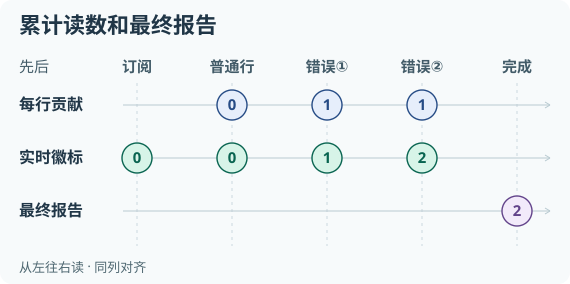

# 04｜怎么从一段日志得出结论？

列表收到三行：一条普通日志，两条写着「找不到入口文件」的错误。两条错误各有自己的编号，徽标现在应该显示 2。构建还在继续，导出报告里的「本次共几条错误」却得缓一缓。

## 同一段加法，什么时候交结果？

RxJS 有两个做累积的操作符。`scan(update, seed)` 每收到一项就用 update 更新状态，并立即送出新状态；`reduce(update, seed)` 用同一套算法更新，只在来源正常完成时发出最终值。对一份已经读完的历史，区别就像把打印放在循环里面还是外面。下面只保留统计用到的行级别。

```js
const history = ['info', 'error', 'error']
let errors = 0
for (const level of history) {
  if (level === 'error') errors += 1
  console.log('徽标', errors)   // 0、1、2
}
console.log('报告', errors)     // 2
```

实时行到来时还没有完整数组，不过更新错误数只需要两个值：原来的数，以及刚到的这行属于什么级别。循环里的加法可以单独留下。

```js
function addError(total, level) {
  return level === 'error' ? total + 1 : total
}
```

`scan(addError, 0)` 把 0 交给第一次调用，之后把每次算出的值留下来，等到下一行接着用。

```js
import { from, scan, reduce, startWith } from 'rxjs'

const levels = from(history)
const counter = levels.pipe(scan(addError, 0))
counter.subscribe(n => console.log('徽标', n))  // 0、1、2
```

输入 info，`addError(0, 'info')` 返回 0，`scan` 随即把这个 0 送给徽标。接着两条 error 各加 1。如果构建刚开始，还没有送来第一行，徽标暂时是空的。若要开窗就显示 0，可以订阅 `counter.pipe(startWith(0))`；这样会先画一次零，收到普通行时再画一次零。

报告也需要同一函数，只把打印的位置从循环里面移到结束处：

```js
const report = levels.pipe(reduce(addError, 0))
report.subscribe(n => console.log('报告', n))  // 2
```

这是新的一次订阅，历史重新读了一遍，total 也从种子 0 重新起算。在 7.8.2 源码里，scan 和 reduce 共用同一个累积函数；差别就是更新后是否发值、完成前是否发值。这样同一份 addError 可以既供徽标使用，也供报告使用。连接只发一行后一直开着，reduce 仍然要等；用户关页会释放这次订阅，不能替来源宣布完成。[累积状态与交付时机](https://github.com/ReactiveX/rxjs/blob/7.8.2/src/internal/operators/scanInternals.ts)

[](../figures/book-04.svg)

空档案也能读完。带初值的 `reduce(addError, 0)` 在空档完成时发一次 0；`scan(addError, 0)` 一次也不发，因为没有哪一行触发过加法。`npm run lab -- 04` 把这两种情况和「持续源关闭后报告数」并列输出。

## 给运行中的构建导出一份报告

报告若还要附上最后一条错误，即便 #2、#3 都已经读到了，也得把 #3 暂存为候选，后面还有机会再来一条。`last(isError, '本次无错误')` 到读完才交出最后的候选；从头到尾都没有命中才交出那句占位文字。

有时边界由人划。用户读到红、灰，点「导出到此处」，之后又来一条红。报告分支从打开就开始收数，在点击时封口，应该写 1 个错误；在线徽标仍会涨到 2。

```ts
// lines 是从打开时就能监听的行广播，clicks 是导出按钮的点击。
const partialReport = lines.pipe(
  takeUntil(clicks),
  reduce((n, row) => n + Number(row.level === 'error'), 0)
)
partialReport.subscribe(n => console.log('导出范围内的错误数', n))
```

按下按钮时，点击事件发给 `takeUntil`，不会混进日志里让 `reduce` 再数一次。`takeUntil` 向报告这一侧发的是 complete，于是 `reduce` 交出已经算好的 1。随后报告退出监听，在线徽标那份订阅仍能接到下一条红色日志。

把两步交换成 `reduce(...), takeUntil(clicks)`，按下去还会收到 complete，文件里却拿不到那个 1。这时点击使最末端的 `takeUntil` 结束报告并向上退订。它前面的 `reduce` 始终没等到日志源说「读完」，手里存着的总数随订阅一起释放。这也解释了为什么用关闭句柄代替导出按钮，会丢掉尚未发出的报告。

<a id="如果只给你上一刻的答案你还能算出下一刻吗"></a>

## 徽标究竟数哪一批行？

成品列表只保留最近的一段日志。把容量缩到两行，依次收到 #41 红、#42 灰、#43 红。这里红表示错误。

| 收到的行 | 此刻表里的红行 | 从连接开始接收的不同红行 | 把每张表的红行数相加 |
| --- | --- | --- | --- |
| #41 红 | #41，计 1 | #41，计 1 | 1 |
| #42 灰 | #41，计 1 | #41，计 1 | 2 |
| #43 红 | #43，计 1 | #41、#43，计 2 | 3 |

来源若每次发**完整的表**，第 2 次的 [41,42] 里还有旧错误 #41。再把表里的错误数加一遍，就会凭一条灰色日志把徽标从 1 变成 2。要显示当前保留表中的错误数，对每张表分别数一次。若标题写「本次运行累计」，要在接纳新行时累计，#41 被挤出列表时仍然算一次。在成品中改搜索词，列表会缩小，错误计数仍按当前任务保留的全部行计算。[控制台模型](../app/model.ts)

那「最近三行里的错误数」只记一个数够吗？甲最近是「错、好、好」，乙是「好、好、错」，两边都显示 1。随后各来一条好，甲挤掉一条错，读数降为 0；乙挤掉一条好，读数仍是 1。只给加法函数一个 1 和一条好，同样的输入算不出两个答案。保留最近三行的错误标记，才能知道这次挤掉哪一个。

接下来可以用搜索框缩小列表。错误徽标继续数保留的原始行，列表要按新词重画；输入 `error` 的五次按键，有必要重画五次吗？[第 5 章 · 输入停多久再筛选](05.md)

<details>
<summary>回看前面学过的用法</summary>

<a id="practice-1"></a>

**1.** 先筛错误再取第一条，与先取第一条再筛错误对照；构造使两个版本结果不同的最小输入。

<a id="practice-2"></a>

**2.** 把同一组日志分别作为有限源和持续源发送；判断报告是否产出、什么时候必须主动退订。

<a id="practice-3"></a>

**3.** 分别回放一个空数组和含一条记录的数组，写出何时结束；与不结束的日志源作对照。

</details>

<a id="发散练习"></a>

<details>
<summary>配套练习 · 什么时候可以交出结论</summary>

<a id="transfer-a"></a>

[拼字台上的铅笔分与墨水分](../练习/04.md#transfer-a)

<a id="transfer-b"></a>

[一窑三处的釉样，什么时候可以盖章？](../练习/04.md#transfer-b)

</details>

## 章末附录 · 本章 RxJS API 速查

<details>
<summary>空档与未命中的返回值</summary>

下面用同一份耗时档案 2、0、3、0（毫秒）对照查询。若协议约定“必须恰有一次耗时为 3”，第一条命中暂时不能展示，第二条命中却能立即判错。`single(n => n === 3)` 在本例完成时交 3。实验把输入或条件改掉，分别断言下面四种错误；界面据此可以区分坏数据、缺数据和取错位置。

| 操作 | 何时知道失败 | 错误类型 |
| --- | --- | --- |
| 空档案要求 single() | 正常完成却连一项都没收到 | EmptyError |
| 非空档案要求恰有一次 9 | 完成时没有一次匹配 | NotFoundError |
| 要求恰有一次 0 | 第二个 0 到达时 | SequenceError |
| elementAt(9) | 完成时未到索引 9 | ArgumentOutOfRangeError |

`elementAt(2)` 采用零基索引，得到 3；越过末尾可给第二参数作默认值。负索引在构造操作符时就抛错。表中四种导出既可作 Error 子类型，也可在运行时用 `instanceof` 区分；有继承的 name、message 等成员。7.8.2 已弃用手工调用这几种构造器的签名。需要自己的业务错误，可以让 `throwIfEmpty(() => Error('缺少审计行'))` 在空完成时创建错误，省略工厂默认产生 EmptyError。若空档案合法，`defaultIfEmpty('无记录')` 会发出占位，非空输入原样通过。源自身出错时不会生成这个占位。

允许“查无此项”也能正常完成时，`find(n => n === 9)` 发一次 undefined，`findIndex(n => n === 0)` 则给第一个匹配的索引 1，查不到给 −1。两个查找都能在命中时停止。若只关心是否有记录，`isEmpty()` 收到首行就给 false，空完成才给 true。`every(n => n > 0)` 遇到 0 就能给 false；到最后仍无反例才给 true。空档案也满足“每一行都合格”，因此不能把 every 用作“存在合格记录”的证明。

**把结论写进类型。** first、last 的类型守卫重载能收窄成功值；find 用守卫仍须处理 undefined。默认值异型时留意输出联合类型，尤其是 UI 占位文本与日志对象并存时。普通谓词可以读 value、index、source。Boolean 重载用真值规则筛选，0、空串也会被排除，single(Boolean) 仍要求恰好一个真值。find(Boolean) 在此版本的声明中只返回真值类型，运行时零匹配仍会发 undefined。类似地 every(Boolean) 对全假值类型有字面量 false 的推断，空完成仍发 true。对可能为空的档案应按运行时合同设计分支。

```ts
const mixed = of('ok', 0);
const text = (x: string | number): x is string => typeof x === 'string';
const required: Observable<string> = mixed.pipe(first(text));
// @ts-expect-error 查找允许缺席
const optional: Observable<string> = mixed.pipe(find(text));
```

旧代码会给 every、find、findIndex 的谓词再传 thisArg。把 `function (n) { return n < this.limit }` 加第二参数 policy 改成 `n => n < policy.limit`，再用原本含边界值的输入核对结果。实验对同一 policy 验证两种 every 写法。这样谓词显式捕获规则，Boolean 版本也无需传 thisArg。

</details>

<details>
<summary>按位置和通知划出报告范围</summary>

假设四条记录的耗时依次是 2、0、3、0。若前两条属于预热，`skip(2)` 从 3 开始显示，得到 3、0。`take(2)` 则显示 2、0 后立刻结束。若要扣下**尾部**两条，`skipLast(2)` 必须等第三条来了才知道第一条可以放行，最终交出 2、0；`takeLast(2)` 要到完成时才交出 3、0。对持续源，后者即使缓冲已有两项也不会发。

预热的长度若不固定，可以在第一个零处换阶段。`skipWhile(Boolean)` 略过开头的 2，遇零永久开闸，得到 0、3、0；`takeWhile(Boolean)` 只得到 2，`takeWhile(Boolean, true)` 还包含首次不满足条件的 0，然后完成。这些谓词可读取 index。takeWhile 的守卫在不含边界时能收窄类型，含边界时必须容纳失败的那一项。skipWhile 的谓词恒为 true 时输出类型为 never；开闸后它会接受任意后续值，因此对一般谓词不能推断“所有输出都不满足谓词”。

如果边界是另一个输入，例如用户点了按钮，就用通知流。写下时间线“日志 1、点击、日志 2”：`skipUntil(clicks)` 订阅后等首次点击才放行，得到 2；`takeUntil(clicks)` 在点击时完成，只得到 1。仅让通知流 complete 没有点击，不会触发这两扇门。位置会改变业务含义：先 takeUntil 再 count 会在关闭时生成截断报告；仅对 count 的订阅调用 unsubscribe，则不会替上游制造一次完成。

报告想标注首尾时，`startWith('加载')` 会先发送标签，`endWith('结束')` 只在正常完成后追加。都可接多个值，产生原值与标签的联合类型；startWith 对 null、undefined 还有单值重载。旧代码在末尾传 scheduler 的重载已弃用。实验把 `base.pipe(startWith(1, clock))` 写成 `scheduled([of(1), base], clock).pipe(concatAll())`，即按调度顺序接入前导序列和源。尾部的 `base.pipe(endWith(3, clock))` 可写成 `concat(base, scheduled([3], clock))`。只传 clock 给 endWith 对应空的尾序列。实验对照值与虚拟时刻；普通头尾标签使用不带 scheduler 的版本即可。

</details>

<details>
<summary>本章 API 与成员表</summary>

同一组错误日志可以产生连续更新的徽标，也可以产生结束时才签发的报告。查累计与取值操作时，特别留意它何时已经知道答案。

**接入来源与订阅**

| API | 用法 |
|---|---|
| [`Observable`](../RxJS-7.8.2-API清单.md#api-114) | 描述一次可订阅的执行，可以交付零个或多个值，随后完成、报错或继续等待。 |
| [`Subscription`](../RxJS-7.8.2-API清单.md#api-180) | 一次执行的句柄，可集中登记清理动作并用 unsubscribe 释放。 |
| [`of`](../RxJS-7.8.2-API清单.md#api-125) | 按参数逐个同步交付后完成；传一个数组会把整份数组作为一个值。 |
| [`from`](../RxJS-7.8.2-API清单.md#api-73) | 将数组、Promise、可迭代对象等转成流；数组逐项交付，Promise 兑现后交付其结果。 |
| [`fromEvent`](../RxJS-7.8.2-API清单.md#api-74) | 订阅时为事件目标注册监听，退订时移除，用于按钮和键盘等输入。 |

**变换、筛选与累计**

| API | 用法 |
|---|---|
| [`map`](../RxJS-7.8.2-API清单.md#api-91) | 对每个输入执行投影，交付一个对应结果；第二个参数是这一段订阅内的序号。 |
| [`filter`](../RxJS-7.8.2-API清单.md#api-65) | 逐项检查谓词，只放行满足条件的值；类型谓词还可收窄下游类型。 |
| [`pipe`](../RxJS-7.8.2-API清单.md#api-134) | 按从左到右的顺序组合操作；流的 pipe 方法把这些操作应用到当前来源。 |
| [`scan`](../RxJS-7.8.2-API清单.md#api-157) | 用同一段加法维护运行中的徽标，每行都能触发一次新读数。 |
| [`reduce`](../RxJS-7.8.2-API清单.md#api-146) | 把每行贡献加起来，来源正常完成时才发布最终报告。 |
| [`count`](../RxJS-7.8.2-API清单.md#api-40) | 统计全部输入或满足谓词的输入，正常完成时发出总数。 |
| [`toArray`](../RxJS-7.8.2-API清单.md#api-210) | 收集本次订阅的所有值，在正常完成时交出一个数组。 |
| [`min`](../RxJS-7.8.2-API清单.md#api-101) | 在正常完成时交出见过的最小项，可提供比较函数。 |
| [`max`](../RxJS-7.8.2-API清单.md#api-94) | 在正常完成时交出见过的最大项，可提供比较函数。 |
| [`first`](../RxJS-7.8.2-API清单.md#api-69) | 取首个符合条件的值后完成；没有匹配时用默认值或报告错误。 |
| [`last`](../RxJS-7.8.2-API清单.md#api-89) | 来源正常完成时交出最后一个匹配值；没有匹配时用默认值或报告错误。 |
| [`single`](../RxJS-7.8.2-API清单.md#api-168) | 验证恰好一项符合要求，多项或没有符合项均会报错。 |
| [`find`](../RxJS-7.8.2-API清单.md#api-67) | 找到首个匹配值即交付；正常读完仍未找到时发出 undefined。 |
| [`findIndex`](../RxJS-7.8.2-API清单.md#api-68) | 找到首个匹配项即交付其序号，未找到时发出 −1。 |
| [`elementAt`](../RxJS-7.8.2-API清单.md#api-51) | 取从零起算的指定位置；越界时交付提供的默认值或报错。 |
| [`every`](../RxJS-7.8.2-API清单.md#api-58) | 出现首个反例就交付 false；正常完成且没有反例时交付 true。 |
| [`isEmpty`](../RxJS-7.8.2-API清单.md#api-87) | 见到首值就交付 false；没有值而正常完成时交付 true。 |
| [`defaultIfEmpty`](../RxJS-7.8.2-API清单.md#api-43) | 仅在无值且正常完成时交付默认值。 |
| [`throwIfEmpty`](../RxJS-7.8.2-API清单.md#api-198) | 将无值的正常完成转换为错误。 |
| [`take`](../RxJS-7.8.2-API清单.md#api-187) | 只交付前 n 项，取够后完成并退出上游。 |
| [`takeLast`](../RxJS-7.8.2-API清单.md#api-188) | 记住最后 n 项，等来源正常完成才依次交付。 |
| [`takeUntil`](../RxJS-7.8.2-API清单.md#api-189) | 通知源第一次发值时完成输出并解除来源订阅。 |
| [`takeWhile`](../RxJS-7.8.2-API清单.md#api-190) | 连续放行满足条件的前缀；inclusive 为 true 时也交付首个不满足条件的值。 |
| [`skip`](../RxJS-7.8.2-API清单.md#api-169) | 忽略前 n 项，随后正常转发。 |
| [`skipLast`](../RxJS-7.8.2-API清单.md#api-170) | 始终暂留末尾 n 项，使最后这几项不被交付。 |
| [`skipUntil`](../RxJS-7.8.2-API清单.md#api-171) | 通知源发值前丢弃来源输入，之后放行。 |
| [`skipWhile`](../RxJS-7.8.2-API清单.md#api-172) | 丢弃开头连续满足条件的项，从首个不满足条件的项起全部放行。 |
| [`startWith`](../RxJS-7.8.2-API清单.md#api-173) | 订阅时先发给定的初始值，然后订阅原来源。 |
| [`endWith`](../RxJS-7.8.2-API清单.md#api-55) | 来源正常完成后追加指定的收尾值。 |
| [`firstValueFrom`](../RxJS-7.8.2-API清单.md#api-70) | 返回 Promise，拿到首值就兑现并退订；空完成时用配置的默认值或拒绝。 |
| [`lastValueFrom`](../RxJS-7.8.2-API清单.md#api-90) | 返回 Promise，正常完成时用末值兑现；空完成时用配置的默认值或拒绝。 |
| [`EmptyError`](../RxJS-7.8.2-API清单.md#api-54) | 需要一个值却遇到空序列时使用的错误。 |
| [`SequenceError`](../RxJS-7.8.2-API清单.md#api-163) | single 等约束发现序列中有多个匹配项时使用的错误。 |
| [`NotFoundError`](../RxJS-7.8.2-API清单.md#api-109) | single 带谓词检查非空序列却找不到匹配项时使用的错误。 |
| [`ArgumentOutOfRangeError`](../RxJS-7.8.2-API清单.md#api-4) | 表示位置参数超出允许范围，例如 elementAt 取不到指定位置。 |

**时间与调度**

| API | 用法 |
|---|---|
| [`scheduled`](../RxJS-7.8.2-API清单.md#api-158) | 用指定调度器安排对输入的消费及交付。 |
| [`VirtualTimeScheduler`](../RxJS-7.8.2-API清单.md#api-219) | 用逻辑帧替代宿主时间，调用 flush 推进已排定动作。 |

**组合来源与在途工作**

| API | 用法 |
|---|---|
| [`concatAll`](../RxJS-7.8.2-API清单.md#api-29) | 按外层交付顺序排队展开内部流，前一条完成才订阅下一条。 |
| [`concat`](../RxJS-7.8.2-API清单.md#api-28) | 依次订阅多个来源，上一条正常完成才进入下一条。 |

**共享、批次与分组**

| API | 用法 |
|---|---|
| [`Subject`](../RxJS-7.8.2-API清单.md#api-174) | 既能接收通知，也能把通知同步广播给当前观察者。 |

**方法、属性与测试助手**

| 成员 | 用法 |
|---|---|
| `subscribe()` | 登记观察者、接入一次执行，返回控制该次订阅的句柄。 |
| `next(value)` | 交付一个值；Subject 会把这次通知发给当前观察者。 |
| `complete()` | 通知正常结束，随后释放资源；主动退订不会给观察者补发 complete。 |
| `unsubscribe()` | 主动结束本次订阅并触发清理；不能据此判断远端写入是否成功。 |
| `closed` | 读取订阅是否已关闭，可用于让同步生产循环尽早退出。 |
| `add()` | 把子订阅或清理函数挂到父订阅；父订阅已关闭时会立即执行清理。 |
| `now()` | 读取当前调度器的时间，在虚拟实验里对应逻辑帧。 |
| `flush()` | 推进虚拟时钟并执行待办动作；在 run 内可提前结算已安排的断言。 |

</details>

[上一章](03.md) · [本章实验](../labs/04.ts) · [目录](../README.md) · [下一章](05.md)
