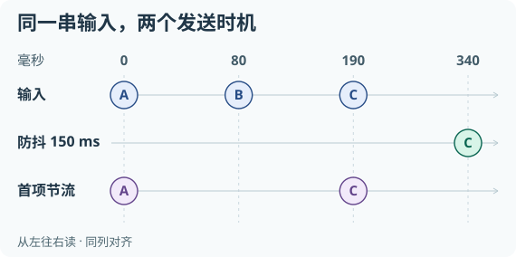

# 05｜搜索框、刷新按钮和心跳为什么不能共用一种限流？

构建还在出日志，错误徽标照常更新。现在想从列表里找含有 error 的行。打到 er 时，手还没停，没必要立刻拿半个词重画整张表。可以等最后一次编辑过去 150 毫秒，再让新词生效。

## 用户停手后才查

`debounceTime(150)` 接收一串值，给每次订阅保留一个待发候选。有新值时替换候选，从这次到达重新计算 150 毫秒；安静够久才发最新值。用普通 JS，可以让每次编辑先撤掉上一次预约，再开一个新定时器。这两次模拟键入放在同一个调用栈，只会打印 AB。

```js
let pending
function edited(word) {
  clearTimeout(pending)
  pending = setTimeout(() => console.log('查', word), 150)
}
edited('A')
edited('AB')
```

定时器的回调保留了这一次的 word。把两次调用拉开到 200 毫秒，第一次预约已经执行过，第二次撤不掉它。若编辑更密，例如 0、80、190 毫秒各来一个不同的词，预约会连续推迟两次。表里用 A、B、C 简写三个词。

| 时刻（毫秒） | 输入 | 尚未执行的搜索 |
|---:|---|---|
| 0 | A | 约在 150 查 A |
| 80 | B | 撤掉 A，改在 230 查 B |
| 190 | C | 撤掉 B，改在 340 查 C |
| 340 | 此前再无编辑 | 发出 C，现在没有候选 |

这种从最近一次输入开始等待的做法叫防抖。输入框和之前的预览按钮一样，可以交给 `fromEvent`。后面接上 `debounceTime(150)`，两次紧挨着的编辑就只会交出 AB。这段代码可以在项目根目录的 `.mjs` 文件里运行。

```js
import { fromEvent, map, debounceTime } from 'rxjs'

const box = new EventTarget()
const words = fromEvent(box, 'input').pipe(map(e => e.detail))
const search = words.pipe(debounceTime(150))
const panel = search.subscribe(word => console.log('查', word))
box.dispatchEvent(new CustomEvent('input', { detail: 'A' }))
box.dispatchEvent(new CustomEvent('input', { detail: 'AB' }))
setTimeout(() => panel.unsubscribe(), 250)
```

若面板在 50 毫秒时提前关闭，AB 还在等，连这一次也不会打印。RxJS 把等待登记在这次订阅上，所以退订也能取消等待。上面的 JS 每次都重新开定时器；7.8.2 的实现只更新最新值和到达时刻，已排定的动作醒来时会核对期限，没到就再约剩余的时间。两种写法实现的是同一段安静期。[debounceTime 的等待与清理](https://github.com/ReactiveX/rxjs/blob/7.8.2/src/internal/operators/debounceTime.ts#L64-L121)

`debounceTime` 的第二个参数可以换调度器。调度器负责两件事：告诉操作符现在是什么时刻，以及稍后执行哪个动作。平时省略它，使用真实时钟；`npm run lab -- 05` 用虚拟时钟回放同一段输入，「停手搜索」会精确打印 340 毫秒的 C。

把同一串手势换成刷新按钮。用户希望点一下立刻刷新，接下来的 150 毫秒内别重复刷新。这回 0 时就发 A，到 150 才能再接受点击。80 的 B 落在这段时间内，190 的 C 到达时已经可以刷新。用默认的 `throttleTime(150)`，输出为 0 的 A、190 的 C。

[](../figures/book-05.svg)

## 用户删光了，为什么还在搜 error？

10 毫秒输入 error，70 毫秒清空。若先 `filter(Boolean)` 再等停顿，等待器只见过 error，160 照常发出它。用户删光是想恢复全部日志。如果空串到不了防抖这一步，旧的 error 就会在输入框已经空了的时候生效。

若所有编辑都要等停顿，直接让空串也进入 `debounceTime(150)`，220 才把空串交给列表以恢复全部行。若清空要立即生效，可以给每个词指定自己的放行信号。假设页面有一个 `type="search"` 的输入框。下面从这个元素读取每次编辑后的字符串，`timer(150)` 会在 150 毫秒后发一次信号。

```ts
import { debounce, fromEvent, map, of, timer } from 'rxjs'

const input = document.querySelector<HTMLInputElement>('input[type="search"]')!
const edits = fromEvent(input, 'input').pipe(map(() => input.value))
const selected = edits.pipe(
  debounce(word => word === '' ? of(0) : timer(150))
)
const panel = selected.subscribe(word => console.log('当前筛选词', word))
// 关闭搜索面板时调用 panel.unsubscribe()
```

70 的空串顶替 error，`of(0)` 立即发出信号，于是同一刻交给列表的是空串。如果这里返回 `EMPTY`，它只 complete，没有表示「放行」的 next。只要输入源还开着，70 这一刻就看不到清空。实验特意让源延续到 300；在源完成时才交出的空串，已经晚了 230 毫秒。

第 3 章的相邻去重放在这里，也会影响等待时间。0、80、190、400 分别输入 A、A、B、A。先去相邻重复值，80 的第二个 A 到不了等待器，150 就能查 A；随后在 340、550 查 B、A。先等停顿，第二个 A 会改约到 230，又被 190 的 B 顶掉，最终只查 B、A。成品的本地搜索先取输入框文字，等 180 毫秒停顿，再忽略相同的结果。[界面接线](../app/main.ts)

<details>
<summary>图表每 150 毫秒画一帧，从哪一刻开始等？</summary>

图表想把一阵输入合成一帧。一种做法是「收到第一项就约 150 毫秒后画」，这段时间只更新要画的值。A 约了 150，B 把待画的值换成 B，绘制时间仍是 150。150 画 B。下一项 C 在 190 才来，第二帧因此在 340。这是 `auditTime`。

另一种是「从打开图表起，每隔 150 毫秒检查一次」。150 读到 B，300 读到 C，450 没有新输入就不画。这叫 `sampleTime`。第一帧和上一种完全相同，第二帧却早了 40 毫秒。下面的 `keys(clock)` 是实验里负责回放的函数，它让 A、B、C 在表里的时刻到达，460 毫秒时结束。四种规则各听一遍相同的输入。

```ts
const search  = keys(clock).pipe(debounceTime(150, clock))
const refresh = keys(clock).pipe(throttleTime(150, clock))
const draw    = keys(clock).pipe(auditTime(150, clock))
const plot    = keys(clock).pipe(sampleTime(150, clock))
```

若每一项都该保留，只需晚一点回放，`delay(150)` 会把 A、B、C 逐个平移到 150、230、340。延迟本身不会替你选一项。还要在输入发生时把输入框的字符串取出来；若把 DOM 元素交给 delay，等回放时才读 `value`，取到的可能已经是下一个词。

</details>

## 尚在等待的时候关面板

假设只有 A 在 0 输入，10 时结束。若输入**正常完成**，`debounceTime` 会立即交出待发的 A；若面板在 10 时**退订**，等待随之取消，再没有搜索。实现「关闭就放弃待查词」时，把 `takeUntil(closeClicks)` 接在防抖之后。放在防抖前，点击会让防抖看到上游 complete，反倒赶出 A。

心跳也可以接到同一个关闭按钮。实验每 10 毫秒一拍，在 25 关闭。到 100 再查，只有 10、20 两次心跳，清理一次。

但已发出去的请求多了一段寿命。如果选中任务 A 时已开始读详情，随后切到 B，停掉 A 面板的计时器仍然不够。B 的详情可能先显示，接着又被 A 迟到的结果覆盖。[第 6 章 · 切任务时谁还能写面板](06.md)

<details>
<summary>回看前面学过的用法</summary>

<a id="practice-1"></a>

**1.** 输入『A、A、B、A』并插入停顿，预测请求候选次数；交换去重与防抖的位置后重画时间线。

<a id="practice-2"></a>

**2.** 用关闭按钮终止心跳，检查面板销毁时是否仍有计时器。

</details>

<a id="发散练习"></a>

<details>
<summary>配套练习 · 谁决定下一次更新的时刻</summary>

<a id="transfer-a"></a>

[鼓点到来时，灯究竟有多亮？](../练习/05.md#transfer-a)

<a id="transfer-b"></a>

[听鸟人何时能给一句鸣唱画句号？](../练习/05.md#transfer-b)

</details>

## 章末附录 · 本章 RxJS API 速查

<details>
<summary>节流的尾项与逐项延时</summary>

固定的等待只是一个特例。把 `debounceTime(150, clock)` 改为 `debounce(value => timer(150, clock))`，同一条时间线仍得 340:C。现在可以按 value 的长度决定等待，例如单字等 300，两字以上等 100。每次输入调用选择函数，并退订旧的等待流。等待流要发出 next 才提前释放候选；单独 complete 不会让候选立即通过。

同样把时长交给函数，`audit(() => timer(150, clock))` 在每个窗口首项上选一次关闭信号，窗内继续更新缓存；`throttle(() => timer(150, clock))` 默认在放行首项后选一次信号，窗内跳过其余项。实验逐对比较固定和函数两版。三个函数都应返回能转换为流的 ObservableInput；直接返回数字 150 无法表示通知。

throttle 和 throttleTime 都能用 ThrottleConfig 指定边沿。leading 默认 true，允许在窗口开头发；trailing 默认 false，设为 true 后会保存被压住的最新值。两个都开，A 在 0 发，B 在 150 补发并开始下一段等待，C 落在这段内，所以到 300 才发。窗口里只有已在开头发过的 A，就不会再重复一个 A。只开 trailing 会等待尾沿，两边都关则无值可发。配置在 throttle 的第二参数，在 throttleTime 的第三参数；第二参数留给 scheduler，例如：

```ts
const edges: ThrottleConfig = { leading: true, trailing: true };
const updates = keys(clock).pipe(throttleTime(150, clock, edges));
// @ts-expect-error trailing 接受布尔开关，毫秒数应传给 throttleTime
const wrong: ThrottleConfig = { trailing: 150 };
```

如果产品说“所有日志延迟 150 毫秒重放”，把三项逐个平移，答案应是 150:A、230:B、340:C。用 `delay(150, clock)`，三项都能保留。它也接受 Date，表示等到指定时刻才允许传值；已过时刻按零等待调度。Date 用绝对时间，调度器的 now 必须采用相容的时间基准。源出错会直接终止等待，不能依赖 delay 延后异常提示。

当每条记录要等自己的“详情就绪”，`delayWhen((value, index) => readyFor(value, index))` 为每项订阅一条等待流，首次 next 才释放原值，传给下游的是原日志。给 A 的等待设为 300，给 B、C 设为 10，实验得到 **90:B、200:C、300:A**。这条管道保留能等到信号的各项，允许乱序。7.8.2 中返回 EMPTY 只会丢掉对应项。与 debounce 的区别可以用“快速到达两个值，两条等待流都发了信号”这一例子检验。

旧的 `delayWhen(wait, gate)` 还把“何时订阅源”混进第二参数。实验按 7.8.2 的行为写开：

```ts
const gate = timer(50, clock);
const source = defer(() => of(clock.now()));
const wait = () => timer(10, clock);
const released = concat(
  gate.pipe(take(1), ignoreElements()),
  source.pipe(delayWhen(wait)),
);
```

第一段吞掉门信号本身，首次 next 或空完成都会结束这一段；然后才订阅 source。用 defer 读取实际订阅时刻：新旧两版都在 **60 发出数值 50**。单纯把整条链 delay(60) 会读到 0，不能保留这项语义。

</details>

<details>
<summary>两张图同周期却不同拍</summary>

同一个任务同时打开窄图和大图，要求“大致每 100 毫秒更新一次”。第一张图在 0 订阅，第二张在 40 订阅，共享同一条实时行广播。两张图各自调用 sampleTime(100)。输入在 60 为低、110 为高、155 又回到低，之后一直没有变化。窄图在 100 读到低，200 读到低，从未画出高峰。大图在 140 已经读到高，240 又读回低。报告中两张截图都会说自己严格按 100 毫秒取样，却对同一个故障给出不同印象。

把每个观察者从第几毫秒起收数写在表头，会比只给出周期更容易复算。节拍一到，把上次读完以来收到的最新值交付，并清掉“有新输入”标志。按相同的值再次来一项也算新输入；如果之前另有去重，才会看不到那个事件。

| 时刻 | 行广播 | 0 打开的图 | 40 打开的图 |
| --- | --- | --- | --- |
| 60 | 低 | 暂存低 | 暂存低 |
| 100 | 无 | 画低 | 仍有低 |
| 110 | 高 | 暂存高 | 把低换成高 |
| 140 | 无 | 仍有高 | 画高 |
| 155 | 低 | 把高换成低 | 暂存低 |
| 200 和 240 | 无 | 200 画低 | 240 画低 |

这里有两个独立的失败条件。第一，两份订阅起点不一致，等周期并不能保证同相位。相位就是第一拍落在时间轴的哪个位置。第二，即使两张图都在 100、200 采样，高峰在两拍之间完整地起落，任一张仍会漏掉。从图上对不上数开始排障，先比较两张图用的是不是同一批节拍，然后再检查该图究竟承诺描绘瞬时值还是保留每次峰值。只把 100 改成 50，能让这个例子的高峰更容易出现，但再把高峰宽度缩短，原问题就能复现。

如果目标是让所有开着的图在同一拍读取，可以让任务层定时发出一个公共绘制信号。各图订阅同一份正在广播的信号，使用 sample(paintTicks)。两个观察者都已就绪时，下一拍会同时取样。把 interval(100) 写进一个变量再让两个图去订阅，未必做到了这点。interval 是按订阅启动的，两个订阅仍能各自开钟。可以在任务层只安装一次实际计时，把每次回调广播出去；实验里的等价模型是用一个 EventTarget 派发 paint 事件。这样“同拍”成为可以断言的输入事实。晚开的图也只能从它开始听行广播之后收数据，若首次绘制一定要含已有状态，需要单独交一份当前快照。

</details>

<a id="日志写于哪一秒浏览器收到它又是哪一秒"></a>

<details>
<summary>对照来源时间和交付时间</summary>

假设服务器给两行错误盖的时间戳分别是第 8 秒和第 9 秒。连接一度中断，浏览器在第 12 秒才一起收到它们。现在画一张每 10 秒一格的图，第一格是从 0 秒到 10 秒之前。先给图写个完整的标题，再决定两条错误画在哪格。

标题若为「浏览器每十秒收到的错误」，两条都进第二格。订阅从第 0 秒开始，用浏览器的钟每 10 秒交出一批就符合要求。标题若为「服务器每十秒产生的错误」，两条都属于第一格。把同一个定时器调得再准也无济于事。你得保留行里的发生时间，按那一列决定归属，还得决定第 12 秒到来的行有没有权改写已经画过的第一格。

这里有一个可以向产品确认的取舍。允许修订时，先画第一格为「目前收到 0 条」，补发抵达后改为 2。要求一旦公布就不再变，就需要来源给出「此前的行已发齐」的依据，或约定等待期限以及超期行的处理办法。浏览器静默十秒，只能证明这十秒没有收到行。把题中的网络延迟改成零，两种图会碰巧一样；测试里保留一次晚到，图的标题才真正约束实现。

`interval(10)` 每隔 10 毫秒从 0 起报数，第一拍在 10。需要首拍在 3，之后每隔 10，可以用 `timer(3, 10)`，在 3、13、23 收到 0、1、2。只给到期时间的 `timer(3)` 在 3 发一次 0 并完成。timer 还可给绝对 Date，interval 省略 period 默认为 0；它们都可指定调度器。旧单次重载 `timer(3, undefined, clock)` 改成 `timer(3, clock)` 即可，实验同时断言时刻、值及订阅已结束。

要诊断“第三次输入是否晚了”，先明确记录单位。`timestamp(provider)` 从 provider.now() 读时刻，把原值装进 `Timestamp<T>` 的 value 和 timestamp 字段；`timeInterval(clock)` 把原值装进 `TimeInterval<T>` 的 value 和 interval 字段，第一项从订阅时刻算，以后从上一项算。实验把时钟读数平移 1000，时间戳得到 1000、1080、1190；间隔则是 0、80、110。这两列不能互换。

```ts
const provider: TimestampProvider = { now: () => 1000 + clock.now() };
const stamps: Observable<Timestamp<string>> = keys(clock).pipe(timestamp(provider));
const gaps: Observable<TimeInterval<string>> = keys(clock).pipe(timeInterval(clock));
// @ts-expect-error 时间提供者须返回数值
const broken: TimestampProvider = { now: () => '中午' };
```

TimestampProvider 只要求 now()。timeInterval 的公开参数类型为 SchedulerLike，因此实验传完整时钟。四个类型在实验里都有编译期正反例。时间操作符可从根入口或 `rxjs/operators` 导入，ThrottleConfig 在两处均可用；创建函数和其余三种记录／时钟类型从 `rxjs` 导入。

</details>

<details>
<summary>本章 API 与成员表</summary>

输入 A、B、C 时，搜索框要等静默期，刷新按钮则要立即回应第一次点击。对照 debounceTime 与 throttleTime 的窗口起点。

**接入来源与订阅**

| API | 用法 |
|---|---|
| [`Observable`](../RxJS-7.8.2-API清单.md#api-114) | 描述一次可订阅的执行，可以交付零个或多个值，随后完成、报错或继续等待。 |
| [`finalize`](../RxJS-7.8.2-API清单.md#api-66) | 在完成、出错或退订时执行收尾逻辑，适合释放资源或核对清理次数。 |
| [`EMPTY`](../RxJS-7.8.2-API清单.md#api-53) | 不交付任何值，订阅后立即正常完成。 |
| [`of`](../RxJS-7.8.2-API清单.md#api-125) | 按参数逐个同步交付后完成；传一个数组会把整份数组作为一个值。 |
| [`from`](../RxJS-7.8.2-API清单.md#api-73) | 将数组、Promise、可迭代对象等转成流；数组逐项交付，Promise 兑现后交付其结果。 |
| [`fromEvent`](../RxJS-7.8.2-API清单.md#api-74) | 订阅时为事件目标注册监听，退订时移除，用于按钮和键盘等输入。 |
| [`defer`](../RxJS-7.8.2-API清单.md#api-44) | 每次订阅才调用工厂，适合重新创建请求或读取当时的状态。 |
| [`ObservableInput`](../RxJS-7.8.2-API清单.md#api-115) | 可以被 RxJS 接作来源的输入类型，涵盖流、Promise、可迭代对象等。 |

**变换、筛选与累计**

| API | 用法 |
|---|---|
| [`map`](../RxJS-7.8.2-API清单.md#api-91) | 对每个输入执行投影，交付一个对应结果；第二个参数是这一段订阅内的序号。 |
| [`filter`](../RxJS-7.8.2-API清单.md#api-65) | 逐项检查谓词，只放行满足条件的值；类型谓词还可收窄下游类型。 |
| [`pipe`](../RxJS-7.8.2-API清单.md#api-134) | 按从左到右的顺序组合操作；流的 pipe 方法把这些操作应用到当前来源。 |
| [`tap`](../RxJS-7.8.2-API清单.md#api-191) | 在通知经过时执行观察或记录动作，正常返回时继续转发原通知。 |
| [`distinctUntilChanged`](../RxJS-7.8.2-API清单.md#api-49) | 首项通过，以后与上次放行的值比较，只交付变化。 |
| [`scan`](../RxJS-7.8.2-API清单.md#api-157) | 保存本次订阅的累计状态，每处理一个值就交出新状态；种子本身不会单独发出。 |
| [`take`](../RxJS-7.8.2-API清单.md#api-187) | 只交付前 n 项，取够后完成并退出上游。 |
| [`takeUntil`](../RxJS-7.8.2-API清单.md#api-189) | 通知源第一次发值时完成输出并解除来源订阅。 |
| [`startWith`](../RxJS-7.8.2-API清单.md#api-173) | 订阅时先发给定的初始值，然后订阅原来源。 |

**时间与调度**

| API | 用法 |
|---|---|
| [`interval`](../RxJS-7.8.2-API清单.md#api-86) | 按固定周期从 0 起递增发值，第一次发值要等一个周期。 |
| [`timer`](../RxJS-7.8.2-API清单.md#api-206) | 等到指定时刻或延时后发 0；给第二个周期参数可继续递增发值。 |
| [`debounceTime`](../RxJS-7.8.2-API清单.md#api-42) | 输入 A、B、C 时不断推迟搜索。最后一次输入在 190 毫秒，等待 150 毫秒后于 340 毫秒交付 C。 |
| [`debounce`](../RxJS-7.8.2-API清单.md#api-41) | 每项用自己的时长流控制等待，新输入取代旧候选；时长流发值时放行。 |
| [`throttleTime`](../RxJS-7.8.2-API清单.md#api-196) | 放行一次后在固定窗口内限流，可用配置决定是否发出首项、尾项。 |
| [`throttle`](../RxJS-7.8.2-API清单.md#api-194) | 用时长选择函数划定抑制后续输入的窗口，可配置首尾交付。 |
| [`ThrottleConfig`](../RxJS-7.8.2-API清单.md#api-195) | 用 leading、trailing 控制节流窗口首尾的交付策略。 |
| [`auditTime`](../RxJS-7.8.2-API清单.md#api-11) | 由输入开启固定时长的窗口，窗口到期交付最近一项。 |
| [`audit`](../RxJS-7.8.2-API清单.md#api-10) | 由输入启动时长流，时长流发值时交付这段期间的最新输入。 |
| [`sample`](../RxJS-7.8.2-API清单.md#api-155) | 采样信号发值时交付自上次采样以来的最近一项；没有新项则不重复发。 |
| [`sampleTime`](../RxJS-7.8.2-API清单.md#api-156) | 以订阅为起点周期采样，有新输入才交付最新一项。 |
| [`delay`](../RxJS-7.8.2-API清单.md#api-45) | 将值延后指定时长或延至给定日期交付，错误通知不会按值一起延后。 |
| [`delayWhen`](../RxJS-7.8.2-API清单.md#api-46) | 为每个输入选择独立的延时流，在它发值时交付该输入。 |
| [`timeInterval`](../RxJS-7.8.2-API清单.md#api-199) | 将值与距上次交付的间隔配对，首项间隔从订阅开始算。 |
| [`timestamp`](../RxJS-7.8.2-API清单.md#api-207) | 把每次交付的值与该刻的时间戳配对。 |
| [`TimeInterval`](../RxJS-7.8.2-API清单.md#api-200) | 保存 value 和 interval 的对象类型，表示值及间隔。 |
| [`Timestamp`](../RxJS-7.8.2-API清单.md#api-208) | 保存 value 和 timestamp 的对象类型，表示值及时间戳。 |
| [`TimestampProvider`](../RxJS-7.8.2-API清单.md#api-209) | 提供 now() 的读钟接口，可替换成实验时钟。 |
| [`SchedulerLike`](../RxJS-7.8.2-API清单.md#api-161) | 同时提供 now 与 schedule 的调度器接口。 |
| [`VirtualTimeScheduler`](../RxJS-7.8.2-API清单.md#api-219) | 用逻辑帧替代宿主时间，调用 flush 推进已排定动作。 |

**组合来源与在途工作**

| API | 用法 |
|---|---|
| [`concat`](../RxJS-7.8.2-API清单.md#api-28) | 依次订阅多个来源，上一条正常完成才进入下一条。 |

**共享、批次与分组**

| API | 用法 |
|---|---|
| [`Subject`](../RxJS-7.8.2-API清单.md#api-174) | 既能接收通知，也能把通知同步广播给当前观察者。 |
| [`buffer`](../RxJS-7.8.2-API清单.md#api-16) | 收集来源的值，边界流发值时交出本批数组，再开新批次。 |

**网络、错误与终止**

| API | 用法 |
|---|---|
| [`ignoreElements`](../RxJS-7.8.2-API清单.md#api-83) | 忽略全部 next，仍然转发 error 和 complete。 |

**方法、属性与测试助手**

| 成员 | 用法 |
|---|---|
| `TimeInterval.interval / Timestamp.timestamp` | 前者是连续交付之间的间隔，后者是本次交付的时刻，两者的 value 字段都保留原值。 |
| `subscribe()` | 登记观察者、接入一次执行，返回控制该次订阅的句柄。 |
| `next(value)` | 交付一个值；Subject 会把这次通知发给当前观察者。 |
| `complete()` | 通知正常结束，随后释放资源；主动退订不会给观察者补发 complete。 |
| `unsubscribe()` | 主动结束本次订阅并触发清理；不能据此判断远端写入是否成功。 |
| `closed` | 读取订阅是否已关闭，可用于让同步生产循环尽早退出。 |
| `add()` | 把子订阅或清理函数挂到父订阅；父订阅已关闭时会立即执行清理。 |
| `now()` | 读取当前调度器的时间，在虚拟实验里对应逻辑帧。 |
| `schedule(work, delay?)` | 安排一项可取消的动作，可给延时及随动作传入的状态。 |
| `flush()` | 推进虚拟时钟并执行待办动作；在 run 内可提前结算已安排的断言。 |

</details>

[上一章](04.md) · [本章实验](../labs/05.ts) · [目录](../README.md) · [下一章](06.md)
