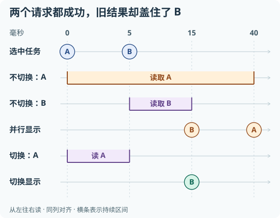

# 06｜切任务、存备注、并行补详情：新任务来了怎么办？
## 隔章自测｜不看解法再做一次

<a id="practice-1"></a>

**1.** 修复一次搜索回归：防抖并没有解决旧结果覆盖。用两次相距足够远、返回顺序相反的输入复现，再决定取消旧查询的位置。

<a id="practice-2"></a>

**2.** 给每次模拟请求分别记录创建、订阅与清理，以证据区分没有启动、被取消、正常完成。

<a id="practice-3"></a>

**3.** 把刷新按钮监听误放到每次选中任务的回调里；切三次再点一次，定位为什么发起了多次请求。

先把自己的预期写到纸上，再回到本章实验比较。保留一项故意不同的输入，说明哪条断言会改、哪条仍应成立。


## 闭卷建模

0 毫秒选 A，5 毫秒选 B。A 的详情要 40 毫秒，B 的只需 10 毫秒。假如两条请求一到就发，屏幕会依次收到什么？产品要的是“当前选中任务的详情”。画出允许显示的值，并标记旧请求何时可以停止工作。再把两个输入改成同一条备注的两个修订版本，要求逐笔保存，画一遍服务端可以看到的顺序。

动手前再交三份预测：

1. 搜索框有 5 毫秒等待期。0 时输入 A，20 时输入 B，查询各耗时 40、5 毫秒。按时刻写出候选和结果，指出哪里可能覆盖新内容。
2. 给刷新按钮分别记录了“创建请求”和“清理请求”。只看这两种记录，能证明第二次点击启动过底层工作吗？再选一个观测点区分正常结束和中途取消。
3. 选 A、B、C 三次，再点一次刷新，服务端却记录三个任务各刷新一次。设计一个能复现的最小监听关系，给修复后应看到的请求序列。

## 一个输入制造另一个输入

先试算一遍最容易写出来的版本：两个请求互不干涉，各自完成便写屏幕。B 在 5 + 10 = 15 写入；A 在 0 + 40 = 40 又写入。此时下拉框是 B，面板内容却是 A。这个故障甚至不需要丢包，两个请求全部成功就能复现。

**读图 · 两个请求都成功，旧结果却盖住了 B**

[](../figures/book-06.svg)

时刻按数字读。B 在第 5 毫秒取代 A；若保留旧订阅，第 40 毫秒屏幕会退回 A。切换策略在第 5 毫秒撤掉 A 的计时读取，只交付 B。

把下拉框值映射成详情请求时，先别急着 subscribe。看看 map 后的元素是什么：

```ts
const request = (key: string) =>
  timer(key === 'A' ? 40 : 10).pipe(map(() => key));
const pending = selection.pipe(map(request));
```

若 selection 发字符串，pending 每次交出的是一个 `Observable<string>`。它描述“从订阅我开始计时，到点交出 key”。外层交付这个对象时，里面的计时器还没启动。我们需要一层逻辑决定**订阅哪一个、何时退订、把谁的 next 转给屏幕**。这种把内部流的值送到同一条输出流上的操作叫展开。

如果把请求直接写进选择回调，外层订阅持有下拉框的监听，回调里的每个 `subscribe` 却各自返回一个句柄。关掉下拉框的监听，只能阻止下一次选择；已经启动的 A 和 B 仍可写屏幕。要修正它，就得保存当前句柄、在换项时释放它，并在面板关闭时再释放一次。把请求当作外层交付的值，正好让这些工作集中到展开这一步。请求函数负责描述怎样取一份详情，展开规则负责决定这次读取可以活多久，最外层的面板只需持有结果订阅。

详情必须跟着选择走。A 的计时器已跑了 5 毫秒，B 来时退订 A，订阅 B。B 从 5 开始计 10，15 交结果；A 的 40 再也不会出现。`pending.pipe(switchAll())` 实现这个选择。合在一起就是 `selection.pipe(switchMap(request))`。投影函数可读外值及索引，返回 ObservableInput，比如 Observable、Promise 或数组；函数返回裸数字不是一条内部流。字符串本身可迭代，误返回任务名会逐字符展开，想传一个完整名字应显式用 of(key)。

若保存也用同样的策略，第二次点击可以让界面错过第一次保存的确认。更严重的是，服务端可能早就写入了第一次提交；退订不能回滚那次写入。让上一笔确认并完成后再开始下一笔，才符合“按点击顺序逐笔写入”的约定。点击时先捕获任务与文本，排到队首才读取表单会读到别的修订。用 `concatMap(save)`，A 在 40 确认并结束，B 此时开始，50 才提交确认。若 A 发过进度却一直没有 complete，队首仍被占用。

## 把时钟拨到第三个任务

实验把 A、B、C 分别放在 0、5、6，它们从**实际订阅时**算起分别耗时 40、10、5。外层在 7 正常完成。先圈出每次空出名额的时刻，再看结果；读每格时注意时间与任务名是一起验收的。

| 产品约束 | 内部订阅如何变化 | 输出（时刻与任务） |
| --- | --- | --- |
| 只看当前任务 | A 在 5 取消，B 在 6 取消 | 11 C |
| 逐笔存备注 | B 在 40 启动，C 在 50 启动 | 40 A，50 B，55 C |
| 补全三条详情，同时最多两条 | A、B 先启动，15 腾出名额给 C | 15 B，20 C，40 A |
| 一次刷新在途，后续点击作废 | A 占用入口直到 40，B、C 都被忽略 | 40 A |

第三行是 `mergeMap(load, 2)`。默认并发上限为 Infinity，给正整数可限制在途订阅数；等待的输入仍会积压。把上限改为 1 就能得到串行顺序。下游用 key 将结果写回对应行，不能拿响应到达次序当作行号。第四行是 `exhaustMap(refresh)`：忙时丢掉整个新输入，空闲后才接受下一次点击。如果用户的最后一个值代表不可丢的修改，这条策略会丢数据。四行都在最后一个需要保留的内部流结束后才正常完成。第 7 毫秒外层结束时，已排队的备注仍要保存。

**把“创建”从“启动”里拆出来。** 本章实验给每次投影三个探针，下面是保留探针位置的简化版。defer 内的函数在每次订阅时运行。timer 的清理能取消尚未触发的定时任务。

```ts
function make(key: string) {
  mark('创建 ' + key);
  return defer(() => {
    mark('订阅 ' + key);
    return timer(durations[key], clock).pipe(
      map(() => key),
      tap({ complete: () => mark('完成 ' + key) }),
      finalize(() => mark('清理 ' + key)),
    );
  });
}
```

对照 `map(make)` 后接 `switchAll()`、`concatAll()`、`mergeAll(2)`、`exhaustAll()`，与直接用 switchMap、concatMap、mergeMap、exhaustMap。在这个冷请求实验中，每对的**输出值和时刻**相同；创建时刻可以不同。concatAll 收到 B 描述后把它排队；concatMap 先排外值，等 40 才调用 make(B)。exhaustAll 版在 5 有“创建 B”，却没有“订阅 B”；exhaustMap 版甚至没有“创建 B”。这回答了第二份预测的前半题。若把 fetch() 放在 map 中直接创建 Promise，工作会提早开始，单靠限制后面的内部订阅数就管不住并发。用 `defer(() => fetch(...))` 可推迟启动；实际中止网络还需要传输层支持和退订清理，例如绑定 AbortController。

再读切换时的两个标记。A 在 5 有清理，没有完成；C 在 11 先正常完成再清理。finalize 在完成、错误和主动退订路径都会执行，故单独看到清理不能判断原因。把 B 改成在到期时抛错，重跑两路并发：15 时下游收到错误，A 与 B 同时清理，C 留在队里从未订阅。若产品允许某条详情失败而继续加载其余行，应在单条内部请求内将错误变成带 key 的失败结果；第 11 章再处理重试和降级。对保存要区分失败、未确认和已经提交，前端收到错误并不能证明写入从未发生。

## 两个可以复现的界面故障

**搜索防抖后仍串台。** 第一道预测中，A、B 相距 20，足够分别熬过 5 的安静期，且内容不同，两者也都能通过 distinctUntilChanged。于是 5 开始查 A，25 开始查 B。若并行提交，先到 **30 B**，再到 **45 A**。把去重阈值或者等待期当修复方案，遇到更慢的 A 就会复发。决定旧查询寿命的位置在**查询被订阅的地方**：

```ts
const result = keys.pipe(
  debounceTime(5, clock),
  distinctUntilChanged(),
  switchMap(query),
);
```

同样输入下验收只有 30 B；25 时新的有效候选会让 A 失去订阅。这里承诺“最新已确认候选胜出”。若需求改成“原始输入一变立刻清除旧查询”，25 太晚，20 就该切换；可在原始值去重后用外层 switchMap 包住等待期和整个查询，让每次新输入一起取消二者。这个差别在 A 恰好于 22 返回时就能观察到。

**一次点击刷了三个任务。** 第三道预测可用外层 `tasks.subscribe(key => ...)`，在回调里再 `fromEvent(button, 'click').subscribe(...)` 复现。每次选择装上一个闭包，各记住自己的 key。切完 A、B、C 再点一次，三个闭包都运行。即便面板关闭时一起收拾这些监听，面板开着时仍会重复请求。把监听寿命交给选择流：

```ts
const refreshKeys = tasks.pipe(
  switchMap(key => fromEvent(button, 'click').pipe(map(() => key))),
);
```

每次选中任务会替换上一份监听。验收一次点击只发 C，整体退订后再次点击则什么也不发。要给刷新动作增加“忙时忽略”约束，还应决定忙状态是跨任务共享还是每个任务独立，把订阅生命周期放在相应层级。先画监听的寿命，再画请求的寿命。

## 需要上一次结果，或结果本身带来下一项

备注修订可能带增量。初值 0，输入 +1 和 +2，后端分别在订阅后 10、2 毫秒才给新状态。普通 scan 在回调中直接算新值；这里回调返回“以后才会给出新状态”的流。`mergeScan(add, 0, 2)` 调用 add 时读取**最近实际发出的状态**。两次调用都赶在首个结果之前，因而各自读到 0；2 毫秒得 2，10 毫秒得 1，最终竟成了 1。实验改并发数为 1，第二次调用读到已提交的 1，依次得 1、3。种子不会单独发给下游，累加器还可读处理索引。默认并发上限是 Infinity。

`switchScan(add, 0)` 也把内部发出的值记作新状态，每次新输入会切走上一份内部工作。同样输入下 +1 尚无结果就被切走，+2 从 0 算出 2，最终只见 2。若第一份工作已发过中间值，那次发出的状态会成为后续计算的起点。要求每一笔增量都生效时，应保留串行处理。

翻历史页又多一层关系。拿到第 1 页才能知道第 2 页的地址，每个响应可以产生下一次输入。`expand` 先发种子项，再把每个已发项投给函数，内部结果也进入同一过程。实验用页码代替游标：

```ts
const page = (n: number) => n < 3 ? of(n + 1) : EMPTY;
const pages = of(1).pipe(expand(page));  // 1、2、3，随后完成
```

第 3 页仍会显示，EMPTY 让这个分支自然终止。投影可读索引，第二参数限制展开的并发分支数，默认 Infinity；遇到循环游标必须给出终止条件。旧第三参数 scheduler 已弃用，需调度内部订阅时写成 `expand(n => page(n).pipe(subscribeOn(clock)))`。实验对无并发积压的三页核对新旧结果序列；新写法显式调度每条内部订阅，若旧程序依赖同步副作用，还要核对订阅时刻。

## 保存队列顺序全对，为什么 B 的备注被写了两遍？

设想在控制台里编辑任务 A 的交班记录。0 毫秒点保存，文字为“已接单”；4 毫秒改为“已复核”再点；6 毫秒切到任务 B，输入“待补图”也点一次。每笔保存占用 20 毫秒，回执到达即完成。这次验收不看按钮是不是闪了三次，要读三份请求里实际带的任务和文字。有一个会通过顺序测试的错误实现：点击直接进入 concatMap，轮到它时才读取 task.value 和 note.value。三个回执确实逐个到达，第二份却给 B 又写了一次“待补图”。

把输入、开工和回执分开手算。0 时队列空，第一笔马上执行，读到 A 和“已接单”。4 时第一笔没结束，第二个点击进入队列；此刻投影函数尚未执行。6 时第三个点击也只拿到一个排队位置，表单已经变成 B。20 时第一笔结束，轮到第二笔执行，读取的是此刻的 B 和“待补图”。40 时第三笔执行，再读一遍 B 和“待补图”。到 60，三笔都正常完成。错误实现一共发出 A、B、B；若三次都发生在 A 且第一次也恰好和最后一次同文，按任务和条数对账甚至会完全相符。要发现第二版丢失，证据必须包括每笔文字。

| 点击时刻 | 用户当时确认的内容 | 轮到执行 | 若此时才读表单 |
| --- | --- | --- | --- |
| 0 | A，已接单 | 0 | A，已接单 |
| 4 | A，已复核 | 20 | B，待补图 |
| 6 | B，待补图 | 40 | B，待补图 |

修复要在点击通知仍在手里时取走两个字符串。先 map 成 {task, text}，再由 concatMap 把这份值传给保存函数。可以把它理解成柜台收到三张填好的单据。上一张没办完也不妨碍接过下一张；真正发送请求仍须等上一张完成。若 map 只交出表单 DOM 元素，或者每次改同一个 draft 对象后返回它，队列中储存的仍是通往可变内容的引用。要读取的字段均为字符串时，构造一个新对象就够了。如果备注日后含可变的附件数组，就要决定提交时固定的是附件编号列表还是附件对象的全部内容，按合同复制或固定版本。盲目复制整个页面状态既浪费，也仍然解释不了哪些数据用户确认过。

这儿有两个很适合互换位置试验的操作。trim 和“是否允许空文本”的判断都属于接单。若允许在排队期间继续编辑，等开工才校验当前框，就可能把原先合法的修订撤掉，或者把一次空点击补成后来才写好的内容。而从连接池借连接、开始网络计时这些动作属于执行，应留在投影返回的冷工作里。过早调用会让所有请求先启动，再被串行地观察回执。回执按顺序显示，服务器却可能已把后写的版本覆盖了。看回执只能核实一个端点，还要在模拟保存函数真正开始时检查收到的参数及启动时刻。

若撤销按钮可以取消某一份未开工的单据，按任务名撤销就太粗。两笔 A 内容不同，有的必须保留。给每个点击分配稳定的修订标识，日志显示“接纳修订 2，等待上一笔”，取消也指向修订 2。操作符内置的队列并没有提供一张可任意删除的产品待办表；若要让人编辑队列，可以把等待项显式保存在状态中，以一份已确认的命令出队。若完全不需要撤销，原来的 concatMap 配合两三个字符串就足够。先看产品允许改变的是表单草稿还是已提交修订，才能决定要不要维护额外的队列。

### 到底等到了哪一种“完成”

再给保存接口加入上传进度。每笔在启动后 2 毫秒给一次“已发送”，20 毫秒才给“已提交”并正常完成。有人在内部加 take(1)，希望只处理一个回执。A 在 2 已经让内部流结束，于是 B 从 2 就可开工。若第一次通知只是发出了请求体，服务器此时可能还没提交 A，串行保证被缩短成了“请求体发出的顺序”。修法取决于协议：有明确的最终回执类型时可先 filter 到最终回执再取一份；若业务还要求确认后做一段清理且完成才可复用资源，就让整个内部流自然结束。用纯 timer 模拟一发就完成的接口不会暴露这种错误，要让首份进度与最终确认隔开一段时间。

相反的故障是进度持续推送。最终确认到了却一直开着订阅等后续通知，concatMap 会让下一张单据一直排队。诊断时若“回执已到”和“内部流完成”在日志上只有同一个标签，就无法区分停在服务端还是停在队首。分别记录一次确认值与一次 complete，同时查看第二笔是否出现过订阅。如果协议约定终态回执是本笔的最后一件事，可以取首个终态后结束这份内部观察；若错误地把“正在排队”也识别成终态，将重现上一段的过早放行。举两条在首个状态字段上不同、后面都成功的输入，比只看成功记录更能检验判断条件。

## 切到 B 后，详情还在加载，转圈却消失了

详情面板有一个 loading 标志。常见接法是在任务名外层 tap 中先令 loading = true，再 switchMap 到详情，在详情的 finalize 里令 loading = false。手动慢慢切任务，每次一开一关都像是对的。让 A 的请求占 40 毫秒，B 在 5 毫秒切入，详情要再等 10 毫秒。第 5 毫秒结束时，B 的订阅明明在途，屏幕状态却成了空闲。这个故障与 A 是否返回陈旧数据是两道题，哪怕旧结果被完全挡住仍会发生。

按函数调用顺序放慢第 5 毫秒。B 先到外层 tap，写 true。通知继续传给 switchMap，它先退订 A，A 的 finalize 同步运行，把布尔值写成 false。然后创建和订阅 B，此时没有任何人再次写 true。B 仍要跑到 15，期间显示“加载完成”。如果只检查最终 loading 是否 false，坏实现和好实现都会通过。观察点要放在新的选择已经被处理、B 尚未返回的间隙。例如到 6 毫秒读取一次状态，并用 B 的结果日志证明它要到 15 才出现。整个过程都在一根线程上，改变的是访问共享标志的先后。

对于只有一个当前详情的面板，把“开始加载”放进内部请求的订阅工厂就能修正这一例。B 到来时先结束 A，随后 B 的工厂执行、写 true，B 完成或被替换时由自己的 finalize 收拾。现在第 5 毫秒内写入的最后一个值变成 true，15 才回落。为假设留一条边界：这里的清理是同步写本地变量，且面板同时最多有一份详情。如果清理自己又排了一个稍后才执行的异步 UI 动作，旧 A 的动作仍可能在 B 启动后执行。可以让渲染状态携带请求标识，在写入时确认它还属于当前请求，或者把这些状态都作为受切换约束的内部输出传出。

还可以用带任务身份的状态值来画详情。选中 B 后先交出“B 加载中”，查询成功后再交出“B 已就绪，数据为……”。渲染层用一份值同时决定标题、转圈和内容，避免任务名从下拉框读、完成状态从另一个变量读。若 B 在真正查询前就被 C 取代，B 的加载态可能短暂出现，但之后属于 B 的完成态不会越过切换边界。若 UI 想保留 A 的旧内容直到 B 有结果，要明确把它标成“上一次显示的 A”，别把旧表格放在 B 的标题下面当成已加载。先画出想保留的中间帧，比调试最终一帧更容易发现这些承诺互相打架。

换到并行加载三行详情，刚才的布尔修复就失效了。A 与 B 都启动，B 先结束，写 false 时 A 仍在途。若显示整张表是否忙，可以为实际内部订阅开始加一、清理减一，当前计数大于零才显示忙。若显示每一行的状态，就按行与请求身份维护。把加一放进外层点击会把一直排队或被忽略的输入也算入在途；把减一只放进 complete 又会漏掉取消和错误。用时间线核账：两份内部工作并行时应到 2，短的完成回到 1，长的取消回到 0。短请求结束的一刻正是布尔写法的最小反例。如果一个内部订阅还会重试，要决定界面数的是整次业务操作还是每次传输尝试，再选择包住哪一层。

### 迁移到任务内的刷新按钮

现在再增加一个约束：A 的刷新要 40 毫秒，A 没刷完时再点 A 可以忽略；切换到 B 后应立刻允许手动刷新 B，旧 A 的结果也不能占住详情区。写法一是在选择流上只切换按钮监听，得到带 key 的点击，再在整条点击流末尾 exhaustMap(refresh)。写法二是在每个任务的内部先监听按钮，内部使用 exhaustMap，然后由外层 switchMap 包住整段。两个版本都能防同一任务双击，区别出现在换任务时有没有一份尚未完成的刷新。

用 0 选 A、1 点刷新、3 再点、5 选 B、6 点、30 再点作输入。B 刷新耗时 10。第一种写法里 1 启动 A，3 被忽略；5 只换了点击的来源，外层那个 exhaustMap 仍忙到 41。因此 6 与 30 的 B 都被拒绝，41 却可能把 A 交给当前画面。第二种写法在 5 连同旧监听一起释放旧请求，6 能启动 B，16 收到 B；30 已空闲，再一次 B 到 40 返回。拿一个可控计时器代替实际刷新，能从“启动 B”与“收到 B”这两个观测点判断是入口挡住了点击，还是进了入口却被取消。若产品确实要求跨任务同时只能运行一次重建，全局忙有其用途；此时就应显示正在重建 A，并为 B 的拒绝给出符合文案的反馈。

决定外层套哪一层时，从用户可以结束的最小工作单元倒推。若“切任务”意味着旧任务的一切显示和刷新监听都过期，选择流拥有这一整棵订阅；若切任务后保存仍必须完成，保存动作就不能放在随选择被替换的子树里。可以在按保存时捕获任务，把单据送到寿命更长的保存队列。如此同一个按钮区域内的两个动作归属不同：详情结果服务当前画面，交班备注服务实际提交的任务。把它们都挂在一个面板销毁信号下虽然简短，用户一离开就有可能失去第二份尚未开工的修订。

## “停止接单”之后，队里那张单据怎么办？

为控制台设计交班按钮。按下时有人希望“把已经接的办完”，有人理解为“立即停止面板里所有工作”。输入只有 A、B，0 点 A，3 点 B，5 点交班，A 要 20，B 要 10。要让两种文案都有可预测的行为，先在纸上画两条线：上面一条代表新点击还能不能被队列听到，下面一条代表队列对当前工作是否仍有订阅。平常两条线一起亮着，交班可以只关第一条，也可以直接拔掉第二条。

若先 takeUntil(handoff)，再 concatMap(save)，5 毫秒的交班使点击输入正常完成，队列记下不会再有新单据。A 继续到 20，已经接纳的 B 等到 20 开工，30 确认，下游才收到完成。试着在 8 再点 C，C 进不了队。此处的“已经接纳”指外层值已经到队列，并不要求保存工厂已经执行。这正好说明为什么要在接单处抓取快照，交班人走了，旧表单甚至可能已经卸载，队列仍须靠那张单据完成任务。

若先 concatMap(save)，最后才 takeUntil(handoff)，5 毫秒是队列输出端的截断时刻。订阅者看到完成，队列整体失去订阅，A 的计时器被清理，B 没有机会启动。若直接在 5 调用总订阅的 unsubscribe，资源方面同样会清理，但这个订阅者的 complete 回调也不会运行。一个把“保存成功”放在最外层 complete 回调里的实现，在交班时可能凭空报喜，因为下游正常结束只能证明这个输出已经封口。要证明业务提交，应查看每一份带修订号的成功确认。

“已启动却被退订”的后果还取决于底层。我们的 timer 清理后不再发出模拟确认，不能据此对真实服务端声称“A 没有写”。如果事务已经提交而响应还在路上，用户看到的应是“未确认”，并可以凭修订标识核对结果。B 若在冷工厂之前一直只是一份单据，则可以凭“没有启动过”给出更强结论。把 A 和 B 都标成“保存失败请直接重试”会让 A 冒重复写风险，也混淆 B 根本没试过的事实。在试验输出中分别找这两个时刻的记录，再把它们翻译成文案，能够让界面承诺止于实际掌握的证据。

排队还有可见的成本。若用户平均每 5 毫秒接一笔、每笔需要 20 毫秒，单工位长期只能每 20 毫秒办完一笔。只看前 19 毫秒，在 0、5、10、15 接了四笔，第一笔在办、三笔在等，入口从未拒绝。即使把展开并发设成 2，也只是多开一个工位；若服务端要求对同一条备注按修订顺序写入，放开并行可能破坏原约定。限制在途数无法限制已经接纳的总量。若业务只要最新草稿，可以显式合并尚未提交的中间版本并让用户知道；若承诺逐笔交班，则在队列过长前暂缓接单、显示队列长度或保存到可恢复的存储。不要把“尚未发送”画成“已保存”，这样即使关闭页面也不会对账困难。

### 迁移题：任务内有顺序，任务之间可以同时办

现在需求是 A 的修订 1、2 必须逐笔确认，B 的备注无需等 A；切换详情不会撤销之前接纳的单据。已知只存在 A、B 两个任务，0 与 2 接两笔 A，3 接一笔 B，A 每笔 20，B 一笔 5。合理答案可以很朴素：在接单时固定任务和文字，按任务分给两份各自存活的串行队列，各自只处理本任务的命令。0 启动 A1，2 的 A2 等待；3 启动 B1，8 确认 B1；20 确认 A1 再启动 A2，40 确认 A2。页面可以按任务显示确认进度，跨任务的回执顺序本来就没有全序承诺。只有一份全局串行队列也能保证 A 内顺序，但 B 要等两笔 A 完成才开工，不满足此题的延迟约束。

为什么不能直接全局 mergeMap(save, 2)？它可能先用掉两个名额给 A1、A2，既让 B 等，又让 A2 在 A1 确认之前开始。如果 A2 特别快，先提交的新版本还可能被慢的 A1 覆盖。为什么也不能用当前下拉框的 switchMap 包住每份保存队列？因为切到 B 就会丢掉仍在等的 A2。验证时同时改变任务名和耗时，让 A2 很快而 A1 很慢，按修订标识核对“开始 A2”是否真的晚于“确认 A1”。只核对最后显示的文字相同，区分不了漏掉一份修订与两份都正确执行。任务数从两个扩成任意多个时，还要给空队列安排释放时机；这个成本属于长期持有队列的拥有者，和详情区当前在看谁没有必然关系。

运行本章实验时，可以先看“接单时取值”和“开工时取值”。遮住文字，只读三次启动时刻，两行应该无法区分；再盖住时刻，只核对第二笔的任务和文字，才能判断修复是否生效。“切换后的忙状态”在请求返回之前取样，回答的是处理中用户看见什么。把观测放到所有回执之后，这个故障又会从记录中消失。

## 两张实作台：给山脊着色，给鼓声剪带

下面两个工作坊分别交一张图和一条录音带。把“来了一个新输入”换成具体动作，手上的事可能是一小块仍可撤走的草图，也可能是一声错过就再也听不到的鼓。同样的排队顺序，对前者能节省画具，对后者却可能造出一段根本没演过的录音。

<a id="transfer-a"></a>
### 发散题 A｜纸图翻过山脊，绘笔该追哪一幅？

地理课有一个离线地形沙盘。所有几何形状都已在本地，绘图器只需把几何着色成小方格，称作瓦片。桌上有两支绘笔，每支一次画一格；取到笔才开始计时。一幅纸图夹进图框时，会交出这幅所需的瓦片次序，有空笔就按次序开画。一格画完立刻盖在它自己的格位，不必等整幅完成。翻到别幅时，旧图撤掉，旧图上已经盖过的格跟纸一起取走；仍在着色的旧格允许丢掉，未开画的旧格也不用补交。新图不与旧图共用瓦片，本轮不留跨幅底稿。

0 格夹入西幅，需要脊、谷、桥，着色耗时分别为 12、4、6 格。7 格夹入东幅，需要湾、岸，耗时分别为 3、5 格。8 格老师收起待选图册，不会再夹入另一幅；图框和绘笔仍留给学生完成当前图。每格只有一个格位，输入的一行是“这一整幅所需的格子”，没有任何网络传输。请交绘笔的领用与归还记录，以及观众真正见到过的盖章时间表。第 7 格换纸之前谷是否曾经可见，与收工时东幅有哪些格子，是两道不同的问题。

同桌提议给每幅单独发两支笔，画完都交给同一个图框；另一位同学要把东西两幅全画完后再依次上图。各指出一处可在时间表上圈出来的差别。再画一张变式图，翻纸提早到第 2 格，此时桥那一格在什么意义上“没画”？给出能区分“根本没领笔”“领了笔又交还”“已经盖过”的观察办法。

<details>
<summary>展开瓦片工位、图框寿命和跨幅底稿的取舍</summary>

#### 把纸框和绘笔分开摆放

用两枚硬币代表笔，在纸上画一条等笔的短队。0 时西幅到场，把两枚硬币放到脊和谷上。它们各自的截止时刻为 12 与 4；桥排第三，没有硬币也没有倒计时。4 时谷画完，把谷盖在西幅的谷格位，取回那枚硬币立刻放到桥上。桥从此刻起算六格，本来会在 10 完成。7 时检查脊和桥，各有一份没有完成的涂色，换纸使这两份都失去用途，硬币收回。谷先前盖过这一事实依旧成立，但图框不再有西幅的格位供它显示。

紧接着把两支可用的笔放在东幅的湾与岸上，预计 10 和 12 完成。8 时收走图册，由于没有换纸，也没有关掉绘笔，两份东幅着色继续；10 时盖湾，12 时盖岸，这才收工。若用完成顺序给格子编号，谷会被盖到西幅第一个位置“脊”，湾可能被盖上前一幅的空位。“第几个完工”不能充当空间坐标，每次输出都要携带它所对应的格子身份。题中格名互不相同，可以直接当键；真实地图常用缩放层、横纵格号共同确定一个格位。

| 时刻 | 纸框 | 两支笔在做什么 | 此刻观众新见的印记 |
| --- | --- | --- | --- |
| 0 | 西幅 | 脊与谷 | 无 |
| 4 | 西幅 | 谷交笔，桥接手；脊继续 | 谷 |
| 7 | 东幅 | 脊、桥交还，湾、岸接手 | 无 |
| 8 | 东幅 | 老师收册，两笔继续 | 无 |
| 10 | 东幅 | 湾交笔，岸继续 | 湾 |
| 12 | 东幅 | 岸交笔，结束 | 岸 |

变式的第 2 格换纸时，谷还差两格，脊还差十格，两笔都在旧图上，桥一直等在队里。桥条目存在于西幅清单，没人取笔，暂停或取消“桥的计时器”就无从谈起。脊、谷则都有领用、早退还书面记录，但都未盖印。再将时刻改回 7，谷会同时有领用、正常盖印、归还三项，脊只有领用和早退还，三种状态现在有了可执行的判别。只看上图的最终截图无从知道桥在主例中也消耗过三格的工时。

#### 一格从什么时候消耗一支笔？

先别把东西两幅都放进程序，只写如何给一格着色。下面的 cell.cost 是单格独占笔的格数，计时器响一次便交出该格标识。实验将领笔记录放在 defer 工厂内，这样只有订阅发生才拿笔。建一个描述“桥需要六格”的对象并不会抢走谷的笔。同样，将归还放在 finalize，提前撤纸与画完都需要归还。峰值是曾同时领用的最大笔数，可以用它检查有没有在换幅的一瞬间擅自添出两支笔。

```ts
const raster = (cell: Cell) => defer(() => {
  starts.push([clock.now(), cell.id]);
  peak = Math.max(peak, ++active);
  return timer(cell.cost, clock).pipe(map(() => cell.id), finalize(() => {
    active--;
    frees.push([clock.now(), cell.id]);
  }));
});
```

沿着第 4 格看，谷的 timer 发值，所以上游不是简单地把笔从硬币堆里拿回，它先让观众得到带谷标识的一张小图。内部流完成，清理归还，原先等待的桥才有实际订阅。从输入端看三格都在 0 时出现；从绘笔端看仍然有 [4,'桥'] 这一行。若把 starts 记在分割图幅、列出清单的那段代码中，桥的开始记录会错误写 0。验收“排队中尚未开始”必须把观测点放在实际资源边界，光给投影函数改名叫 start 不能保证里面只在开工时运行。

第二步只管一幅。from(cells) 依次递交清单项目，带上限的 mergeMap 把名额分给前两项，待其中某项完成后再启动下一项。西幅清单在 0 格即已读完，只能说明所需瓦片不再增加。若此时就拆走绘笔，谷也没有机会画出来。要一直等清单已读完、等候项消化掉、在途项均结束，才算画完这幅。

```ts
const render = (cells: Cell[]) => from(cells).pipe(mergeMap(raster, 2));
sheets.pipe(switchMap(render))
  .subscribe(id => inks.push([clock.now(), id]));
```

最外层的输入是整幅。外层在 7 给出新清单，switchMap 撤掉旧的 render，依附于它的在途计时器与等笔队列一并结束，然后启动东幅的 render。订阅的嵌套关系在此代替“遍历所有西幅待办并检查纸号”的手工取消。把东幅两格放在同一个内部组也有作用，稍后若再切北幅，不必靠格名猜该撤谁。最后在 8 调用 sheets.complete()，当前 render 仍可正常完成，得到的观众轨迹如下。

```ts
assert.deepEqual(result.inks, [[4, '谷'], [10, '湾'], [12, '岸']]);
assert.equal(result.peak, 2);
```

如果希望在 8 整个阅图课堂立刻解散，需要释放最外层总订阅；那会直接取消东幅，以上轨迹只剩谷。收起一本供切换的图册和收走桌上的绘笔模型对应两种不同操作。不要为了让虚拟钟最后能停止，就把其中任意一种收动作当成另一个。两种约定恰好都在“东幅已画完之后收”的样本中表现相同，所以本题把收册特意放在 8，介于东幅开始和第一格完成之间。

#### 让错误的绘图规则自己留下笔迹

改一行，把外层切换改成 mergeMap(render)，内层仍然规定每幅限两支笔。这看起来依旧写着数字 2，可在 7 格前后旧幅、新幅各自有一套独立名额。旧脊和旧桥尚未释放，湾与岸又同时拿笔，所以 peak 变 4。在实验的确定性时钟里，10 的旧桥动作比 10 的湾先入队，12 的旧脊动作也比 12 的岸更早入队，因而同格内会依次冒出两个盖章值。

```ts
assert.deepEqual(draw(false).inks,
  [[4, '谷'], [10, '桥'], [10, '湾'], [12, '脊'], [12, '岸']]);
assert.equal(draw(false).peak, 4);
```

这份反例不依赖同一格里谁恰好先画，只要看到换纸后仍盖桥或脊、绘笔峰值曾经超过 2，就足以否定它。若在真实设备上两个同格事件可能顺序不同，验证这两个事实比强求列表中 10 的哪项在前更稳健。另一个貌似有效的补丁是在订阅最后发现画的是旧格就不显示。这能修复屏幕上的多余印记，不能归还仍在使用的笔，peak 还会到 4。分别对可见结果与资源占用写断言，才能区分“新图表面没有污点”和“绘图器真的把预算交给了新图”。

若改用 concatMap(render) 串起整幅，只有西幅完全画完才轮到东幅。主例里西幅谷、桥、脊依次在 4、10、12 完成，东幅到 12 才启动，湾 15、岸 17 完成。它只需两支笔且不会把两幅同时画乱，不过 7 时老师已夹好东幅，学生还在给旧纸涂色，东幅要多等五格。若每幅内部还要求等全图画完才一次贴上去，西幅 4 的谷也没有渐进显示。对于给地图册印刷整页的任务，等所有墨点就绪再装订可能合理；题目里的沙盘要边转边看地形，这些时间差都是验收内容。拿“最终两幅都能画完”当合格条件，便忽略了这份工作的观看方式。

#### 是整幅换纸，还是同一幅向东挪半格？

原题刻意保证两幅无共用格。改成西幅为脊、谷、桥，东幅为桥、湾、岸，绘笔规则还该不该在 7 撤掉桥？若先求最容易保证正确的版本，仍撤掉西幅所有工作，东幅重新安排桥。桥的画面取决于固定的地形资料，重算能得到相同图，在新图中位置也正确，代价是 4 到 7 画过的三格时间白费。如果东幅把桥排第一，7 开始重新用六格，13 才能看见桥；让旧桥继续则可能在 10 就画好。这种浪费与显示了错误图是两个等级的问题，可以先用上述版本保证画对，再量出重叠区域值得回收多少工时。

要实际沿用旧桥，需要一个比图幅活得久的绘制所有者。先从新旧两幅的格号集合求交：仅西幅需要的脊撤走，只要某个正在显示的幅仍要桥就保留其工作，只给新需求湾、岸分配剩余名额。定下两笔总预算后，保留的桥已经占一笔，不能又给湾和岸各开一份，必须决定两者谁先。假设优先湾，7 起湾与桥同画，它们都到 10 返回；这时再开岸，15 完成。纯切换版可能让桥变慢，保留版也可能拖慢岸。要依据用户先想看路桥还是海岸挑优先级，并用可读的图块标识验收，无法用“做了缓存所以更快”概括所有格子的等待。

共用格号本身也要足够稳定。纸图以同一地貌“桥”显示在两个位置，不一定代表相同的像素。缩放层变了，线宽和采样密度不同；把黑白版换成等高线着色版，像素也不同。格子的键最好包含生成像素所依赖的参数，例如资料修订、层级、横纵格号及样式。只把“桥”当键，可能在正确的格位贴上旧颜色。另一方面，图框的平移只影响同一格被贴在屏幕的什么地方，若瓦片像素本身不依赖图框位置，就无需把整幅的临时编号也塞进像素键。将“这一块怎么算出来”与“这个观众现在把它贴哪儿”拆开，才能在不串色的前提下复用工作。

再考虑一件实际可观察的事：西幅已经交付过的谷，在新幅也出现。switchMap 会让今后的旧输出停止，它不会自动擦掉已经画进画布的旧像素。在本题中“夹入东幅”包含了取走旧纸的物理动作，所以源端实验只记新印记。若把它实现成一块可复用画布，换幅时还需明确清空旧格、移动可复用格或先铺低分辨率底图，再将新返回的单格贴上。否则即使 result.inks 的断言全对，观众也可能见到残留的西幅山脊。给渲染器另外一项验收：主例在 7 与 10 之间，空白东幅或已指定的底图应占住旧格，不能把尚未被新格覆盖的旧格误认成东幅资料。

#### 先画远近，还是先画便宜的格？

假设老师要求“两支笔，尽早让我看清行走路线”。若只说“限两份同时画”，还没有定义以什么顺序入队。西幅脊 12 最慢却排第一，谷 4 早交，桥到 4 才能开。若把谷和桥排前，0 时就开谷与桥，4 交谷、6 交桥，脊从 4 才开始，在主例 7 换幅之前来不及交。这样观众见过西幅两格，数目变多；但如果唯一关键的方位标在脊上，而老师把西幅停留十六格，脊反要等到 16，原序只需到 12。衡量首格延迟、关键地标出现时间与全图完成时间，会给出不同的排队偏好。可以先把这三种量都从 starts 和 inks 算出来，向使用者确认哪一项决定读图是否顺畅。

多个缩放级别之间还有父子关系。若资料中先有一张粗图，粗图完成时替全幅提供轮廓，再画四张细图替换四角，这里多了一项先后条件。父图是否必须先算，要看子图的几何是否依赖父图结果。若只是显示上优先给人一个大概，父子像素可独立计算，选择排队优先级就够了；若只有读完父结点才能知道应展开哪些子结点，清单是工作结果动态长出来的，就要用“收到一项结果再产生子输入”的展开思路。可以从一格根结点开始，叶子返回空流，内结点只交真正可见的孩子，并检查同一个格号不会循环产生父亲。先在纸上写“格号是否已经可知”，才能决定该用一次静态 from(cells)，还是运行途中继续扩展清单。

再给学生一个不依赖调度器的守恒检查。在任何瞬间，已经领走的笔数减去归还数，应该等于此刻占用数；从来不得为负，收工回到零，峰值不能超过两。这个量无法推断画得对不对，但很容易发现一次错过的取消清理。主例 7 前余额为二，换纸后又为二。只在换纸前后各读一次，可能错过中间先开新工再收旧工的短暂峰值。实验在每一次真实领取处更新 peak，任何一瞬冲到四都会被留下。比照一个只在每个钟面格末端轮询的计数器，你会知道为什么“每次检查都只看到两笔”未必证明整场从未超额。

还有一种边界情况是新幅清单为空，比如转向还没有地形资料的区域。切换到空数组仍然要撤掉旧幅，新的 from([]) 完成且没有任何印记。若为了“节省空输入”先把空幅 filter 掉，外层看不到翻纸，脊和桥仍会继续画，空白区域反而涌出旧地貌。这与第 2 格变式只差一个参数，适合用作自己写的补充断言：0 开西幅，2 给空幅，预期有两次早退还、零印记、峰值二。此时“没有可画的格”本身携带换幅指令，应由图幅层处理，而不应由单格过滤逻辑提前抹去。

</details>

<a id="transfer-b"></a>
### 发散题 B｜踏板已经松开，录音机为什么还在采鼓声？

打击乐教室在地板上放了甲、乙、丙三只带名字的踏板，围着同一个话筒。踩下空闲录音机旁的一只踏板才开一段现场录音，归属写踏板名；主人松开才剪断本段。正在录时再踩别的踏板，那次踩下作废，不许占位预录，松开别人的踏板也不能剪断主人的片段。话筒实时递来敲击音节，没有倒带功能。纸上一个“咚”代表当时采到的一整小块声音，可以用字代音，不需要音乐设备。

排练从第 0 格踩甲开始。第 3 格踩乙，5 格松乙，9 格松甲，12 格踩丙，18 格松丙。话筒在 1 格收到“咚”，6 格收到“哒”，10 格收到“嗒”，14 格收到“啪”。19 格收起可以发起新录音的踏板册，21 格撤掉全部器材。请交录音袋封面与剪带纸：谁得到了几段录音，每段从哪一格打开、哪一格剪断、袋里听得见哪几声？标明落在全部录音之外的一声是否还能在撤台时补回。

助教让每一脚都排队，以免漏掉乙；还有人建议无论松哪一只脚都停。分别用纸带指出最早出现分歧的时刻，并追踪一次错误剪带会怎样改变后面的声音归属。最后把玩法改成“几个学生依次点播已经录好的鼓样”，描述原题中哪项物理约束消失，怎样验收这时的排队是否忠实。先扮演三个人做一遍动作，再展开答案。

<details>
<summary>展开录音袋、踏板门控与迟到的剪带信号</summary>

#### 把开窗的时间印在录音袋上

甲在 0 踩下时唯一的话筒空闲，立刻打开甲袋。1 格的咚装入甲。3 格有人踩乙，此时甲袋还开着，这一脚被明确丢弃，连乙袋都不取。5 格乙松开，她从没占到录音机，自然也没资格让甲停。6 格的哒因此仍在甲袋中，9 格甲松，剪断并封袋。10 格嗒发生时没有开袋，声音随着演奏时间过去；哪怕稍后有座空录音机，已经过去的实时声音也不会再次抵达。12 格丙踩时设备空闲，14 的啪装入丙，18 松开剪袋，19 收册、21 撤台都不再给袋子添声。

| 袋名 | 实际开口 | 标记过的声音 | 剪断时刻 |
| --- | ---: | --- | ---: |
| 甲 | 0 | 1 咚，6 哒 | 9 |
| 乙 | 没有开袋 | 无 | 无 |
| 丙 | 12 | 14 啪 | 18 |

注意乙没有一段“静音录音”。她根本没有得到袋子。若另一次排练在空闲时踩下，直到松开期间恰好没人敲鼓，那么确实要有一个开、剪时刻齐全而里面没有声音的袋。这两种情况在“收到几个音节”的数组里同样是零，在结算录音次数时却不同。把领取袋、装声和归还袋分别记录，正好能让本章的创建、订阅、发值与清理在实物上对上号。袋名可以来自踏板，段号在允许同一踏板反复开始时还应另编，否则两个空袋会被误当成一份。

#### 把一次踩下展开成一段可以剪断的声音

先独立写“已获准录音的一脚”要做什么。press.take 是这一次获准使用的踏板名。mic 在任意时刻都可发声；录音订阅一装上才听得见此后的声音。up 是全教室的松脚广播，先判断报的名字与本段是否一致，再只要第一次匹配。通知流送出一次匹配值时，takeUntil 结束本段录音。名字不符的松开不会让这份订阅提前结束。

```ts
const capture = (press: Press) => defer(() => {
  opened.push([clock.now(), press.take]);
  return mic.pipe(
    takeUntil(up.pipe(filter(key => key === press.take), take(1))),
    map(sound => press.take + '/' + sound),
    finalize(() => cuts.push(clock.now() + '/' + press.take)),
  );
});
```

把过滤位置拿纸走一遍。5 格那次 up.next('乙') 会投给所有正在听松开广播的袋；甲袋的谓词读到乙与甲不相等，不向 takeUntil 发值。若只写 takeUntil(up)，5 格就出现错误剪口，6 格的哒无处可装。若写成 up.pipe(take(1), filter(...))，5 格取走了唯一许可检查的松开事件，过滤后通知流空完成。takeUntil 对仅完成而未发值的通知不会剪断，9 格真正的松甲已经没人听，甲袋可能一直开到撤台。两个“只差一下位置”的版本分别造成过早与过迟，连同第 6 格新声一起看，比只检查最后是否关机更容易找出差别。

再往外套一层，让设备决定下一脚有没有录音资格。题目要求占用期间新踩下直接作废，exhaustMap 就把获准录音的那一脚交给 capture，其余在忙时经过的输入不调用这个投影。这样 opened 的第二项直接是 [12,'丙']，没有 [3,'乙']，也没有 [9,'乙']。按键口到话筒之间没有任何排队者，松开时无需清理某位等待者的预订。

```ts
const session = down.pipe(exhaustMap(capture))
  .subscribe(sound => notes.push(sound));
assert.deepEqual(live.opened, [[0, '甲'], [12, '丙']]);
assert.deepEqual(live.notes, ['甲/咚', '甲/哒', '丙/啪']);
assert.deepEqual(live.cuts, ['9/甲', '18/丙']);
```

断言里的 live 是 record(false) 把时钟推进到 21 后带回的三本小账。先遮住 notes，只看 opened 和 cuts，就能画出两个可听区间；再把 1、6、10、14 四个点放入区间，亲手重建 notes。反过来，仅凭 notes 看不出甲是在 7、8 还是 9 剪断，因为那几格里没有声响，所以 cuts 有独立验证价值。若再把 18 改成 13，丙仍有开有剪，但 14 的啪应从 notes 消失。这是无需增设任何新接口就能检查“准许开袋”与“真正收声”两个状态的短试验。

#### 错过的松脚不会重新广播

错误版本使用 concatMap，甲在 0 得设备，乙在 3 只作为一个外值排队。5 松乙时还没有人安装乙的松脚监听。9 甲剪断，队首乙才实际开工，此时乙早已离开踏板。排队保存的是“3 格曾踩过乙”这项事实，没有保存乙在 5 格已松的整段生命周期。9 之后的 10 格嗒被错装到乙袋；12 丙踩下又排在乙后面。14 的啪也进乙袋。18 松丙对乙没用，19 外层不再来新脚，但队首还在等一次永远不会重演的松乙，丙永远没有机会开袋。21 撤台直接释放订阅，finalize 才记下“21/乙”。这是拆机时的归还，不能据此说乙在 21 亲自松了脚。

```ts
const queued = record(true);
assert.deepEqual(queued.opened, [[0, '甲'], [9, '乙']]);
assert.deepEqual(queued.notes, ['甲/咚', '甲/哒', '乙/嗒', '乙/啪']);
assert.deepEqual(queued.cuts, ['9/甲', '21/乙']);
```

从创建时刻分析，更能看清为何“多等一会儿”救不回来。乙在 3 的实体手势已经发生，当时既没有抢到设备，也没有为乙创建能听后续松开的内部订阅。在 9 重新解释这次按下，就相当于把人的脚从过去搬到现在。保存开始时刻 3 作为字段可以告诉你它排了六格，却不能补回 3 到 9 期间的声音，还会把未来无关的声贴上过去的名字。若以支持工单那类“允许晚点处理同一份资料”的直觉判断，这个错误很容易被叫成“保证不丢任务”。在现场拾音中，拿错一段声音比明确告知当时设备忙更糟。

换一种错误展开也值得手算。若每次踩下都替换上一个袋子，3 格的乙会剪掉甲，自己接管 3 至 5；这段内没有鼓声，得到一段真空袋。甲的 6 格哒已失去接收者，9 松甲也不用再处理。12 至 18 的丙不变。若改成多个袋同时录，3 至 5 可同时录到甲和乙；主例这一段碰巧没人敲鼓，两个版本在听觉上也许区别不大。只在 4 格增加一声“叮”，就会得到甲/叮与乙/叮两份，而单机规则只准甲/叮。用重叠区间内的一声来验收，比用排练最后同时有几个录音文件更能判断声道归属。

#### 现场采集与点播采样的分水岭

现在桌上换成三段已经录好的鼓样，点一下踏板就播放它自己的固定音频。假设甲、乙、丙的音频时长分别为 9、2、6 格，仍在 0、3、12 点播。产品要求每次点播都要听到，从头播到尾，音频之间不能重叠。这一回排队是合理答案。0 到 9 播甲；乙 3 入队，9 才从自己的第一帧开始播，到 11 正常结束；12 丙开播，18 结束。乙在 5 是否松开，对“点一下播全段”的合同没有作用，时长由固定素材本身决定，不能沿用原来的松开门。若用户改要求按住才播，规则又会回到需要观测按下与松开的关系。

可在纸上把录音与点播各画成两列。录音的声音来源钟属于外界，10 的嗒不会因为有人排队而推迟；开始动作决定能截到这根时间线的哪一截。点播素材的内容与长度已存在于文件里，订阅时可从第一帧重新起计，延迟开播只移动整段，不会把原素材中的第二声换成别人此刻敲的音。因此判断“是否适合排队”除了问是否允许延迟，还要问“延迟启动之后，被处理的素材是否仍是同一份”。从热的话筒改成冷的样本播放器，业务对象发生了根本变化，外层相同的踏板序列应得到不同策略。

若教室真的要求按下的每个人都获得**自己当时那段现场声**，只有一台单段占用式录音机满足不了强制保留重叠片段的需求。可以保持一份全程录音，再为每次按下与松开记下时间区间，课后按区间导出。于是重叠段共享同一物理音频，装袋动作只是给素材写书签。代价是必须从最早可能的按下之前就开始录，存储要足够长，还需统一时间基准。漏录了 10 的嗒，事后光靠“那时应该有一声”的书签造不出声音。另一种方案是每位演奏者有独立输入声道，此时可以各自持有录音资格，才不会把他人的鼓也录进自己的音轨。先跟老师厘清目标是“每个时间区间”还是“每个人的声音”，两种硬件的最低要求不同。

#### 剪口与采样块对不上怎么办？

本题一个音节一项，并且所有按下、松开都刻意避开音节抵达的格。真实工作站通常按一块一块采样数据递给上层，比如一块覆盖格 8 到 12，而甲的松开恰在 9。若一律按这块被交付的时刻判断归属，整块在 12 才到就全被丢弃，会连 8 到 9 本该属于甲的声也剪掉。要达到精确到采样的剪接，需在采集端给块标出起始采样号、长度，记录踏板边沿对应的采样号，再用区间交集取应保留的部分。教程的计时器负责演示订阅归属，不能自动填补采样系统没有提供的边界信息。

拿一个小整数例子走一遍。音频块含采样号 80 到 119 共四十个样本；录音窗口到 90 截止，约定包含开头、不包含截止号。块与窗口重叠的是 80 到 89，共十个，若只保留整个块或整个丢掉都错。若丙在 100 开窗，同一块的 100 到 119 又可进入丙，90 到 99 只有现场而无人录。假设按键设备给的只是主线程的毫秒时钟，音频设备给的是采样帧号，要先知道这两个钟怎样对齐，否则给出“精确十个”的答案缺少依据。纸上先定离散的格号，就能专注学习谁持有录音窗口；搬向真实设备时则把刻度来源当成接口的一部分。

同一格里的先后也能改变袋中内容。如果把丙的松开和啪都移到 14，先收到音节再松会把啪装入，先松后收到就没有。把区间定义为左闭右开可以给离线剪接一个一致答案：恰在结束采样号的声归到结束之后。在线程序能否实现这个约定，取决于是否使用同一个采样时基及是否有能力重排同刻输入；两个不同设备同报“14 毫秒”不足以证实真实顺序。实验选择 14 的声、18 的松开，是有意避开这一问题。在扩写同格试验时，明确哪次 clock.schedule 先把动作排入队列，再对该顺序断言，比笼统抱怨“时间不准”更能定位规则。

#### 一脚卡住，与正常停奏怎样分开记？

把原题的 9 松甲删除。正确的独占规则会让甲一直占机，后来丙的按下也被忽略。19 格踏板册收起只代表以后没有新录音申请，甲没有因此交还设备。21 格撤台时才由总订阅清理甲。此时 notes 里连 10 的嗒、14 的啪都会归入甲。这可能正是操作者忘松踏板的真实后果。若产品要求“丢失松脚最多录十五格”，应额外给每一次获准开窗的录音安排独立的最大时长，到期标注为保护剪断；有人在到期前正常松脚就应撤销自己的保护钟。若把最大时长从开机时全局起算，后开的丙可能只分到残余几格，与“一段最多十五格”不符。

同理，清理回调被调用既可能是甲主动松开，也可能是老师撤台，还可能是话筒异常。原题用动作表配合 cuts 能区分主例的 9 和错误版的 21。若以后把录音袋交给无法取得动作表的人，应另记收尾原因。可以在匹配到 up 的分支记录“踏板释放”，在总撤台路径记录“撤台”，把真正的释放工作集中到统一清理函数；各分支只登记原因，避免同一把剪刀被使用两次。若设备断线却仍把每次 finalize 都盖成“正常录完”，只看成功路径的断言不会发现。给纸带增加一次话筒异常，检查已采到的片段如何标注、后续是否还有资格开新袋，才能决定要在哪一层把失败转成可继续的课堂状态。

最后听一遍三份袋子的差别。错误的排队版包含一个熟悉的“啪”，但署名是乙；仅把所有声音按时刻拼回去，或许听不出错误，因为声音本身是真的。正确的课堂交付还包括谁在该时刻确实持有设备，以及一次本该无人录的嗒有没有被偷装进袋。为此断言要保留“踏板名/声音”的配对，而不只保存声音，也不能只保存开关布尔量。地图题的格位同样必须随像素结果到达，但那里的旧工作可以凭本地资料重新算，这里的鼓槌一落，错过便只能留下空白。

</details>

两台实作装置都在 [第 06 章迁移实验](../labs/transfer/06.ts)。在项目根目录运行 `node labs/transfer/06.ts`，先读绘笔领用与峰值，再读录音袋的开、剪与实际收声。可把换幅提前，或删除一条松脚输入，分别验算哪份工作根本没开始、哪份工作持续到了撤台。

## 迁移一段保留任务名的旧投影

旧版四个 Map 操作符都允许传 resultSelector，把外值、内值、外索引、内索引凑成一条记录。现在把转换放进内部流，就能在闭包中保留对应的任务和索引。下面把并发也写出来：

```ts
keys.pipe(mergeMap(
  () => of(4, 5),
  (key, n, i, j) => [key, n, i, j].join('/'),
  1,
));

keys.pipe(mergeMap((key, i) =>
  of(4, 5).pipe(map((n, j) => [key, n, i, j].join('/'))),
  1,
));
```

实验断言完整四项，头一项 A/4/0/0，末项 B/5/1/1。若旧代码的选择器占位是 undefined，直接删占位，mergeMap 的并发数移到第二参数。其他三种策略同样把选择器移到内层 map，保留原有展开策略。若投影原先返回 Promise，可先用 from 转换，再接内层 map。本章所有管道操作符在 `rxjs`、`rxjs/operators` 两处对应同一组行为。

从项目根运行 `node --experimental-strip-types labs/06.ts`。先看“保存”两版的创建时刻，再看“详情 B 出错”是否留下 A 的结果。最后打开浏览器控制台，选 A、输入备注并点“入队保存”，随即切 B 并保存另一条备注。详情区应跟随 B，保存动作应各自携带点击时的任务；用“检查服务端”观察已保存备注数，配合实验的确认顺序验收。在这一章，时钟实验承担了人为制造稳定乱序的任务，界面负责检查真实交互与数据归属。

---

[上一章](05.md) · [本章实验](../labs/06.ts) · [目录](../README.md) · [下一章](07.md)

