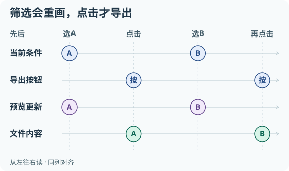

# 07｜历史记录、实时日志和工具栏，谁驱动谁？

任务已经切到 B，历史里有两行：“info 开始编译”和“error 找不到入口”。在搜索框输入 error，只剩第二行。导出一次，再清空搜索，两行都应该回到屏幕，下载的文件里仍然只有那条错误。这里是对已收到的行做本地筛选，清空输入框不必重新查询任务。

## 同一份列表，两种触发方式

把第 6 章返回的日志列表记作 list，把搜索框停顿后发出的字符串记作 word。画面里保留哪些行，用普通函数就能算：

```js
function visible(list, word) {
  return list.filter(line => line.includes(word))
}
```

构建还在进行，“error 构建失败”随时会抵达。用两个 JS 回调来接，列表更新时要读上次的词，词更新时又要读上次的列表。`combineLatest([rows, term])` 接收这两个来源，返回一个新的 Observable。订阅它，它便监听两边，各留一个最近值。两边都给过值以后，任意一边更新都会交出一对 `[list, word]`。到这里还没有做筛选，后面的 map 才调用 visible。

导出也用到两个来源，分工却不同。点击决定**什么时候写文件**，当前画面决定**写什么**。因此把 clicks 放在 pipe 左边，把 view 交给操作符 `withLatestFrom(view)`。

```sh
node --input-type=module <<'JS'
import { Subject, combineLatest, map, withLatestFrom } from 'rxjs'
const rows = new Subject(), term = new Subject(), clicks = new Subject()
const visible = (list, word) => list.filter(line => line.includes(word))
const view = combineLatest([rows, term]).pipe(map(([list, word]) => visible(list, word)))
view.subscribe(lines => console.log('屏幕', lines.join('、')))
clicks.pipe(withLatestFrom(view)).subscribe(([, lines]) => console.log('文件', lines.join('、')))

clicks.next('导出')   // view 还没有值
rows.next(['info 开始编译', 'error 找不到入口'])
term.next('error')
rows.next(['info 开始编译', 'error 找不到入口', 'error 构建失败'])
clicks.next('导出')
term.next('')
JS
```

导出管道从订阅时就监听 view，随时记下最近的一份列表。它只在 clicks 发值时交出 `[点击的值, 最近的列表]`，所以回调可以写成 `([, lines]) => …`，跳过数组第一项。第一次点击时还没有列表，这次点击就过去了。输入 error 以后，屏幕先画一条错误，接着画两条；第二次点击立即取走这两条。清空搜索只会重画屏幕。

回到开头那张已有两行的历史表。单独运行上例，`rows.next(...)` 那一行还不会画出任何东西：`term` 尚未发过值。`combineLatest` 无从知道搜索框里的空白就表示「显示全部」。若输入框初始为空，可以在这个例子里把 `term` 改成 `new BehaviorSubject('')`（从 rxjs 导入）。它保存当前词，订阅当场就会得到空串。此时在输入 error 之前，第一份历史抵达就能画出两行；第一下过早的导出点击仍然无效，因为那时连历史都没到。

同一份 `view` 在这里被订阅了两次：屏幕订了一次，`withLatestFrom` 为导出又订了一次。两边各自保存最近的列表与词。在 `visible` 的函数体里先打印 word 再返回筛选结果，两次打印之间没有第二次键入。这里的数组已经在内存里，结果相同；若订阅会启动网络连接，代价便大不相同。第 8 章会用连接数把这个区别量出来。

[](../figures/book-07.svg)

若写成 `combineLatest([clicks, view])`，第一次点击会被记住；等 view 的首份列表一到，导出就会发生，以后每次改词还会再写文件。从调用方式就能读出这个差别。combineLatest 的参数并排放，任意一路都能触发。withLatestFrom 的参数只提供取值，触发权留给调用 pipe 的那一路。

## B 的历史没到，怎么会导出 B 的文件？

留在 B 时，点击取走的就是眼前这份列表。麻烦在切换的一瞬间：如果 B 的标题已经换好，行列表还保留 A 的 a1，这时按导出就会收到名为 B、内容却属于 A 的文件。第 6 章撤掉旧订阅，只能挡住 A 今后的来信；A 上次已经画出来的那一行还得处理。

```ts
const phases = task.pipe(switchMap(key => results[key].pipe(
  map(row => ({ key, row })),
  startWith({ key, row: null })
)))
const files = clicks.pipe(
  withLatestFrom(phases),
  filter(([, phase]) => phase.row !== null),
  map(([, phase]) => phase)
)
```

这里 `results[key]` 是实验里对应任务的结果来源。选择 B 当场交出 B/null，意思是“这次还在等”。第一次点击取到 null，被过滤。B/b1 到达只更新待取的状态，直到再点一次才创建文件。若把过滤搬到 phases 里，B/null 就进不了取样的位置，那里记着的 A/a1 反倒会通过。运行 `npm run lab -- 07`，在实验末尾把点击从 B 返回之前移到之后，比较两种写法。

<a id="两个字段来自同一次修改中间能出现半张新表吗"></a>

## 一条错误日志，为什么更新了两次数字？

工具栏上还有一项「总行数 / 错误行数」。列表从空变成只有一条错误，两项数字应当一起从 0 / 0 变成 1 / 1。一种很自然的拆法是，分别从列表派生总数和错误数，再把两条数字流合起来。下面用 BehaviorSubject 保存当前列表。new 时给它初值；每一位订阅者先收到当前值，调用 next 则把新值送给已订阅的各个分支。在项目根目录运行这段命令，数一数更新一次打印了几行。

```sh
node --input-type=module <<'JS'
import { BehaviorSubject, combineLatest, map } from 'rxjs'

const rows = new BehaviorSubject([])
const total = rows.pipe(map(list => list.length))
const errors = rows.pipe(map(list => list.filter(x => x === 'error').length))
combineLatest([total, errors]).subscribe(pair => console.log(pair))
rows.next(['error'])
JS
```

逐步跟这一次 `next`。总数分支先接到新表，交出 1；组合处的错误数仍是上次的 0，于是先交出 [1, 0]。等错误数分支也处理完这张表，才交出 [1, 1]。完整输出是 [0, 0]、[1, 0]、[1, 1]。所有调用都可以发生在同一轮同步代码里。即便浏览器下一次绘制只让你看见最后一个值，订阅回调仍见过中间值。若回调会根据「已有日志且没有错误」点亮成功提示，就会误触发。

把两个数字放在同一个 map 里算，就能让它们一起更新：`rows.pipe(map(list => [list.length, list.filter(x => x === 'error').length]))`。同一次 next 只会打印 [1, 1]。如果右侧显示的是用户设置的告警阈值，情形就不同了。即使没有新日志，调阈值也该更新工具栏，这时用 combineLatest 组合两个来源就很合适。

<details>
<summary>历史和实时日志的衔接</summary>

实验手动发送 H1、实时 L1、历史完成、实时 L2。`concat(history$, live$)` 在历史完成才订阅实时端，所以仅得 H1、L2。若实时端是订阅时才启动的回放，可以串接；若实时端持续广播且页面要保全明细，就必须在 L1 发生前监听。`merge(history$, live$)` 同时监听可用的输入，按实际到达次序追加，得到 H1、L1、L2。它不能独自解决历史与实时范围重叠时的去重；项目要依日志 ID 或游标处理重叠。`merge(a$, b$, 1)` 限制同时活跃一路，在这组输入上也会漏掉 L1。

两路可能都包含第 42 行。若服务端保证同一任务的行号唯一且行只追加，可以先按行号合并，再从合并后的列表计算错误数。否则列表虽然按 id 只画一次，徽标却可能给 42 投两票。若两路都没收到某行，本地去重也补不回来；连续回放需要服务端提供游标等接续约定。

</details>

<details>
<summary>不同的配对条件会给出哪些结果</summary>

在根目录运行 `npm run lab -- 07`。第一路同步发 H1、H2 后完成，第二路同步发 A、B 后完成。按传入顺序订阅时，先在纸上填表，再看实验打印的值。

| 控制台问题 | 计算方式 | 这次收到的结果 |
|---|---|---|
| 当前行与当前标签是什么 | `combineLatest([history, labels])`，每路只留最新 | H2/A，H2/B |
| 两份历史都读完时各停在哪 | `forkJoin({history, labels})`，每路都要有值并完成 | 一份对象 H2/B |
| 第 n 行的第 n 个标签是什么 | `zip(history, labels)`，每路暂存尚未配对的值 | H1/A，H2/B |
| 两个镜像谁先响应就一直读谁 | `race([history, labels])`，沿用首先发出通知的源 | H1，H2 |

在第一行，把 H1 写进第一格时第二格还空，H2 很快就覆盖了 H1。第三行则把 H1、H2 排队，A 取走队首 H1，因此要考虑快源长时间等慢源的内存代价。一旦已完成的一路队列耗尽，配对结束。`race` 也可传分列参数；若首通知是完成或错误，竞争当即结束。用 `race(EMPTY, history)` 可看到无值完成。

把第一路换成 `EMPTY`，第二路换成 `NEVER`。在 7.8.2，`forkJoin` 发现一路不可能贡献末值，立即无值完成；`combineLatest` 的首值凑不齐，完成计数又在等另一路，既无值也未完成。实验同时检查完成回调和订阅状态。单把普通历史配上 `NEVER` 也会让 `forkJoin` 一直等。用两份有限回放做验收时，可以 `actual$.pipe(sequenceEqual(expected$, (a,b) => a.id === b.id))`，按序逐项比，自定义比较适合不同对象表示的同一行。长度不同或遇到不同项给 false，两边结束且全部匹配才给 true；省略比较器使用严格相等。

若历史流已写在管道左端，`concatWith(live$)`、`mergeWith(live$)`、`raceWith(mirror$)`、`zipWith(labels$)`、`combineLatestWith(labels$)` 都把左端纳入计算。后三者分别得到胜者的值、位置元组、最新值元组。实验对相同输入分别执行创建式与管道式。管道操作符从 `rxjs` 或 `rxjs/operators` 导入均可。另一个场景是用户逐项选完文件才确定比较几份：`of(history, labels).pipe(zipAll())` 收集外层给出的源，外层完成才按位置组合；改为 `combineLatestAll()` 则按最新值组合。二者都可传 `(...values) => result` 作投影。若外层是一直未确认结束的选择流，两者都不会开始监听那些内部源。

</details>

<details>
<summary>读组合操作的类型声明和旧签名</summary>

实验末尾的 `Inputs = [Observable<number>, Promise<string>]` 表示两种来源。沿类型推一遍：`ObservedValueOf<Inputs[0]>` 抽出 number，`ObservedValueTupleFromArray<Inputs>` 逐位置抽取得到 `[number,string]`。反向写 `ObservableInputTuple<[number,string]>` 就允许第二路给 Promise、数组或流，只要元素是 string；把第二路写成 `of(false)` 会在编译时报错。`Cons<number,[string]>` 把数字接在元组头上，`Head` 和 `Tail` 再分别取回 number 和 `[string]`。这解释了 `zipWith` 为什么能保住左端类型。

如果下游只会收到其中任意一项（比如 merge），`ObservedValueUnionFromArray<Inputs>` 给出 `number | string`；`ValueFromArray<[number,string]>` 直接从值数组取同一联合。已弃用的 `ObservedValuesFromArray` 是前一联合工具的别名，实验用类型相等断言保护迁移。不要把联合数组当作有固定位置的元组，实验末尾有编译器反例。

`forkJoin` 和 `combineLatest` 都可传对象保留键，传空数组或空对象则无值完成；实验还对照了 `forkJoin(null)` 与 `forkJoin(undefined)`。声明允许这两个调用，实际订阅却会收到 TypeError：这里传入了一项无法转成流的值。要表示零项输入，请传 `[]`。把输入标成 `any` 会匹配保守的 `Observable<unknown>` 重载。数组加结果函数可直接合成显示文字，`zip` 还接受分列输入和可选的末尾投影。迁移旧的 `forkJoin(a,b)`、`combineLatest(a,b,project)` 时把源放进数组，保留投影或在管道内 `map(([a,b]) => project(a,b))`。实验对比了汇总和带投影组合各自迁移前后的结果。旧的调度器尾参还可能决定订阅时刻：例如 `merge(a,b,limit,scheduler)` 可写成 `scheduled([a,b], scheduler).pipe(mergeAll(limit))`，串行展开对应 `concatAll()`。旧 combineLatest 调度式调用可从 `scheduled([a,b], scheduler).pipe(combineLatestAll())` 开始迁移，连首值和订阅时刻一起验收，它会调度内部订阅及通知，简单删去尾参可能改变热源结果。

</details>

界面里可以照着开头的动作试一次：搜 error，导出，再清空。下载文件保留那一刻的错误行。把错误数单独做成工具栏上的徽标，收起列表时也能看到它。这样一来，徽标和列表就都要读这份日志。

[继续读第 8 章 · 让两个面板共用一条连接](08.md)

<a id="发散练习"></a>

<details>
<summary>配套练习 · 什么动作会触发一次输出</summary>

<a id="transfer-a"></a>

[给默片排一场可以倒带的双语放映](../练习/07.md#transfer-a)

<a id="transfer-b"></a>

[两台秤怎样配出一份可复烤的面团](../练习/07.md#transfer-b)

</details>

<details>
<summary>回看前面学过的用法</summary>

<a id="practice-1"></a>

**1.** 从实时日志累积当前错误数，再接入筛选条件；解释为什么只变筛选条件也可能需要重算视图。

<a id="practice-2"></a>

**2.** 连续点击两次导出：按『每次都要导出』和『忙时忽略』各实现一次，核对启动次数与读取筛选条件的时机。

<a id="practice-3"></a>

**3.** 预览筛选结果时快速切换条件；在慢请求返回前改变条件，标出防抖等待和旧查询退订的两个不同时刻。

</details>

## 章末附录 · 本章 RxJS API 速查

<details>
<summary>查看本章用到的 API 和成员</summary>

**接入来源与订阅**

| API | 用法 |
|---|---|
| [`Observable`](../RxJS-7.8.2-API清单.md#api-114) | 描述一次可订阅的执行，可以交付零个或多个值，随后完成、报错或继续等待。 |
| [`finalize`](../RxJS-7.8.2-API清单.md#api-66) | 在完成、出错或退订时执行收尾逻辑，适合释放资源或核对清理次数。 |
| [`EMPTY`](../RxJS-7.8.2-API清单.md#api-53) | 不交付任何值，订阅后立即正常完成。 |
| [`NEVER`](../RxJS-7.8.2-API清单.md#api-105) | 保持沉默，既不发值也不自行结束。 |
| [`of`](../RxJS-7.8.2-API清单.md#api-125) | 按参数逐个同步交付后完成；传一个数组会把整份数组作为一个值。 |

**变换、筛选与累计**

| API | 用法 |
|---|---|
| [`map`](../RxJS-7.8.2-API清单.md#api-91) | 对每个输入执行投影，交付一个对应结果；第二个参数是这一段订阅内的序号。 |
| [`filter`](../RxJS-7.8.2-API清单.md#api-65) | 逐项检查谓词，只放行满足条件的值；类型谓词还可收窄下游类型。 |
| [`pipe`](../RxJS-7.8.2-API清单.md#api-134) | 按从左到右的顺序组合操作；流的 pipe 方法把这些操作应用到当前来源。 |
| [`scan`](../RxJS-7.8.2-API清单.md#api-157) | 保存本次订阅的累计状态，每处理一个值就交出新状态；种子本身不会单独发出。 |
| [`take`](../RxJS-7.8.2-API清单.md#api-187) | 只交付前 n 项，取够后完成并退出上游。 |
| [`startWith`](../RxJS-7.8.2-API清单.md#api-173) | 订阅时先发给定的初始值，然后订阅原来源。 |

**时间与调度**

| API | 用法 |
|---|---|
| [`timer`](../RxJS-7.8.2-API清单.md#api-206) | 等到指定时刻或延时后发 0；给第二个周期参数可继续递增发值。 |
| [`debounceTime`](../RxJS-7.8.2-API清单.md#api-42) | 每次新输入重置静默计时，安静满指定时长才交付最近一项，正常完成会冲出待发值。 |
| [`scheduled`](../RxJS-7.8.2-API清单.md#api-158) | 用指定调度器安排对输入的消费及交付。 |
| [`VirtualTimeScheduler`](../RxJS-7.8.2-API清单.md#api-219) | 用逻辑帧替代宿主时间，调用 flush 推进已排定动作。 |

**组合来源与在途工作**

| API | 用法 |
|---|---|
| [`switchMap`](../RxJS-7.8.2-API清单.md#api-183) | 把输入映射成内部流，新输入到达时退订旧内部流，只转发当前一条。 |
| [`concatMap`](../RxJS-7.8.2-API清单.md#api-30) | 逐个启动内部流，上一条正常完成后才处理下一项排队输入。 |
| [`mergeMap`](../RxJS-7.8.2-API清单.md#api-97) | 把输入映射成可同时工作的内部流，结果按抵达顺序交付，可限制并发数。 |
| [`exhaustMap`](../RxJS-7.8.2-API清单.md#api-61) | 一个内部流运行期间忽略新的外部输入，空闲后才接下一项。 |
| [`concatAll`](../RxJS-7.8.2-API清单.md#api-29) | 按外层交付顺序排队展开内部流，前一条完成才订阅下一条。 |
| [`mergeAll`](../RxJS-7.8.2-API清单.md#api-96) | 并发订阅外层交来的内部流，将它们的输出汇到一起，可限制并发。 |
| [`combineLatest`](../RxJS-7.8.2-API清单.md#api-23) | 日志和筛选均有值后，任一变化都重算预览。 |
| [`combineLatestWith`](../RxJS-7.8.2-API清单.md#api-25) | 把当前来源和参数来源按最新值组合，任一路更新都可触发。 |
| [`combineLatestAll`](../RxJS-7.8.2-API清单.md#api-24) | 等外层完成后订阅收集到的内部流，再组合它们的最新值。 |
| [`withLatestFrom`](../RxJS-7.8.2-API清单.md#api-225) | 点击导出时取当刻条件；仅修改筛选不会多生成一个文件。 |
| [`concat`](../RxJS-7.8.2-API清单.md#api-28) | 依次订阅多个来源，上一条正常完成才进入下一条。 |
| [`concatWith`](../RxJS-7.8.2-API清单.md#api-32) | 在当前来源正常完成后，依次订阅后续来源。 |
| [`merge`](../RxJS-7.8.2-API清单.md#api-95) | 同时接入多个来源，按实际抵达顺序转发各路输入。 |
| [`mergeWith`](../RxJS-7.8.2-API清单.md#api-100) | 把其他来源与当前来源并接，谁先到就先转发谁。 |
| [`forkJoin`](../RxJS-7.8.2-API清单.md#api-72) | 各路都给过值并正常完成后，一次性交付它们的末值组合。 |
| [`race`](../RxJS-7.8.2-API清单.md#api-142) | 让最先通知的一路决定结果，若首个通知是值则继续跟随胜出的来源。 |
| [`raceWith`](../RxJS-7.8.2-API清单.md#api-143) | 让当前来源和其他来源竞争，保留最先通知的一路。 |
| [`zip`](../RxJS-7.8.2-API清单.md#api-226) | 按各路输入的序号一一配对，快的一方暂存，等慢的一方到齐。 |
| [`zipWith`](../RxJS-7.8.2-API清单.md#api-228) | 把当前来源与其他来源按各自的第 n 项配对。 |
| [`zipAll`](../RxJS-7.8.2-API清单.md#api-227) | 在外层完成后，用 zip 将收集到的内部流逐项配对。 |
| [`sequenceEqual`](../RxJS-7.8.2-API清单.md#api-162) | 按顺序比较两个来源的值和长度，得到是否相等的布尔值。 |
| [`Cons`](../RxJS-7.8.2-API清单.md#api-39) | 在元组开头增加一个类型，描述组合结果的首项。 |
| [`Head`](../RxJS-7.8.2-API清单.md#api-81) | 取得元组第一项的类型。 |
| [`Tail`](../RxJS-7.8.2-API清单.md#api-186) | 取得元组去掉第一项后的剩余类型。 |
| [`ObservableInputTuple`](../RxJS-7.8.2-API清单.md#api-116) | 描述指定元组每个位置允许的流输入类型。 |
| [`ObservedValueOf`](../RxJS-7.8.2-API清单.md#api-119) | 提取 ObservableInput 会交付的元素类型。 |
| [`ObservedValueTupleFromArray`](../RxJS-7.8.2-API清单.md#api-121) | 从一组流输入推导保留位置的输出元组类型。 |
| [`ObservedValueUnionFromArray`](../RxJS-7.8.2-API清单.md#api-122) | 从一组流输入推导所有可能元素的联合类型。 |
| [`ObservedValuesFromArray`](../RxJS-7.8.2-API清单.md#api-120) | 旧类型别名，作用同 ObservedValueUnionFromArray。 |
| [`ValueFromArray`](../RxJS-7.8.2-API清单.md#api-216) | 提取数组或元组的元素类型。 |

**共享、批次与分组**

| API | 用法 |
|---|---|
| [`Subject`](../RxJS-7.8.2-API清单.md#api-174) | 既能接收通知，也能把通知同步广播给当前观察者。 |
| [`BehaviorSubject`](../RxJS-7.8.2-API清单.md#api-13) | 保存当前值；仍活跃时，新订阅者立即收到它，包括构造时给定的初值。 |

**方法、属性与测试助手**

| 成员 | 用法 |
|---|---|
| `subscribe()` | 登记观察者、接入一次执行，返回控制该次订阅的句柄。 |
| `next(value)` | 交付一个值；Subject 会把这次通知发给当前观察者。 |
| `complete()` | 通知正常结束，随后释放资源；主动退订不会给观察者补发 complete。 |
| `unsubscribe()` | 主动结束本次订阅并触发清理；不能据此判断远端写入是否成功。 |
| `closed` | 读取订阅是否已关闭，可用于让同步生产循环尽早退出。 |
| `now()` | 读取当前调度器的时间，在虚拟实验里对应逻辑帧。 |
| `schedule(work, delay?)` | 安排一项可取消的动作，可给延时及随动作传入的状态。 |
| `flush()` | 推进虚拟时钟并执行待办动作；在 run 内可提前结算已安排的断言。 |

</details>

[上一章](06.md) · [本章实验](../labs/07.ts) · [目录](../README.md) · [下一章](08.md)
