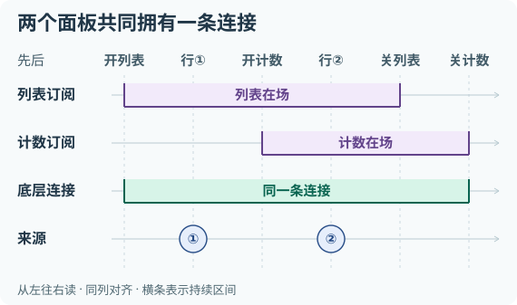

# 08｜错误计数器上线，为什么多了一条连接？

日志表已经在接收 B 的日志。给筛选框旁边加一个错误徽标，最省事的写法是让它也订阅日志，然后自己数。这样接，两处都能更新，服务端却会为同一个 B 开两条连接。

## 一次订阅执行一次连接函数

`new Observable(subscriber => …)` 保存的是函数。把同一个 Observable 传给两个人，只是让他们拿到同一个订阅入口；两边各调用一次 subscribe，函数体就会执行两次。

暂时用一个 Set 代替服务端的连接名单。每次登记回调打印“接通”，移除时打印“断开”。下面先让两块面板直接订阅 channel，第二遍只把 input 换成共享来源：

```sh
node --input-type=module <<'JS'
import { Observable, share } from 'rxjs'
const wire = new Set()
const channel = new Observable(subscriber => {
  const receive = row => subscriber.next(row)
  wire.add(receive)
  console.log('接通')
  return () => { wire.delete(receive); console.log('断开') }
})
const input = channel   // 第二遍改为 channel.pipe(share())
const list = input.subscribe(row => console.log('列表', row))
const badge = input.subscribe(row => console.log('徽标', row))

for (const receive of wire) receive('错误 1')
list.unsubscribe()
console.log('列表已退出，连接数', wire.size)
badge.unsubscribe()
JS
```

第一遍会连续打印两个“接通”。退订列表时删掉第一个回调，徽标还有一个自己的回调。第二遍只打印一个“接通”，但“错误 1”仍到达两个面板。

这个差别也可以用上一章的 Subject 手动做出来。保留上例的 wire 和 channel，导入 Subject，从 `const input` 开始，用下面这段替换余下的代码：

```js
const bus = new Subject()
const list = bus.subscribe(row => console.log('列表', row))
const badge = bus.subscribe(row => console.log('徽标', row))
const connection = channel.subscribe(bus)

for (const receive of wire) receive('错误 1')
list.unsubscribe()
badge.unsubscribe()
console.log('两块面板都退出，连接数', wire.size)
connection.unsubscribe()
```

`bus.subscribe(...)` 和 `channel.subscribe(bus)` 里的同一个 bus 扮演了两个角色。面板把它当 Observable，从它收值。channel 把它当观察者，有一行就调用它的 next，结束或出错也通知它。Subject 收到通知，再发给已经登记的面板。由于 channel 只有一个观察者，只会打印一次“接通”。

退订两块面板以后，连接数却仍然是 1。Subject 管的是面板的名单，持有上游句柄的是 connection。手工接线就得手工退订 connection。`channel.pipe(share())` 把这部分也管了起来：默认由一个 Subject 转发，第一块面板订阅时连上 channel，最后一块退出时断开仍在运行的连接。页面可以把返回的 Observable 分给两个面板，两边各自退订自己的句柄。如果每次挂载都重新调用 `channel.pipe(share())`，两个面板会各得一份这样的连接。

[](../figures/book-08.svg)

在成品控制台只开一个页面，选同一任务，同时勾选日志表和错误计数，点「检查服务端」。依次关掉日志表、错误计数，每次等连接状态更新后再查。预期连接数是 1、1、0。想看谁先退出，可以在 share 后加 finalize 记录各面板退订，在 share 前加 finalize 记录连接清理。

## 从哪一行开始计数

两块面板现在共用连接，但徽标上的数字还得有个起点。成品显示最近保留的日志中有几条错误，可以直接从日志表那份完整列表算出来：`rows.filter(row => row.level === 'error').length`。最早的错误滚出列表，这个数字也会减一。

如果希望徽标显示“本次采集以来的错误数”，情况就不同了。两条错误到达以后才打开徽标，把 scan 写在挂载函数里，第三条错误来了也只能从 1 数起。要从头记，可以让采集会话持有计数订阅，把最近的数留给新挂上的面板。下面 sharedRows 每次发一行：

```ts
const total = new BehaviorSubject(0)
const session = sharedRows.pipe(
  filter(row => row.level === 'error'),
  scan(n => n + 1, 0)
).subscribe(n => total.next(n))

const counter = total.subscribe(drawCount)
```

假设错误 #17、#18 在开徽标之前到达。`session` 从采集开始就在数，先后调用 `total.next(1)`、`total.next(2)`。此时执行 `total.subscribe(drawCount)`，哪怕之后一行也没有，徽标也会立刻显示 2。关掉徽标只需退订 `counter`。只要 `session` 继续听，下次打开还能看到关窗期间累计的数。

同样都是一条连接，为什么不把 `scan` 直接接在 `sharedRows` 后面给两个面板各订一次？在那种写法里，两个面板共用的是**行**。晚来的面板从 #19 才开始调用自己的加法，第一条错误会把它的计数从 0 加到 1。上例把加法放在 `session` 这份持续的订阅里，两边读的是它已经算出的**数**。这个数能追溯到哪一行，取决于 `session` 何时启动。

<a id="哪些地方应该有权调用-next"></a>

## 一条发生过的事和一个当前值

清屏按钮和当前任务都可以用 Subject 接入。写入端用 next 通知在场的观察者，页面可以只拿 `asObservable()` 提供的订阅入口。清屏发生后再挂面板，无须重演刚才的点击。选中 B 后再挂面板，它却需要立即知道当前任务。BehaviorSubject 为后一种情况保存当前值，构造时就要给初值。

在 `npm run lab -- 08` 的第一组实验里，先写入 1，再挂面板，然后写 2 并完成。再挂一块面板会怎样？✓ 表示这份订阅收到了完成。

| 转发器 | 中途加入的面板 | 完成后加入的面板 | 控制台中的用途 |
|---|---|---|---|
| `new Subject<number>()` | 2，✓ | ✓ | 清屏命令只发给在场者 |
| `new BehaviorSubject(0)` | 1，2，✓ | ✓ | 当前任务有初始值，活跃期间一订阅就能读 |
| `new ReplaySubject<number>(2)` | 1，2，✓ | 1，2，✓ | 晚开面板可补读最近两行 |
| `new AsyncSubject<number>()` | 2，✓ | 2，✓ | 只发布作业成功完成时的最后结果 |

AsyncSubject 直到成功完成才交出末值。BehaviorSubject 完成后的新订阅只会收到完成；需要在完成后仍可翻看的最近两行，就选表中的 ReplaySubject。

列表和徽标现在只占一条连接。构建跑快一点，上千行还是会沿着同一条连接抵达；每来一行都重画整张列表，开销仍在浏览器这一端。

<details>
<summary>一次性历史读取的缓存与失效</summary>

一次历史读取完成后，第二个面板才订上。`share()` 默认在完成后重置，所以会重新开一次。`shareReplay({bufferSize: 1, refCount: true})` 会留下已完成的最后一份历史；第二位读者立即收值，然后完成。如果历史还在下载时所有读者就离开了，refCount 为 true 会断开这次仍在途的读取。

把 `windowTime` 设成五刻，只能限制旧值的回放年龄。第 0 刻读到版本 1 并完成，第 5 刻再开时值已过期，但完成状态仍在，可能只收到 complete。要“成功后五刻，下次打开重新读”，可以在完成后重置共享入口：

```ts
const history = defer(loadHistory).pipe(share({
  connector: () => new ReplaySubject(1),
  resetOnComplete: () => timer(5, clock)
}))
```

第 5 刻定时器让缓存失效；如果第 8 刻才有人订阅，加载函数也到第 8 刻才会再执行。

</details>

<details>
<summary>由开始按钮控制连接和同步分支</summary>

在现场频道里，面板可能先后到达；有时两条计算分支却必须在第一行到达前都就位。试想源是同步的 `of(1,2)`：等第一条分支订阅返回，源已经完成了。`connect(selector, config?)` 先把 selector 返回的结果接好，再启动共享源。实验的核心是：

```ts
const dual$ = source$.pipe(connect(shared => merge(
  shared.pipe(map(n => '行' + n)),
  shared.pipe(map(n => '计' + n))
)))
```

订阅一次，得到 行1、计1、行2、计2，上游仅启动一次。每次新的外部订阅都会重新执行这个过程。`ConnectConfig<T>` 传入时要求 `connector: () => SubjectLike<T>`，可据此换成适合的转发器。若产品另有“开始采集”按钮，使用 `connectable(source, { connector: () => new Subject(), resetOnDisconnect: true })`，得到的 `Connectable<T>` 除了能订阅，还有 `connect(): Subscription`。先订阅，再按开始调用 connect，停止时退订**连接句柄**。实验在开始前、连接中、停止后分别写 1、2、3，面板只见 2。默认断开时更换转发器，再连接时需把新面板接到新转发器；配置 false 可保留原转发器及其终止状态。

</details>

<details>
<summary>在观察者回调里再次广播</summary>

拿笔停在下面的 `bus.next('已清屏')` 那一行：外层的“清屏”已经交给 table，却还没轮到 audit。内层 next 会等外层走完，还是现在就把第二个事件交给所有订阅者？

```ts
const bus = new Subject<string>();
const table: string[] = [], audit: string[] = [];
bus.subscribe(event => {
  table.push(event);
  if (event === '清屏') bus.next('已清屏');
});
bus.subscribe(event => audit.push(event));
bus.next('清屏');
assert.deepEqual(table, ['清屏', '已清屏']);
assert.deepEqual(audit, ['已清屏', '清屏']);
```

原先的清屏通知还在第一个观察者里，就嵌套调用了 next。第二个观察者先收内层的“已清屏”，返回外层才收“清屏”。把确认放在实际清屏操作结束后发布，渲染回调就可以只读。

</details>

<details>
<summary>Subject 和共享配置的版本细节</summary>

实验在 AsyncSubject 完成前还断言了一次数组为空。若没有写过任何值就完成，它只发完成；若 `error(err)`，则以错误终止，未公布的末值作废。BehaviorSubject 的 `value` 和 `getValue()` 提供同步读数，发生错误后再读会抛出保存的错误。ReplaySubject 的缓存还可以按年龄限制：`new ReplaySubject(2, 5, clock)` 最多两项，存活不足 5 个时间单位。第 0 刻写 10，第 4 刻写 20，第 5 刻加入只见 20。第三参数提供 `now()`，因此可以手动推进时钟来查精确边界。回放交付仍是同步的。它还会先回放有效缓存，再向晚到者送出已经发生的错误。

要通知现有面板正常结束，调用 `complete()`；要报告故障，调用 `error(err)`，两者都会使后续 next 失效。直接对 **Subject 本身** 调用 `unsubscribe()` 会令 `closed` 为真，并切断其观察者列表；面板收不到完成通知，随后再 `next` 会抛出 `ObjectUnsubscribedError`。实验按错误类断言。关闭一个面板应退订该面板拿到的句柄。检查是否有人监听用 `observed`；旧代码读 `observers.length`、`isStopped`、`hasError`、`thrownError` 依赖已弃用的内部字段。将显示所需的终态和原因写进自己的 complete/error 回调即可。旧 `Subject.create(destination, source)` 拼接两个方向，迁移时分别保留写入目标与可读来源；旧 `lift` 在应用层可换成 `pipe` 和明确的操作符。检验迁移要分别观察写入去了哪里、订阅读到了什么。

让同步历史加载返回递增版本号。`share()` 默认遇到完成、错误、活跃源的引用数归零都会重置。第一个读者若已经读完，下一位会重新加载。`shareReplay({bufferSize: 1, refCount: true})` 在源已成功完成时保留最后版本，实验两次读取都得 1，载入仅一次。若源尚活跃，最后的读者离开则断连并丢弃那份缓存；源出错后可以重新订阅加载。位置写法 `shareReplay(1)` 默认 refCount 为 false，无人读取时一个仍在工作的频道会继续运行。`ShareReplayConfig` 对象必须明确 refCount，`bufferSize`、`windowTime`、`scheduler` 可选，分别限制条数、年龄及提供时间基准；省略容量与时长意味着无限缓存。位置重载按这三个可选字段的顺序传入。

换一个规则：历史成功后缓存到“重新载入”信号到来。`share({connector: () => new ReplaySubject(1), resetOnComplete: () => reset$, resetOnError: true, resetOnRefCountZero: true})` 让完成后的第二位读者得到旧版本，`reset$.next()` 后第三位才读到新版本。`ShareConfig` 的三个 reset 选项都可取布尔值或通知流工厂，工厂返回的流发出值时才重置，错误工厂还能接到错误原因。重置使**下次订阅**建立新连接，原来已经收到错误的面板不会自动恢复。实验并排验证永久保留已完成结果与按信号失效；这些管道操作符及其配置类型也从 `rxjs/operators` 导出。

</details>

[继续读第 9 章 · 日志太密时怎样减少重画](09.md)

<a id="发散练习"></a>

<details>
<summary>配套练习 · 多个读者共享哪段历史</summary>

<a id="transfer-a"></a>

[长笛晚到，第一声应该落在哪一拍](../练习/08.md#transfer-a)

<a id="transfer-b"></a>

[桌游中途换座，接手的人可以知道什么](../练习/08.md#transfer-b)

</details>

<details>
<summary>回看前面学过的用法</summary>

<a id="practice-1"></a>

**1.** 分别记录两个面板各自的退订和底层连接的清理；解释关闭一个面板时哪一个计数应增加。

<a id="practice-2"></a>

**2.** 让筛选栏晚于日志面板挂载；用相同输入对照首次渲染与主动导出分别由谁触发。

</details>

## 章末附录 · 本章 RxJS API 速查

<details>
<summary>查看本章用到的 API 和成员</summary>

**接入来源与订阅**

| API | 用法 |
|---|---|
| [`Observable`](../RxJS-7.8.2-API清单.md#api-114) | 描述一次可订阅的执行，可以交付零个或多个值，随后完成、报错或继续等待。 |
| [`Observer`](../RxJS-7.8.2-API清单.md#api-124) | 接收 next、error、complete 三种通知的对象类型。 |
| [`Subscription`](../RxJS-7.8.2-API清单.md#api-180) | 一次执行的句柄，可集中登记清理动作并用 unsubscribe 释放。 |
| [`finalize`](../RxJS-7.8.2-API清单.md#api-66) | 在完成、出错或退订时执行收尾逻辑，适合释放资源或核对清理次数。 |
| [`of`](../RxJS-7.8.2-API清单.md#api-125) | 按参数逐个同步交付后完成；传一个数组会把整份数组作为一个值。 |
| [`defer`](../RxJS-7.8.2-API清单.md#api-44) | 每次订阅才调用工厂，适合重新创建请求或读取当时的状态。 |
| [`Subscribable`](../RxJS-7.8.2-API清单.md#api-176) | 只要求能够接收观察者并返回退订句柄的接口。 |

**变换、筛选与累计**

| API | 用法 |
|---|---|
| [`map`](../RxJS-7.8.2-API清单.md#api-91) | 对每个输入执行投影，交付一个对应结果；第二个参数是这一段订阅内的序号。 |
| [`pipe`](../RxJS-7.8.2-API清单.md#api-134) | 按从左到右的顺序组合操作；流的 pipe 方法把这些操作应用到当前来源。 |
| [`tap`](../RxJS-7.8.2-API清单.md#api-191) | 在通知经过时执行观察或记录动作，正常返回时继续转发原通知。 |
| [`distinctUntilChanged`](../RxJS-7.8.2-API清单.md#api-49) | 首项通过，以后与上次放行的值比较，只交付变化。 |
| [`scan`](../RxJS-7.8.2-API清单.md#api-157) | 保存本次订阅的累计状态，每处理一个值就交出新状态；种子本身不会单独发出。 |
| [`take`](../RxJS-7.8.2-API清单.md#api-187) | 只交付前 n 项，取够后完成并退出上游。 |

**时间与调度**

| API | 用法 |
|---|---|
| [`interval`](../RxJS-7.8.2-API清单.md#api-86) | 按固定周期从 0 起递增发值，第一次发值要等一个周期。 |
| [`timer`](../RxJS-7.8.2-API清单.md#api-206) | 等到指定时刻或延时后发 0；给第二个周期参数可继续递增发值。 |
| [`VirtualTimeScheduler`](../RxJS-7.8.2-API清单.md#api-219) | 用逻辑帧替代宿主时间，调用 flush 推进已排定动作。 |

**组合来源与在途工作**

| API | 用法 |
|---|---|
| [`combineLatest`](../RxJS-7.8.2-API清单.md#api-23) | 各来源都有首值后，任一路更新就组合各路最新值。 |
| [`withLatestFrom`](../RxJS-7.8.2-API清单.md#api-225) | 由主流发值触发，附带其他来源的最新值；配套来源须先各发过一项。 |
| [`merge`](../RxJS-7.8.2-API清单.md#api-95) | 同时接入多个来源，按实际抵达顺序转发各路输入。 |

**共享、批次与分组**

| API | 用法 |
|---|---|
| [`Subject`](../RxJS-7.8.2-API清单.md#api-174) | 既能接收通知，也能把通知同步广播给当前观察者。 |
| [`BehaviorSubject`](../RxJS-7.8.2-API清单.md#api-13) | 保存当前值；仍活跃时，新订阅者立即收到它，包括构造时给定的初值。 |
| [`ReplaySubject`](../RxJS-7.8.2-API清单.md#api-151) | 按条数或时长保留已发值，向晚到者补发仍在缓冲内的值。 |
| [`AsyncSubject`](../RxJS-7.8.2-API清单.md#api-9) | 只在正常完成时交付最后一项；失败时传出错误。 |
| [`SubjectLike`](../RxJS-7.8.2-API清单.md#api-175) | 同时具有观察者和可订阅对象两种能力的结构类型。 |
| [`ObjectUnsubscribedError`](../RxJS-7.8.2-API清单.md#api-112) | 已对 Subject 本身退订，又尝试使用它时可能收到的错误。 |
| [`share`](../RxJS-7.8.2-API清单.md#api-164) | 让列表和计数器共用一条上游连接，关掉列表后计数器仍可接收。 |
| [`shareReplay`](../RxJS-7.8.2-API清单.md#api-166) | 共享上游并回放最近值；refCount 控制无人订阅时是否释放仍在运行的上游。 |
| [`ShareConfig`](../RxJS-7.8.2-API清单.md#api-165) | 设置 share 的转发器，以及错误、完成或订阅数归零后的重置策略。 |
| [`ShareReplayConfig`](../RxJS-7.8.2-API清单.md#api-167) | 设置回放容量、保留时长和引用计数等共享参数。 |
| [`connect`](../RxJS-7.8.2-API清单.md#api-34) | 在一次订阅中先建立选择函数里的共享分支，再连接来源。 |
| [`connectable`](../RxJS-7.8.2-API清单.md#api-35) | 创建需要显式 connect() 才订阅上游的可连接流。 |
| [`Connectable`](../RxJS-7.8.2-API清单.md#api-36) | 表示带 connect() 的流；连接句柄可与消费者订阅分别释放。 |
| [`ConnectConfig`](../RxJS-7.8.2-API清单.md#api-38) | 配置 connect 操作符所用的 connector 工厂，以选择内部共享用的转发器。 |

**方法、属性与测试助手**

| 成员 | 用法 |
|---|---|
| `subscribe()` | 登记观察者、接入一次执行，返回控制该次订阅的句柄。 |
| `next(value)` | 交付一个值；Subject 会把这次通知发给当前观察者。 |
| `error()` | 以错误终止当前序列并释放订阅资源。 |
| `complete()` | 通知正常结束，随后释放资源；主动退订不会给观察者补发 complete。 |
| `unsubscribe()` | 主动结束本次订阅并触发清理；不能据此判断远端写入是否成功。 |
| `closed` | 读取订阅是否已关闭，可用于让同步生产循环尽早退出。 |
| `add()` | 把子订阅或清理函数挂到父订阅；父订阅已关闭时会立即执行清理。 |
| `asObservable()` | 只暴露订阅接口，让消费方不能通过这个入口向 Subject 写入。 |
| `getValue()` | 同步读取 BehaviorSubject 当前值；若已出错会抛出保存的错误。 |
| `BehaviorSubject.value` | 通过属性读取当前值，读取行为与 getValue() 一致。 |
| `observed` | 指示 Subject 当前是否还有观察者。 |
| `observers` | 旧代码可见的观察者列表；判断是否仍有人监听可用 observed。 |
| `isStopped` | 旧的内部状态标志，表示 Subject 已经停止接收新值。 |
| `hasError` | 表示 Subject 是否以错误终止的旧内部字段。 |
| `thrownError` | Subject 保存的原始终止错误，旧代码可能直接读取此字段。 |
| `Subject.create` | 旧工厂，可用给定写入目标和读来源构造代理 Subject。 |
| `lift()` | 旧接口，按 Operator 构建派生流；自定义操作可优先组合已有操作符。 |
| `connect()` | 主动连接可连接流与来源，返回可独立关闭的连接句柄。 |
| `now()` | 读取当前调度器的时间，在虚拟实验里对应逻辑帧。 |
| `schedule(work, delay?)` | 安排一项可取消的动作，可给延时及随动作传入的状态。 |
| `flush()` | 推进虚拟时钟并执行待办动作；在 run 内可提前结算已安排的断言。 |
| `shareReplay({ refCount })` | 配置字段。为 true 时，最后一位读者退出会释放仍活跃的上游订阅。 |
| `shareReplay({ windowTime })` | 配置字段。控制已缓存的值可以回放多久；过期本身不会重新发起读取。 |

</details>

[上一章](07.md) · [本章实验](../labs/08.ts) · [目录](../README.md) · [下一章](09.md)
