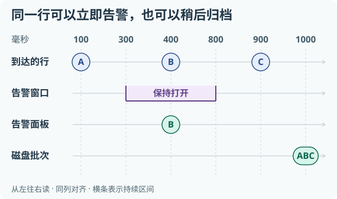

# 09｜每秒涌入上千行，怎么保留明细又不刷爆界面？

**先画时间线。** 这一秒在第 100、400、900 毫秒各来一行；第 300 毫秒进入告警状态，第 800 毫秒解除。磁盘每秒收一批，告警面板在告警期间实时显示。标出两处第一次拿到数据的时间，并写下各自看见哪些行。若用户在第 700 毫秒关闭面板，哪些数据已经可见？

## 一组数据有两个交付时刻

磁盘在 1000 毫秒收到三行数组；面板在 300 毫秒可以开始监听告警窗口，400 毫秒收到这一行。窗口开始时就交给下游一个可订阅的流；批次关闭时才交给下游一份数组。这一区别决定了能否在 700 毫秒关面板前看到告警。开窗口本身不会减少逐行计算；把普通渲染订阅接到每秒统计或数组，把明细订阅限在告警期间，才改变屏幕更新次数。

```ts
const batches$ = rows$.pipe(bufferTime(1000))
const alerts$ = rows$.pipe(
  windowToggle(alertStart$, id => alertEndFor(id)),
  mergeMap(activeWindow => activeWindow)
)
```

**读图 · 同一行可以立即告警，也可以稍后归档**

[](../figures/book-09.svg)

第 400 毫秒的 B 同时属于告警窗口和磁盘批次。沿这一列往下读，面板已经拿到 B，磁盘要到第 1000 毫秒才拿到含 B 的数组。

每次告警带一个 id，`alertEndFor(id)` 返回对应告警解除时发出通知的流。第一行给落盘端交数组；第二段在每次开始时立即订阅新窗口，把其中每行交给告警面板。替换为 `bufferToggle` 会把首次可见时间推迟到结束。多个告警同时打开时，同一行会进入每个活跃窗口；如果业务只要求一条全局警报，要先定义重叠告警的合并规则。

在根目录运行 `node --experimental-strip-types labs/09.ts`。第一组实验不用等一秒，用手动边界精确复演：写 1、开告警、写 2、切批并解除告警、写 3、源完成。在发出边界前停下检查，`window` 已转发 1，`buffer` 还没有交出数组；告警窗口已转发 2，告警批次仍为空。正常完成后普通批次为 [1,2]、[3]，告警批次只有 [2]。主动退订会丢掉尚未交付的缓冲，因此“页面已关闭”不能充当“磁盘已写完”的确认。

## 把边界换掉，重新预测去向

若导入程序自己给出页尾信号，`buffer(cut$)` 在每次信号 next 时交数组并重新收集，`window(cut$)` 立即给出第一扇窗口，再随信号换窗。实验也执行 `bufferWhen(() => cut$)`、`windowWhen(() => cut$)`：结果边界相同，但是每开一批都重新调用工厂，适合读取当时的收集周期，例如 `() => timer(currentPeriod())`。避免返回一个订阅时立即触发的关闭源，否则会在新批次尚未收到第一行时连续重开。`bufferToggle(open$, selectEnd)` 和 `windowToggle(open$, selectEnd)` 则要等开信号，工厂能按开信号的值选择关闭源；开信号之间可能重叠，也可能留下不收集的空档。

如果接口按条数限制包大小，用 `bufferCount(3)`，每 3 条交一批，正常完成时交出非空尾批。若想看最近三条的局部趋势，试 `bufferCount(3, 2)`，每两条就新开一批，第三条同时落入两批。`windowCount(3, 2)` 切出相同的值，但窗口打开时就能订阅。实验给 1、2、3、4，数组是 [1,2,3] 和 [3,4]；窗口依次转为数组则还有一个 []。原因是第四条刚发出便到了“再开一窗”的时刻，源随后完成。把第二参数调到大于 3，两次开批之间就会漏行，因而不能用这组参数做完整归档。

若用户要求一秒钟不管来了几条都刷新一次，用 `bufferTime(span)` 或 `windowTime(span)`。实验把一秒缩成 5 刻，在 1、2、6 写入，在 7 完成，得到 [1,2] 和 [6]；读取窗口中的行则在 1 就可见。两者均支持末位传调度器，以便让实验自己推进时间。还可以传 `(span, creationInterval, maxSize, scheduler)`：第二项决定多久另开一批，短于 span 就重叠，长于 span 则有空档；第三项使满额的一批提前关闭。用 `(1000, null, 200)` 可实现“满 200 行或满一秒即交，下批随即开始”。显式指定开批间隔时，满额提前关闭仍须等计划中的下一次开批。验收完整性要数输入、输出的行 ID，包括重叠期间的重复与空档期间的遗漏。批处理只改变下游交付节奏；磁盘长期慢于输入时排队仍会增长。

## 画面不再卡顿，积压去了哪里？

把归档需求换成一组能算的数字。来源每秒推 1000 行，磁盘持续每秒能写 600 行，先忽略每批的固定开销。十秒后共到了 10000 行，磁盘最多写完 6000 行。只要承诺逐行完整保存，至少还有 4000 行得留在某处。把刷新频率从每行一次调成每秒一次，能让画面流畅，却不会改变这笔账。

在批量写确实能摊薄固定开销时，把 100 行合写一次可能提高实际吞吐量。怎样知道它已经够快？分别数一段时间里**接纳的行数和确认写完的行数**，再看差额是否持续上升。只看批次数会被骗：10 个待写批次，每批是 10 行还是 1000 行，占用差得很远。让 `concatMap` 等上一批写完再开下一批，会限制同时在写的工作，但热来源仍可继续向队列交行。

若输入始终快于落盘，得再定一条业务规则。可暂停的分页接口可以在本页写完后才请求下一页，这才把下游的容量传回生产端；已经持续广播的推送需要上游协议支持才能达到同一效果。若只画走势图，可以按时间格保留最大值，明确接受格内细节消失。若是必须完整的归档，就要为积压准备存储或提高写入能力，并约定容量用尽时如何报告。面对同一股流，显示和归档可以有各自的损失预算。

## 每个任务的计数从哪里开始

A、B 交错进入系统时，一个总数不足以回答“这个任务在本轮来了几行”。`groupBy(row => row.task)` 首见一个键就交出一个 `GroupedObservable<K,T>`，其只读 `key` 标识该组。随后把这一行交给对应组。默认组是热的，因此要在收到组时马上订阅。把 A 的组一直读到完成才去订阅 B，会错过 B 前面的行。

**回访一。** 输入 A@1、B@2、A@3，关闭本轮各组，再输入 A@4。要求每组独立更新“条数和最后时间”，同时落盘必须按批次次序，即使第一批最慢。分两步推导，先让每个活跃窗口都有自己的累加器：

```ts
const counts$ = rows$.pipe(
  groupBy(row => row.task, {
    element: row => row.at,
    duration: () => roundEnd$,
    connector: () => new Subject<number>()
  }),
  mergeMap(group => group.pipe(
    scan((state, at) => ({ n: state.n + 1, at }), { n: 0, at: 0 }),
    map(state => ({ task: group.key, ...state }))
  ))
)
```

`element` 让组内只传时间戳，`connector` 为每个新组造独立转发器，`duration` 为各组指定寿命。实验用同一轮结束信号关闭所有已开组；若只想关闭某一任务，可在工厂中按 `group.key` 过滤关闭事件。关闭从内部映射移除该键，下次同键会建新组。判据依次是 A:1@1、B:1@2、A:2@3、A:1@4。若没有 duration，长期运行时曾见过的任务键可一直保留到源终止。

再把 `bufferCount(2)` 得到的两批交给 `concatMap(writeBatch)`，每次写入的流完成才启动下一批。实验用虚拟时钟在写完时记录数组，首批费 5 刻、次批费 1 刻。`mergeMap` 写完的顺序是 [3,4]、[1,2]，串行写得到 [1,2]、[3,4]。记录**完成**时的数据才能发现乱序，单看写入函数被调用的顺序会让两个实现看起来一样。这里的落盘回执是模拟的，接真实写入时应让内部流的完成对应实际确认。

**回访二。** 用户已点过清空，又选中任务 B，这时才挂载第二块面板。应补发哪一个？把清空送进 `Subject<void>`，当前任务放进有初值的 `BehaviorSubject<string>`，对两个入口分别在动作之后订阅。实验断言清空观察数组为 []，任务数组为 ['B']。若把清空也缓存，晚挂面板会擦掉它刚加载的历史。

**回访三。** 批次写入时要盖上当时的统计快照，旁边的预览则要持续显示最近写信号与最新计数。给 A 的两行时间戳 1、2，把唯一写信号分别插在两行之间和两行之后。先决定谁有权触发写入，再试 `combineLatest([flush$, counts$])` 对 `flush$.pipe(withLatestFrom(counts$))`。实验中提前写时，预览先见 A:1@1，再见 A:2@2；写入只取 A:1@1。延后写时双方都只有 A:2@2。每次写要保留所有任务的快照时，还须将逐组更新累积为以任务为键的表；此例每次只取最近更新的一组。

### 按下停止时，最后半批到底归谁

给归档工具栏加一个“停止接收，保存已收到的行”的按钮。此刻页面上写着“已收 5 行”，磁盘确认只有 3 行。先别调小批量上限，拿出两张纸，一张记已经进入收集器的编号，一张记写入端已经确认的编号。只要两张纸中间还有差额，停止就需要明确谁负责把哪些行送过这段路。把回调统一叫 stop 很容易掩盖两个需求：停止接纳新行，与放弃尚未交付的工作。

先把磁盘换成立即确认的收件箱，每三行一批。第 1、2、3 刻依次来 1、2、3，第三刻收件箱得到 [1,2,3]。第 4、5 刻来 4、5，第 6 刻按钮发一次停止信号。有人把 takeUntil(stop$) 放在 bufferCount(3) 之后。takeUntil 收到信号会向自己的下游发完成，同时退订上游。收件箱看到了完成，可是向上游收集器传去的是退订。收集器的数组里虽然有 4、5，它没有接到来自行源的完成通知，也就没有机会沿仍然打开的通道交出尾批。

把停止信号放到行入口，写成 `rows$.pipe(takeUntil(stop$), bufferCount(3))`。沿数据的方向读，第 6 刻 takeUntil 关闭这一段行输入，向收集器发完成；收集器先交出 [4,5]，再交出自己的完成。第 7 刻就算共享线路上还有 6，它也不会进入已停止的这轮归档。第一种放法和第二种放法的最终订阅都已关闭，第一批也完全相同。区分它们只需要观察第 6 刻是否多交了一批，以及这批的内容；仅断言“停止以后不再打印”会同时放过两种实现。

把磁盘的延迟加回来。第 3 刻启动首批写入，耗时五刻，到第 8 刻才确认。按刚才的修法，第 6 刻尾批已经形成，但串行写的前一批仍在途中，尾批只能排队。若停止时把整个归档订阅也一起 unsubscribe，队列失去所有者，先前对尾批的修复就白做了。让行入口按时完成，让末端的 concatMap 保持订阅，等第一批确认，再启动第二批，第二批完成后归档结果才完成。此时可以关掉“正在保存”的指示。这个推导假定写入返回的流会完成，且完成代表真正确认；若它只代表已把数据塞进另一层内存队列，界面就只能承诺送到了那一层。

还可以把停止信号提前到第 3 刻，与第三行同刻发生。对手动 Subject，先 next 第三行再 next 停止，能交满一批；反过来先停止，只交两行尾批。这里没有一个普遍的“同毫秒必算哪边”，决定归属的是两次通知到入口的先后。需求若写着“用户按停止前已经显示的都要保存”，显示端和归档端就要能指认同一条截止行，例如用最后一个已接纳编号做验收。服务端已产生而本地尚未收到的行，并不在这句本地承诺的证据范围内。

若按钮另有“放弃本次导入”，直接退订可以是合理选择。再问已成功写完的第一批怎么办：取消后续订阅无法撤销此前的磁盘副作用。想做到整个导入全有或全无，需要写入端提供临时文件与提交动作，或相应的事务边界。RxJS 的完成、错误、退订可以表达流程何时停，却不能凭这些通知推导出外部存储的回滚能力。迁移到离线导出时，合理答案之一是先把所有批次写入临时目标，收到末次真实确认再公布文件；失败时把临时目标标成不完整，重新开始之前先决定是否复用。

### 两场告警同时打开，面板上的重复行该删吗

给每场告警配一份独立的诊断附件。告警甲在第 1 刻开启，第 5 刻解除；告警乙在第 3 刻开启，第 7 刻解除。第 2、4、6 刻各来一行，编号与时刻相同。把甲、乙各画成一横条，分别把到行的三根竖线往下延长。穿过甲的是 2、4，穿过乙的是 4、6。归档磁盘应只写三个不同的行，附件里的成员总数却应是四。两份附件各有一行 4 恰好证明第 4 刻两场告警同时在场。

一个会在单场演示里通过的实现把两次 open 都接到同一个 end$，任何一次解除就让所有活动收集器关门。第 5 刻发“解除甲”，两份附件当场都交了，乙只有 4。第 6 刻的行还在磁盘里，乙的附件却永远少它。尤其容易误判的是排查时看见“有开有闭，批次数等于二”，于是把缺行归咎于传输。按 id 选关闭输入，例如在关闭工厂里返回 `end$.pipe(filter(closed => closed === id))`，第 5 刻只有甲交付，乙仍有一扇打开的窗，等第 7 刻才交付 [4,6]。实验特意在解除甲后先查一次收件箱，这一步就能抓住提前关窗。

现在要求输出带附件名称。bufferToggle 交的是数组，下游不能仅凭“第几批”找回“第几个开信号”。让乙提前到第 4 刻收完、甲到第 7 刻才结束，结束顺序便与打开顺序相反。若通过外部队列每次取最早的名字，会把乙的行交给甲。可以由开信号启动各自的内部订阅，在闭包里持有本次 id，把行收集到对应解除为止，再把 id 和行一起交付。对实时展示则是在每次开信号里把每行映成带告警 id 的值，当场送出，无须为等数组凑齐而延后第一行。这里假定行源本来已共享，否则每开一份诊断都可能重新启动采集。

如果同名告警未解除又开一次呢？按 id 过滤会让两轮订阅在一次解除时一起结束。若同名只表示同一个持续事件，应该在入口处识别“已经开启”，忽略重复开信号。如果同名表示可并存的两次故障，就给每次发生一个实例号，让解除报告这个实例号。用名字作为 Map 的键然后把旧订阅覆盖掉，只会让旧订阅失去可找回的句柄，不会使它停止。用连续两个“甲 开始”加一个解除做验收，应先能说明预期有几个活跃附件，再讨论具体操作符。

全局预警灯又是另一种消费方式。甲开启，灯亮；乙开启，灯仍亮；甲解除时乙还在，所以灯必须继续亮到第 7 刻。若实现是开始就设置 true、结束就设置 false，它会在第 5 刻提前熄灭。保存活跃实例的集合，每次开闭后看集合是否为空，既能解释灯的变化，也能检查重复解除不会把计数减成负数。于是同一批输入可以支撑三个不同判断：磁盘按原始行归档，诊断附件按各自区间收行，灯按活跃集合显示。把附件合并后的行拿去统计磁盘吞吐，会把重叠时的一次接收误算成两次。

### 为什么给窗口串行排队会丢掉整段明细

接下来让归档每两行换一卷，每卷需要一点处理时间。一个颇自然的想法是用 windowCount(2) 切窗，再用 concatMap 按卷处理。名字里的“排队”听起来正好保证完整。先区分队列里装进了什么：bufferCount 交出的是已装好两行的数组，而 windowCount 打开时交出的是订阅入口，下一行到来才会沿入口广播。把入口放进队列并不等于订阅它，更不会替队列把以后经过的行保留下来。

在第 0 刻接上第一扇窗口，第 1、2 刻来行 1、2，第一卷收齐，当场开始写，要到第 7 刻才办完。第二扇窗在第 2 行之后已经打开，入口排到了 concatMap 后面；第 3、4 刻 3、4 经过它，随后它自己就结束了。第 7 刻队首移走，终于轮到订第二个窗口。普通热窗口在完成后接受订阅，只会告知“已结束”。在这时接 toArray 收到空数组完全合法，说明这个订阅从未观察到任何成员，无法由此证明窗口所在的那段时间一行也没来过。

修复可以有两个落点。只要求按卷写文件，就先 bufferCount，形成稳定的数组再交给串行的写入队列，队首阻塞不会让后续数组的成员消失。若同一窗口还承担实时检测，则先并行订上每一扇窗，各自收集成员或更新统计，形成能够保存的结果后再交给写入队列。此时队列保的是结果。若窗口允许重叠、结束先后不等于打开先后，第二种方案交付的便是结束次序，写入若必须按开启次序还需用卷号安排。卷号由开窗时分配，不能等完成后才按输出顺序编号。

拿一段高峰期算一算代价：每刻进两行，一卷两行，每三刻磁盘才能确认一卷。连续六刻共进六卷，若从第一卷形成时才开始写，到第六刻只确认了第一卷，第二卷仍在写，其余等候。给 concatMap 设置串行只保证在途写入至多一个，不能约束上游继续交卷。把窗口入口排队显得省内存，实际上换来了缺行；把每卷数组完整保存才会暴露真实积压。打算长期无损采集时，必须另外安排可以承受的保留空间、上游限速或转存。遇到容量上限要向产品明确哪份数据能舍弃，不能让满载时的行为取决于某个面板碰巧订得有多晚。

运行本章实验时，排在首卷后面竟然有两个空数组。第一个本应含 3、4，原因是订阅迟到；第二个又是什么？把窗口打开的时刻也画在横线上：第 0 刻开第一扇，发完第 2 行开第二扇，发完第 4 行开第三扇，第 5 刻源完成。最后这扇确实一行也没等到。相邻的两个 [] 在输出上完全相同，背后却各有一种原因。若为了“修复”而在写入前过滤掉空数组，磁盘看上去只有一卷干净的 [1,2]，3、4 消失的证据也被一同过滤了。

要分清这两种空，可以在收集端记下每次开窗的时刻，在实际订阅窗口时再记一笔。第二扇早在第 2 刻就交出入口，第 7 刻才有人读；第三扇即使立即读也收不到任何值。另一项对照是只让写入立即完成，保持源和切窗间距不变。这样第二扇可以及时接上，第二份是 [3,4]，只剩第三份为空。若改用数组方案，bufferCount 在正常完成时只交非空尾批，所以写入端只会启动两次。这里比较的是成卷语义；若业务还要求“即使整段没有行也得写入一条巡检心跳”，应让心跳有自己的时间边界和记录类型。否则下游看见空卷，既无法判断是健康信号，也无法判断订阅是否迟到。

### 报表里的“这一秒”是哪只钟的时间

归档卷已经完整，控制台上却冒出一个新问题：第 2 秒的文件里怎么有第 1 秒的错误？先给每行记两个时刻。一个是设备记录错误的时刻，另一个是控制台收到这行的时刻。断线重放、历史回补，甚至一次慢的解码，都可能把后者推迟。bufferTime 在订阅之后按调度器推进边界，它没有读过行对象里的时间戳。只要用相对订阅起点的时钟，这条管道能回答“本地在这段时间接收了多少行”。

设订阅建立在第 0 刻，每五刻交付。行甲标记发生于第 1 刻，第 2 刻收到；行乙发生于第 3 刻，却在第 7 刻才补来；行丙发生于第 6 刻，也在第 7 刻收到，排在乙之后。用手指从左到右沿接收线走，第 5 刻交出 [甲]，第 10 刻交出 [乙,丙]。若业务要求按发生刻度分五刻一段，第一段应含甲、乙，第二段只有丙。调大 span 可以让某些晚行碰巧赶上，却改变了每段范围，也无法为任意迟到提供保证。把每批内部按时间戳排序同样无效，第 5 刻已经交出去的批内根本没有乙可排。

迁移题可以这样设定：仪表要实时显示“刚才接到的量”，夜间报告要回答“故障集中在哪个时段”，两个结果都来自同一归档。前者用接收时钟切批，明确第一段从订阅时开始。后者先保存每行真实的发生时间，报告从完整记录按发生时间计算桶号，例如发生刻度除以五再向下取整，把同号行累加。这个桶号有固定起点，与页面何时打开无关。若跨设备时钟尚未对齐，就算算法严格按字段切段，也只能解释为“设备各自上报的时刻”，不可凭一批数组推出实际因果先后。

若夜间报告还得在现场每五刻先发一个估计，迟到的乙该怎么办？可以给初值声明“截至当前接收进度”，乙到来时更新第一段的计数并提高版本。若读者要求一经公布永不更改，就需要上游确认“这个范围的行已经发完”，或双方约定最多迟到几刻并规定超限的处置办法。第 5 刻只有甲时，本地没有足够信息区分“本段再无别行”和“乙正在路上”。这两种世界在当前输出上完全相同，任意定时器都只能表示等得够久，不能自行提供完备性的证明。

## 在类型上守住分组边界

`BasicGroupByOptions<K,T>` 允许提供 duration 和返回 `SubjectLike<T>` 的 connector，element 只能省略或为 undefined，订阅组读到完整 T。`GroupByOptionsWithElement<K,E,T>` 要求 `element: (row: T) => E`；此时工厂应创建 E 的转发器，duration 接收的也是 E 的组。实验末尾尝试给数字组返回字符串以及改写 `group.key`，strict 编译器必须拒绝两处。省略选项直接按键分组也保留原值。如果输入是 `string | number`，传 `(v): v is string => typeof v === 'string'` 则得到键为 true 的字符串组和键为 false 的数字组；先判断键就能安全选择对应处理。

旧签名 `groupBy(key, element, duration, connector)` 将三个选项按位置排列，只设 duration 时还得为 element 留空。改为 `groupBy(key, {element, duration, connector})`，保留相同的关闭时机、元素和转发器工厂。实验给旧、新管道同时喂交错输入，逐组完成的数组都是 [1,3]、[2]、[4]；只比最后总条数会看不出 A 是否真的重开。本章管道和分组类型在 `rxjs`、`rxjs/operators` 两入口复用同一声明。

回到控制台的日志面板，渲染端用 `bufferTime(150)` 收集一段时间的视图快照，略过空批，再取批内最后一幅来画。这里每幅快照已包含当前列表，所以跳过中间几次绘制仍可看到明细。如果输入改成一行一行的增量，同样取批尾就会丢行。用实验中的 [1,2] 做验收：归档必须收到 1、2，渲染可以只画一次包含这两行的列表。

## 两场实作：数据放进去之后，还能不能认回它属于哪里

<a id="transfer-a"></a>
### 发散题 A｜让交错冲洗的底片各归其页

暗房给两卷底片做接触印样，供摄影师拿着放大镜选片。每页两行两列，从左上向右、再从下一行左侧向右摆放。每格只放一幅底片，同一卷内按送到暗房的顺序排列，一页不得混卷。满四幅立刻曝光；卷主说“本卷冲洗完”时，把剩下的一至三幅排在新页靠前的格子，余格保留空白。没有待印底片的卷不能凭空多印一张纸。每次曝光都要能在底片袋上找到相应编号。

实验钟从第 1 刻数到第 10 刻，前七刻依次送入甲 11、乙 21、甲 12、甲 13、乙 22、甲 14、甲 15。第 8 刻乙宣告结束，第 9 刻甲宣告结束，第 10 刻又传来一次乙结束。请交摄影师三样东西：实际曝光的时刻与卷名、每张纸正面的四格草图、以及一份检查是否漏印或重印的办法。再做一个小手工：沿每张纸**竖直中线**翻到背面，在与正面图像相同的物理位置写编号。请写出背面朝向你时最后一页的四格。假定左右翻纸且顶边始终朝上。

有人先把所有底片每四幅排满一张，再在纸上分别贴甲、乙标签。用同一组输入找出最早能判定这个流程已错的刻数。另有一台机器按“最近四张、每来两张就另开一页”打校样，摄影师想借来做无重复的档案印样。请说明何时还能借用，哪些参数或工序必须先核实。

<details>
<summary>展开冲洗台手算、分页管道和翻纸定位</summary>

拿两条纸分别写甲和乙，每收一幅就在对应纸条上贴一个小方块。第 1 到第 4 刻结束，甲有 11、12、13，乙有 21，两条都尚未凑齐四格。全台总数虽已是四，此时不应曝光。若先按总到达次序每四张成页，第一张就是 [11,21,12,13]，第一次满页便已混卷。更早的第 2 刻检查正在摆放的底稿也可预见混卷；若检验者只能观察交给摄影师的成品，第 4 刻是他能拿到错误证据的第一刻。把“错误状态什么时候形成”和“从交付物什么时候看得出”分开，有助于决定断言应放在哪一步。

第 5 刻乙又进 22，乙台已有两幅；第 6 刻甲进 14，甲台第一次达到四，立即交付第一张甲页。此时只腾空甲台，乙的两幅应留在原位。第 7 刻甲的 15 是下一页左上角，不能覆盖刚曝光那一页的第一个 11。第 8 刻乙先结束，印一张只占上排的乙页；第 9 刻甲结束，印一张只有左上角的甲页。第 10 刻同一个乙结束重来，没有遗留工作。总计三次曝光，纸的到达次序甲、乙、甲，不等于按卷名排好的装订次序。

| 曝光刻 | 卷与卷内页 | 左上 | 右上 | 左下 | 右下 |
|---|---|---:|---:|---:|---:|
| 6 | 甲第一页 | 11 | 12 | 13 | 14 |
| 8 | 乙第一页 | 21 | 22 | 空 | 空 |
| 9 | 甲第二页 | 15 | 空 | 空 | 空 |

检查时先在第 4 刻数纸，正确管道零张，错误管道一张。再在第 7 刻检查一整页的格子，确保它没有因为下一张甲页开始而被改写；最后比较三页的精确内容。只比“有三张纸”会放过串卷，只比纸面上一共七幅会放过“11 印了两次、12 一次也没印”。把非空编号收集起来，在本题编号全局唯一的前提下，排序后和输入的七个编号逐项比对，能查缺失与重复；它仍然查不出甲乙互换了位置，所以和逐页断言配合。现实里两卷都可能用 01 作首张编号，核对的身份就要是卷名与编号两者一起。

**先做一个故意摆错的晒框。** 同一批输入可以同时给两套暗房流程使用。错误流程将卷名在入口去掉，分组所需的依据从此就丢了。读到以下三行时，在纸上圈出信息消失的那个位置。

```ts
negatives$.pipe(map(n => n.frame), bufferCount(4))
  .subscribe(p => wrong.push(p))
```

map 之后，只剩 11、21 等数。这个练习特意选十几和二十几帮助肉眼认卷，但卷名本来是独立字段；后面再按十位数猜卷并不是合法修复。改一项输入，让两卷都有编号 11，就知道推断会失去依据。第四次送片后实验断言 wrong 恰好是 [[11,21,12,13]]，而 pages 的长度仍为零。看到错误结果是意料中的，可以保留它作为最小反例；若用错误流程去替换正式流程，正确流程的这条中途断言当场报错，无须等暗房收工。

修复要给每卷保留自己的工作台。收到新卷的第一幅才开台，把卷名当键交给 groupBy。为每个工作台订属于这卷的结束信号：宣布乙结束只能关乙台，甲未满的 15 仍在甲台上。g.key 就是建台时那次卷名，duration 选择对应通知使该组正常完成。

```ts
groupBy(n => n.roll, {
  duration: g => developed$.pipe(filter(roll => roll === g.key))
})
```

得到一组就立刻接收其中的底片。把上一段的分组操作接在 negatives$ 上，下面是从组到页的核心，先看每批实际有几幅：

```ts
mergeMap(g => g.pipe(
  map(n => n.frame),
  bufferCount(4),
  map(frames => ({ roll: g.key, frames }))
))
```

第 8 刻乙组正常完成，交出 [21,22]，甲的 15 继续等待。如果 duration 少了按卷过滤，甲的尾页也会在第 8 刻交付；即使最终页数正确，实验此刻要求 pages.length 等于 2 的断言仍会失败。接下来将最后一行的 frames 转成实际版面。

组交的每批最大长度为四，未满批只含真实编号。做印样图时还要把它装进固定的物理格子，空格若在数组中根本不存在，做坐标换算时就不能区分“右上空着”和“纸只有一格”。实验用下面的小步把两个问题分开处理，每曝光一次创建一张自己的摆放图。

```ts
const cells: (number | null)[] = [null, null, null, null]
frames.forEach((frame, i) => { cells[i] = frame })
return { roll: g.key, cells }
```

第 9 刻 frames 只有 [15]，写入下标零，另外三个 null 是有意保留的格位。若改为把所有页都指向同一个 cells 并反复擦写，第一张已收妥的印样也会变成下一页内容。若先过滤掉所有 null，再用数组长度推出纸宽，最后甲页可能被当成一格宽的纸，翻到背面仍把 15 写在左上。null 是这里的排版约定，不是新的底片；检查是否漏印时要略过它，检查格子位置时必须保留它。

**拿着最后一页真的翻一次。** 在纸面朝向自己时给四角临时命名 a、b、c、d，第一行 a b，第二行 c d。沿竖中线翻过去，纸的原左上角现在位于观看者右上角，原右上角位于左上角，底边同理。背面的观看次序 b、a、d、c，最后甲页应为 [空,15,空,空]。它和把整个数组倒过来得到的 [空,空,空,15] 不同，后者把上下也换了。函数 backOfSheet 只交换每行的两格；实验先断言最后一页背面的位置，再对甲满页翻两次，必须恢复原图。仅检查翻两次还原并不足够，因为上下翻转两次也能还原；单次翻纸的有向例子指定了物理动作。

想把这种方式推广到三列两行，可以在正面用从零起的行 r、列 c 表示格位，正面下标为 r 乘列数加 c。竖翻后行不变，背面列等于列数减一再减 c。以三列的左下格 (1,0) 为例，对应右下格 (1,2)，而中间一列翻过来仍在中间。页的组成应在做这种变换之前就已经固定；若先把连续底片按“每三个左右互换”修改总序列，再去分页，两卷交错时不同卷的编号会互相搬动。把排版当作对**一张已归属到某卷的页**的纯变换，才能单独验证哪类错误来自分组，哪类来自坐标。

**借来的校样机怎样改。** 最近四幅每两幅另开一页，在单卷 11、12、13、14、15 上，第一页是 11、12、13、14，第二页至少含 13、14、15，重叠的 13、14 是摄影师比较相邻曝光变化时刻意保留的上下文。若承诺档案中每幅只出现一次，起张间隔必须等于容量四，且最后不足四幅时仍需由结束动作收尾。把开页距离改成五更加省纸，却会使第五幅落在空档。用缓冲数说明：普通 bufferCount(4) 是连着铺的格子；bufferCount(4,2) 每添两格另开一条纸带，这些条带会暂时同时接收一幅。同一输入在档案与校样上的验收函数不同，档案查唯一归属，校样要查相邻页按指定跨度重叠了哪些帧。

如果这次任务叫“从五幅里每隔两幅取一张做缩图”，答案又不同。那是选取 11、13、15 三幅，未选的 12、14 有意不印。把四张叠页误当成抽样，最终画面可能比原卷还多，无法满足节省相纸的目标。先把输出草图画成三项编号，或者画成两个相互搭接的四格，作者和操作员就能及早发现他们说的“隔两张”指的是选片步长还是开页间距。确定要借的是晒框的容量，还是输片器的步距，才能决定保留机器的哪部分设置。

另一个常见现场差异是摄影师想先看乙的样，再看甲，暗房却先晒出甲的第一页。可以先允许各卷按自身边界成页，在交付端为装订另排卷序与页码；这样第 6 刻已形成的甲页不会占着晒框阻塞后来的乙片。若要求严格等乙整卷交完才交甲，甲可能要在候印架上等一段时间。若误用“只读完第一卷再接第二卷”，在第一卷结束前送到的乙 21、22 将无在场接收者。让所有开台的卷同时收片，等拥有独立数组后再排装订次序，是本章热窗口与可保存的页之间的区别在暗房里的落点。收片次序、曝光次序、装订次序各自可以有理由，必须说清在哪一步重新安排。

**结束信号不是一张空底片。** 有人建议在乙结束时塞一个特殊编号 0，当作“以下补空”。若乙台已收两幅，这个 0 会占去第三格；若恰好收了三幅，0 还会使一张三幅加假编号的页当场满页。随后真正的完成来临时，检查总数就会多出一项。把空白作为排版值 null，把结束作为组寿命的通知，两者都不会混进实际底片输入。若摄影师确实送来一幅过曝得全白的底片，仍有真实卷号与片号，它应占一格并计入校验；白色图像和空格在实物上也许肉眼难分，身份记录却必须区分。

最后用两个极端卷检查是否掌握了收尾。没有一幅片就收到空卷结束，当前建台办法连组都没有，应当不出页。整整四幅刚曝光就结束，组完成时内部没有非空尾批，也不应多出空白页。若馆藏要求空卷也出一份“无底片”的封套，那是卷目录的交付物，不能从只在首片出现时建组的流程里等它自然生成；需要卷登记入口，在卷主声明结束且实际张数为零时开具封套。一个小小的输入约定决定了某种输出究竟能不能从现有流推得，先把空卷情形带过管道走一遍就能检验。

</details>

<a id="transfer-b"></a>
### 发散题 B｜两块苗圃揭开遮雨布，各接到了多少雨

园艺课要决定第二天是否补水。试验使用一台可调速喷雨器模拟降雨，刻度单位是毫米／小时；每次调挡后雨强保持不变，直到下一次调挡。实验开始在第 0 分钟给出 0，第 2 分钟改为 6，第 5 分钟改为 12，第 8 分钟回到 0，第 10 分钟停止观察。忽略风、径流和蒸发，雨在田面均匀落下。这里讨论每块土面接到的水深，不用假设两块地面积相同。

苗床在第 1 分钟揭布、第 7 分钟盖布；花圃在第 4 分钟揭布、第 10 分钟盖布。揭布那一刻起开始接雨，盖布那一刻起不再接雨。请给两块地各交一张计算纸，列出不同雨强实际作用了多久、分别贡献多少毫米。若两张纸碰巧总数相同，要让老师看得出计算确实各按自己的揭布区间进行。再回答田面管理员的问题：直接把两份毫米数相加，能称作这场雨的雨深吗？

第二轮故意盖住喷雨器的刻度盘：第 5 分钟知道有人调挡，却读不出调到了几，第 8 分钟才重新确认是 0。其他输入保持相同。交给种植员的报告必须区分可以确定的毫米数和有多少分钟雨强不明。最后做一项盲检，把第一轮第 6 分钟再读一次，仍然是 12；这次多余读数能否改变任一块土面的水深？用实算或可运行的断言说明。

<details>
<summary>展开按作用时长算水深的推导，以及缺测时怎样交报告</summary>

先把喷雨器的四次设置画成台阶。第 0 分钟读到 0，保持到第 2 分钟；2 到 5 是 6，5 到 8 是 12，8 到 10 是 0。这里题面明确保证“设定后保持”，所以两个读数之间能够画一段水平线。若是隔三分钟瞄一眼真实天气，两次读数相同也不能保证中间始终相同，那时只能说明采用了分段常值近似。本题用可调速设备把这个物理假设显式给出来，使我们能准确验证分段算法，不拿近似冒充实测事实。

再用两条不同颜色的纸覆盖揭布区间。一段雨对一块土的贡献由两个条件共同决定：设备处在该档位，而且土面露在外面。取二者在时间轴上压在一起的长度。比如 2 到 5 的中雨，苗床 1 就揭开，所以接满三分钟；花圃 4 才揭开，只收最后一分钟。6 毫米／小时乘三分钟，先将三分钟除以 60 得 0.05 小时，再乘 6 得 0.3 毫米。若直接乘得 18，单位仍是“毫米·分钟／小时”，漏掉了时间基准的换算。

| 土面 | 雨强 0 的已知时长 | 雨强 6 的时长与水深 | 雨强 12 的时长与水深 | 合计 |
|---|---|---|---|---|
| 苗床 [1,7) | [1,2) 一分钟 | [2,5) 三分钟，0.3 mm | [5,7) 两分钟，0.4 mm | 0.7 mm |
| 花圃 [4,10) | [8,10) 两分钟 | [4,5) 一分钟，0.1 mm | [5,8) 三分钟，0.6 mm | 0.7 mm |

两块都揭布六分钟，各行的有效作用分钟相加都等于六，这是一项独立检查。花圃多接了一分钟强雨，却比苗床少接两分钟中雨，两者刚好抵消。若换一个结束时间，例如把花圃提前到第 7 分钟盖，只留下 [4,5) 的 0.1 和 [5,7) 的 0.4，合计 0.5；苗床仍是 0.7。用这个改动能抓出“第一块算一次，把数字复制给另一块”的假实现，基线两块相等并不能独自识别这种错误。

**一条读数要等到哪时才能交出它的贡献？** 第 2 分钟刚调到 6，只能知道新的速率；不知道这档会保持多久，就还算不出这段最终水量。第 5 分钟下一次调挡到来，前一段才同时拥有起点、终点和速率。实验先把刻度纸转成这种可计算的区段，最后一笔只当作观察结束的右边界。

```ts
of(...points).pipe(pairwise(), map(([left, right]) => ({
  start: left.minute, end: right.minute, rate: left.rate
}))).subscribe(s => segments.push(s))
```

pairwise 每次把相邻两点交成一对，第一点单独到来时没有一对可交。这里要读 left.rate，刚读到的 right.rate 决定的是下一段。若改成 right.rate，2 到 5 这三分钟会被算成 12，5 到 8 又会被算成零，末段还会误读第 10 分钟的边界占位 null。检查花圃的 unknown 必须为零就能及早发现错移。只保留调挡点、完全省掉第 10 分钟边界也不对；[8,10) 虽然不贡献毫米，它仍是**已知干燥的两分钟**。末次盖布或观察截止必须给最后一档一个右端，才能交完整的覆盖记录。

为什么不简单地在每块地揭布时开一个读数窗口，盖布时把里面的数拿走？花圃在第 4 分钟开窗，窗里能听到的调挡是 12 和 0。可揭布瞬间生效的 6 是第 2 分钟设定，窗口里没有这条通知。实验把这个接法独立演了一遍：先向 stations 发 6，再发揭布、12、0、盖布，收集结果恰为 [[12,0]]。对这个数组求和、平均或取末项都没有办法知道 6 曾经作用了一分钟，因为构造输入时就舍掉了开始状态。若问题是“揭布期间一共调了几次挡”，同一窗口收到了两次，反倒刚好适用。计动作与计作用量需要的证据不同。

**把交集翻译成一行算术。** 区段的起点与床面揭布点，哪个更晚就从哪个开始；区段的终点与盖布点，哪个更早就到哪个为止。没有交集时相减会是负数，所以最低记零。将下面的 s 想成一段台阶，bed 是一块地一段完整的揭布记录。

```ts
const minutes = Math.max(0, Math.min(s.end, bed.close) - Math.max(s.start, bed.open))
if (s.rate === null) total.unknown += minutes
else total.mm += s.rate * minutes / 60
```

对苗床和 5 到 8 分钟算一遍，较早的结束是 7，较晚的开始是 5，相差两分。对花圃和 0 到 2 分钟，较早的结束是 2，较晚的开始是 4，相差负二，截为零。若漏掉最外层的 Math.max(0,...)，遇到一个完全不相交的强雨段就可能从已接雨量中倒扣毫米。本题最前与最后的档位恰好为零，负长度乘零仍是零；做这种改错实验时可以用完全盖布的 [9,10) 土面跟早先的 12 档比较，良好实现应始终得零，无须靠正负误差偶然抵消。

每块地从独立的 `{bed: bed.name, mm: 0, unknown: 0}` 开始，沿各段 reduce 累加，段走完才交一份报告。实验先把有限读数推成 segments，再按 beds 顺次读取它们，因此 concatMap 在此是依次生成两张纸；它没有让一块地必须等另一块盖布后才在现实中接雨。若将对象种子建在外层让两次归约共用同一可变对象，花圃可能在苗床的 0.7 上接着加，连已交出的苗床那张纸也会跟着改变。每次进入一块地的计算才建种子；如果有必要保留逐段中间状态，返回新对象或在交付时复制，避免所有中间记录最后指向同一个数值。

**读不到刻度时，雨没有停止。** 第二轮把 5 到 8 这一段的 rate 换成 null，表示无法确定强度。两块地与这段的交集长度仍能精确求得。苗床有两分钟未知，已知水深只来自 [2,5) 的 0.3；花圃有三分钟未知，已知部分只来自 [4,5) 的 0.1。报告应写“确认 0.3 mm，另有 2 min 未知”和“确认 0.1 mm，另有 3 min 未知”。沿用前一档 6 会悄悄填补证据空白，给种植员一份无法从读数验证的确定值。把 null 直接换零则混淆了无法测量与确实干燥，两个结果即使数值一样也会导向不同的补水决策。

这里有个很短的改错练习。把分支条件写成 `if (!s.rate)`，JS 会把数值零也送进 unknown。这样第一轮苗床会凭空多一分钟未知，花圃多两分钟未知，而两块地的 mm 都还是 0.7。若只断言 mm，测试会全绿。实验比较的是每张纸的 [mm, unknown] 二元组，第一轮两个未知时长都应为 0，第二轮则分别为 2 和 3。这不是给一份雨量添个好看的附注；报告一旦要交给依赖完整观测的使用者，完整性就是结果的一部分。若设备还给出可选的物理上限，例如最强只有 12 毫米／小时，可以据此给出不确定范围。苗床两分钟未知至多再贡献 0.4，但这个“至多”必须明确依赖设备上限。

**盲检为什么选择第 6 分钟。** 它位于强雨段内部，而且两块地都还揭着布。插入另一条同值读数后，原来的 [5,8) 只变成 [5,6)、[6,8) 两段。花圃都覆盖，两段水深为 0.2、0.4，仍加成 0.6；苗床只覆盖到 7，两段各贡献 0.2，仍为 0.4。这个输入会改变事件条数、平均读数甚至窗口中的明细形状，却不能改变灌进土里的水量。实验构造 split 数组再算一遍，两张纸仍是 0.7。分段相加时保留原始数值，只在最终断言对齐到规定小数位，避免把每个短段都舍成零。若报告精度只到百分之一毫米，也应说明是在最终报告处舍入。

把盲检反过来，可以删掉哪一个读数？可删第 6 分钟补记的 12，因为相邻两段由同一已知强度覆盖；不能删第 5 分钟的未知调挡，删它就会让系统误以为 6 档持续到 8。也不能只因为最后一次读数与前次同为零就删掉截止时刻；截止具有界定观察范围的作用，虽不改变数值，仍影响已知覆盖的时长。若要压缩刻度纸，可以把有效区段直接写成起点、终点、档位三项，只合并连续、同值而且来自同一观测规则的段。这样能解释为什么压缩后还能回答同样的揭布区间查询。

**从毫米换成实际用水。** 一平方米上的一毫米水就是一升，因为一米乘一米乘 0.001 米等于 0.001 立方米。若苗床两平方米、花圃三平方米，两块互不重叠，基线接到的体积分别是 1.4 升与 2.1 升，总共 3.5 升。若以这五平方米为整体报告平均接水深，需要把总体积除以总面积，得到 0.7 毫米，不能把两份深度直接加成 1.4 毫米。若问无遮挡地面在整场雨中的雨深，则由设备 [2,5) 的 0.3 加 [5,8) 的 0.6 得 0.9 毫米；这是另一个观察面积与覆盖条件下的问题。先把报告写明每块地、整片地或无盖参考面，再选可以相加的物理量。

当苗床与花圃实际上指同一地块的两个观察区，面积可能重叠，直接加体积也可能把共同部分算两遍。单独汇报两位种植员各自田块受到的水是合理的，求整园去重后的总量则要知道几何覆盖与遮盖约定。时间轴上重叠同样如此：如果同一地块在 [1,7) 揭一次，又误登记 [4,10) 为同一块布的第二次揭开，按两块独立地相加就会把 4 到 7 的雨算两遍。应先在同一物理地块内合并接雨区间，再与雨段求交；若本来确是两块独立土，重叠的时间贡献给各自那张纸，两边都合理。这与印样中同一幅底片能否出现在两张校样的判定一样，要从交付物的单位认清重复。

**能不能在盖布当刻就报数？** 有限实验拿到了完整刻度纸，适合离线重算。若种植员一盖布就来问，等待下一个未来调挡才交上段会使报告拖延。可以为每块露出的地保留“当前生效档位、上次积分时刻、累计水深、未知时长”。揭布时先从设备取当前档位并记揭布时刻；遇到调挡先用旧档乘已经经过的分钟，再把新档放进去；盖布时也先用旧档补最后一截，再交报告。对花圃，第 4 分钟揭布时就须拿到 6，5 分钟先加 0.1 再换 12，8 分钟再加 0.6 并换 0，10 分钟补零后交 0.7。这样每次只保留一小份工作状态，代价是不能随意回头重算一块以前没有登记的地。

若土面覆盖与调挡恰好同刻，例如第 5 分钟才揭布，约定左闭右开让先前那档作用的时长严格为零。从 5 到下一时刻使用 12。在线实现可以按同一刻先把各块地积到这个边界，再应用当刻的新揭盖状态与新档位。无论同刻零时长的转换排在前还是后，都不应制造一整分钟的旧档贡献。离线算法的 max/min 算式直接给相邻边界零长度；把某段的长度写成 end 减 start 再加一，是把刻度端点当成离散张数来数，时间不因此平白增长一分钟。用恰在 5 揭、也在 5 盖的零时长试验，任何雨强下都应得到零水深。

如果中间收到一笔迟送的调挡记录，纸上写第 3 分钟实际曾短时切到另一档，离线方案可按真实生效时刻重新排定区段并重算相关两块地；在线方案若已交报告，必须决定出更正版还是保持“按当时可见读数”的旧口径。本题给定的是顺时输入，pairwise 假定相邻两条的时刻按不减次序排列，无法自动修复逆序记录。将来拿到真实测量纸，发现新起点早于上一时刻时应先澄清是补录、时钟误差还是本地录错。尤其不要把算式里的 Math.max(0,...) 当作修复输入逆序的办法，它只负责两个合法区间没有交集时贡献为零。

</details>

两道题共用[印样与苗圃实验](../labs/transfer/09.ts)。在仓库根目录运行 `node labs/transfer/09.ts A` 可检验晒出的三张纸，`node labs/transfer/09.ts B` 可比较正常、缺测与额外同值读数三轮报告。

---

## 隔章自测｜不看解法再做一次

<a id="practice-1"></a>

**1.** 并行算各任务的窗口统计，按序落盘批次；故意延迟首批写入，用持久化顺序证明选择正确。

<a id="practice-2"></a>

**2.** 分别用事件总线发布『清空』和用状态源保存『当前任务』；验证晚挂载的面板不应重放清空指令，却应能读到当前任务。

<a id="practice-3"></a>

**3.** 对带时间戳的分组计数与批次写入信号分别建模；换一组到达顺序，预测哪个动作会多触发一次。

先把自己的预期写到纸上，再回到本章实验比较。保留一项故意不同的输入，说明哪条断言会改、哪条仍应成立。

## 章末附录 · 本章 RxJS API 速查

告警在窗口打开时就要逐行显示，磁盘等批次关闭才接收数组。对照 window 与 buffer 两组操作的首次交付时刻。

**接入来源与订阅**

| API | 用法 |
|---|---|
| [`Observable`](../RxJS-7.8.2-API清单.md#api-114) | 描述一次可订阅的执行，可以交付零个或多个值，随后完成、报错或继续等待。 |
| [`of`](../RxJS-7.8.2-API清单.md#api-125) | 按参数逐个同步交付后完成；传一个数组会把整份数组作为一个值。 |

**变换、筛选与累计**

| API | 用法 |
|---|---|
| [`map`](../RxJS-7.8.2-API清单.md#api-91) | 对每个输入执行投影，交付一个对应结果；第二个参数是这一段订阅内的序号。 |
| [`filter`](../RxJS-7.8.2-API清单.md#api-65) | 逐项检查谓词，只放行满足条件的值；类型谓词还可收窄下游类型。 |
| [`pipe`](../RxJS-7.8.2-API清单.md#api-134) | 按从左到右的顺序组合操作；流的 pipe 方法把这些操作应用到当前来源。 |
| [`pairwise`](../RxJS-7.8.2-API清单.md#api-131) | 从第二项起，把上一次和这一次输入组成一对。 |
| [`scan`](../RxJS-7.8.2-API清单.md#api-157) | 保存本次订阅的累计状态，每处理一个值就交出新状态；种子本身不会单独发出。 |
| [`reduce`](../RxJS-7.8.2-API清单.md#api-146) | 逐项累计，等来源正常完成才交付最终累计值。 |
| [`toArray`](../RxJS-7.8.2-API清单.md#api-210) | 收集本次订阅的所有值，在正常完成时交出一个数组。 |
| [`takeUntil`](../RxJS-7.8.2-API清单.md#api-189) | 通知源第一次发值时完成输出并解除来源订阅。 |

**时间与调度**

| API | 用法 |
|---|---|
| [`timer`](../RxJS-7.8.2-API清单.md#api-206) | 等到指定时刻或延时后发 0；给第二个周期参数可继续递增发值。 |
| [`VirtualTimeScheduler`](../RxJS-7.8.2-API清单.md#api-219) | 用逻辑帧替代宿主时间，调用 flush 推进已排定动作。 |

**组合来源与在途工作**

| API | 用法 |
|---|---|
| [`switchMap`](../RxJS-7.8.2-API清单.md#api-183) | 把输入映射成内部流，新输入到达时退订旧内部流，只转发当前一条。 |
| [`concatMap`](../RxJS-7.8.2-API清单.md#api-30) | 逐个启动内部流，上一条正常完成后才处理下一项排队输入。 |
| [`mergeMap`](../RxJS-7.8.2-API清单.md#api-97) | 把输入映射成可同时工作的内部流，结果按抵达顺序交付，可限制并发数。 |
| [`combineLatest`](../RxJS-7.8.2-API清单.md#api-23) | 各来源都有首值后，任一路更新就组合各路最新值。 |
| [`withLatestFrom`](../RxJS-7.8.2-API清单.md#api-225) | 由主流发值触发，附带其他来源的最新值；配套来源须先各发过一项。 |

**共享、批次与分组**

| API | 用法 |
|---|---|
| [`Subject`](../RxJS-7.8.2-API清单.md#api-174) | 既能接收通知，也能把通知同步广播给当前观察者。 |
| [`BehaviorSubject`](../RxJS-7.8.2-API清单.md#api-13) | 保存当前值；仍活跃时，新订阅者立即收到它，包括构造时给定的初值。 |
| [`SubjectLike`](../RxJS-7.8.2-API清单.md#api-175) | 同时具有观察者和可订阅对象两种能力的结构类型。 |
| [`buffer`](../RxJS-7.8.2-API清单.md#api-16) | 收集来源的值，边界流发值时交出本批数组，再开新批次。 |
| [`bufferCount`](../RxJS-7.8.2-API清单.md#api-17) | 按项数收集成数组，可用第二个参数决定每隔多少项开新批。 |
| [`bufferTime`](../RxJS-7.8.2-API清单.md#api-18) | 按时段交付一批行，适合批量落盘；退订可能丢弃尚未交付的尾批。 |
| [`bufferToggle`](../RxJS-7.8.2-API清单.md#api-19) | 开始信号开启一批，对应关闭信号发值时交付这批数组。 |
| [`bufferWhen`](../RxJS-7.8.2-API清单.md#api-20) | 用工厂为每一批创建关闭信号，信号发值时交出数组并开始下一批。 |
| [`window`](../RxJS-7.8.2-API清单.md#api-220) | 将输入按边界信号切成可订阅的子流，窗口打开后即可逐项消费。 |
| [`windowCount`](../RxJS-7.8.2-API清单.md#api-221) | 按项数开子流窗口，窗口之间可以相接、重叠或留空档。 |
| [`windowTime`](../RxJS-7.8.2-API清单.md#api-222) | 按时间创建子流窗口，订阅窗口即可在关窗前接收其中的值。 |
| [`windowToggle`](../RxJS-7.8.2-API清单.md#api-223) | 告警开始时开子流，告警解除时关窗，窗口内的行抵达时就可显示。 |
| [`windowWhen`](../RxJS-7.8.2-API清单.md#api-224) | 用关闭信号工厂反复划分子流，每次换窗都可重新确定边界。 |
| [`groupBy`](../RxJS-7.8.2-API清单.md#api-78) | 按键拆成多个带 key 的子流，同键输入进入同一活跃分组。 |
| [`GroupedObservable`](../RxJS-7.8.2-API清单.md#api-80) | 表示带 key 的分组子流，订阅后读取该组的值。 |
| [`BasicGroupByOptions`](../RxJS-7.8.2-API清单.md#api-12) | 配置分组持续时间、转发器等，保留原输入作为组内元素。 |
| [`GroupByOptionsWithElement`](../RxJS-7.8.2-API清单.md#api-79) | 含 element 投影的分组选项，允许组内元素与原始输入不同型。 |

**方法、属性与测试助手**

| 成员 | 用法 |
|---|---|
| `GroupByOptionsWithElement.element` | 指定每个分组内交付什么，例如保留键作组标识、只把测量值送给累加器。 |
| `subscribe()` | 登记观察者、接入一次执行，返回控制该次订阅的句柄。 |
| `next(value)` | 交付一个值；Subject 会把这次通知发给当前观察者。 |
| `complete()` | 通知正常结束，随后释放资源；主动退订不会给观察者补发 complete。 |
| `GroupedObservable.key` | 分组流上的键，标识当前子流属于哪一组。 |
| `now()` | 读取当前调度器的时间，在虚拟实验里对应逻辑帧。 |
| `schedule(work, delay?)` | 安排一项可取消的动作，可给延时及随动作传入的状态。 |
| `flush()` | 推进虚拟时钟并执行待办动作；在 run 内可提前结算已安排的断言。 |

[上一章](08.md) · [本章实验](../labs/09.ts) · [目录](../README.md) · [下一章](10.md)
