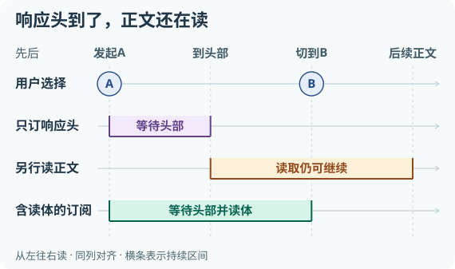

# 10｜把模拟源换成真实网络

## 合上书先做

任务 A 的历史响应到了一半，你切到 B。屏幕上只有 B。还能有哪些工作在继续？给浏览器和服务端各选一个能区分这些情况的观测点。

再给控制台写三个验收场景。日志列表和角标先后打开、先后关闭，各应看见什么？修改筛选词与点击导出各应产生几个请求？刷新按钮连点三次，第一次返回后再点一次，服务端应看见几次刷新？

## 先给一次读取划定寿命

第 9 章已经能把日志攒成一批再画。现在把历史记录换成 HTTP。先在项目根目录执行 `node --experimental-strip-types labs/10.ts`。实验会启动临时本机 HTTP 服务。观察两次请求开始的时刻，再看服务端收到旧连接关闭时，订阅者收到了哪段正文。

`from(fetch(url))` 求值时先调用 fetch，即使面板一直没打开，请求也已开始。多个订阅拿到同一个 Promise。改成 `defer(() => from(fetch(url)))`，每次订阅才创建请求，退订能丢弃结果，但这个 Promise 没有释放网络的操作。若 A 的请求晚于 B 返回，`switchMap` 拆掉 A 的订阅，两种实现都可能只画出 B。要让拆订阅也能中止请求，可以让 `fromFetch` 管理 AbortController。

```ts
import { fromFetch } from 'rxjs/fetch';
import { switchMap } from 'rxjs';

const history = tasks.pipe(switchMap(task => fromFetch(
  '/history?' + new URLSearchParams({ task }),
  { selector: async response => {
    if (!response.ok) throw Error('读取历史失败 ' + response.status);
    return await response.json();
  } }
)));
```

拆成两段想：第一段等响应头，第二段读响应体。不带 selector 的重载接受 URL 或 Request 和可选 RequestInit，发出 Response 就完成。此时在下游调用 `response.json()`，原订阅已经完成，不能靠它取消读体。带 selector 的重载等待返回的 Promise 或流，读体还属于这次订阅。HTTP 404 也能正常交付响应头，所以在解析前判断 `ok`。实验刻意让旧请求发头和部分正文后一直保持打开，等 selector 已进入再切换；结果只有 `/new`，旧响应触发服务端 `close`。这比在屏幕上找旧行多测了一件事。要判断保存操作是否已提交，还要查服务端记录；关闭响应连接不会撤销已完成的写入。

**读图 · 响应头到了，正文还在读**

[](../figures/book-10.svg)

沿切到 B 的竖线比较。若读体在 fromFetch 的 selector 内，此时退订仍能中止 A；若拿到 Response 后单独读体，原来的订阅早在头部抵达时就完成了。

### 两个面板拿到同一个 Response，谁能读第二遍？

给历史面板加一个“本页共几行”的摘要。列表和摘要都等同一个 HTTP 结果，开发者把已经创建的 fetch Promise 存在模块里，各自订阅，各自调用 response.json()。打开网络面板，确实只有一条成功请求。可是列表有四行，摘要却报读体失败。把两个面板的挂载顺序对调，坏的又成了列表。先别改服务器，想想那一条成功请求究竟交付了什么。

Response 带着状态码、响应头和一条供读取的正文流。拿到它相当于拿到这次传输的读取权。读体方法会消费正文；把同一个 Response 放进两个变量，只会多一个指向它的引用。这里要分享的是解析好的四行数据。两段代码分别对同一个可读流申请从头到尾读一次，先开始的读者占用了它，后来的读者会遇到 TypeError。这个错误发生在客户端，重查 HTTP 状态依然是 200。

用四个时刻复盘。时刻 0 创建 Promise，请求出发。时刻 1 响应头抵达，Promise 兑现，两个回调依次取得同一个对象。时刻 2 列表开始读，哪怕正文只到半截，这一次读取也已经占用了流。时刻 3 摘要开始读，无法再取得一份独立正文。失败甚至可以早于列表显示第一行。把摘要挂载推迟到列表渲染完毕，只改变出错的时间。可以在各自读取的入口看 response.bodyUsed，再把响应对象的引用作一次相等比较；这比猜测 JSON 的语法哪里不合法更快。

把边界向后移一步。在 fromFetch 的 selector 里检查状态、读取 JSON、验证行结构，把解析后的行数组作为一次 next 交给下游，再把这一层得到的流共享给列表和摘要。此时列表取行内容，摘要取 length，后来的读者无需再读正文。两个面板都应把数组当作只读数据；若摘要还要选出时间最新的记录，直接在共享数组上 sort 会让列表的顺序跟着变。可以遍历求最大值，或先复制再排序。共享一个解析结果省下的开销，伴随的是共同持有同一份对象的责任。

本章实验在回环服务上让两个读者按已知顺序读取同一个文本 Response。第一个得到路径字符串，第二个遭遇 TypeError，服务端只登记一次路径。对照组先在 selector 里读成字符串，再让两个订阅分别取得它，仍只登记一次路径，两个读者都能验出完整文本。实验用文本去掉了 JSON 格式和数组排序两个变量；把文本换成 JSON，仍然是读取正文这一步只能做一次。在浏览器中确实需要两份独立字节流时，可在开始读之前 clone()；一个读者远落后于另一个时，复制出来的分支可能积存数据。只求行数的组件没有这项需要。

### 再次打开历史，为什么网络面板没有新请求？

假设摘要关闭后过了十分钟，服务端已经为任务 A 新增两行。重新打开列表，马上看见旧的四行，网络面板却一片空白。很多人会先去关掉浏览器缓存。先在订阅时创建请求的工厂入口放一个计数器。若重新打开连工厂都没进，原因就可以定位在 HTTP 缓存之前。这里要分别问两件事：上一次读取是否已经完成？这次打开拿到的是否仍是上一次的共享流实例？

沿着这段顺序算一次：列表订阅，历史读完，流发出数组并正常完成，列表结束；稍后摘要订阅同一条带一项回放的流。RxJS 7.8.2 的 shareReplay 会保留正常完成时的缓冲，摘要立即收到那一项，随后收到 complete。配置 refCount 为 true 对仍在执行的源有用：最后一个读者提前离开，可拆掉上游订阅。但“最后一个离开时尚未读完”和“已经完成后又来了一个人”走的是两条不同路径。把前者在 /live 上的经验照搬到一次性 HTTP，就会错误预测第二次打开会联系服务器。

对照几种产品动作就能决定缓存该放在哪里。一次打开同时有列表和摘要，可以在这次打开的作用域里保存同一个共享实例；关闭面板组后丢掉它，下次打开重新构造一次。若业务把“刷新”作为过期信号，可以让常驻的刷新流在每次点击时创建一次新读取，把最新结果共享给当前面板。若需求是离开又回来仍看上次结果，保留成功回放就合适，但应同时显示采样时间。选择取决于承诺给读者的这四行是哪一次读取的结果。

还有一处容易把实验做反。对只发一次值的源，firstValueFrom 在取得 next 时就退订。若它恰好是唯一订阅者，引用数可能在共享层收到 complete 之前降到零，下一人订阅便可能启动新请求。要验证“正常完成后回放”，让第一个订阅确实等到 complete，例如对这个有限源用 lastValueFrom。两段实验都能成功取得第一份文本，判断正常完成这一条件却会得到不同答案。调试时应把 next、complete 和主动退订分开记。

## 想画进度条时，读取的单位变了

本节的历史 JSON、超时和 404 用成品服务：运行 `npm start`，从它打印的地址打开控制台。章末另有一个 `--browser` 实验服务，专门观察 /refresh 和 /export；不要在那台服务上验证成品的历史路由。

浏览器的 XMLHttpRequest 能告诉我们已经传了多少字节。以下片段可以放在浏览器项目模块中，先预测只返回四行 JSON 的接口是否一定能画出十个进度格。

```ts
import { ajax, AjaxError, AjaxTimeoutError, type AjaxConfig } from 'rxjs/ajax';

const options: AjaxConfig = {
  url: '/history', queryParams: { task: 'A' },
  responseType: 'json', includeDownloadProgress: true, timeout: 2000
};
ajax<unknown[]>(options).subscribe({
  next(event) {
    if (event.type === 'download_load') console.log('历史行数', event.response.length);
    else console.log(event.type, event.loaded, event.total);
  },
  error(error) {
    if (error instanceof AjaxTimeoutError) console.log('超过等待时间');
    else if (error instanceof AjaxError) console.log(error.request.url, error.status, error.response);
  }
});
```

成功时用最终的 `download_load` 读取正文。`AjaxDirection` 取 `upload` 或 `download`，和 `loadstart/progress/load` 组合成事件类型。上传时加 `includeUploadProgress`，同一订阅便能区分上传结束与服务端应答结束。中间 progress 的次数由浏览器决定。若 `originalEvent.lengthComputable` 为假，显示已传字节，别用 total 当分母。把 A 的 timeout 改成 1 毫秒，用项目延迟返回的 A 历史路由验证超时分支；再换成不存在的路径并放宽超时，检查状态 404。

`AjaxConfig` 只要求 url。queryParams 接受字符串、URLSearchParams、键值对象或键值对列表。method、body、headers 决定发送内容；async 默认为 true，timeout 单位毫秒，responseType 默认 json。user/password 供 XHR open 的认证参数使用，withCredentials 控制跨源凭据。xsrfCookieName 与 xsrfHeaderName 配对把指定 cookie 值转成请求头，应限定可信目标。旧 crossDomain 标志影响库加头的行为，跨域访问本身由浏览器和服务端的 CORS 配置决定；迁移时显式核对请求头。createXHR 可注入测试用 XHR。旧 progressSubscriber 的单独监听迁为上述两个进度开关，再按事件 type 分流。

订阅时库会填入默认值。响应里的 `request: AjaxRequest` 包含规范化的 url、method、headers、async、timeout、responseType、crossDomain、withCredentials，以及可选 body、user 和 password。因此 `{url:'/history'}` 可作配置，不能冒充已发请求。`AjaxResponse<T>` 由原始 ProgressEvent、xhr、request 和可选事件类型构造，除了 status、response、loaded/total，还能查 responseHeaders。旧 responseType 快捷成员可改读 xhr.responseType。T 只是调用者声明的正文类型，接不可信数据应先按 unknown 校验。`AjaxError` 保留 xhr、request、status、responseType、response，超时子类 `AjaxTimeoutError` 也满足这个接口，所以先判子类。两个错误构造器供 instanceof 识别使用，新代码应通过请求失败触发错误。

只需正文可写 `ajax.getJSON<Row[]>(url)`；`ajax(url)` 和 `ajax.get(url, headers)` 返回带状态的包装。`post/put/patch(url, body, headers)` 发送请求体，`delete(url, headers)` 无 body 参数。若把 getJSON 的结果当包装读 status，会在类型检查阶段发现错误。

### 传满一百字节时，刷新按钮能解锁吗？

假设这次刷新要先上传一百字节筛选配置，再由服务端计算匹配行。时刻 4，浏览器报告 upload_load，loaded 和 total 都是 100；时刻 9，服务端才算完并发回结果。若把“任意一条进度的 loaded 等于 total”写成解锁条件，时刻 5 的第二次点击便可能与第一次计算重叠。在总长未知时，两项都为零还可能过早满足这个条件。百分比可用来画某个方向的传输量，无法据此给整次操作划终点。

让视图分别保留传输阶段和动作是否在途。上传结束后把提示改为“等待结果”，继续保持请求占用；收到最终应答并通过业务检查后再标为成功。若超时，用失败状态结束本次等待。两种退出都要释放按钮，本次成功的提示只属于前一种。让 exhaustMap 的内部流覆盖整个应答过程，哪怕一次点击来自键盘而非按钮，也会服从同一个边界。若为了尽快显示反馈，在内部流加了 take(1)，一旦开启中间进度，第一条事件就可能结束订阅并中止余下传输。此时应移除这个截断，或在只需要最终结果的分支先筛出最终应答再取一次。用只有一个最终事件的小文件做测试会掩盖这个故障，在手算时补上一条上传进度即可把两种实现区分开。

## 请求的进度和结果能放进同一条流吗？

给上传面板约定三种消息：已发出请求、已传送一部分字节、服务器已受理并返回编号。传输进度到了 100%，服务器接着返回“文件格式不符”。请沿这条线找出能点亮「上传成功」的消息。到最后一字节时，本机已经把要送的数据送了出去；能判断业务成功的那个编号还没有出现。用一个 0 到 100 的数字同时代表这两件事，渲染函数迟早要靠猜。

一个做法是把管道里每个值的含义写进类型。比如进度消息带字节数，受理消息带文件编号。下面是这个接口的草图，`total` 允许来源暂时不知道文件总长。

```ts
type UploadEvent =
  | { kind: 'progress'; sent: number; total?: number }
  | { kind: 'accepted'; fileId: string }
```

同一条订阅能按序读到多次 progress，再读到 accepted。只关心进度条的视图取前一种；只负责把新文件加入列表的消费者取后一种。把输入换成「传了 50 字节，总长未知，随后受理」，第二个消费者仍可正确工作，第一个可以显示已传字节。若来源只给“响应体读完”的完成通知，适配器还得检查服务端响应才有依据交出 accepted。把 `finalize` 接在末尾直接宣布成功，会让用户在传到一半关闭面板时也看到成功提示。

试着给这个接口加一项需求：大文件校验需要一分钟，上传结束后界面要显示“校验中”。应该加一个能由真实来源证实的阶段，例如服务端返回校验任务号，再用它追踪结果。若来源只会返回最终回执，客户端仍可显示“等待确认”，却无法知道服务器此刻是不是已经开始校验。设计流里允许出现哪些值，也就是在规定界面有资格向用户声称哪些事实。

## 一条连接怎样喂两个消费者

打开项目控制台的日志列表与错误计数，观察 /live 的 WebSocket 连接，然后依次关闭两个消费者。项目按任务在 URL 上选频道。`webSocket<Row>(url)` 或 `webSocket<Row>({url, ...})` 创建 `WebSocketSubject<Row>`，第一次订阅开始连接；同一实例的订阅者共用连接，最后一个离开时关闭。重新调用工厂产生另一个实例。`next` 发送消息，默认 JSON 编码，接收时默认 JSON 解码。`complete()` 请求正常关闭，主动 `error({code: 4000, reason: '...'})` 要用合法关闭码。面板应退订自己的 Subscription，直接调用 socket.unsubscribe() 会处置共享对象。

`WebSocketSubjectConfig` 可用 protocol 协商子协议，binaryType 选 blob 或 arraybuffer；换二进制时同时提供 serializer 和 deserializer。旧 resultSelector 改为 deserializer。openObserver 与 closeObserver 观察真实的打开与关闭事件，closingObserver 可观察主动发起关闭的路径。WebSocketCtor 可替换宿主实现。类构造器还接受 Observable 与 destination，这是包装已有源与写端的路径；组合读取逻辑用 pipe，旧 lift 属于内部实现。

若服务器提供一条连接上的多频道协议，可这样分配订阅。以下命令须由服务端实现；项目的 /live 采用 URL 选频道。

```ts
const channel = socket.multiplex(
  () => ({ join: 'A' }), () => ({ leave: 'A' }), msg => msg.task === 'A'
).pipe(shareReplay({ bufferSize: 1, refCount: true }));
```

multiplex 为每个订阅发送 join，退订发送 leave，谓词过滤入站消息。共享放在它后面，两块面板才只发一对协议命令。题目要求角标只看今后的消息时用 `share()`，晚开面板须立即显示当前快照时用上面的单条回放；对于增量日志，一条回放只能恢复最后一行，要回放完整视图须先累积成快照。实验用回环 WebSocket 服务端记录真实连接，A 由 `takeUntil(leave)` 退出，B 仍在时关闭数为 0，B 退出变 1。晚来的 B 分别看到空数组和 [1]。浏览器中再核对服务端活跃连接数由 1 降到 0。

### 历史与直播在同一张表里相遇

现在把历史列表和实时频道放进同一个面板。打开任务 A 时，一边取最近的历史，一边收新日志。故障报告很奇怪：刚进来明明看见一条红色错误，过了一会儿整行消失，可错误角标还亮着。两条请求都成功，也没切任务。判断这个故障要看两把不同的钟，一把记录服务器把哪些行收入快照，一把记录浏览器按什么顺序看见消息。快照指服务端在某个确定位置取下的那份数据。

设历史快照截到 A 的第 40 行。时间 0 浏览器订阅直播并申请历史；时间 1 服务端固定了快照；时间 2 实时第 41 行先到，列表从空变为 [41]，角标加一；时间 3 历史正文才读完。若响应回调做的是“整个列表赋值为历史行”，此时屏幕退回到第 40 行。角标来自独立消费者，仍记着 41。从 HTTP 看，每个字节都按计划到达；从用户看，控制台擦掉了一件已经发生的事。仅仅把历史请求换成可以取消的请求，对这段同一任务里的先后顺序毫无影响。

一个直观修复是等历史加载完成再连直播。把快照时刻保留在 1，设 41 是在时刻 2 广播，频道只推加入后的新消息。时刻 3 才订阅的人永远收不到它。现在列表会很平稳地保持在 40，连“一闪而过”这条故障线索也消失了。这个变式区分了防覆盖与防漏收，前者是客户端合并问题，后者还需要知道服务器能否补发错过的区间。打开了 WebSocket 并不等于服务器已经确认加入了某个频道。

先只解决覆盖。给两个入口加标签，历史到达是“一批已知行”，直播到达是“这一条已知行”。由同一处累积这两种输入，按稳定标识认出同一条日志。假设本题的日志只追加，每条都带任务内递增且唯一的序号，同一身份的内容不可变。给 A 保留一张序号到行的表，来了 41 就登记 41，来了历史就逐行补登记，显示时按序号排序。这使两个到达顺序得到同一个最终列表。需要给角标计算错误数时，从这张去重后的表派生计数，或只在第一次插入身份时增加，历史与直播便不再各算各的。

改变一个数检验修复。若直播先收到 40、41，历史稍后也带 39、40，普通数组拼接会显示两份 40，照到达顺序展示还会把 39 放在 41 后面。按身份合并的过程是先登记 40 和 41，再补 39，再见到同一条 40 时保持原记录，最后渲染为 [39,40,41]。这份结果的行数是 3，传入的行却有 4 条。仅断言行数可能漏掉“删错了一行，同时多加一行”的实现，比较排好序的身份更有分辨力。如果 B 也从 1 开始编号，切任务时应更换整张表，或使用任务与序号组成的键。跨任务共用裸序号会悄悄吃掉正确数据。

再解决漏收。假设服务端愿意在历史里返回一个位置，并支持“从这个位置之后继续订阅”。这个位置叫游标，可以是对客户端不透明的字符串。先读历史得到位置 P，再订阅 P 之后的变化；传输途中即使有新行，服务端仍能从保留的记录里补发。另一个可行约定是先等服务端确认直播已就绪，在本地暂存直播消息，再读取一份覆盖到明确位置的快照，合并暂存行后进入正常显示。第二条路需保证确认之后不漏事件，快照覆盖确认之前的历史范围。服务端若只保留最近十行，长时间断开后的位置可能已过期，此时应承认存在缺口，重新读取可得区间并告诉用户范围。

这些是接口约定的推演。项目的 URL 选频道足以观察连接的创建和释放；不要看到一次演示正好无缺口，就推断它为任意断线时长提供了游标续传。检验协作约定时，给服务端一个可辨认的行号，刻意让它落在取快照之后、客户端真正开始收直播之前。旧接口若既不回放，也没有再次按位置读取的能力，客户端就没有能从中恢复那一行的信息。把等待时间改短只能缩小这个区间。

### 迁移到只显示最近三行的浮窗

浮窗带宽有限，只显示任务最新三行。一位同事把上一段的登记表改成“每来一行就塞到末尾，超过三条就丢队首”。用一次直播 [44,45] 和一份晚到的历史 [41,42,43] 试一下。浮窗该显示哪三行？如果只把最后的三个元素留下，又会看到哪三行？这次两边没有重复，去重不能替你作决定。

按任务序号选，答案应是 [43,44,45]；按抵达顺序截断，后来的三条历史会挤掉两条真正较新的直播。可以把同任务的当前候选与输入按身份合并，取序号最大的三条，再按阅读顺序从小到大画。因为本题只追加，被淘汰的行以后也进不了最大的三个，保留这三个候选就够了。这条推理依赖“最新”的定义。若需求改为“刚到达的三次通知”，历史算一次批通知还是三次行通知得先和使用方约定；若允许撤回 45，先前排名第四的行可能回到视图，可见三条便不足以回答下一次更新。

## 哪个操作有权发请求

先用筛选框改词，不点导出。行集和筛选状态都应驱动列表，可将 `combineLatest([rows, term])` 的输出映射成可见行。导出只有点击时才取快照，故用 `clicks.pipe(withLatestFrom(view))`。筛选状态要有初值，否则第一次导出可能等不到可取的值。成品将快照导出成本地文件；本章实验把导出送到 HTTP 服务，用请求数验证这套触发规则。改词只多一次视图计算，点一次才有一个 /export 请求。

在项目根目录运行 `node --experimental-strip-types labs/10.ts --browser`，打开终端打印的本机地址。打开开发者工具的网络面板，等初始页面加载完，清空请求记录。在筛选框输入 error，列表应立刻只剩 error B，网络请求数仍为 0。点击导出一次，页面记录 /export/error，网络面板新增一个同名请求。这里的导出接口回显筛选条件，便于看清请求由谁触发。

再按三次「刷新」，在第一次 download_load 前完成三次点击。服务端分两段发正文，中途等一秒；网络面板应只新增一个 /refresh，页面可能出现多条进度消息，但只出现一次 download_load。等它到达后再点，才会看见第二个请求。按钮绑定的核心是：

```ts
fromEvent(button, 'click').pipe(
  exhaustMap(() => ajax({ url: '/refresh', responseType: 'text', includeDownloadProgress: true }))
).subscribe(event => console.log(event.type, event.loaded));
```

在终端按 Ctrl+C 结束交互实验。默认命令使用同样的事件来源接口 EventTarget 和可控制的响应闸门，自动断言请求数量。

### 任务选择已到 B，导出的行却来自 A

再把导出改得接近实际工作一点：导出按钮需要写出“当前任务、筛选词、实际可见的行”。选择框会立刻切换标签，历史正文要等网络传回来。为了让界面更平滑，设计师希望切换期间仍看得见旧表。这时 withLatestFrom 确实能在点击那一刻取到每条支线的最新值，却不能保证它们属于同一次读取。把三项最新值直接拼成一个文件，会出现文件名叫 B、里面却是 A 的情况。这个问题与网络速度有关，即使所有响应都严格按请求顺序到达也能重现。

把点击夹在两次更新中间。时刻 0，任务 A，筛选 error，表格有 A 的第 8 行。时刻 1，选择 B，标签立刻更新，B 的历史开始下载，表格还停在 A。时刻 2，点击导出，取到的最新三个值是 B、error、[A8]。时刻 3，B 的历史返回并画出 B2。把断点设在时刻 3 以后一切看起来都正常，出错的文件只在时刻 2 能取得。用本机可控的“正文到达”信号代替网络等待，把点击放在信号前后各一次，就可以稳定观察哪个点击具备导出资格。

先确定产品的承诺。一种承诺是“导出眼前所见”，那就把表格所对应的任务和筛选条件一起保存在渲染用的视图对象里。时刻 2 可以导出，但文件应标 A，且旁边应标明眼前仍是 A 的上次结果。另一种承诺是“导出已选任务目前可见的行”，时刻 2 应禁止导出，时刻 3 以后才允许。两种承诺都能做对。只用请求是否忙碌来推测表格属于谁，遇到后台预取或独立的详情请求时就很难解释。把来源标签和正文放在同一次 next 中交付，导出与渲染才有共同的事实依据。

对第二种承诺，可以让任务切换立即发出带 B 的加载中状态，旧表作为单独的展示信息留下。B 的正文解析完成后，一次发布带 B、筛选条件和可见行的就绪状态。按钮取样这个状态后检查它是否就绪，只在就绪时建立请求。注意检查的位置：若先把状态流里所有的加载中都过滤掉，再交给 withLatestFrom，后者会一直记得上一个就绪的 A。先取样再检查，时刻 2 看见的是加载中，才有机会挡住点击。把两个操作对调，输出类型可能一样，业务含义已经改了。禁用按钮给人明确反馈，命令入口检查状态则让快捷键与鼠标遵守同一规则。

一个更隐蔽的变体是 A→B→A。有人给晚到的结果加判断：“如果返回的 task 等于当前 task 就接受。”假设第一次 A 的读取一直没有完成，第二次 A 已经返回更新过的表，随后第一次 A 才完成，两次 task 都是 A。若允许并发写进同一处状态，单比较任务名会接受旧 A。可以让一次选择拥有一次独立的读取订阅，用 switchMap 把退订旧订阅和发布新结果绑定起来；若有回调绕过这条订阅直接改公共表，则需随请求带上代次标识，在写入前核对。这样即使重选了同名任务，也能区分两份同名结果的来源。

在 labs/10.ts 里找到 checkExportDuringSwitch。先看 B 的 ready 变成 false 后紧接着的那个 click，再顺着两条订阅分别找它们最后一次收到的状态：先筛就绪值的支线仍留着 A，完整状态支线已经记下 B 正在加载。这里直接记录获准导出的任务名，不发文件请求。这样即使 /export 一直正常应答，也能单独验证错文件名是在哪一步产生的。

### 导出的瞬间能保存多久

设导出使用串行队列，上一份文件还在生成。用户在 error 过滤下点一次，随后清空筛选。等轮到这份导出时再去读输入框，虽然只发出一次请求，请求内容已经改变。修复要把两步分开：接受点击时取得不可变的导出参数，排队后才用那份参数发请求。如果参数里保存的是随时会被 push 的 rows 数组引用，给它起名叫 snapshot 也不能冻结旧内容。对于只需行号的接口，在点击时投影为新的行号数组即可；若文件还要包含可能被编辑的备注，要一并复制这次导出真正依赖的字段。

用数字算一次可以看出三种验收的区别。点击时错误行是 [8,12]，等待期间追加了错误行 15，再后来第 8 行加了一段备注。按点击快照导出应含 8、12，且使用点击时的备注。按服务器执行时的最新条件重新查询，可能含 8、12、15，备注也是新的。只传筛选字符串能表达后一种意图，却不足以复现前一种。如果历史本身可变，传行号仍只能指明哪几条；要精确复现旧备注，可传当时的文本，或由服务端支持按数据版本读取。这里应该问使用导出文件的人：“你希望用它复盘刚才看到的故障，还是得到生成那刻的最新结果？”这会改变请求体。

最后把这个区别带回网络面板。网络面板的一行记录可以确认请求方法、目标和发起时刻，展开请求体还可以核对发送的行号。文件内容错了却只有一次请求时，增加节流不会修正任何数据。沿着“表格就绪 → 点击取样 → 排队 → 发出请求”查第一处行号发生变化的位置，就能判断应该修复渲染数据的归属、快照的制作，还是服务器按参数读取历史的方式。

如果把 exhaustMap 改成 switchMap，旧结果也不会覆盖屏幕，但网络面板会多出已启动又被取消的请求。下一章要处理另一条边界：这次读取失败之后，按钮能不能再用。

## 网络工作坊｜让接收者证明自己手里有什么

以下两个工作坊各有独立输入。做电子杂志时准备一张纸，左边写已经持有的字节，右边写新到的字节；做棋局时换一张纸，左边写棋谱，右边写发给房间的命令。两题都可以停在题面，隔天直接从自己的纸稿接着做。

<a id="transfer-a"></a>
### 发散题 A｜列车进隧道以后，还能读哪一期杂志？

出版社在列车出发前提供一期离线杂志《海岸》。把真实刊物缩成八个字节，每个数字代表一个字节。第一版依次为 10、11、12、13、14、15、16、17，版标是 "sea-1"。阅读器有两处空间：读者能打开的书架，以及只供下载器使用的临时格。只有收齐同版全部字节才能上架。题目约定本次传输直接使用原始字节，不涉及压缩、解密或跨站访问。磁盘可以把一次已验证的替换整体生效；下面凡说“落盘”都是指这一步已经成功。

时刻 0 开始取刊，时刻 1 得到版本与总长，时刻 2 网络层报告已收到五个字节，此时临时格只落盘了前三个。时刻 3 进入隧道，未落盘的内容丢失。时刻 6 恢复信号，列车员只允许阅读器再建立一次传输。出版社可能仍供应原版，也可能已把同一地址换成六字节更正版 20、21、22、23、24、25、版标 "sea-2"。出版社能按读者给出的已有版本和所需区间作答；版本相符可交付一段，不符则交付整份现版。上架之后列车立即再次断网。

请交付一张取刊凭条，写明时刻 6 阅读器要告诉出版社什么；再交付两张架上书的验收单，给出两种情况下最终的版标、长度、首尾字节。发行员还有一份可疑的回信：自称原版第 4 到第 7 号位置，附上的内容却是 13、14、15、16、17。位置从零计数，两端均包含在内。请说明这封回信到手时书架和临时格各发生什么。最后给屏幕上的“可以离线阅读”选一个出现时刻，并向列车员解释为什么那个时刻之前不能拔掉网络和电源就交书。

<details>
<summary>展开取刊凭条、两种回信及实作推导</summary>

#### 从断电以后仍在的东西算起

把前三个字节写在纸上，每个下面标位置，依次是 0、1、2。下一笔应该写在 3。网络层那次进度把位置 3、4 上的字节也算进去了，磁盘却找不到它们。如果拿 5 作为恢复起点，收到 15、16、17 后，手里的序列只有 10、11、12、15、16、17，中间的空洞无法靠给文件末尾补两个零修复。进度条回答了连接上搬过多少东西，恢复凭条需要能交给下一次读取的连续前缀长度。两者即使来自同一次传输，也可能差几个字节。

凭条可以读成一句话：“我有《海岸》版标 "sea-1" 从位置 0 起连续三个字节，请给我从位置 3 起的余下内容；若它们已不属于当前版，请交付可独立阅读的整版。”HTTP 的一种表达是给同一地址发送 Range: bytes=3- 和 If-Range: "sea-1"。后者携带服务端给出的强 ETag，也就是能用来判别这份表示是否相同的版本标识。引号属于这个标识。在这个约定里字节位置从零起算；“已经有三个字节”对应下一位置 3，“最后已有的位置是 3”却对应下一位置 4。把这两个口语句子写在凭条旁边，可以避免一类很难从文件名看出来的差一错误。

旧版仍在时，服务端回 206，Content-Range 为 bytes 3-7/8。斜线前两个数指这份回信覆盖的位置，斜线后是整个表示的长度。含两端的区间长度要算 7−3＋1，得到 5；前缀 3 加上 5 正好等于 8。附上的五个字节占据 3、4、5、6、7，没有覆盖已有位置，也没有跳过任何位置。这时把两段顺次拼成 10 到 17，再核对版本与长度，完成整份落盘并把书架入口指向它。第一张验收单填 "sea-1"、8、10、17。若还想证明中间没有抄错，逐字节比较这份只有八字节的试刊即可。真实大文件需要出版社提供独立的完整性信息才能做类似的内容核验。

换版时回的是正常的 200 全文。把八格纸翻面，按新的总长画六格，从 0 写入 20 到 25。第二张验收单填 "sea-2"、6、20、25。有人认为“既然请求里带了 Range，就把回来的内容一律追加”，这样得到九个字节，前三个来自旧版，后六个来自新版。即便排版器碰巧能打开文件，混版也没有发行依据。还须考虑服务端不支持区间而直接返回原版全文的情形；同为 200，处理仍从零开始。能否追加取决于回信对所交付内容的说明，请求上写了什么只能证明你曾经要过什么。

可疑回信则在三处露出矛盾。已有长度是 3，回信却从 4 开始；所称区间只有四个位置，正文却有五个字节；若简单写在已有内容后面，碰巧能凑齐八个字节，却无法解释服务端声明的位置。拒收后，临时格仍是 10、11、12，书架仍无此期。把这个分支加进实验比只喂一个长度明显不对的文件更有价值。错误实现若只看“3＋5＝8”，就会把这封错信也判成可阅读。此时允许再取一次要由列车员决定，本题的一次机会已经用完；不要在错误分支悄悄重开连接改变预算。

把凭条翻译成程序时，先给“能带上下一班车的数据”一个类型。这里 bytes 只放从零起连续的前缀，total 是这份表示的整期长度：

```ts
type Part = { edition: string; total: number; bytes: number[] };
const saved: Part = { edition: '"sea-1"', total: 8, bytes: [10, 11, 12] };
```

从这个类型里找不到网络层的 loaded，正好可以发现错误依赖：假如接收函数必须额外找上次进度事件才能恢复，把卡拔到另一台设备就跑不起来。实验在 receive 的订阅内读出 body 数组，走 206 分支时由本地前缀推导期待收到的头，而非把头上写的起点当作自己的现状：

```ts
assert.equal(reply.status, 206);
assert.equal(edition, base.edition);
const start = base.bytes.length;
const end = start + body.length - 1;
assert.ok(body.length > 0 && end < base.total);
assert.equal(reply.headers.get('content-range'), `bytes ${start}-${end}/${base.total}`);
return { edition, total: base.total, bytes: [...base.bytes, ...body] };
```

给五字节回信时，模板串中的三个数依次是 3、7、8。如果把比较整行删掉，起点写错的回信也会执行最后一行，此时 `assert.rejects(firstValueFrom(receive(saved, suffix(4))))` 将因“本应拒绝却成功了”而失败。观察运行方向很重要：这里的 rejects 是把一次预期内的拒收变成通过的断言；若它自己报错，就应回头找哪个门槛被绕开。内容格式是实验服务的规范格式；实际接多方实现时可以先解析字段、逐项比较数值，再对缺失或未知总长另定规则。

对全文的构造只使用这封回信自己的信息。核心返回式是：

```ts
return { edition, total: body.length, bytes: body };
```

它在 200 且全文长度已核对的分支执行。若仿照 206 写成 `bytes: [...base.bytes, ...body]`，版标与 total 仍是新的，数组却变成九项，断言中对完整 replacement 的比较会失败。只看“接收函数完成了几次”则捕不到这个错误。对一封回信只订阅一次也有原因：这里是把一份已经取得的 Response 作为输入；defer 延后了读取动作，不能让同一份已消费的正文重新变成可读。若要教会它重新发请求，工厂的输入应换成能取得新 Response 的传输动作。

#### 把一次接收分成可以撤销和已经生效的两段

先写一个只做判定的小步骤。输入是已落盘的版标、连续长度、预期总长，以及本次响应。完整传输需要检查成功的全文状态；分段传输需要检查版标、区间起点、区间终点、总长和实际读出的字节数。这里服务端约定每次都提供版标，全文提供长度，区间给出确定的总长；更通用的下载器必须另外约定头字段缺失时怎样确认完整性。若服务器返回 404 错误页，它也可能有字节、有长度，甚至可以完整读完。不能把“读完一段正文”作为“获得一期刊物”的充分条件。

在输入快照上做运算，得到新的候选内容，再发布候选。切勿一边读一边覆盖唯一一份已验证的前缀，然后才核对版标。设已经把更正版前四字节写到了旧临时格，最后两个没来，进隧道后你既拼不回第一版，也没有完整第二版。让临时格按版标区分、让书架入口只指向已经生效的版本，是为了让读者在任意一次中断后都能解释眼前的状态。落盘与更新入口在真实文件系统中是两步时，需要选择该系统确实支持的提交方式；本题把一次替换原子生效作为存储提供的条件。

把判断插回 RxJS 管线时，读完整段 body 的过程也属于这次下载。可在订阅时建立 fromFetch，在 selector 内核对回信类型，再读 arrayBuffer，构造候选。先在下游得到 Response，然后另外开启脱离订阅的读体与落盘，会把下载的所有权切成几段。点“取消”后界面可能消失，背后的落盘回调仍握着书架入口。即使请求已经被取消，已排入本地存储的写操作也由存储层决定能否撤回；所以在更新入口前仍要核对当前下载是否有发布权。一次读取的清理不能代替一次本地替换的条件检查。

这里的小刊物足以装进内存，读完整段后再交候选最容易验证。若一期有两百兆，同样的代码会让设备同时持有旧前缀、新响应和拼接后的副本。可以改成按块把字节放入临时文件，每完成一次可恢复的写入，才把已确认的位置向前移。不要把一半写入的块登记成整个已完成块。若断电时文件比记录的连续前缀长，重新启动应以两者能共同证实的位置为界，对多出的尾部重新核验或舍弃；若记录宣称有五字节而文件只有三个，直接从五续取一定留下缺口。把发布整期与登记可恢复的小块分开，读者就能在节省内存的同时保持同一条正确性要求。

#### 用两种进度给一句文案找依据

在时刻 2，若总长可靠且单位相同，可以显示“线路已收 5/8，设备已留存 3/8”。前者约 62.5%，后者 37.5%。进隧道后线路进度保留为这次尝试的历史，下一次请求的 loaded 要从该请求自己的起点重新算。例如补段已传 2/5 时，若两个新字节均已可靠写入，整期持有量是 (3＋2)/8；若还在读取内存缓冲，则仍是 3/8。把上次的 5 和这次的 2 相加，会把位置 3、4 各算两遍。在只看百分比的界面上，两种错误都可能表现得很顺滑。

若回到的是六字节新版，整期分母和基准一起换掉。屏幕可以明确写“已换更正版，正在接收 2/6”；强迫新版的进度接着旧版的 62.5% 单调增加会撒谎。用户真正需要单调的通常是同一版本内已经安全保存的连续数量。切换到另一版时应说明版本变化。即便到了 6/6，只有验证、持久化和书架入口提交都成功，才出现“可以离线阅读”。倘若网络层已经结束而存储空间不足，用户仍能看到明确的失败位置，并且不会在下次没网时才发现书架上的封面点不开。

</details>

<details>
<summary>取刊工作坊续作｜把单次恢复扩展到多次中断</summary>

#### 把一本残刊交给另一台阅读器

两台阅读器共享一张存储卡。第一台只在内存里留着“正在下载的地址”，拔卡前已经写了三个字节；第二台只读到文件名《海岸》和文件长度 3，它能否填出刚才的取刊凭条？地址可能指向最新一期，文件名也可能是用户起的。仅凭长度无法判断这三字节属于哪一版，第二台就没有足够依据要求拼接。可为临时文件保存一份很小的说明，含刊物的取件地址、表示的强版本标识、预期总长、已经确认的连续长度，以及识别这份临时文件的本地标识。能从磁盘重新计算的量应与说明互相核对。缺失关键证据时，可以重新取全文；不能把猜测写回说明，让下一台把猜测当成事实。

试着把未完成的卡与已经上架的卡交换。假如一本旧版完整刊物正在供乘客阅读，后台取新版失败，合格的结果是旧书仍能翻到最后一页，后台临时格记录了新版已确认的进度。若在新版时刻 1 收到响应头就把旧书删掉，服务短暂不可用会变成用户失去本可阅读的刊物。可以让书架入口保持指向旧文件，待新版整个就绪才切换。已有读者若需要在本次阅读期间始终看到同一版，还要让它在打开书时固定所读版本，并保留旧文件直到这批读者离开。磁盘峰值可能同时包含两版，设备余量不足时应在下载策略里明确选择延期更新或请用户释放空间。

#### 区间回信也可能只够再前进一步

设出版社为节省车站的短连接时间，每次最多给三个字节。已有 0 到 2，第一次恢复给出 206、bytes 3-5/8、内容 13、14、15。起点接得上，终点没超过总长，数量也合得上。这是一段有效进展，却还没有满足上架条件。新的连续长度是 6，下一次应该请求从 6 开始；书架验收仍是未就绪。若程序把每个成功完成的 HTTP 请求都映射成“本书下载完成”，乘客会在第七个字节第一次被读取时才遇到问题。可以把单段函数的输出设计成含总长和当前内容的候选，由上一层比较两者长度来决定暂存或发布。本章新实验的 receive 就只负责这个单段判断。

再设服务器在相同 ETag 下给出 bytes 3-5/9。即使前三个新字节碰巧与预期相同，先前固定的版本长度是 8，总长冲突说明这套表示约定不自洽。重复请求同样的段不保证能修好它。把这一次当成无法证明可追加的回信，保留已有证据；若有预算，可丢弃本次增量、重新取得一份可以证实完整的全文。另一种常见回信是 416，表示所要求位置无法满足。假如本地报告已有八字节，服务器也报总长八，首先核对版标、现有内容与提交记录：可能文件已经下完，只差书架入口未提交。仅凭两个长度相等就当作同一刊物，仍然会接受另一份恰好同长的旧版。

#### 为什么本题特意限定原始字节

读者在手机上看见一个汉字，以为恢复点可以写成“已经收了第几个字符”。把试刊内容改成 UTF-8 文本，其中一个汉字可能占三个字节，恰好在第二个字节处进隧道。若分段各自按完整字符串解码，前一段末尾和后一段开头都可能出现替代字符。把这两个字符串拼接也还原不出原文。先按字节合并，再以完整编码解码，才与区间协议的计量单位相同。若业务确实要边下边展示文字，要保留解码器跨块的状态，并把它和磁盘上可以续取的位置分别管理。字符计数、字节偏移、页码是三个不同的坐标。

同理，若线上采用内容编码，传输表示的区间与应用拿到的解码后字节位置可能不一致。把解码后文件的长度直接塞回请求头，无法得到题目中那份加法证明。一个简单的发行协议可以提供版本固定、表示固定的离线包，按这个包的字节定义区间。若出版社只能按章节提供独立资源，也可以退一步：清单标明每个章节的版本与长度，断线只重取未完整的章节。章内断掉会损失更多已传工作，但省去了在客户端恢复半个压缩流的难题。比较方案时要算清网络重新传输的量、设备保存中间态的代价，以及服务端愿意兑现的接口约定。

#### 在不等列车的情况下复核

运行 `node labs/transfer/10.ts A`。实验直接构造带状态码、头字段和二进制正文的 Response。固定的三字节前缀是一次中断后重新启动的起点。读第一条断言时，先遮住期望数组，沿着 receive 的区间检查逐位填八个位置。再看错误回信，函数在发布新值之前失败，因此调用方仍可对旧对象做一次精确比较。最后读 200 分支的断言，同时核对版标更新和整个数组相等。这三次订阅分别代表三封独立回信，不会重复消费同一份正文。

若要检验自己的变体，可以把正确回信缩成刚才的 3 到 5 并把正文同步缩短；预测新候选合法、长度为 6、原前缀保持原样。若只改区间字符串而保留五字节正文，则应走拒收。这个对照把“合法的短响应”与“自相矛盾的响应”区分开。另一个值得做的试验是让磁盘提交失败，观察是否仍未替换书架；这需要在调用单段函数的外层提供存储替身。现有实验核验接收判定，没有模拟电源、存储持久性或代理服务器；纸面上的书架要求要到相应的存储边界去验证。

</details>

<a id="transfer-b"></a>
### 发散题 B｜两位解说员怎样接手同一盘棋？

棋社给两位解说员配了一张电子棋盘。对局室 Q 从标准初始局面开始，裁判把双方轮流走的一步称为“一手”，从 1 连续编号。一份裁判电文只含房间、手数和起止格，不含整盘棋。各房间同一手数可以走不同的棋；在本轮赛事内，同房间同手数的裁判电文内容固定。裁判能重复播报已经宣布的一手。电子棋盘只能展示自己能从开局完整推得的局面，若证据不足，应保留最后可信局面并暂停继续推演。

时刻 0，甲打开 Q，裁判室需要收到入席通知。时刻 1，Q 宣布第 1 手 b1-c3。时刻 2，乙也打开 Q，希望当场接手讲解，可以立即问“现在 b1 上还有棋子吗”。时刻 3，甲离席，乙仍在。时刻 4，另一室 R 宣布第 2 手 d7-d5；稍后 Q 宣布第 2 手 e7-e5，并重复播报一次。时刻 5，Q 电文直接跳到第 4 手 g8-f6。时刻 6，乙也离席。裁判室只需按房间知道这张电子棋盘是否仍有人用，多发一次离席就可能使留在场内的人收不到后续电文。

请交付两份作品。一份是裁判室从这张设备收到的入席、离席记录，写出每条的时刻；另一份是乙的解说卡，画出接手、听到第 2 手、听到第 4 手三个时刻可信的棋子变化及能否继续解说。再设计一封足够让乙在缺手之后恢复解说的裁判回信，注明其必需内容，以及收到回信之前应该怎样回答观众“黑马现在是否已经在 f6”。无需知道王车易位等特殊走法，题目给出的起止格都可直接在纸上标记。

<details>
<summary>展开解说卡、房间命令与棋谱推导</summary>

#### 先替甲摆一次棋，再替乙摆一次

把棋盘的 b1 和 c3 画成两个格：开局 b1 是白马，c3 空。时刻 1，甲将白马从 b1 移到 c3，记“已推到第 1 手”。时刻 2 乙刚到，问题指的是眼下的局面。若解说席只分发以后才到的电文，乙还握着一张初始摆法，答案会错成“有”。如果给乙一份从开局到当前的完整棋谱，他可以重演得出 b1 空、c3 有白马；如果给一份含当前棋子位置和已走手数的棋盘，也能直接回答。两份资料效果相同，是因为这场赛事提供了固定开局和确定的走法。

只给乙最近一步有时看起来也行。恰好只有一手时，把最近一步作用到初始局面就是整盘答案。把乙到场改到时刻 4 之后，给他最近的 e7-e5，他可以知道黑兵从 e7 到 e5，却会把白马留在 b1。这个反例解释了共享应该放在哪里：若缓存的是一步变化，重放一项只能恢复这一步；若缓存的是应用完所有连续步之后的局面，重放一项就足以回答任意格的当前占用。试图用一个例子就决定回放长度时，一定先换一个加入时刻。

时刻 4，R 的 d7-d5 对 Q 的棋盘没有任何作用，甚至不能用来把 Q 的连续手数从 1 推进到 2。随后 Q 的 e7-e5 把黑兵从 e7 移到 e5，连续手数成为 2。再次听到同一手时仍保持这份局面。若按“每收到消息就搬一次”执行，第二遍会想从已空的 e7 取出一枚兵；实现若用赋值把 e7 内容挪到 e5，反而可能擦去刚走过去的黑兵。重复播报是否无害取决于接收者怎样解释消息，底层即使始终保持交付顺序也不能替你消除业务层的重复。

时刻 5 出现 4，已知连续前缀止于 2，期望值是 3，故保留白马在 c3、黑兵在 e5 的第 2 手局面，同时标出“缺第 3 手，暂停”。观众问 f6 时，可以回答“最后确认的第 2 手时 f6 为空；现在的完整局面待核对”。你知道裁判播过第 4 手，却不具备从第 2 手直接推演到现在的依据。即便某个棋子的位置似乎可以猜中，漏掉的一手可能涉及吃子、将军或特殊行棋权。把半知的图画成可信整盘，会让下一位解说员继续在错误前提上推演。

命令纸上只有时刻 0 的 join Q 和时刻 6 的 leave Q。甲在时刻 3 的离开仅使使用人数从 2 降到 1。乙若因为甲离席被一起断掉，到时刻 4 后可能还讲着旧的棋盘；裁判会以为再没人听 Q。反过来，若一直等整台设备退出才离席，时刻 6 后人已走完，房间却还持续推送。维护一份房间级使用期，使人数从零变一时入席、从一变零时离席，就能把纸上的两条命令变成实际可观察的输出。网络连接本身可同时运送多房间的消息，离开 Q 是否关闭底层连接还取决于是否有其他房间在用。

实验还让乙故意晚到一手，专门试试只缓存最后一封电文的写法。recent 依次收到第 1、2 手，seat 一直占着席位，确保试验期间没有任何断连：

```ts
const lastMove = recent.pipe(shareReplay({ bufferSize: 1, refCount: true }));
const seat = lastMove.subscribe();
// 两手都已经公布后，另一位解说员才接入
const evidence: string[] = [];
const newcomer = lastMove.subscribe(turn => evidence.push(turn.move));
assert.deepEqual(evidence, ['e7-e5']);
```

上面注释处依次送入 b1-c3、e7-e5。这个断言通过，恰恰说明接手失败：乙的证据里完全没有白马离开 b1 的信息。把 bufferSize 改成 2 可以让这位迟到者接到前两手，同时上面的单项回放断言也会失败，却不能保证第 50 手才来的解说员获得前 48 手。若确实要支持从任意开局细节回看，可以保存整局棋谱；只要能回答当前位置时，也可以维护局面快照。两者在每次接手时传给解说席的数据量不同。

#### 从电文到可接手的棋谱

可以把接收器想成站在一张桌子前的记谱员。桌子只收房间 Q 的信，抽屉里存着已确认的步序，桌角立牌表示是否暂停。新信来时，先认房间，再看立牌，再和抽屉长度比较。同房间且手数恰好多一，就把一步放到末尾；手数已出现过，按赛事的不可变承诺保持旧抽屉；手数更大且跳过了下一手，就翻出暂停牌。每次向解说席交付的是一份当前棋谱及立牌状态。听众退出并不会把抽屉的一半带走。若所有人都走了，再来的人要从何处接手，则须另作协议约定。

把这个过程写成函数，比把各个判断散进两个解说窗口容易检验。输入可以取 {moves, frozen} 和一封信，输出同形状的新状态。追加时创建新的步序，这样乙手里的第 1 手快照不会因后面多了一步而悄悄变成第 2 手。开始暂停时保持步序，把 frozen 改成 true；已经暂停时即使收到第 5 手，也不能基于缺损前缀继续追加。若界面只需在局面真的改变时重画，可在累积之后按状态引用去掉连续相同的输出。新实验特意保留重复通知，借此观察“听到了重复电文”和“棋谱多了一手”是可分别计数的两件事。

在 RxJS 里，filter 负责房间，scan 把桌上的抽屉从一封信传到下一封信，shareReplay 让两位解说共享同一次记谱并给迟到者一份当前结果。这里 scan 的种子是记谱员心里的初始局面；种子本身不会在订阅的当下自动广播。乙在时刻 2 到场时已经有一份经过第 1 手计算的结果，故能立即取得。如果需求还要求甲在第一封电文之前就看到开局，则应另发初始局面，例如在共享之前把初始状态放在输出开头。把一份初始局面放在共享之后，会让每个后来者先短暂看到开局再跳到当前，这对直播解说可能造成一次误读。

试着把共享移到 scan 的前面。两位解说共用传输，入席计数也完全正确，但他们分别持有自己的抽屉。迟到者若只拿到一条最近的电文，前面所说的丢局面仍然存在。反过来，把每个窗口独立创建的房间管线各自 shareReplay 一次，看起来大家都用了“共享”，裁判却会收到两次 join。共享只作用于同一实例的订阅者；负责按房间识别实例的那层需要真的把同一个对象交给甲乙。最简的单房间实现是在装配时创建一次 Q 流，两个窗口都订阅它。多房间的目录可按房间和场次索引，过期时回收，不能只按棋子颜色或当前窗口号索引。

沿着实验的 room 变量做一次装配。wire 是棋社送进设备的公共电文，commands 是本地发给裁判室的命令簿。先写入席和离席这对动作：

```ts
const roomInput = defer(() => {
  commands.push('join Q');
  return wire.pipe(
    filter(turn => turn.room === 'Q'),
    finalize(() => commands.push('leave Q'))
  );
});
```

这个分步写法把实验中的第一个 defer 单独命名。只创建 roomInput 时命令簿为空；第一份上游订阅才会写入 join，拆订阅时 finalize 写入 leave。若把 join 写在 defer 外，哪怕今天两位解说员都缺席也会报到；若完全不共享，每人订阅都会单写一次 join。前者要用“从未有人入席”作反例，后者用“有两人重叠在场”就能看出来。把谁在订阅变化时执行哪一行标出来，往往比猜服务器有没有自动重连容易。

再在 roomInput 后接收棋谱。实验里的 moves 是从初始局面依序重演的全谱，可用它回答题面关于格子的位置问题：

```ts
const room = roomInput.pipe(
  scan((board, turn) => {
    if (board.frozen || turn.ply <= board.moves.length) return board;
    if (turn.ply !== board.moves.length + 1) return { ...board, frozen: true };
    return { moves: [...board.moves, turn.move], frozen: false };
  }, { moves: [] as string[], frozen: false }),
  shareReplay({ bufferSize: 1, refCount: true })
);
```

时刻 5 到来时长度是 2，4 超过 2 所以不会被重复分支吃掉，4 又不等于 3，所以执行冻结行。若把第二个 if 去掉，就会把 g8-f6 放入数组第三项，观众会以为它是白方第 3 手；实验中最后一次 moves 的比较和最后一项 frozen 的比较都会失败。反过来，若无条件把所有大于当前长度的手都拒绝，第一手也永远无法进谱。写谓词时可以在纸边代入比当前小、等于当前、恰好多一和超出多一四种数，对应可证实的重复、重复、合法推进、缺口。手数从 1 开始是协议条件，负数等非法输入应在进桌之前拒收。

最后读一眼实验里选择的观测时刻：

```ts
const viewer = room.subscribe();
wire.next({ room: 'Q', ply: 1, move: 'b1-c3' });
const reviewer = room.subscribe(board => {
  boards.push(board.moves);
  freezes.push(board.frozen);
});
viewer.unsubscribe();
assert.deepEqual(commands, ['join Q']);
```

这个中途断言保证甲离席时还没有 leave。只在实验结束后数命令，可能看不出 leave 被提前到了时刻 3；即使最终计数对了，时刻 4 的两条 Q 电文也可能错过。读者仿写时可将 reviewer 的订阅移到 viewer 离开之后再观察一次。引用数先到零，此前还在执行的记谱订阅被拆掉；在同一个冷启动协议下，新的使用期会重新入席。这时不能承诺乙立即看到此前的快照，必须有下文讨论的恢复依据。

#### 哪种裁判回信能让解说重新开始

一种回信是补齐从已确认手数之后直到裁判当前手数的连续步序。譬如 Q 本场第 3 手 g1-f3、第 4 手 g8-f6，回复还说明当前到第 4 手。拿本地的第 2 手盘面试走，白方另一匹马从 g1 走到 f3，黑马从 g8 到 f6，两步齐全，才能把暂停牌收起并回答“已在 f6”。本题模型在缺手时没有保存那封第 4 手供将来应用，若裁判只补第 3 手，你至多能确认到 3，还要再取得第 4 手。选择在本地暂存以后各手也可行，但须给暂存区设上限，并在补洞后按顺序重演，不可先画最晚一封。

另一种回信是带场次与手数的权威局面。例如直接给出 Q 本场第 4 手后的整盘，包含下一方行棋以及后续规则所需的附加状态。只给一张能看见棋子位置的图片，可能回答 f6 的占用，却不足以让规则引擎继续判定易位、吃过路兵等资格。哪个字段是必须的，要从“恢复后允许做什么”倒推出去。如果解说员只负责报位置，需求较小；如果同一台设备还要接受下一步着法，协议就需足以重建合法行动集合。实验用步序代替完整引擎，依赖同一标准初始局面，从而能把注意力放到电文是否连续上。

恢复过程本身也会跨越时间。设暂停时已知 2，向裁判索取快照期间收到了第 5 手，随后拿到截在 4 的权威盘面。若直接丢掉暂存后宣布“已经追平直播”，第 5 手便无处再来；若先应用 5，再用 4 的快照整盘覆盖，又退回了一步。稳妥的条件是给恢复回复标清它覆盖到的位置，将属于同一场次、严格大于该位置的后继连续接回，仍有缺号就继续暂停。若裁判支持从第 4 手之后重播，可少存一些暂存数据，代价是恢复时需要额外对话。这项能力需要裁判实现，订阅端改一个操作符不能凭空补出裁判没保存的棋谱。

</details>

<details>
<summary>棋社工作坊验收｜同一条连接上到底该数什么</summary>

运行 `node labs/transfer/10.ts B`。断言把四份观察并排保留：命令簿、乙收到的每份棋谱、每份棋谱能否继续推进，以及乙离席后的最后一条命令。乙刚入席有一份回放；R 的电文没有产生一份 Q 输出；Q 第 2 手、重复的第 2 手、跳号的第 4 手分别引出一次状态输出。因此乙总共观察到四份，长度依次为 1、2、2、2。若只按数组长度判断“可以继续”，最后两份同为 2，界面就解释不了为什么这次应该暂停。若只记录 frozen 又会漏掉串房或者重复走子的错误。把两组观察按同一次交付对齐，才知道解说员看到了什么。

再给自己一张单项改动的判卷：保持 Q 的电文原样，只把 R 那封的房间改为 Q。现在两封号称同一手的电文内容冲突，违反题面“同房间同手数的内容固定”的前提。现有程序会先接受 d7-d5，将随后 e7-e5 当成重复，故不能被用于需要检测裁判改判的赛事。若裁判允许更正，应由协议说明更正从哪一手生效、后续旧谱是否作废；最小可观察的测试要包含同号异文，并要求等待权威裁决或接收带修订号的新谱。单把判断从小于等于改成小于会让所有合法重复也被当成缺口，并没有给更正建立依据。

实验以 Subject 递送电文，能精确安排迟到和交错顺序。它衡量的是房间命令与接收状态。真正接到 WebSocket 上时，还需区分“本地决定入席”“命令写入连接”“裁判确认已入席”三个时刻。若裁判要在第三个时刻才开始转发，刚写下 join 就向观众宣告已追平，可能漏掉在途中发生的开局一步。应让入席回信携带本场标识与起始棋谱，或由裁判保证能够补给确认以前的必要手数。这样从纸牌换成真实线路，仍能逐一指出每个可见格子的依据。

两题的实验与原来的真实网络实验可分别运行。取刊需要在回信头与正文之间建立约束；棋局需要在相邻电文和订阅交接之间建立约束。完整源码及 A、B 两个入口见[本章发散实验](../labs/transfer/10.ts)。

</details>

---

## 隔章自测｜不看解法再做一次

<a id="practice-1"></a>

**1.** 对照已经创建的 fetch Promise 与订阅时才创建的请求；快速切任务，分别检查旧结果是否到达、网络请求是否真的中止。

<a id="practice-2"></a>

**2.** 为同一实时频道开两个消费者：检查是否只连一次、晚来的面板是否重放、最后一个离开后是否断连；显式选择回放与引用计数配置。

<a id="practice-3"></a>

**3.** 连接真实筛选栏；更改筛选条件只刷新视图，点击导出才发请求，以网络请求数验收。

<a id="practice-4"></a>

**4.** 用真实刷新按钮连续点击三次；第一次响应前应只有一个请求，响应后再点应能启动新请求。

先把自己的预期写到纸上，再回到本章实验比较。保留一项故意不同的输入，说明哪条断言会改、哪条仍应成立。

## 章末附录 · 本章 RxJS API 速查

切任务时，响应头可能已到、正文还在读取。先查 fromFetch 的 selector，再看 WebSocket 的订阅和退订分别控制什么。

**接入来源与订阅**

| API | 用法 |
|---|---|
| [`of`](../RxJS-7.8.2-API清单.md#api-125) | 按参数逐个同步交付后完成；传一个数组会把整份数组作为一个值。 |
| [`Observable`](../RxJS-7.8.2-API清单.md#api-114) | 描述一次可订阅的执行，可以交付零个或多个值，随后完成、报错或继续等待。 |
| [`Subscription`](../RxJS-7.8.2-API清单.md#api-180) | 一次执行的句柄，可集中登记清理动作并用 unsubscribe 释放。 |
| [`finalize`](../RxJS-7.8.2-API清单.md#api-66) | 在完成、出错或退订时执行收尾逻辑，适合释放资源或核对清理次数。 |
| [`from`](../RxJS-7.8.2-API清单.md#api-73) | 将数组、Promise、可迭代对象等转成流；数组逐项交付，Promise 兑现后交付其结果。 |
| [`fromEvent`](../RxJS-7.8.2-API清单.md#api-74) | 订阅时为事件目标注册监听，退订时移除，用于按钮和键盘等输入。 |
| [`defer`](../RxJS-7.8.2-API清单.md#api-44) | 每次订阅才调用工厂，适合重新创建请求或读取当时的状态。 |

**变换、筛选与累计**

| API | 用法 |
|---|---|
| [`startWith`](../RxJS-7.8.2-API清单.md#api-173) | 订阅时先发给定的初始值，然后订阅原来源。 |
| [`map`](../RxJS-7.8.2-API清单.md#api-91) | 对每个输入执行投影，交付一个对应结果；第二个参数是这一段订阅内的序号。 |
| [`filter`](../RxJS-7.8.2-API清单.md#api-65) | 逐项检查谓词，只放行满足条件的值；类型谓词还可收窄下游类型。 |
| [`pipe`](../RxJS-7.8.2-API清单.md#api-134) | 按从左到右的顺序组合操作；流的 pipe 方法把这些操作应用到当前来源。 |
| [`scan`](../RxJS-7.8.2-API清单.md#api-157) | 保存本次订阅的累计状态，每处理一个值就交出新状态；种子本身不会单独发出。 |
| [`take`](../RxJS-7.8.2-API清单.md#api-187) | 只交付前 n 项，取够后完成并退出上游。 |
| [`takeUntil`](../RxJS-7.8.2-API清单.md#api-189) | 通知源第一次发值时完成输出并解除来源订阅。 |
| [`firstValueFrom`](../RxJS-7.8.2-API清单.md#api-70) | 返回 Promise，拿到首值就兑现并退订；空完成时用配置的默认值或拒绝。 |
| [`lastValueFrom`](../RxJS-7.8.2-API清单.md#api-90) | 返回 Promise，正常完成时用末值兑现；空完成时用配置的默认值或拒绝。 |

**组合来源与在途工作**

| API | 用法 |
|---|---|
| [`switchMap`](../RxJS-7.8.2-API清单.md#api-183) | 把输入映射成内部流，新输入到达时退订旧内部流，只转发当前一条。 |
| [`exhaustMap`](../RxJS-7.8.2-API清单.md#api-61) | 一个内部流运行期间忽略新的外部输入，空闲后才接下一项。 |
| [`combineLatest`](../RxJS-7.8.2-API清单.md#api-23) | 各来源都有首值后，任一路更新就组合各路最新值。 |
| [`withLatestFrom`](../RxJS-7.8.2-API清单.md#api-225) | 由主流发值触发，附带其他来源的最新值；配套来源须先各发过一项。 |

**共享、批次与分组**

| API | 用法 |
|---|---|
| [`Subject`](../RxJS-7.8.2-API清单.md#api-174) | 既能接收通知，也能把通知同步广播给当前观察者。 |
| [`BehaviorSubject`](../RxJS-7.8.2-API清单.md#api-13) | 保存当前值；仍活跃时，新订阅者立即收到它，包括构造时给定的初值。 |
| [`share`](../RxJS-7.8.2-API清单.md#api-164) | 让订阅者共同使用一个上游订阅；默认随首位接入、末位退出而开关仍在运行的来源。 |
| [`shareReplay`](../RxJS-7.8.2-API清单.md#api-166) | 共享上游并回放最近值；refCount 控制无人订阅时是否释放仍在运行的上游。 |

**网络、错误与终止**

| API | 用法 |
|---|---|
| [`rxjs/fetch · fromFetch`](../RxJS-7.8.2-API清单.md#api-236) | 把状态检查和读正文放在 selector 内，切任务时仍可中止旧请求的读体阶段。 |
| [`rxjs/ajax · ajax`](../RxJS-7.8.2-API清单.md#api-229) | 用 XMLHttpRequest 发请求并交付响应，可配置进度事件和超时。 |
| [`rxjs/ajax · AjaxConfig`](../RxJS-7.8.2-API清单.md#api-230) | 设置 ajax 请求的地址、方法、响应格式及进度等选项。 |
| [`rxjs/ajax · AjaxRequest`](../RxJS-7.8.2-API清单.md#api-233) | 描述已确定的 XHR 请求参数，可从响应或错误对象检查。 |
| [`rxjs/ajax · AjaxResponse`](../RxJS-7.8.2-API清单.md#api-234) | 封装响应内容、HTTP 状态以及对应请求和 XHR 的结果对象。 |
| [`rxjs/ajax · AjaxDirection`](../RxJS-7.8.2-API清单.md#api-231) | 区分上传与下载进度的方向类型。 |
| [`rxjs/ajax · AjaxError`](../RxJS-7.8.2-API清单.md#api-232) | 表示 ajax 请求失败，可读取状态码及底层 XHR。 |
| [`rxjs/ajax · AjaxTimeoutError`](../RxJS-7.8.2-API清单.md#api-235) | 表示 XHR 触发了请求超时，是 AjaxError 的一种。 |
| [`rxjs/webSocket · webSocket`](../RxJS-7.8.2-API清单.md#api-246) | 创建双向 WebSocket 流，通过订阅读消息、通过 next 送消息。 |
| [`rxjs/webSocket · WebSocketSubject`](../RxJS-7.8.2-API清单.md#api-247) | 同时管理套接字的接收与发送，支持在一个连接上复用逻辑频道。 |
| [`rxjs/webSocket · WebSocketSubjectConfig`](../RxJS-7.8.2-API清单.md#api-248) | 配置连接地址、编解码函数以及开关连接等观察钩子。 |

**方法、属性与测试助手**

| 成员 | 用法 |
|---|---|
| `subscribe()` | 登记观察者、接入一次执行，返回控制该次订阅的句柄。 |
| `next(value)` | 交付一个值；Subject 会把这次通知发给当前观察者。 |
| `complete()` | 通知正常结束，随后释放资源；主动退订不会给观察者补发 complete。 |
| `unsubscribe()` | 主动结束本次订阅并触发清理；不能据此判断远端写入是否成功。 |
| `closed` | 读取订阅是否已关闭，可用于让同步生产循环尽早退出。 |
| `multiplex()` | 为逻辑频道建立收发规则，订阅时发订阅消息、退订时发退订消息，并筛选入站消息。 |
| `ajax.get` | 发起 GET，交付带状态码等信息的 AjaxResponse。 |
| `ajax.getJSON` | 发起 GET 并只交付解析后的 JSON；泛型标注不会检查真实载荷。 |
| `ajax.post` | 用 POST 发送请求体，交付 AjaxResponse。 |
| `ajax.put` | 用 PUT 发送请求体，交付 AjaxResponse。 |
| `ajax.patch` | 用 PATCH 发送请求体，交付 AjaxResponse。 |
| `ajax.delete` | 用 DELETE 发起请求，交付 AjaxResponse。 |
| `shareReplay({ refCount })` | 配置字段。为 true 时，最后一位读者退出会释放仍活跃的上游订阅。 |

[上一章](09.md) · [本章实验](../labs/10.ts) · [目录](../README.md) · [下一章](11.md)
