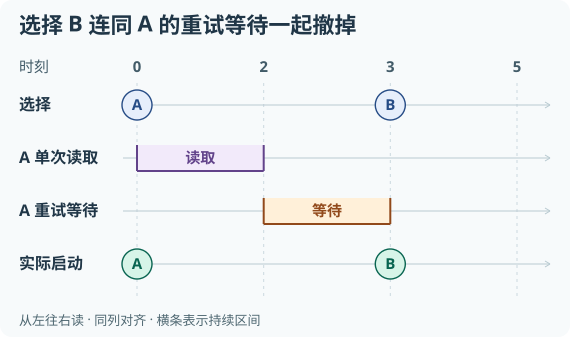

# 11｜断线以后，只恢复该恢复的部分

点下「模拟推送断线」时，假设 B 的列表已经画到第 41 行。页面还开着，筛选词也没变，只是服务器把推送连接关了。重连后需要的是 41 之后的记录。若错误一路传到最外层，连用来选任务的监听都会退出，改选 A 也不会再有请求。

## 留下任务选择框

RxJS 的一次订阅一旦收到 error 就结束了。要让屏幕继续工作，`catchError` 允许程序在这里换一个来源。先把出错的位置放在历史读取里，用两个很短的来源模拟结果。`of(task)` 被订阅时发出任务名再完成，`throwError(() => Error('断线'))` 被订阅时直接报错。

```sh
node --input-type=module <<'JS'
import { Subject, of, throwError, switchMap, catchError } from 'rxjs'
const tasks = new Subject()
function read(task) {
  console.log('读取', task)
  return task === 'B' ? throwError(() => Error('断线')) : of(task)
}
tasks.pipe(
  switchMap(read),
  catchError(() => of('离线'))
).subscribe({ next: text => console.log('屏幕', text), complete: () => console.log('结束') })
tasks.next('B')
tasks.next('A')
JS
```

选择 B 后，read 返回的来源报错。错误经过 switchMap，连它对 tasks 的监听也随之结束。这时 catchError 调用我们给它的函数，这个函数返回 `of('离线')`。catchError 转而订阅它，把这个来源的所有通知交给屏幕。因此屏幕先收到一次 next，显示“离线”，随后又收到 complete，打印“结束”。后面的 A 无人接收。

要让下一次选任务还能调用 read，只需要让失败的那次读取提供替代结果。把上面 pipe 里的两行换成这一行，两次选择保持原样：

```js
switchMap(task => read(task).pipe(catchError(() => of('离线'))))
```

现在被替换的只是 B 那次读取。替代来源完成时，switchMap 仍在监听 tasks，后面就有了「读取 A」「屏幕 A」。这也解释了为什么回调要返回一个来源：`of('离线')` 可以交给面板一个替代值；如果屏幕只需等下次选择，就在回调里记下错误，再返回 EMPTY，让本次读取直接完成。

## 把一次重试写出来

手动切到 A 可以发起新读取。若人还在看 B，只是服务端短暂断开，能否等它恢复后再试一次？把第一次失败、第二次成功的两次读取写进同一个函数，就能分清 retry 重新执行了哪段代码。

```sh
node --input-type=module <<'JS'
import { defer, of, retry, throwError } from 'rxjs'
let attempts = 0
function load() {
  attempts += 1
  console.log('尝试', attempts)
  if (attempts === 1) return throwError(() => Error('断线'))
  return of('历史 B')
}
defer(load).pipe(retry(1)).subscribe({ next: console.log, error: e => console.log(e.message) })
JS
```

`defer(load)` 接受一个无参工厂，每次订阅都调用 load，再去订阅它返回的来源。`retry(1)` 则只认自己左边的 Observable，遇到 error 就再订阅它一次。两者合在一起，第一次调用 load 得到一条会报错的来源。它报错后，第二次订阅又调用了 load，这回得到“历史 B”。retry 不需要知道 load 做的是 HTTP 还是 WebSocket。

把最后一行的 `defer(load)` 换成 `load()` 再跑，这个区别就很明显。此时 load 在组装管道时只调用了一次，返回那个一订阅就报错的 Observable。retry 依约订了两次，但两次都是它，输出也就只有“尝试 1”和“断线”。

接回任务选择。用户选了 A，失败后原定稍等再试；如果用户已经改选 B，从这次等待中醒来的 A 就该过期。把“一次尝试、最多再试两次、用完机会给提示”都放进一个函数：

```js
function historyFor(task) {
  return defer(() => loadHistory(task)).pipe(
    timeout({ first: 2000 }),
    retry({ count: 2, delay: (_error, n) => timer(100 * n) }),
    catchError(() => of({ task, status: '无法读取历史' }))
  )
}
const history = tasks.pipe(switchMap(historyFor))
```

失败时，retry 会调用 delay 并订阅它返回的 timer。第一次等 100 毫秒，第二次等 200 毫秒。一个定时器发出值，才会开始下一次尝试。把 `finalize(logAttemptEnd)` 接在 retry 前，能看到每次尝试的清理；接在 retry 和 catchError 之后，看到的是整轮结束或取消的清理。

[](../figures/book-11.svg)

图里把等待压缩成三刻。第 2 刻 A 报错，第 3 刻切到 B 时，switchMap 拆掉整份 historyFor(A)，连带退订那个还没响的 timer。第 5 刻不会再发一次 A。运行 `npm run lab -- 11`，实验将定时器换成手动放行信号：先切 B 再放行，请求记录是 A、B；先放行再切 B，则是 A、A、B。

前面的请求在交出结果之前就失败了。推送连接却可能先交出第 41 行，才报告断线。`retry` 会拦下这次 error 并重新订阅；面板已经收到的 41 不会被收回。下面把两次连接压成一个能在项目根目录直接运行的例子：

```sh
node --input-type=module <<'JS'
import { concat, defer, of, retry, throwError } from 'rxjs'
let connections = 0
const live = defer(() => {
  connections++
  if (connections === 1) return concat(of(41), throwError(() => Error('断线')))
  return of(41, 42)
})
live.pipe(retry(1)).subscribe(id => console.log('画出', id))
JS
```

输出是 41、41、42。第二个 41 来自第二次连接：这里的模拟服务器又从 41 开始发了。`retry` 只知道怎样再订一次，手里没有行号，也无从知道两笔 41 是同一条日志。成品把续读的位置留给知道行号的那段代码。

模型记得 B 已收到的最大行号 cursor=41。连接工厂写成 `defer(() => live(task, cursor))`，再次订阅时才拼出地址；这一轮发给服务器的是 `after=41`。如果一直沿用页面打开时拼的 `after=0`，每次重连就会从头要。

WebSocket 报错时由 retry 重新订阅；正常关闭时收到的是 complete，成品用 repeat 再连。用户主动切到 A 则会退订整轮 B，包括重连的等待。打开浏览器的 Network 面板，点一次「模拟推送断线」，可以对比两次 /live 请求的 task 和 after。服务端只能补发还保留着的历史；本项目每个任务最多保留 200 行。[重连代码](../app/model.ts) · [服务端补发](../app/server.mjs)

<a id="能重新订阅是否就能把业务操作再做一次"></a>

## 回执丢失，还能不能再保存一次？

在同一张面板上，“重新读取 B”可以自动做，旁边的「入队保存」却另有一个麻烦。假设你追加“已复核”，服务端刚从版本 7 写到 8，确认回信丢了。浏览器只看到连接断开，和根本没收到请求时一样。如果自动把这次保存再发一次，服务端可能会追加两条“已复核”。

成品把这种情况显示为“未确认”，让人可以核对结果。若产品要自动重送，可以在每次点击时生成一个命令编号，连同当时的文字一起保存；重试沿用同一个编号。服务端把写入与这个编号的回执一起登记，再收到同号时就返回那份回执。实验模拟了两次传输：同号仍是版本 8，换号则到了版本 9。两次有意的点击即便文字相同，也应保有两个编号。[保存入口](../app/main.ts)

<details>
<summary>当期限要求的是可显示的结果</summary>

上例的 first 从每次尝试订阅时起算，第一条值到了就满足期限。如果请求每两秒报告一次下载进度，却一直没有详情，`timeout({each: 3000})` 也可以永远等下去：每个进度值都会重新计时。用户要求“点击后六秒内有可看的详情”，就应先只留下可用的详情，再对这条结果流检查 first。

还要决定六秒约束的是哪一段。第一次等四秒超时、等一秒重试、第二次再等四秒，总计九秒。若六秒包括重试，就把整轮的 first 期限放到 retry 后、加载提示和降级值之前。如果来源在没有正文时直接完成，计时器随订阅一起结束，想提示“空响应”须另外处理这次空完成。

</details>

<details>
<summary>失败后，队列里第二项去了哪里？</summary>

实验先发 1、2，保持 1 在途，让它报错，随后发 3。内部 catchError 返回 EMPTY，只结束失败这一项。concatMap 此时才启动排队的 2；mergeMap 早已让 2 开始；exhaustMap 在忙时已经忽略了 2。三者都还会接纳 3。去掉内部 catchError，1 的错误会结束整个订阅。

</details>

<details>
<summary>重试条件、正常完成后的重复与超时信息</summary>

`TimeoutConfig<T,O,M>` 还可以用 `with(info)` 直接换源。`TimeoutInfo<T,M>` 中 meta 是调用方的标记，seen 是已发值数，lastValue 类型为 T 或 null。7.8.2 的超时路径先退订原源，清理会清空 lastValue；要保留最后一行应自行记录。实验以 `NEVER` 触发首包超时，with 产生「历史/0」。这样超时已经转成正常值并完成，外面的 retry 就没有错误可重试。把 fallback 放在 retry 之后，才会先耗尽尝试再显示降级。

`retry(2)` 允许**额外**两次订阅。`RetryConfig` 的 count 默认无限，delay 可给固定毫秒或返回通知流的函数，resetOnSuccess 为 true 时每收到一个 next 就重置失败计数。因此每轮先吐出缓存再报错的流可能一直重试。`repeat(2)` 的 2 则是含首轮在内的**总订阅次数**；它在完成时重新订阅，错误仍会传出。`RepeatConfig` 的 delay 是毫秒或接收重复序号的工厂。两种 delay 工厂都靠首次 next 放行；直接完成会停止整轮，抛错会终止整轮。重复订阅已经部分成功的流会重复交付先前值，项目的实时日志用行号去重。

用在线状态放行重试时，delay 工厂可返回 `online$.pipe(filter(Boolean), take(1))`。online$ 保存当前的布尔值，故障传来时若已经恢复就能立即再试。普通的恢复事件可能早已过去，直接用布尔状态而不筛选，又会把 false 当作放行信号。

</details>

<details>
<summary>把错误也录进一段可回放的记录</summary>

通常的 error 通道会终止订阅，不能由后面的 toArray 收集。`materialize()` 把每次 next/error/complete 编成普通 next 值，末尾再正常完成。因此「0，然后断线」的录像是两条记录 N、E；成功源 `of(0)` 则录到 N、C。调用 `dematerialize()` 回放时，E 重新变为错误，C 重新变为完成；录像中 E 后面的记录不再交付。

```ts
type Tape = ObservableNotification<number>;
const ok: NextNotification<number> = { kind: 'N', value: 0 };
const failed: ErrorNotification = { kind: 'E', error: '断线' };
const finished: CompleteNotification = { kind: 'C' };
const tape: Tape[] = [ok, failed];
from(tape).pipe(dematerialize()).subscribe({ next: console.log, error: console.error });
```

这三个对象组成按 kind 区分的联合类型。`ValueFromNotification<typeof ok>` 是 number，完成与错误的值类型是 never。实验中删掉 N 的 value，或给完成记录对应的值类型赋 0，编译器都应拒绝。error 字段若是 Error 实例，保存为 JSON 前先提取 message 等信息，直接序列化可能只剩空对象。

旧代码常用 `Notification.createNext(0)/createError(err)/createComplete()`，也有 `new Notification('N', v)`、`new Notification('E', undefined, err)` 和 `new Notification('C')`。`NotificationKind` 的 NEXT、ERROR、COMPLETE 对应这三个字面量。旧 hasValue 可以用 `kind === 'N'` 判断，即便值为 undefined 也成立。实例 observe(observer) 按种类分派，do 接收一至三个位置回调，accept 两种形式都收；toObservable() 生成相应的单次流。迁移时存上面的普通对象，在 kind 分支访问 value 或 error，用 `of(note).pipe(dematerialize())` 交付相应通知，便无须依赖类方法、弃用的工厂和位置回调。

有时无需录像。只关心一次上传是否结束，用 `ignoreElements()` 丢弃所有 next，完成或错误照常到达。要按顺序尝试展示多个独立片段，`onErrorResumeNextWith(a,b)` 与传入数组 `[a,b]` 都会在前一源完成或报错后订阅下一源。实验先忽略进度，再接一个失败片段和 `of(2)`，最终收集 [2]。这样会吞掉各源错误，业务需要记录故障应在进入这条链之前记录。

materialize 把 error 变成普通的 E 记录再完成；把 retry 放在它之后，就不会收到用来触发重试的错误。如果只录用户最后收到的消息，可以先 retry 再 materialize。若要查每次失败，把观察错误的回调放在 retry 里面，另记尝试号。

</details>

<details>
<summary>全局诊断钩子与旧配置</summary>

`config` 是整份 RxJS 实例共享的 `GlobalConfig`。onUnhandledError 可异步观察没有被订阅者处理的错误；onStoppedNotification 用于诊断发往已停止订阅者的通知。两者默认 null，都不是一次读取的恢复入口。验证钩子时可在隔离进程临时安装计数器，例如给已完成的 Subscriber 再发一个值，在下一次事件循环读取计数，应增加一次，然后还原原钩子。实验用正反类型检验回调输入，随后对已完成的订阅者发送 42，断言钩子只收到一次 N，并在 finally 中恢复原值。

旧 Promise 成员用于旧 Promise 转换路径，现代调用用 firstValueFrom/lastValueFrom 和宿主 Promise；useDeprecatedSynchronousErrorHandling 应迁往显式的 error/catchError，useDeprecatedNextContext 所服务的回调内 this.unsubscribe() 应迁往显式的订阅生命周期或 takeUntil。全局开关会波及别的面板。回到控制台，断开实时连接时保留任务选择监听，恢复当前频道；历史耗尽尝试则报告历史失败。下一章把这里的「等一下再试」换成可以精确核对的帧。

</details>

[继续读第 12 章 · 用虚拟时钟重演一次关窗](12.md)

<a id="发散练习"></a>

<details>
<summary>配套练习 · 一次失败应当结束哪段工作</summary>

<a id="transfer-a"></a>

[一页诗集该等字等到什么时候？](../练习/11.md#transfer-a)

<a id="transfer-b"></a>

[缺了一块拱片，拼图工坊还能检哪一道接缝？](../练习/11.md#transfer-b)

</details>

<details>
<summary>回看前面学过的用法</summary>

<a id="practice-1"></a>

**1.** 分别让错误处理位于单次查询内部和整个输入流外部；第一次搜索失败后，再输入一次，判断搜索框是否还活着。

<a id="practice-2"></a>

**2.** 给保存、补详情、刷新各注入一次失败，记录失败后哪些待处理操作被保留；不要盲目重试写入。

<a id="practice-3"></a>

**3.** 区分一次性的断线事件与持续的连接状态；让状态栏在重连中途挂载，预测它看到的第一条消息。

<a id="practice-4"></a>

**4.** 让读取连续失败两次；把请求工厂和清理分别放在重试内外，记录每次尝试与整轮恢复各执行了几次。

</details>

## 章末附录 · 本章 RxJS API 速查

<details>
<summary>查看本章用到的 API 和成员</summary>

**接入来源与订阅**

| API | 用法 |
|---|---|
| [`Subscriber`](../RxJS-7.8.2-API清单.md#api-179) | 源用它交付通知，并通过 closed 检查下游是否已经退出。 |
| [`finalize`](../RxJS-7.8.2-API清单.md#api-66) | 在完成、出错或退订时执行收尾逻辑，适合释放资源或核对清理次数。 |
| [`EMPTY`](../RxJS-7.8.2-API清单.md#api-53) | 不交付任何值，订阅后立即正常完成。 |
| [`NEVER`](../RxJS-7.8.2-API清单.md#api-105) | 保持沉默，既不发值也不自行结束。 |
| [`of`](../RxJS-7.8.2-API清单.md#api-125) | 按参数逐个同步交付后完成；传一个数组会把整份数组作为一个值。 |
| [`from`](../RxJS-7.8.2-API清单.md#api-73) | 将数组、Promise、可迭代对象等转成流；数组逐项交付，Promise 兑现后交付其结果。 |
| [`defer`](../RxJS-7.8.2-API清单.md#api-44) | 每次订阅才调用工厂，适合重新创建请求或读取当时的状态。 |
| [`throwError`](../RxJS-7.8.2-API清单.md#api-197) | 订阅时以错误终止，常用工厂提供这次执行的异常。 |

**变换、筛选与累计**

| API | 用法 |
|---|---|
| [`map`](../RxJS-7.8.2-API清单.md#api-91) | 对每个输入执行投影，交付一个对应结果；第二个参数是这一段订阅内的序号。 |
| [`filter`](../RxJS-7.8.2-API清单.md#api-65) | 逐项检查谓词，只放行满足条件的值；类型谓词还可收窄下游类型。 |
| [`pipe`](../RxJS-7.8.2-API清单.md#api-134) | 按从左到右的顺序组合操作；流的 pipe 方法把这些操作应用到当前来源。 |
| [`toArray`](../RxJS-7.8.2-API清单.md#api-210) | 收集本次订阅的所有值，在正常完成时交出一个数组。 |
| [`take`](../RxJS-7.8.2-API清单.md#api-187) | 只交付前 n 项，取够后完成并退出上游。 |
| [`takeUntil`](../RxJS-7.8.2-API清单.md#api-189) | 通知源第一次发值时完成输出并解除来源订阅。 |
| [`startWith`](../RxJS-7.8.2-API清单.md#api-173) | 订阅时先发给定的初始值，然后订阅原来源。 |
| [`firstValueFrom`](../RxJS-7.8.2-API清单.md#api-70) | 返回 Promise，拿到首值就兑现并退订；空完成时用配置的默认值或拒绝。 |
| [`lastValueFrom`](../RxJS-7.8.2-API清单.md#api-90) | 返回 Promise，正常完成时用末值兑现；空完成时用配置的默认值或拒绝。 |

**时间与调度**

| API | 用法 |
|---|---|
| [`timer`](../RxJS-7.8.2-API清单.md#api-206) | 等到指定时刻或延时后发 0；给第二个周期参数可继续递增发值。 |
| [`debounceTime`](../RxJS-7.8.2-API清单.md#api-42) | 每次新输入重置静默计时，安静满指定时长才交付最近一项，正常完成会冲出待发值。 |
| [`rxjs/testing · TestScheduler`](../RxJS-7.8.2-API清单.md#api-245) | 用虚拟帧建立来源，断言通知时刻与订阅区间。 |

**组合来源与在途工作**

| API | 用法 |
|---|---|
| [`switchMap`](../RxJS-7.8.2-API清单.md#api-183) | 把输入映射成内部流，新输入到达时退订旧内部流，只转发当前一条。 |
| [`concatMap`](../RxJS-7.8.2-API清单.md#api-30) | 逐个启动内部流，上一条正常完成后才处理下一项排队输入。 |
| [`mergeMap`](../RxJS-7.8.2-API清单.md#api-97) | 把输入映射成可同时工作的内部流，结果按抵达顺序交付，可限制并发数。 |
| [`exhaustMap`](../RxJS-7.8.2-API清单.md#api-61) | 一个内部流运行期间忽略新的外部输入，空闲后才接下一项。 |
| [`concat`](../RxJS-7.8.2-API清单.md#api-28) | 依次订阅多个来源，上一条正常完成才进入下一条。 |
| [`forkJoin`](../RxJS-7.8.2-API清单.md#api-72) | 各路都给过值并正常完成后，一次性交付它们的末值组合。 |

**共享、批次与分组**

| API | 用法 |
|---|---|
| [`Subject`](../RxJS-7.8.2-API清单.md#api-174) | 既能接收通知，也能把通知同步广播给当前观察者。 |
| [`BehaviorSubject`](../RxJS-7.8.2-API清单.md#api-13) | 保存当前值；仍活跃时，新订阅者立即收到它，包括构造时给定的初值。 |
| [`shareReplay`](../RxJS-7.8.2-API清单.md#api-166) | 共享上游并回放最近值；refCount 控制无人订阅时是否释放仍在运行的上游。 |

**网络、错误与终止**

| API | 用法 |
|---|---|
| [`catchError`](../RxJS-7.8.2-API清单.md#api-21) | 截住上游错误，改订阅返回的替代来源；摆放位置决定哪层读取被替换。 |
| [`retry`](../RxJS-7.8.2-API清单.md#api-152) | 报错后重新订阅一次读取；把重试等待放在该任务内部，切到 B 时等待也能取消。 |
| [`repeat`](../RxJS-7.8.2-API清单.md#api-148) | 来源正常完成后重新订阅，可控制总轮数和轮间等待。 |
| [`timeout`](../RxJS-7.8.2-API清单.md#api-201) | 检查等首项或后续项的期限，超时后报错或切换到配置的替代来源。 |
| [`ignoreElements`](../RxJS-7.8.2-API清单.md#api-83) | 忽略全部 next，仍然转发 error 和 complete。 |
| [`onErrorResumeNextWith`](../RxJS-7.8.2-API清单.md#api-127) | 当前来源失败或完成都继续接后续来源，忽略各段的错误通知。 |
| [`materialize`](../RxJS-7.8.2-API清单.md#api-93) | 把 next、error、complete 变成可作为普通值传递的通知对象。 |
| [`dematerialize`](../RxJS-7.8.2-API清单.md#api-47) | 把通知对象还原为下游的值、错误或完成。 |
| [`TimeoutError`](../RxJS-7.8.2-API清单.md#api-203) | 表示等待通知超过指定期限，默认由 timeout 报告。 |
| [`TimeoutInfo`](../RxJS-7.8.2-API清单.md#api-204) | 提供超时时已收到的项数、最近值和自定义元数据。 |
| [`TimeoutConfig`](../RxJS-7.8.2-API清单.md#api-202) | 设置首项期限、相邻项期限、时钟和超时后的替代来源。 |
| [`RepeatConfig`](../RxJS-7.8.2-API清单.md#api-149) | 设置总执行次数和正常完成后的再次订阅延迟。 |
| [`RetryConfig`](../RxJS-7.8.2-API清单.md#api-153) | 设置额外重试次数、等待策略及成功发值后是否重置计数。 |
| [`Notification`](../RxJS-7.8.2-API清单.md#api-110) | 可表示三种通知的旧类，能用于保存和重放事件。 |
| [`NotificationKind`](../RxJS-7.8.2-API清单.md#api-111) | 以 N、E、C 区分值、错误和完成的枚举。 |
| [`ObservableNotification`](../RxJS-7.8.2-API清单.md#api-118) | 三种通知形状的联合类型，可按 kind 分支处理。 |
| [`NextNotification`](../RxJS-7.8.2-API清单.md#api-106) | 表示一个值通知，kind 为 N，值保存在 value 中。 |
| [`ErrorNotification`](../RxJS-7.8.2-API清单.md#api-56) | 表示一个错误通知，kind 为 E，原因保存在 error 中。 |
| [`CompleteNotification`](../RxJS-7.8.2-API清单.md#api-26) | 表示正常完成，kind 为 C。 |
| [`ValueFromNotification`](../RxJS-7.8.2-API清单.md#api-217) | 从值通知中推导载荷类型。 |
| [`config`](../RxJS-7.8.2-API清单.md#api-33) | RxJS 的全局配置对象，修改钩子会影响同一运行环境里的其他订阅。 |
| [`GlobalConfig`](../RxJS-7.8.2-API清单.md#api-77) | 描述全局错误报告、已停止通知处理等配置项的类型。 |

**方法、属性与测试助手**

| 成员 | 用法 |
|---|---|
| `NotificationKind.NEXT / ERROR / COMPLETE` | 分别对应 N、E、C，可用来区分值、错误与正常完成。 |
| `TimeoutInfo.seen / lastValue / meta` | 超时前已经交付的数量、最近值和配置中传入的元数据，用于记录故障上下文。 |
| `subscribe()` | 登记观察者、接入一次执行，返回控制该次订阅的句柄。 |
| `next(value)` | 交付一个值；Subject 会把这次通知发给当前观察者。 |
| `error()` | 以错误终止当前序列并释放订阅资源。 |
| `complete()` | 通知正常结束，随后释放资源；主动退订不会给观察者补发 complete。 |
| `unsubscribe()` | 主动结束本次订阅并触发清理；不能据此判断远端写入是否成功。 |
| `schedule(work, delay?)` | 安排一项可取消的动作，可给延时及随动作传入的状态。 |
| `TestScheduler.run()` | 在 TestScheduler 的虚拟时间环境中执行回调，提供建源和验收工具。 |
| `cold(marbles)` | 创建冷测试源，弹珠时间线从每次订阅起点重新计算。 |
| `expectObservable()` | 记录给定订阅区间内的通知，用弹珠图检验值、错误和完成时刻。 |
| `expectSubscriptions()` | 检查一个或多个订阅区间，用来证明何时启动和释放资源。 |
| `subscriptions` | 冷、热测试源保存的订阅记录，可交给 expectSubscriptions 检查。 |
| `toBe(...)` | 给出期望的弹珠序列或订阅区间，可额外映射符号对应的值和错误。 |
| `Notification.createNext` | 构造保存普通值的通知对象。 |
| `Notification.createError` | 构造保存异常的通知对象。 |
| `Notification.createComplete` | 构造表示正常完成的通知对象。 |
| `Notification.kind` | 用 N、E、C 区分值、错误和完成。 |
| `Notification.hasValue` | 表示通知是否属于 next，包括实际交付 undefined 的情况。 |
| `toObservable()` | 把一个 Notification 还原为发值、出错或完成的来源。 |
| `observe()` | 根据通知种类调用给定观察者的相应方法。 |
| `accept()` | 将通知交付给观察者或对应的回调函数。 |
| `Notification.do(...)` | 根据通知种类调用位置参数中对应的回调。 |
| `config.onStoppedNotification` | 配置已停止的订阅者又收到通知时的诊断钩子。 |
| `config.onUnhandledError` | 配置未由观察者处理的错误如何报告。 |
| `shareReplay({ refCount })` | 配置字段。为 true 时，最后一位读者退出会释放仍活跃的上游订阅。 |

</details>

[上一章](10.md) · [本章实验](../labs/11.ts) · [目录](../README.md) · [下一章](12.md)
