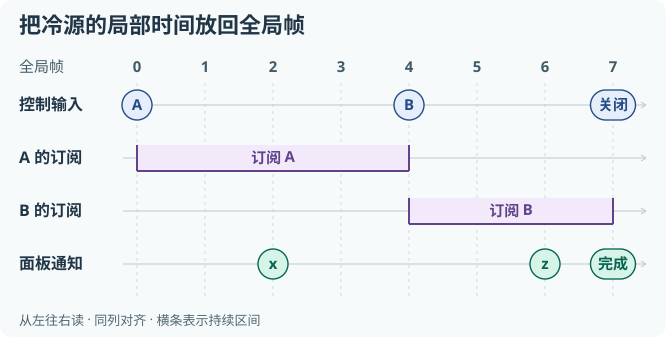

# 12｜把偶发的时序错误变成每次都能复现的测试

第 11 章的控制台会在连接断掉后再试。值班员恰好在重试前关了面板，屏幕随即安静下来。连接是真停了，还是下次连上时没人显示？这个问题在浏览器里很难重现两遍。用一只由测试推进的钟，可以让两段代码在完全相同的时刻遇到那次关窗。

<a id="测哪一刻才有机会推翻自己的实现"></a>

## 录屏里看不到的那段读取

先看一次正常切换。帧 0 选 A，帧 4 切 B，帧 7 关窗。这里每帧是虚拟的 1 毫秒，实验中的两个按钮写成 `hot`，一按就在全局时间线上留下一个点。

```text
帧号       0123456789
选中任务   a---b-----
关窗       -------x--
```

A 的读取写作 `cold('--x--y|')`。它另有一个起点：从被订阅算起，过 2 帧送 x，过 5 帧送 y，6 完成。B 的表是 `--z--w|`，要从选 B 的帧 4 起算，因而 z 在 6、w 在 9。屏幕会留下 x 和 z。还有一种实现也能画出这两行：A 照常运行到帧 5，只是渲染函数看见当前任务已经是 B，就忽略了 y。

[](../figures/book-12.svg)

来看第一种实现。测试里只有一个面板订阅 `view`，却可以分别检查面板、A 和 B 的记录。

```ts
new TestScheduler((actual, expected) => assert.deepEqual(actual, expected))
  .run(({ hot, cold, expectObservable, expectSubscriptions }) => {
    const tasks = hot('a---b------');
    const close = hot('-------x');
    const a = cold('--x--y|');
    const b = cold('--z--w|');
    const view = tasks.pipe(
      switchMap(k => k === 'a' ? a : b),
      takeUntil(close)
    );
    expectObservable(view).toBe('--x---z|');
    expectSubscriptions(a.subscriptions).toBe('^---!');
    expectSubscriptions(b.subscriptions).toBe('----^--!');
  });
```

在 `run` 里，`expectObservable(view)` 会订阅 view，每次收到 next、error 或 complete 都记下帧号和通知。`expectSubscriptions` 的参数则是一个数组：冷源 A 在有人订阅时往里面记起点，清理那次订阅时补上终点。断言只读这份记录；若它自己也订阅 A，测到的就会多出一次读取。`run` 回调返回后，时钟执行排好的动作，再把记录交给比较函数。[可运行的切换实验](../labs/12.ts)

假设页面只是把过期的行藏起来。用 rxjs 导出的 tap、mergeMap、filter 改写上面的 `view`，三个断言原样保留：

```ts
let selected = '';
const view = tasks.pipe(
  tap(k => { selected = k; }),
  mergeMap(k => (k === 'a' ? a : b).pipe(filter(() => k === selected))),
  takeUntil(close)
);
```

通知断言仍然通过。A 在第 5 帧送来 y，filter 读到当前选择是 B，就丢掉了它。出错的是 A 的区间：期望 `^---!`，实际 `^-----!`。其中 `^` 表示订阅，`!` 表示退出；A 一直读到第 6 帧自然完成。B 的区间仍是 `----^--!`。输出里既没有 y，也没有「刚刚丢掉了 y」这样的通知，单凭输出推不出 A 在哪一帧停止工作。

## 时钟怎样让一项工作准点发生

这只钟还要能安排事情。假设帧 3 刚断线，希望在帧 8 再试一次。`SchedulerLike` 把两项操作放在一起：`now()` 给出当前时间，`schedule(work, delay, state?)` 让一项工作在经过 delay 后执行，返回可退订的句柄。RxJS 的 `timer` 就用这两项操作处理「到某一刻」和「再等多久」：

```ts
import { VirtualTimeScheduler, timer } from 'rxjs';

const clock = new VirtualTimeScheduler();
const times: number[] = [];
clock.schedule(() => {
  timer(new Date(8), clock).subscribe(() => times.push(clock.now()));
  timer(8, clock).subscribe(() => times.push(clock.now()));
}, 3);
clock.flush();  // times 是 [8, 11]
```

在这个例子里，钟从 0 走起，`new Date(8)` 的数值也正好是 8。订阅第一个 timer 时，库用截止时刻减去这只钟的 `now()`，于是交给 `schedule` 的延迟是 5。第二个 timer 收到数字 8，就从订阅时再等 8。两次读时和排程都用同一坐标，`flush()` 可以把待办依次执行到帧 11，全程不用等真实的 11 毫秒。若在到期前退订某个 timer，它会连同自己登记的调度句柄一起撤掉。

## 关窗落在两次请求之间

有了订阅记录，就能重演开头那次难抓的重连了。请求在 0 打开，2 报错，隔五帧才会再试。关窗发生在 4。无论代码写成下面哪一行，帧 4 的活跃请求数都是零。

```ts
const inside = request.pipe(takeUntil(close), retry({ count: 1, delay: 5 }));
const outside = request.pipe(retry({ count: 1, delay: 5 }), takeUntil(close));
```

第一行的关闭监听属于单次请求，帧 2 出错时已经退出。此后在等的是 retry，第 4 帧的点击无人接收，于是帧 7 又开了一次请求。第二行让关闭监听贯穿整个重试过程，帧 4 退订时也撤销等待。把钟推进到帧 9，两份记录就分开了：前者多出 [7,9)，后者只有 [0,2)。实验还把 delay 写成一条冷流，因此能单独核对等待在哪一帧被取消。

<details>
<summary>关窗时，输入框还留着一个没提交的字</summary>

同一个按钮也能阻止一次尚未开始的搜索。帧 1 输入 x，静默 4 帧才搜索，帧 3 关窗。此时没有请求，防抖器手里还有 x。

```ts
new TestScheduler((actual, expected) => assert.deepEqual(actual, expected))
  .run(({ hot, expectObservable }) => {
    const close = hot('---c');
    const drained = hot('-x-----').pipe(takeUntil(close), debounceTime(4));
    const dropped = hot('-x-----').pipe(debounceTime(4), takeUntil(close));
    expectObservable(drained).toBe('---(x|)');
    expectObservable(dropped).toBe('---|');
  });
```

drained 中的防抖器收到了上游的完成通知，因此把最后的 x 交给下游，再完成。dropped 中的防抖器被退订，暂存的 x 随计时器一起释放。两种接法都会在 3 关掉键盘监听，所以这个实验看查询出口；上面的重连实验则要看请求入口。

</details>

<details>
<summary>调度器实验里的开工与交付</summary>

`labs/12.ts` 中有一个只发 1 的同步来源。工厂在订阅时写「开工」，观察者的 next 写「收到」。两种写法各自得到以下记录。

| 调度位置 | 工厂 | 观察者 |
|---|---|---|
| `observeOn(asyncScheduler, 2)` | 开工@0 | 收到@2 |
| `subscribeOn(asyncScheduler, 2)` | 开工@2 | 收到@2 |

如果在第 1 帧退出，第一种已经执行了工厂，第二种还没开工。实验的另一段用 `animate('--x--x')` 规定何时可以绘制，用 `animationFrames()` 读到 elapsed 为 2 和 5。原生 Promise 与真实浏览器绘制仍由宿主运行。要查各个调度器和 run 助手的签名，可展开章尾的 API 表。

</details>

帧号与订阅区间还可以留给下一次改代码的人。旧版控制台也有一段「首包超时后重试」，只换一个函数名，何时再连、最后向面板报什么都有可能变。

[继续读第 13 章 · 拿这些断言去迁移旧代码](13.md)

<a id="发散练习"></a>

<details>
<summary>配套练习 · 同时检查输出和订阅区间</summary>

<a id="transfer-a"></a>

[给一小节和弦配动画](../练习/12.md#transfer-a)

<a id="transfer-b"></a>

[裁判桌上的双向沙漏](../练习/12.md#transfer-b)

<a id="transfer-c"></a>

[面团能进下一道工序了吗](../练习/12.md#transfer-c)

</details>

<details>
<summary>回看前面学过的用法</summary>

<a id="practice-1"></a>

**1.** 用虚拟时间断言旧任务退订的精确帧；把关闭信号移到内部源还在运行的时刻，确认没有残留订阅。

<a id="practice-2"></a>

**2.** 用相同输入测试『重复输入会不会推迟发出时间』，既断言输出值，也断言输出帧。

<a id="practice-3"></a>

**3.** 把两个消费者的订阅错开，断言底层连接区间；再让两者之间出现无人订阅的空档，核对重连与缓存。

<a id="practice-4"></a>

**4.** 模拟超时后重试一次仍失败，断言订阅次数、失败帧，以及降级结果是否让外层流继续工作。

</details>

## 章末附录 · 本章 RxJS API 速查

<details>
<summary>展开 API 与用法</summary>

先从 hot 和 cold 找到时间原点，再用 expectObservable 核对画面、用 expectSubscriptions 核对连接。两张图可以揭示不同的错误。

**接入来源与订阅**

| API | 用法 |
|---|---|
| [`Subscription`](../RxJS-7.8.2-API清单.md#api-180) | 一次执行的句柄，可集中登记清理动作并用 unsubscribe 释放。 |
| [`NEVER`](../RxJS-7.8.2-API清单.md#api-105) | 保持沉默，既不发值也不自行结束。 |
| [`of`](../RxJS-7.8.2-API清单.md#api-125) | 按参数逐个同步交付后完成；传一个数组会把整份数组作为一个值。 |
| [`defer`](../RxJS-7.8.2-API清单.md#api-44) | 每次订阅才调用工厂，适合重新创建请求或读取当时的状态。 |

**变换、筛选与累计**

| API | 用法 |
|---|---|
| [`map`](../RxJS-7.8.2-API清单.md#api-91) | 对每个输入执行投影，交付一个对应结果；第二个参数是这一段订阅内的序号。 |
| [`pipe`](../RxJS-7.8.2-API清单.md#api-134) | 按从左到右的顺序组合操作；流的 pipe 方法把这些操作应用到当前来源。 |
| [`distinctUntilChanged`](../RxJS-7.8.2-API清单.md#api-49) | 首项通过，以后与上次放行的值比较，只交付变化。 |
| [`toArray`](../RxJS-7.8.2-API清单.md#api-210) | 收集本次订阅的所有值，在正常完成时交出一个数组。 |
| [`take`](../RxJS-7.8.2-API清单.md#api-187) | 只交付前 n 项，取够后完成并退出上游。 |
| [`takeUntil`](../RxJS-7.8.2-API清单.md#api-189) | 通知源第一次发值时完成输出并解除来源订阅。 |

**时间与调度**

| API | 用法 |
|---|---|
| [`timer`](../RxJS-7.8.2-API清单.md#api-206) | 等到指定时刻或延时后发 0；给第二个周期参数可继续递增发值。 |
| [`debounceTime`](../RxJS-7.8.2-API清单.md#api-42) | 每次新输入重置静默计时，安静满指定时长才交付最近一项，正常完成会冲出待发值。 |
| [`timestamp`](../RxJS-7.8.2-API清单.md#api-207) | 把每次交付的值与该刻的时间戳配对。 |
| [`scheduled`](../RxJS-7.8.2-API清单.md#api-158) | 用指定调度器安排对输入的消费及交付。 |
| [`subscribeOn`](../RxJS-7.8.2-API清单.md#api-178) | 调度订阅来源的动作，可能让取消发生在工厂启动之前。 |
| [`observeOn`](../RxJS-7.8.2-API清单.md#api-123) | 调度向下游交付通知的动作，上游仍可立即开始工作。 |
| [`queueScheduler`](../RxJS-7.8.2-API清单.md#api-141) | 零延迟工作按队列同步执行，嵌套调度排到当前动作之后。 |
| [`asapScheduler`](../RxJS-7.8.2-API清单.md#api-6) | 零延迟时在当前同步栈结束后尽快执行。 |
| [`asyncScheduler`](../RxJS-7.8.2-API清单.md#api-8) | 用异步定时任务安排工作，支持延时。 |
| [`animationFrameScheduler`](../RxJS-7.8.2-API清单.md#api-3) | 默认零延迟时在下一次浏览器绘制机会执行工作。 |
| [`animationFrames`](../RxJS-7.8.2-API清单.md#api-2) | 随动画帧交付时间戳和自订阅以来的经过时间。 |
| [`SchedulerLike`](../RxJS-7.8.2-API清单.md#api-161) | 同时提供 now 与 schedule 的调度器接口。 |
| [`Scheduler`](../RxJS-7.8.2-API清单.md#api-159) | 描述时钟和调度动作的基类。 |
| [`SchedulerAction`](../RxJS-7.8.2-API清单.md#api-160) | 表示可携带状态、再次安排自身的调度动作。 |
| [`VirtualTimeScheduler`](../RxJS-7.8.2-API清单.md#api-219) | 用逻辑帧替代宿主时间，调用 flush 推进已排定动作。 |
| [`VirtualAction`](../RxJS-7.8.2-API清单.md#api-218) | 在虚拟时间队列里按帧和入队顺序执行的动作。 |
| [`rxjs/testing · TestScheduler`](../RxJS-7.8.2-API清单.md#api-245) | 用可推进的虚拟帧代替宿主时钟，既断言 x、z 的交付，也断言 A 和 B 分别在哪一帧退订。 |
| [`rxjs/testing · RunHelpers`](../RxJS-7.8.2-API清单.md#api-244) | TestScheduler.run 回调取得的工具集合，包括建冷热源和写时序断言。 |

**组合来源与在途工作**

| API | 用法 |
|---|---|
| [`switchMap`](../RxJS-7.8.2-API清单.md#api-183) | 把输入映射成内部流，新输入到达时退订旧内部流，只转发当前一条。 |

**共享、批次与分组**

| API | 用法 |
|---|---|
| [`share`](../RxJS-7.8.2-API清单.md#api-164) | 让订阅者共同使用一个上游订阅；默认随首位接入、末位退出而开关仍在运行的来源。 |
| [`shareReplay`](../RxJS-7.8.2-API清单.md#api-166) | 共享上游并回放最近值；refCount 控制无人订阅时是否释放仍在运行的上游。 |

**网络、错误与终止**

| API | 用法 |
|---|---|
| [`catchError`](../RxJS-7.8.2-API清单.md#api-21) | 截住上游错误，改订阅返回的替代来源；摆放位置决定哪层读取被替换。 |
| [`retry`](../RxJS-7.8.2-API清单.md#api-152) | 来源报错后重新订阅，可限制重试次数并安排等待。 |
| [`timeout`](../RxJS-7.8.2-API清单.md#api-201) | 检查等首项或后续项的期限，超时后报错或切换到配置的替代来源。 |

**方法、属性与测试助手**

| 成员 | 用法 |
|---|---|
| `subscribe()` | 登记观察者、接入一次执行，返回控制该次订阅的句柄。 |
| `unsubscribe()` | 主动结束本次订阅并触发清理；不能据此判断远端写入是否成功。 |
| `now()` | 读取当前调度器的时间，在虚拟实验里对应逻辑帧。 |
| `schedule(work, delay?)` | 安排一项可取消的动作，可给延时及随动作传入的状态。 |
| `VirtualTimeScheduler.frame` | 读取虚拟时钟当前所在的帧。 |
| `VirtualTimeScheduler.maxFrames` | 限定虚拟调度器本轮 flush 可推进的最大帧号。 |
| `flush()` | 推进虚拟时钟并执行待办动作；在 run 内可提前结算已安排的断言。 |
| `TestScheduler.run()` | 在 TestScheduler 的虚拟时间环境中执行回调，提供建源和验收工具。 |
| `hot(marbles)` | 在全局帧上建立热测试源，晚订阅者会错过已发生的通知。 |
| `cold(marbles)` | 创建冷测试源，弹珠时间线从每次订阅起点重新计算。 |
| `expectObservable()` | 记录给定订阅区间内的通知，用弹珠图检验值、错误和完成时刻。 |
| `expectSubscriptions()` | 检查一个或多个订阅区间，用来证明何时启动和释放资源。 |
| `subscriptions` | 冷、热测试源保存的订阅记录，可交给 expectSubscriptions 检查。 |
| `toBe(...)` | 给出期望的弹珠序列或订阅区间，可额外映射符号对应的值和错误。 |
| `toEqual()` | 将一个被观察的测试输出与另一条 Observable 的通知进行比较。 |
| `time(marbles)` | 通过弹珠图中完成标记的位置计算虚拟时长。 |
| `animate()` | 用弹珠时间线指定虚拟的浏览器绘制机会。 |
| `createHotObservable()` | 直接在测试调度器上创建热源；run 回调内可用 hot。 |
| `createColdObservable()` | 直接在测试调度器上创建冷源；run 回调内可用 cold。 |
| `parseMarbles()` | 将值弹珠图解析为带帧号的测试通知。 |
| `parseMarblesAsSubscriptions()` | 将含订阅、退订标记的图解析成区间。 |
| `frameTimeFactor` | 测试调度器把弹珠字符宽度换算成帧数时使用的比例。 |
| `createTime()` | 将完成标记的位置转换为虚拟时间，可在 run 回调内用 time。 |
| `hotObservables` | 测试调度器旧的热源登记表，检查具体来源可直接保存 hot 返回值。 |
| `coldObservables` | 测试调度器旧的冷源登记表，检查具体来源可直接保存 cold 返回值。 |
| `shareReplay({ refCount })` | 配置字段。为 true 时，最后一位读者退出会释放仍活跃的上游订阅。 |
| `assertDeepEqual()` | 创建 TestScheduler 时提供的比较函数，用来核对实际通知与期望通知。 |

</details>

[上一章](11.md) · [本章实验](../labs/12.ts) · [目录](../README.md) · [下一章](13.md)
