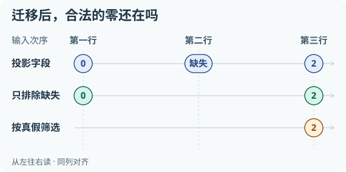

# 13｜接手旧版控制台，在行为不变的前提下迁移

## 打开旧实现之前

列表显示一行日志后，分别做三次演练：连接仍活跃时关掉列表、列表收到完成后退出、列表收到错误后退出。等一会再打开，写下来：会不会瞬间看到上一行？会不会新建连接？连接何时关闭？设计一组能让旧版与候选新版产生不同结果的动作。

再给两处修改写验收。把旧日志中的错误计数投到角标上，输入有 0、有缺失、有 2，应保留哪些？一次读取在帧 0 发起，等两帧仍无数据就报告「超时」，隔三帧再试一次又超时，两版应在什么帧退订、重连、报告什么错误？

## 从最小的反例动手

旧投影 `pluck('stats','errors')` 逐级取值，到缺失处给 undefined。它有一至六层键的类型重载以及任意路径的宽泛签名，拼错的深层键可能失去类型保护。下面让 TypeScript 在真正的数据结构上检查属性。

```ts
const counts = rows.pipe(
  map(row => row.stats?.errors),
  filter((v): v is number => v !== undefined)
);
```

输入 `[{stats:{errors:0}}, {}, {stats:{errors:2}}]`，投影为 [0,undefined,2]，最终为 [0,2]。改成 filter(Boolean) 会吞掉第一个合法值。运行 `node --experimental-strip-types labs/13.ts`，先看投影结果，再看后面的对照记录。以下旧管道均可从 rxjs/operators 取得；本章在根入口同样导出的旧别名，行为与对应操作符一致。

**读图 · 迁移后，合法的零还在吗**

[](../figures/book-13.svg)

两个实现都以 2 收尾。沿第一列检查，按真假筛选还吞掉了合法的 0；拿最终读数比较会漏掉这次迁移回归。

## 凭什么说两段管道等价？

先看一个可以放心改的地方。源每次给毫秒数，第一步除以 1000 换成秒，第二步把秒数加上单位。两步都是只读参数的普通函数 `f` 和 `g`。对这条源的每个数，`map(f), map(g)` 与 `map(ms => g(f(ms)))` 会交付相同的标签。你可以把等式念给同事听：前一个函数交给后一个函数的，恰是同一个值。中途没有分支、订阅或需要另行保留的观察点。先能说明这种简单重构为何成立，才知道哪里值得怀疑。

现在有人把“筛掉心跳，给剩余行编号”的两步对调，理由是每行的文字都没变。拿最小的输入「心跳、错误」试算。先筛后编，错误得到序号 0；先编后筛，它带出序号 1。即使最后只有一行，**投影函数的第二个参数由本段实际收到的输入决定**，移动它就可能改变含义。做迁移前先问一句：编号表示屏幕上的第几行，还是线上收到的第几帧？两种实现都有合理用途。

再换一个容易在评审里溜过去的改动。原来先筛出 `row:` 开头的帧，再解析后面的 JSON；现在提前解析所有帧，随后才筛。不妨插入一个合法心跳 `ping`，再接一条合法日志。原设计会跳过心跳并交出日志，后者会在解析心跳时抛错，连后一行也没有机会到达。调整顺序改变了**函数在哪些输入上必须有定义**。只拿两条正常日志跑通两版，得不到这个证据。

在项目根目录执行 `npm run lab -- 13`，找「管道重写」一行。实验分别验证可合并的两次单位变换、互换后改变的编号和提前解析导致的终止。下次要把管道写短一行，先给自己挑一条能否定等价性的输入，再决定是否值得改。[实验源码](../labs/13.ts)

## 迁移表达式时，先固定谁订阅谁

若每条行记录都变成固定标签，`mapTo(label)` 换 `map(() => label)`，输入输出泛型由上下文推断，旧的显式双泛型写法可移除。对象标签若要保持同一引用，在回调外创建对象。若每次触发都要订阅同一个流，`concatMapTo(inner)`、`mergeMapTo(inner, 2)`、`switchMapTo(inner)` 分别换为 concatMap、mergeMap、switchMap 的 `() => inner` 工厂，并发上限 2 仍放在 mergeMap 的并发参数上。用同步 inner 触发两次都得两次 ok；换成慢 inner 时，三者分别排队、最多两路并行、撤掉旧订阅。把 inner 的创建也搬进回调可能改变热源身份。

旧重载可接 resultSelector，concat/switch 版本也接受显式 undefined，merge 版本还允许在选择器后给并发数。把结果计算搬到内层才能同时保留外值、内值及两个下标：

```ts
const details = tasks.pipe(mergeMap((task, taskIndex) =>
  rowsFor(task).pipe(map((row, rowIndex) => ({ task, taskIndex, row, rowIndex }))),
  2
));
```

`flatMap` 就是 mergeMap 的别名；`exhaust` 作用于流的流，换 exhaustAll，正在运行时新来的内部流会被跳过。`combineAll` 换 combineLatestAll，要等外层完成才订阅收集到的内部流；外层交给它同步源 [1,2] 与 ['ok']，得到 [[2,'ok']]。若外层是一直打开的频道注册表，等待完成会一直没有结果。旧项目里的 animationFrame、asap、async、queue 分别改名为 animationFrameScheduler、asapScheduler、asyncScheduler、queueScheduler，实验检查每对引用都相等。

`empty()` 换 EMPTY，只完成；`empty(scheduler)` 须保留完成的调度，可用 `scheduled([], scheduler)`。`never()` 换 NEVER，始终沉默。`pairs({a:1})` 换 `from(Object.entries({a:1}))` 得 ['a',1]。数组得到字符串下标，普通对象只取可枚举自有字符串键；不要把 Iterable 重载理解成遍历迭代值，例如 Map 的键值对不会作为自身的可枚举属性出现。数字等原始值重载产生空序列。旧传入 scheduler 的场合用 scheduled(entries, scheduler)，7.8.2 的 pairs 在调用时就取 entries。若对象在订阅前修改，保留调用时的快照才能保持行为；移进 defer 会使读者看见修改后的值。

## 同名调用，先看 import 与左操作数

假设 `a=of(1,2)`，`b=of('ok')`。下面每行左侧是**旧管道**中接在 a 后面的操作；在根入口直接调用的同名创建函数需要传入 a。实验用两个入口的不同命名空间，让代码审查者一眼看到调用方式。

| 旧管道（rxjs/operators） | 现代调用 | 同步源上如何得到结果 |
| --- | --- | --- |
| combineLatest(b) | a.pipe(combineLatestWith(b)) | b 首发时 a 最新为 2，得到 [2,'ok'] |
| concat(b) | a.pipe(concatWith(b)) | a 完成才订 b，得到 1、2、ok |
| merge(b) | a.pipe(mergeWith(b)) | 允许重叠；此例 a 同步完成，仍是 1、2、ok |
| race(b) | a.pipe(raceWith(b)) | a 同步先发，保留 1、2 |
| zip(b) | a.pipe(zipWith(b)) | 按序配成 [1,'ok']，第二个数没有搭档 |
| onErrorResumeNext(坏源,b) | a.pipe(onErrorResumeNextWith(坏源,b)) | 遇错继续，仍收齐 1、2、ok |
| partition(isEven) | partition(a,isEven) | 返回两个流，收集结果分别为 [2]、[1] |

例如 `import { onErrorResumeNext } from 'rxjs'` 得到的创建函数仍可用 `onErrorResumeNext([a,b])` 或 `onErrorResumeNext(a,b)`。在 pipe 内传错这个入口会得到流对象而不是操作符。partition 的旧函数返回一对流，严格类型下可写 `old.partition<number>(isEven)(a)`；两个分支分别订阅冷源会执行两次。旧 thisArg 可用闭包或显式绑定替代。

旧 combineLatest、zip 支持数组/展开参数和末尾投影，race 支持数组/展开。迁移时对 With 版本展开来源，投影移到 `map(([x,y]) => project(x,y))`。旧 merge 的并发上限不可丢，用 `from([a,b]).pipe(mergeAll(limit))`。旧 concat/merge 末尾的调度器用于组织订阅；可用 `scheduled([a,b], scheduler).pipe(concatAll())` 或 mergeAll(limit) 安排外层，若原来多个源自身带调度仍保留并比较订阅帧。用异步冷源替换上表的 a 才能看到 merge 与 concat 时间上的差别。

旧 `Operator<T,R>` 对象实现 `call(subscriber, source)` 并返回拆除逻辑；它是旧 lift 的协议。实验用原样转发的 call 返回 `source.subscribe(subscriber)`，得到 [1,2]；返回数字会被类型检查拒绝。迁移自定义算子时交付 `OperatorFunction<T,R>`，即从源到新流的函数。可组合的变换直接用 pipe/map，手写 Observable 时应返回内部订阅，否则页面退出后还会有工作。

## 「只连一次」还没有说清连接寿命

旧 `ConnectableObservable` 由 source 与 subjectFactory 构造，source 保存上游，subscribe 先把读者挂到 Subject，connect() 才启动上游并返回可单独关闭的连接。refCount() 方法或独立的 refCount 操作符则随首位和末位读者开关连接。手动调用 connect 的代码，用 `connectable(source, { connector, resetOnDisconnect: false })` 表达复用旧 Subject 的需求。若旧实现每次都用工厂产生新 Subject，应保留相应的重建条件。

实验让上游手动发 1，第二位读者加入，再发 2 并完成。按第二位读者的观察区分旧方案：

| 手动共享方式 | 第二位加入时 | 再发 2 并完成 |
| --- | --- | --- |
| publish()，普通 Subject | 空 | 收到 2 |
| publishBehavior(0)，BehaviorSubject | 收到当前值 1（第一位初始收到 0） | 收到 2 |
| publishLast()，AsyncSubject | 空 | 完成时才收到 2 |
| multicast(new ReplaySubject(1))，对应 publishReplay(1) 的缓存 | 重放 1 | 收到 2 |

`multicast(subjectOrFactory)` 有实例与工厂两类重载，传实例意味着可以跨连接复用既有缓冲，工厂可创建隔离缓冲。给它 selector 的重载会先为同一轮 selector 内的多个分支接好线，再接上游。迁移 `publish(shared => zip(shared, shared))` 可用 `connect(shared => zip(shared, shared))`；同步源 [1,2] 两个分支会配成 [1,1]、[2,2]。需要特定 Subject 时给 connect 传 connector。若旧 selector 跨调用共享 Subject，须检查其生命周期，直接新建工厂可能改变二次订阅。旧 publishReplay 还接受条数、时长窗口、时间提供者，或在第三位放 selector、第四位放时间提供者；把这些缓存参数交给 ReplaySubject，把分支组合交给 connect。时间提供者只控制窗口年龄。

现在处理开头的三种终点。旧 `publishReplay(1), refCount()` 在本实验使用同一个回放缓存。断订阅时应关闭网络，下一轮还应重放上次数据。可把缓存寿命与连接寿命分开写：

```ts
function preserveReplay<T>(source: Observable<T>) {
  const cache = new ReplaySubject<T>(1);   // 每个共享流各有自己的缓存
  return source.pipe(share({
    connector: () => cache,
    resetOnRefCountZero: true,
    resetOnComplete: false,
    resetOnError: false
  }));
}
```

计数的位置也重要：在共享之前记录工厂开始与 finalize，得到物理订阅数；在共享之后记录会把两个面板算成两条连接。下表每种情形都从新实例开始，上游发 1，然后触发该情形，第二位进入后也退出。实验对比旧版、上面的 share 与候选 shareReplay。

| 条件 | 旧版与保留缓存的 share：累计连接数，晚到观察 | shareReplay({bufferSize:1,refCount:true}) |
| --- | --- | --- |
| 完成 | 1，收到 1 和完成 | 同左 |
| 错误 | 1，收到 1 和旧错误 | 2，本例上游 Subject 已出错，重新订阅只收到错误 |
| 未终止就退出 | 2，重连并先收到旧值 1 | 2，重连且缓冲为空 |

把 resetOnRefCountZero 改成 false 可以保留缓存，却会让未终止的上游在无人观看时继续运行。成品希望离开页面后停止工作；是否跨任务保留旧行则要由产品单独决定。初屏截图无法验证其中任何一个条件。

## 最后迁移计时策略

读取每段最多等 2 帧，第一次超时后等 3 帧再试一次。旧 `timeoutWith(2, fallback, scheduler?)` 换 `timeout({each:2, with:() => fallback, scheduler})`；旧 Date 参数表示绝对首包期限，应改 first。若 fallback 已经发值完成就不会触发 retry。实验让它抛出固定的「超时」，旧 retryWhen 收到错误时，第一次用 timer(3) 放行，第二次把原错误抛回去。

```ts
const result = source.pipe(
  timeout({ each: 2, with: () => throwError(() => '超时') }),
  retry({ count: 1, delay: 3 }),
  catchError(reason => of(reason))
);
```

从订阅图反推：第一轮 [0,2)，第二轮 [5,7)，第 7 帧同帧发出「超时」并完成。实验使用 TestScheduler 对两版分别核对订阅区间和错误转成的值。如果旧通知流在第二次失败时只是完成，最终会静默结束，不能声称等价。旧 `repeatWhen` 接收完成通知，`retryWhen` 接收错误通知，两者依赖 notifier 的 next、error、complete 决定后续。常见的「完成后等待、总共两轮」可改 `repeat({count:2,delay:1})`；实验两版都收到 [1,2,1,2]。涉及外部许可或多种错误策略时，先画旧 notifier 的时间线，再决定配置式 delay 能否保留行为。

## 档案合并后，为什么旧日志反而跑到最后

旧版控制台先读本地归档，再接上本次运行的增量。交接单里只写着「合并两个流」。旧表达式的最后还有一个 1，容易在把 merge 换成 mergeWith 时顺手删掉。能不能删，取一条归档和一条增量各给一个不同的标签，让归档来得慢些。若两条都用 of 立刻发完，在第一条结束和第二条开始之间完全看不见竞争，调换接法也很难留下证据。

先单独写出两份契约。归档 A 从被打开起等三帧交一条 a，再过一帧完成。增量 B 是可按游标重新读取的一页，从被打开起等一帧交 b，再过一帧完成。两者都可视为冷源，每次订阅才开始那次读取。旧 `a.pipe(old.merge(b, 1))` 同时最多占一个名额；收到一项也不会归还这个名额，占用要一直持续到该源结束。帧 0 先让 A 入场，于是帧 3 看见 a；帧 4 A 完成，这时才轮到 B；帧 5 看见 b，帧 6 整个读取完成。两条记录分别属于 [0,4) 和 [4,6)。

候选写成 `a.pipe(mergeWith(b))`，两个名额都能立即用。帧 0 就订了 B，帧 1 已经拿到 b，帧 2 B 读完；帧 3 A 才交出 a，帧 4 整体完成。两版都可把「收齐的行数」显示为 2，排序后的截图也可能完全一样。滚动时就会看见新版先画了一行新日志，随后才插入旧日志。即使界面重新按时间排序，底层并发读取的峰值仍从一变成二。如果归档读完会提交供 B 使用的游标，那么 B 打开时能取到哪一版游标也是行为的一部分；单凭这里的两个标签还不能证明真实数据衔接正确。

本例只有两个冷源，上限也固定是 1，用 `a.pipe(concatWith(b))` 就能直接表达交接。若上限是传进来的参数，保留前文把各来源交给 mergeAll(limit) 的写法。实验各开一只时钟，让旧版、丢掉上限的候选、恢复顺序的新版都拿到同样的冷源。分别钉住 a、b 的到达帧、最终完成时刻和 B 的订阅区间。最后一项尤其重要：若新版同时读取，再把 b 缓存在下游直到 a 到来，那是延后显示。它仍会在帧 0 打开第二个读取，无法满足旧的资源约定。

再问一个操作人员真正会碰到的问题。在帧 2 中途关掉这个档案页，会不会启动 B？沿旧时间线，关窗在 A 交还名额之前，尚在等待的 B 从未被订阅。这时给 B 的 subscriptions 写空数组，才能表达「根本没打开」。如果写一段极短的订阅再立即退订，那表示发生过打开，调用一次工厂就可能产生一个文件句柄或一次读取计费。沿错误时间线，到帧 2 B 甚至已经有一行送到了屏幕。这个改变只移动观察终点，连源的模型都不用重写，却能把「少占一个名额」讲成可验证的事实。

### 迁移到实时尾部

如果 B 的产品定义改成实时广播，从控制台打开起就可能有事件，归档结束前没有人代为保存，刚才的合理改法还够吗？先算帧 1 广播的 b。等到帧 4 才订阅就彻底错过了，B 的相对时间线在这里已经不适用。若需求确实是复刻旧版，只收归档读完以后的广播是可复现的旧行为。若需求是归档与实时行无缝拼接，则要么在读取归档前就接住广播并缓冲，要么要求上游按游标补读。两者都引入新问题：前者要规定缓冲上限和溢出处理，后者要确定归档末行与增量首行是否可能重复。不能只改一个操作符就许诺没有缺口。

一个足以验收这次需求变更的样例，是给归档末行和广播首行同一个序号，再在读取归档期间广播下一个序号。读者应该看到每个序号恰好一次。若归档和广播没有共同的顺序标记，两个内容相同的字符串既可能是重复，也可能是两条合法日志，测试不能凭外观判断。这样回头看原先的小实验，a、b 是人为分配的身份，用于回答「谁先被订阅」，它没有解析真实游标或替产品选定拼接规则。先保住可以证明的旧行为，再把新要求单独放进验收，比较才有意义。

## 同步归档被读取了两遍

第二处迁移藏在同一页的摘要里。导入一份很短的归档时，控制台要给每行配上当时的错误数。两个分支从同一份记录推导，最后按位置配成一对。旧代码在 publish 的 selector 里面接分支；有人把它提出来，先创建一个 shared，再写 `zip(shared, shared)`。为了把订阅时机看清，暂时让左右分支都原样返回行号 1、2。正确的配对应该是 [1,1]、[2,2]。一种格外难查的回归是，这两对居然一项不少，导入计数却翻了一倍。

这里的 selector 就是接收共享流、返回摘要流的函数。「两条腿」指 zip 为左右两个输入分别建立的订阅。即使两个参数指向同一个 Observable，调用两次 subscribe 仍是两次登记；这两次登记能不能赶上同一批数据，要从第一位订阅者到场时的动作算起。

还原帧 0 内部发生的事。JS 可以在一次 subscribe 调用尚未返回时执行完一个同步源。zip 装第一条腿，普通 `share()` 发现首位读者到了，就去打开归档，读完 1 和 2，并完成。zip 暂时没有第二条腿的值，把第一条腿的两项放进自己的队列。轮到它装第二条腿，第一次连接已经完成，默认 share 允许完成后重新开始，于是归档又从头读了一遍。第二次的 1 和 2 恰好与队列逐一配上。全程可以都在帧 0，没有哪根短横能插进两次打开之间。这里必须数调用次数或者记下先后顺序，单把时间单位再切细没有帮助。

这正是 selector 形态值得保留的原因。在 `connect(s => zip(s, s))` 中，先给本次组合准备一个中转的 Subject，再把结果观察者接入 selector 返回的配对流；zip 得以把两条腿都挂在中转处。接下来才订阅原始归档，两边一起看见同一轮读取的 1、2。这个 connect 作为管道操作符替你安排每一轮内部的连接。前面手动连接所用的 connectable(...).connect() 则由调用者决定开工时刻。碰到同一个英文动词，先看返回的是一条能订阅的结果，还是已经建立的连接句柄。

把工厂改成每次读都递增一个批号，能找出更直接的证据。帧 0 第一次打开读到 `1.1`、`1.2`，小数点前后分别记批号与行号，它们在实验里是字符串。用旧 publish(selector) 或 connect(selector)，第一行的左右两边都是 1.1；第二行都是 1.2，打开次数为一。用默认 share 架在 zip 外，配成的却是 [1.1,2.1]、[1.2,2.2]，打开次数为二。若第一遍读的是用户修改归档之前的版本、第二遍读的是修改之后的版本，那么即使条数相同，每个角标也有可能挂错行。这个批号只是让两次打开可见，不依赖真的有人在帧 0 修改文件。

一个看似省事的补丁是把默认 share 换成只缓存最后一行的 shareReplay(1)。同步归档读完，第二条腿加入时只能补到最后一项，它会和第一条腿队首的**第一项**配在一起。接下来第二条腿已经完成且队列已空，剩下的第一条腿数据也凑不出下一对，结果甚至连长度都变了。扩大缓冲到整份归档或许能过小样例，却会保留所有行，而且同一结果再次订阅时还涉及是否重读归档的约定。若真实要求只是一次计算内的两个视角共读同一轮，优先把装两条腿和开源的相对次序表达出来，无须引入跨轮缓存。

这段修复也有一个应当保留的反例。同一个结果对象先订一次，等完成后再订一次，旧 selector 每次都会重新装配和读取；connect 也应如此。两位调用者若分别要求「给我一份此刻归档的摘要」，看到第二批号完全合理。要是把共享边界一直扩大到整个模块，第二个调用者可能永远读取第一份摘要。批号实验因此区分两种计数：在一次摘要订阅内部应只打开一次，而不是进程生命周期内只能打开一次。把计数器放在 `defer` 的工厂里，才会随真实订阅增加；在创建 Observable 变量时加一，只能数出有几个描述对象。

### 迁移到筛选预览

现在把摘要换成「保留行／丢弃行」预览，归档读取会顺便把文件指针往前推。能否简单地分别订阅 partition 的两个分支？结合前文的冷源规则，答案取决于两位消费者是否必须看同一次读取。若每次都能无副作用地从头得到同一固定数组，独立订阅可以得到正确分类，代价是多做一次遍历。若第二次订阅从当前文件指针出发，第一条腿可能已经读尽文件，第二条腿只能得到空结果。把两条分类的计算安在同一个 selector 的连接范围内，或者单遍累积两种结果后再交付，都能避免状态随重复订阅改变。

这里也要选对汇合方式。刚才 zip 是为了让同一行的两个视角相遇；保留与丢弃恰好互斥，不能再逐项配对。若文件有三行且全部保留，丢弃端没有一个 next，zip 就一对也交不出。可以在有限归档的各分类分支上各用 toArray，等两边都完成再交两份数组；这样空分类会明确得到 []。若是永不完成的在线尾部，这个答案会一直攒着不交付，需要逐行更新计数，或先定义有界的一页。用一份全保留的短归档手算结束通知，比换十份两类恰好等长的输入更容易发现这个错误。

## 第二个值到了，第二轮读完了吗

回到上面「完成后等一帧，总共读取两轮」的实验。把同步的 numbers 换成一份每次等两帧才给一行的快照，再过一帧完成。沿用原有 `repeatWhen(done => done.pipe(take(1), delay(1)))`，你可能预计看到两次快照。旧写法确实会尝试打开第二轮。可是 notifier 除了发出「可以开始」的 next，还有权给整条轮询发 complete。这两份权力在一次回调里相邻行使时，第二轮能否交出任何数据要看它来得有多快。

先把第一次读取画在 [0,3)。帧 2 得到 a，帧 3 完成，done 通知到达，take(1) 已经取足。delay 把这一个放行值安排在帧 4，等值交出去后通知流也完成。帧 4 收到放行值，repeatWhen 重订阅一次源；若源是同步数组，就能在这个 next 还没返回时把数组全吐完。原先实验两版都得到 [1,2,1,2]，这点仍成立。对慢快照，帧 4 只是登记了相对两帧后的交付，帧 6 还有待到来。此时放行和通知流结束究竟如何影响在途读取，不能靠「通知流结束」几个字定论，要看旧操作符如何处理**活跃的第二轮**。

在本书锁定的 7.8.2 实现里，repeatWhen 会分别记住主源是否已完成、通知流是否已完成。收到放行值时先把主源的完成标记清掉，再重订阅；通知流随后完成时，主源还在运行，所以此时**不会**结束整条链。帧 6 第二个 a 仍送达，帧 7 主源完成，看见两边都已完成，才给观察者 complete。因此对这个结束条件和这条慢源，原写法仍与 `repeat({count:2, delay:1})` 一致。到这里故障还没有复现；若有人因为通知流在帧 4 结束就预言第二轮被砍掉，第二轮 [4,7) 的订阅记录足以推翻它。

真正会砍掉第二轮的候选写法是把次数限制挪到最后：先 `repeat({delay:1})`，然后 `take(2)`。作者把「读取两轮」理解成「读两行」。仍用每轮只产出一个 a 的夹具，帧 2 和帧 6 的两个值都对，可第二个 a 一到，结果就在帧 6 完成，源被提前一帧拆掉。如果读取在最后一行之后、正常结束之前还要发校验信息，迁移就在这个间隙撤了订阅。对两行一轮的归档，差异更明显：第一轮一旦给足两行，根本不会开始第二轮。对空归档则相反，take 永远数不到两行，仍可能继续轮询。

修复时先在需求上把计数单位圈出来。请求打开两次、收到两条 next、发生两次失败，这是三个计数器。repeat 的 count 把第一次订阅算进总轮数，retry 的 count 给的是第一次失败后还允许重试的次数。把 repeat 的 2 照搬给 retry 会多给一次机会；把 repeat 的 2 盖到 take 上则换了被计数的事物。实验把第二轮的退订时刻作为独立答案，错误候选的 `--a---(a|)` 的尾部表示交付与结束同帧；旧版与修复版在 a 后还有一帧才结束。即使两个屏幕都能截图到两个 a，最后那一帧也属于协议。

换到进度流，一次读取先交「已打开」，再交零到多条内容，最后正常完成。若原需求是「有人查看就立即刷新，成功后再刷新一次」，用 take(2) 最快在第一次读取的第一条内容就停；若原需求真的是「取头两个进度事件就关窗」，则 take 的位置应保留在事件出口，且验收应明确允许提前拆资源。判断迁移成功之前，至少拿一轮零条与一轮多条的数据问同一个问题：退出时到底是谁已经数够？这样可以复用相同的慢源测试法，又不必把某条操作符说明背成答案。

## 缓存过了保鲜期，还会有人重读归档吗

旧版给归档摘要留了一个很短的回放窗口，要求「晚打开的摘要面板最多看到最近四帧内的最后一行」。新维护者读到这个要求，常把它直接理解成「四帧后再打开会自动重新读取」。两句话分管不同对象：前者在决定哪些旧行还有资格送达，后者在决定能否再次打开上游。旧系统若把已完成的缓存保留下来，就可能出现既收不到旧行、又立即收到完成的面板。这在诊断现场看起来很像归档被清空。

手算一个最容易误判的边界。帧 0 第一个面板开读，帧 1 得到 r，帧 2 归档完成并封口。缓存条数一，窗口四，r 的有效时间从帧 1 起算，到帧 5 正好用足四帧。帧 4 才来的面板距写入三帧，还能同步读到 r 和完成；帧 5 来的距写入恰好四帧，会跳过过期的 r，仍然同步得到完成。决定寿命的起点是行写入缓存的时刻。如果沿完成帧 2 起算，就会错误地预言帧 5 仍有一行。如果沿上一位读者打开的帧 4 起算，更会把每次阅读误当成一次续期。

可以把旧 `publishReplay(1, 4, clock), refCount()` 的行为按前面固定缓存的 share 方案重建，把条数、窗口和读时钟交给 ReplaySubject。实验里 clock 取测试调度器，让计算年龄和登记订阅用同一帧号。新观察者订阅时会检查缓冲里的值是否超龄，旧值没有资格再投递；终止通知仍由已经完成的 Subject 交给晚到者。没有一个定时器需要在帧 5 主动打开文件，也不用睡眠四毫秒让缓存自行「刷新」。从 0 到最后一次观察，上游始终只有 [0,2) 那一轮。

错误候选为了让缓存「及时清空」，给 share 一个每次都新建缓存的工厂，同时把 resetOnComplete 打开。第一次完成后，下一位观察者将打开新归档，哪怕它到达时上一行只老了三帧。于是在帧 4 不会立即显示旧 r，新读取最快在帧 5 才吐出它自己的首行。若归档内容没有任何变化，结果最终也叫 r；只比字符串会误判迁移成功。把帧 4 的同步回放、帧 5 的空完成、物理打开总数这三处钉住，就能把「过期」「重置」「重新读取」逐一分开。

要是用户确认真正想要的是过期后重新读取，验收就得换一套。比如第一次读出 r、第二次读出更新后的 s，帧 4 打开能重用有效缓存，帧 5 打开须触发一次新读取，若帧 5 同时进了两块面板还应共享那次读取。简单地每次完成立即重置会在帧 4 白读一次；只给 ReplaySubject 指定 windowTime 会在帧 5 得到空完成。需要让缓存管理者保留可复查的最后写入时刻，在新的读取需求到达时判断是否重开，并让同时到达的读者接到同一进行中的读取。这是带有效期限的读取策略，可以另立功能验证；把它混入兼容迁移，会把有意改变的产品行为报成旧版缺陷。

若要诊断线上反馈「面板一打开就空了」，先在读取工厂、数据回调和完成回调各留一个观察点。假设帧 5 晚到者只有完成回调立即执行，工厂累计一直为一，这符合过期缓存仍保留终止状态的推断。若帧 5 开工数先增加、帧 6 才报告归档为空，则走的是新读取，两次空白界面的原因不同。再把打开时间单独提前一帧；保留窗口的旧实现会立刻给出 r，真正没有任何行的归档仍然给不出。这样一次边界移动就有了反证作用，不需要真的等上一整个缓存周期去猜网络状况。

如果时钟夹具里把 r 写在相对帧 0，就得把上面两次打开也各提前一帧。更一般地，给定写入时刻 t 和窗口 w，在 t+w 的前一帧看旧行，在 t+w 再看一次；把完成安在两者之前，才能单独检验封口后的回放。若源在第二次观察期间还会写入新行，应给新旧两行不同的身份，否则一次新的交付也可能被误读成过期的回放。

## 三份有旧作品可对照的迁移委托

画师要打开旧笔刷，朗读者要听完一本书，陶艺师要让窑里的坯件完整烧完。下面三份作品各有一条旧规约，可以任挑一份，先在纸上给出你愿意签字的验收结果，再展开答案。它们共享[迁移实验文件](../labs/transfer/13.ts)，在项目根目录运行 `node labs/transfer/13.ts A` 即可单独验收画笔，B、C 分别验收播放器和窑炉。每次运行都会重新制造材料，三份委托没有先后依赖。

<a id="transfer-a"></a>
### 发散题 A｜复刻一支会读色样的老画笔

一款旧绘画插件允许画师在时刻 0 安装一张笔刷配方。验收人员手里有一张旧版留下的盖印：安装时纸卡写着宽度 2，夹着一块当时密度为 1 的墨样，还盖了一枚印号。每向印号机取一次号，它就递增一次，从 1 开始。旧版在安装时取号，两次试画都沿用这枚号。画师说当年宽度写在卡面上，墨样可以拿在手里继续调。请把这段口述变成可以裁决软件兼容性的证据。

时刻 2 先把原来那块墨样调成密度 3，再把配方册里的墨样换成另一块密度 9 的，并把册里的宽度改成 4。时刻 4、7 各拿出已经安装的画笔试画一次，按墨样、宽度、印号的顺序读值。画出的每个点还要带一枚圆形笔头标记，调用者能检验两次拿到的是否是安装时那枚标记。请交两份三项读数、一份取号次数和笔头身份的验收意见。画师还想知道，这组输入能不能区分「安装时把墨样也重新做一块」和「每次试画才翻配方册」。

<details>
<summary>展开老配方的鉴定过程</summary>

**先做能区分三种墨色的色卡。** 把原墨样叫甲，替换品叫乙。安装时甲上写 1。时刻 2 的第一个动作改的是甲自身，完成后无论谁拿着甲，去读它的密度都会读到 3。第二个动作只动配方册中指向墨样的那一栏，使它指向乙，已经夹到卡上的甲没有跟着变成乙。因此在 4、7 读原卡，两次都应得到「墨 3，宽 2，印号 1」，印号机累计动作一次。若在安装时把所有材料深复制，得到的是安装时的密度 1；若到作画时才翻册，两次碰到的都是乙，密度 9。给三个数各留一张有颜色的纸块，比用同样密度的两份黑墨更容易核对。

这三个数字测试的是不同问题。宽 2 与 4 区分读配方的时刻；墨 1 与 3 区分在这个时刻究竟取得一个值还是取得墨样的身份；印号从 1 变 2 区分副作用次数。只改册中宽度，快照与深复制就完全相像；只换掉甲而不调甲自身，二者看见的密度仍然相同；只看第一次试画的印号，两种读法都会显示 1。合格夹具要让这三处差异都有单独的目击者。把没变的字段留下也很重要，读者应能说出何处本应相同，而非先断言两张完整对象必然不同。

书里的 pairs 旧入口恰好能制造这种卡。首次读到源码里的 `Object.entries`，可以把它理解成现在就沿着册子的可枚举自有字符串键走一遍，对每个键求一次当前值，记成一个二元组。这趟走完以后，键和值的对应关系已经取出。对于 JS 数字，组里的 2 就是这个数字；对于对象，组里的墨样仍指向原对象；对于 getter，求值的那一刻取到了普通返回值，组里没有再夹一个 getter。后续遍历这些组不再向原配方询问哪些键仍然存在。顺序在这里也是接口：这份配方的三个普通字符串键按创建时的顺序被读出。

```ts
const pairs = mode === '旧' ? rx.pairs(swatches)
  : mode === '快照' ? rx.from(Object.entries(swatches))
  : rx.defer(() => rx.from(Object.entries(swatches)));
assert.equal(accesses, mode === '延迟读取' ? 0 : 1);
```

断言紧贴构造这一行，甚至还没让画师试一笔。JS 在调用 from 前要先计算它的参数，Object.entries 这一趟因此就发生在时刻 0；defer 保存的是日后才能调用的函数，安装当场还没有走访任何属性。若只把最终两张图送去比较，一台每次读取恰好总是返回常量的印号机可能掩盖额外动作。用 getter 来回报访问次数，可以直接观察新旧两种求值时机，不必凭运行快慢推断它读了几遍。

下一小步先写修改动作，再写观察动作。若误把原墨样变量也指向乙，就会在验证「甲有没有被原地改动」时自己丢掉甲。实验让 ink 一直指着甲，册页 swatches.ink 的位置可以指向甲也可以指向乙。两句操作的区别可以在测试里逐字对照：

```ts
ink.density = 3;
swatches.ink = { density: 9 };
swatches.width = 4;
```

将这三句安排在时刻 2，同一帧里它们是顺序执行的普通赋值。若把第一句改成先调新墨样的密度，原卡上仍是密度 1，实验第一张读数会先在 ink 项失败，宽度与印号却不受影响。文档中一句「画师改了墨色」可以包含原地调和与换瓶两种操作，而测试应让这两个动词各有明确的受体。修复的最小改动也可以这样确定：恢复最初夹到卡上的那块甲，不必在所有属性上实施深复制。

实验在作画回调里马上读取那个时刻的 density，存下普通数值。否则观察者若只是把整块墨样丢进结果袋，等最终比对时才打开看密度，可能把作画之后的调整也算进旧画。试着想象在 4、7 之间再调甲成 6。正确旧卡两次应分别用 3 和 6，宽 2、号 1；若把引用存到最后才读，两张色块都会被解释成 6。一个为了测试对象身份而保留引用的观察者，与一个为了测试呈色而保存瞬时数值的观察者，有权交出不同的记录。可以同时维护二者，但不能未经理由地用前者代替后者。

读错答案时，先找第一笔差异。两次若都是「9、4」，说明画笔很可能还在跟随册页；再查安装后访问计数为零、第一次作画后为一、第二次为二，这就把「作画时才读」和「安装时读过但后来又调成相同值」区分开。若为「1、2、1」，时刻和次数都正确，仅墨样身份或取值深度发生变化。用一条反证让它显形：把甲的 density 改为另一个不同于乙的值，旧画笔能跟随甲，深复制版本仍冻结在最初的色块。若两次都碰到 3 却宽度也是 4，说明有些字段来自卡、有些来自册，此时绕着整个对象找一个统一的复制深度并不能解释错误。

**笔头除了长相还有身份。** 旧 mapTo(stamp) 在安装时接到一个圆头标记。把回调写成每次 `() => ({shape:'圆'})` 看起来也画出两个圆，但工具箱按对象当键来查与它匹配的笔尖磨损表，拿到新造的键就查不到原来那支笔。用 strict 的引用比较分别检查两次盖出的标记与安装时的 stamp；仅断言第二枚等于第一枚，也可能只是二者共用另一枚错误的圆头。实验中这一段是独立的小输入，数字 1、2 只是两次落笔：

```ts
const stamp = { shape: '圆' };
const marks: typeof stamp[] = [];
rx.of(1, 2).pipe(rx.map(() => stamp)).subscribe(mark => marks.push(mark));
assert.equal(marks[0], stamp);
assert.equal(marks[1], stamp);
```

若把 stamp 的创建移入 map，两条身份断言都会失败，分别比较 shape 的字符串则都成功。修复时把创建移回安装该支笔的位置。同一支笔要共用标记不代表天下所有圆笔要共用同一块橡皮；若把常量提升到整个模块顶层，又可能把互不相关的两支笔合并。要检查作用域，就安装另一支形状相同的笔，要求本支内部两点同一枚、跨笔取到不同枚。它检验的是创建次数与归属，在两幅完全重叠的位图上根本看不见。

然后从画师的角度审一次迁移。有人主张把旧册完整复制并冻结，在编辑器里确实便于撤销，旧卡却允许笔画反映甲的新密度。若产品决定以后改成冻结配方，新的合理答案应当把时刻 4 的墨色改成 1，并解释旧作品重新作画时为什么少了那次调墨。此时仍要回答取号是在安装还是试画，冻结对象这一招不能替你决定副作用时机。把决定拆成具体字段，维护者就能只冻结确实需要稳定的笔宽，另外给墨样保留现场调色的约定。

**按下一笔再决定画法。** 假设要加一张「镜像笔刷」，同一张卡既给左手笔也给右手笔用。若先订阅一次配方并把它变成永久缓存，可能会让两个不同的安装过程共享印号。先问操作究竟发生两次安装，还是一次安装后两次试画。前者应当各走一趟枚举，同一本册子的 getter 合计取两次；后者就是原实验，getter 一次。可以分别在安装入口、每次试画、卡片记录遍历处标时。同一轮的三个键值都在时刻 4 交给画师，不能由此推回它们是在时刻 4 才从册里取得。

再考虑一支急躁的笔：作画只需要墨样就立即结束，宽和号都没被用到。若卡已经在安装时制成，即便订阅者只 take(1)，取号机早已在安装时动作一次。若迁移成按需逐键读取，每次试画到首项便停，印号可能一次都不取。两版给出的首点密度可以相同，访问计数却不同。要证明实现沿用了旧取号规约，断言应落在用户中途退笔以后。若仅为节省工作想推迟求值，这个例子告诉你节省的是哪一项有外部观测的工作，须同旧插件作者约定改变。

**键名也参与一支笔的配方。** 上例选了普通字符串。若画师给原型增加一种默认纸张，卡的枚举不会把继承的 paper 夹进来；若用 for…in 直接迁移，原型上的可枚举 paper 却会随新卡出现。给材料袋加一枚 symbol 印记，Object.entries 也不会把它当作笔刷设置，遍历所有自有键的替代方案可能多交一项。相反，普通数字形状的键会按对象的键顺序形成字符串键。如果印号 getter 有副作用，变更枚举顺序甚至会改变它看见前面哪一步已经执行。可用一张只有原型默认值和一个自有 ink 的小卡来核查边界，预期是一项 ink，与墨色多少无关。这是理解旧版输入域后再选择迁移原语的另一个理由。

如果配方允许撕掉一页，把帧 2 的修改改为删除宽度并添加一种纸纹，安装时已取出的二元组仍会有 width，那时不存在的键不会凭空出现在旧卡。延迟翻册则会少宽度、多纸纹。这个变体得逐项比较键名，不能只比读数数组的长度：一删一增，长度保持三。用严格类型写课堂扩展时，把允许删除的字段声明成可选，并在读取新项时先判断键；不要用任意类型抹掉配方结构，那会同时丧失一条迁移保障，即调用方还能否合法读取约定的字段。原实验保持固定三键，使快照时机的问题能独立复现。

最后换位想想调用者所说的「复制预设」。若他是在安装之前复制册子，读到的可能是新墨样的引用；若是在安装之后复制卡，读到的是旧卡握着的甲；若是把已画出的图层复制一份，才应该保存当时像素。三项操作在工具栏里都可能叫复制。请他说出复制以后再调甲，哪幅画应变、哪支笔的下一点应变。用这一个未来动作就能分辨被复制的是最终图、笔刷设置还是活的材料关系。迁移验收的交付物可以保持很小，只要给出能区分这三种约定的两次落笔和那一块被调过的墨。

</details>

<a id="transfer-b"></a>
### 发散题 B｜让旧有声书唱片听到片尾

一套旧唱片按甲、乙、丙三章连续播放。每章从针落在该章起独立走时。甲在相对时刻 1 念出 u，3 结束；乙在相对时刻 2 念出 v，3 结束；丙在相对时刻 1 念出 w，2 结束。第一场全碟完好，第二场甲的尾槽破损，仍然念出 u，但到相对时刻 3 报损。旧机器的规矩是碰到坏槽也移到下一章，已念出的字保留。听众只能听字与片尾，器材师另有一支笔记录每次落针和抬针。

请分别给两场交一份听写谱和一份起落针记录，给出整碟的片尾时刻。再单独测试一张有序曲的唱片：它从全局时刻 4 落针，必须在舞台时钟到 6 前开始发声，开声之后允许长停顿。相对落针时刻 1、5 各一个字 p、q，6 自然结束。若未及时开声，播放一声 f 后结束。请写下这张碟在舞台时间轴上的演出，并设计一个读得出「赶上开场」与「每个字都要赶」之差的鉴定意见。

<details>
<summary>展开逐章修复与开声期限的验收</summary>

先像换唱片那样手算。落甲的针在 0，听 u 在 1，抬针在 3。同一刻可以落乙，乙的「2」从 3 重新起算，听 v 在 5，抬针在 6。丙落针在 6，听 w 在 7，到 8 抬针并结束整碟。听写是 (1,u)、(5,v)、(7,w)、(8,片尾)，器材记录是甲 [0,3)、乙 [3,6)、丙 [6,8)。从两个视角看同一刻 3，听众没有获得字，设备却结束了一次读取、又开始一次。若只保存最后的听写文字「uvw」，甚至某台机器提前让乙开读并缓存到 5 才播放也难以察觉。

第二场的听写与全部区间都应相同。改变的是甲的结束原因，坏槽不撤回时刻 1 的话，也不应让听众在 3 听到片尾。把乙和丙接入队列的责任在章节衔接处。如果把损坏吞在整碟最外面，听众确实没听见错误提示，整碟却就在 3 完成了。于是「不播错误声」这条检查在错误机器上也能通过。必须让下一章有一个听得见的 v，并在抬针表中留下非空的乙区间，才能知道故障以后唱臂确实向前走了。

看下边三种表达，先不要改动里面任何时间。旧版从 rxjs/operators 取同名操作符，左边第一章是它所接的源。现代的 With 调用保留同一个左操作数。错误候选也把三章以正确顺序列了出来，问题出在谁负责处理损坏。

```ts
const reading = mode === '旧' ? first.pipe(old.onErrorResumeNext(second, third))
  : mode === '逐章继续' ? first.pipe(rx.onErrorResumeNextWith(second, third))
  : rx.concat(first, second, third).pipe(rx.catchError(() => rx.EMPTY));
```

运行到坏槽，concat 所管理的整列唱片收到错误便停止，尚未轮到的乙、丙从未被订阅。随后 catchError 给外面换上一条只会完成的空流；此时 concat 手里的队列已经拆了，空流完成没有任何「回去继续读第二章」的作用。实验故意先用完好碟跑这三版，它们的字、时刻和结束全都一样。再只把甲的终点从 `|` 改成 `#`，错误候选的输出变为 `-u-|`，第二、三章的 subscriptions 均为空。纸上若预言甲的 u 也会消失，就要分清楚普通流的 next 一经交付不会因后续错误自动回滚。

另一种局部修法是先把每张碟的错误转换成该章完成，再顺序串接已经处理过的各章。对于题面只关心后续继续、从不外报错误的三章，这也能得到相同的听写谱。若只给甲加处理，这次坏槽仍会过，但乙损坏时就会让丙消失。可以手算一场「甲完好、乙一落针就坏、丙仍完好」的新演出。甲在 3 结束，乙的错误也发生在 3，丙立刻在 3 落针，于是 w 到 4 就响，5 整碟落幕。乙有过落针只是寿命为零，与根本没轮到它不同。这个变体把「允许某一张预先指定的坏碟」与「每一章都按相同规矩向前」分开。

再问为什么不能用「失败才换乙」来修。若写甲.catchError(...乙...) 而不管甲的正常完成，那么完好碟时它会直接唱完甲就散场，听不到乙。有人再在外面追加乙，于是坏甲触发乙一次，外面追加又读乙一次，听众反而听到两遍 v。两种终点都应该令唱臂走向同一个下标，但外面只能接收到一次章节结束的事实。先画每章「读到下一字」「正常离章」「损坏离章」三条箭头，前者停在本章，后两者走到同一个下一章。要不要在唱臂旁点亮一个报修灯，是对损坏这一条边的额外观察；不应靠让整部播放器退出再重启来点灯。

**半途按停止键该怎样算。** 假设听众在帧 4 起身，已经听了 u，此刻乙正读但还没念 v，丙尚未打开。旧的逐章继续允许由章节自己的结束推进，听众主动离开却应终止整次演出。合理的设备表为甲 [0,3)、乙 [3,4)、丙空。若把「在 finalize 里无条件打开下一章」当作唱臂，按停止同样会执行清理，然后错误地落针到丙。若用户离场仍听不到 w，因为播放器面向的听众已撤，单核对听写仍能误判它停得干净。把主动断开归为第四条边，目标是整碟关闭，与正常／损坏离章的去向不同。

这种推导还可用来判断是否应该报告损坏。旧规约既没有向下游发一个「甲坏」字，也没有把这个错误留到片尾重抛。若迁移为了让维修工可见，在流里把损坏映成一个普通字 E，听众就会听到 uEvw。验收若只断言最后能到 w、整碟按时完成，便漏掉了插入的额外字。可以在读取甲的内部单独记录损坏原因，仍用原规则推进；若舞台确实新增报损旁白，就要给它独立的时刻与听写，这才是改版功能。把错误是否可见与播放是否继续拆开，便能只改其中一项。

**接着验序曲。** 播放开始是全局 4，首字 p 的相对时刻 1 加上去是 5，早于绝对期限 6。一次开场检查到这里已经满足。q 相对 5，加上去是全局 9，接着 10 整章完成。完整记录是 (5,p)、(9,q)、(10,片尾)。两个字隔了四帧，仍然都合规。另一位维护者把「从开机到截止有两帧」当作整章每段间隔限时两帧，收到 p 后又开启一份从 5 到 7 的等待，到了 7 还没有 q，提前发出 f 并结束。这条错误只在已经准时开声且中段有较长停顿时露面；全章都静默或字字很快，都不足以辨别两版。

```ts
const fallback = rx.of('f');
const oldCue = chapter.pipe(old.timeoutWith(new Date(6), fallback, clock));
const firstCue = chapter.pipe(rx.timeout({ first: new Date(6), with: () => fallback }));
const gapCue = chapter.pipe(rx.timeout({ each: 2, with: () => fallback }));
```

这三行展示实验里同一个分支选择的三个表达式，每次只订阅正在鉴定的那条。Date 在这个虚拟实验里指向数值为 6 的绝对时刻；时钟从零起算，订阅图写 `----^`，因此读时钟时已经是 4。若在真实宿主里直接照抄这个 Date，就会指向一个早已过去的日历时刻，不能拿来当实际开幕时间。在 run 内用虚拟源与虚拟调度让表演可重复，再把「舞台时钟属于谁」作为接设备时的显式参数。这一题故意避开恰在 6 发首字的争议，若产品要钉死同刻相遇的优先级，应另建带明确顺序的夹具。

验收里的一条订阅期望可以帮你找回相对与绝对的换算。完好的首段期限用 `----^-----!`，左起在 4 落针，至 10 才抬。错误的逐段期限只走到 7，是 `----^--!`。两者都会在 5 念 p，若用 take(1) 读一个字就退出，实验主动切断了唯一能区分二者的那段沉默。留够整个间奏比多跑十轮相同的短输入更重要。相应的输出期望应从全局零点画起，订阅在 4 并不会自动替你给输出图补齐四格空白。

**把开机时间移动一格。** 另做一次开场：在全局 5 才落针，首字须等相对两格才能读到，实际将在 7 才出现。绝对期限仍然是 6，这次应在 6 先播 f 并结束。若写 `first:2`，这表示从每次订阅起都可以重给两格，它仍能等到 7，已与旧版的截止含义不同。为了不让边界碰撞遮住问题，可以把首字推到相对三格：正确版仍在 6 降级，错误版在 7 才降级，两者都发 f，单比较发了哪个字又会全绿。相对 first 很适合「每位入座者都有两格等开声」，绝对 first 很适合「全场共用同一次幕启」，选择时先看截止写在整场节目单还是个人入场券上。

把两套唱片规矩组合也值得排一次。若甲没有及时开声，fallback 是一声 f 后正常完成，那么在逐章继续的播放器里，这声会成为甲的一项，完成后仍能落针到乙。若 fallback 改为抛错，逐章继续同样会移到乙，听众只会少听 f。若把 timeout 装在整部已合并的书外面，收到甲的 p 就可能永远满足「首字」条件，乙再长时间没开声也没有自己的开场保护。反过来，给每章分配一本绝对时刻的节目单，若粗心把相同 Date 复制给所有章节，后几章一开始就已经过期。恰当的测试要给乙一个独有的落针时刻和一段足够长的前奏，再问时限究竟由本章还是整场拥有。

**用听众身份检验片尾。** 有些试音员把所有输入读成数组，检查 [u,v,w]。这能查出吞字与多字，却无法区分自然播完整本、外部测试在 w 到达时强行拔针、最后一章播完 w 后永不结束。若机器在整碟 complete 后才熄灭转盘灯，第三种会让转盘一直转，即使最后一个字已念完。想把这个差异纳入契约，最后一章的 w 和自然完成要隔开一格，输出图明确带最后的终点；若写成同刻 w 与完成，至少还要在读取方保留 complete 的观察。书中给的丙恰在 7 发字、8 才关，就是留给片尾的这一个间隙。

若同事打算把所有单章节换成 Promise，先问一章究竟有几次对外通知。只有最后译码成功或失败的一次返回，无法自然表达「已经念出 u，此后才在尾槽遇损」而保留 u；把整章音频读完作为一项交付又改变首字时刻。若继续用可逐段交付的来源，迁移只要处理终点和落针时机。若一定要整章预读，则预读完成、开始播放、片尾结束是三个不同事件，应该分别建模，不能叫同一个 resolve 兼任。这份听写谱正好能检验替代抽象是否丢失了中间字。

最后，把鉴定意见写成录音师能执行的两次盲听。先放两张内容相同、只有甲尾槽有无损坏不同的碟，要求盲听者两次抄下同一份带时刻的 uvw；让器材师核对乙确实在时刻 3 启动。再放一张有长间奏的唱片，要在开声后坚持听到 q，不能因为 p 足以证明开声就提前摘耳机。若发现第一场少了整章，修章节终点；若只在长间奏听到 f，修开场时限。把定位连到两项独立证据，才不至于为解决「没播完」一个表面症状同时改动两处本来正确的规则。

</details>

<a id="transfer-c"></a>
### 发散题 C｜陶艺教室的单膛试烧窑

一座教学用窑每次只容一份坯件。老师交来的是三张可执行的烧制配方，只有真正收下并启动配方，才会点火。旧窑空闲时收下手边那一份；窑里有作品就谢绝新递来的作品，谢绝后不会替学生记住位置。作品即使已经显色，也得等到退火完毕才能腾出窑膛。关上收件台只是停止收件，已经点火的最后一件仍要烧完。

甲釉在时刻 0 递来，从点火起第三格显色 h，第四格完全退火；乙试片在 2 递来，第一格显色 i，第二格退火；丙素坯在 5 递来，第二格显色 j，第三格退火。时刻 6 收件台关门。请交一张成品显色时刻表、一张每件作品的实际占窑区间，以及可以切断总电源的时刻。备选新机有「接受新件立即换炉」和「接受所有件轮流烧」两个档位，请标出各自最早露出差异的时刻。教室会用是否真的点过火来鉴定结果。

<details>
<summary>展开三种窑规与反例试烧</summary>

先追一件完整的甲釉。0 收件时空膛，于是甲占 [0,4)。2 递来的乙碰到甲还在加热，直接谢绝，没有进入任何待烧架。3 时甲显色，试片照片可以拍了，退火却还差一格；这一步只向观察者交出 h，没有释放占用。到 4 甲退完，窑膛才真正空出。5 来的丙有资格进入，故占 [5,8)。6 停止收件，丙才烧了一格，若此时切电会使整件前功尽弃。到 7 拍 j、8 退火完毕，收件端已关闭、窑内也空，此时才可以切总电。旧规程的交付是 (3,h)、(7,j)、(8,完成)，乙的区间为空。

把「谢绝」变成可观测的一件事，要分清递配方与执行配方。时刻 2 的乙确实被老师递出过，因此外层时间线上有一个乙；内层配方的时间线从订阅才起跑，所以没有开工就没有任何相对帧 1 的显色动作。若测试把三份配方都当作从全局零点各自点火的热源，机器即使正确谢绝了乙，外头的炉子也已经把它烧了。那种试验检验的是机器转播了哪份独立炉子的照片，无法证明只点过两次火。本题明确给的是可执行但尚未执行的配方，因而三条冷源的 subscriptions 可以作为点火与断电证据。

实验把外层收件门写成一条热流，字母的值就是整张配方。读这几行时，让每个字母在纸上指向**一个流**；不能把 h 直接当作 a 的值，因为 h 还要等点火后三格才出现。

```ts
const glaze = cold('---h|');
const trial = cold('-i|');
const bisque = cold('--j|');
const buttons = hot('a-b--c|', { a: glaze, b: trial, c: bisque });
const fired = buttons.pipe(rx.exhaustAll());
```

订阅 fired 后，exhaustAll 在手上没有活跃内部订阅时接受下一份配方，把它的输出转交出去。忙时看到新配方，跳过且不订。旧版管道为 `buttons.pipe(old.exhaust())`，同一个输入、相同位置替换为现代名字。这次迁移形式比前两题更短，然而只有证明「收到外层值」与「订阅那一内层值」的区别，才能声称名字虽换，窑规仍在。实验让两版各自在全新的一只钟上烧一次，并分别验收，不让其中一版实际印出的结果充当另一版的唯一预期。

接着对第二台机器试烧。在「接受新件立即换炉」档，帧 2 递乙时，机身真的拆掉甲 [0,2)，那张原本帧 3 才能拍的 h 已经不会发生。乙从 2 点火，3 显 i，4 退完。丙与旧版一样从 5 到 8，7 拍 j。输出图为 `---i---j|`。如果只检查「帧 3 有一个作品显色，帧 7 还有一个」，两张时间图完全重合；如果只检查「最终件数是二」，仍会误判通过。最早的物理差异在帧 2 的抬炉与点火，最早的可见差异在帧 3 的字母。给 h、i 起不同名字不是装饰，而是把哪一位学生的作品得到完整时间写进验收。

把代码中上面的 exhaustAll 换成 `rx.switchAll()` 就能看到这个反例。旧规程要求 `expectSubscriptions(trial.subscriptions).toBe([])`，换炉版却明确得到 `--^-!`。空数组表示整个实验都没有订阅乙，不能写成在 2 刚订即退的一段；后一种可能已经接通点火继电器。另一个断言把甲固定在 `^---!`，换炉只有 `^-!`。两个失败分别指向哪件不该启动、哪件不该中断。倘若甲的 h 恰在 1 就显出来，用只比较首张照片的验收甚至会给中途断火的甲发一张合格证。

第三台的「轮流烧」档很有说服力，因为它也保证同一时刻只有一件。它在 2 先收下乙并排队，直到 4 才分配给乙窑膛。乙占 [4,6)，在 5 交 i。丙在 5 到场时也得等，6 才能入，因而占 [6,9)，在 8 交 j，9 才能拉总闸。甲照常在 3 交 h。于是图为 `---h-i--j|`。若外部只观察订阅的起止，这种偷偷排队在 2 还没有为乙点火，最早要到 4 才有额外订阅可见；若柜台记录是否发了待烧牌，2 收牌就已经违约。题面给的鉴定依据是点火，回答最早差异时要注明用的哪位见证人。两个档位各有合理用处，但「至多一份正在烧」这一句规格不足以把它们鉴定为兼容。

在实验里这台机器只改一处为 `buttons.pipe(rx.concatAll())`。试着保留旧版显色表，第一处失败会是帧 5 多出 i；再看丙，旧表的 j 在 7，新表却在 8。排队导致的差异不止多烧了乙，还占去了丙本该开始的时隙。某些维护者会在出口过滤乙的字母，乍看两版作品名都是 h、j，丙的时间仍晚一格，总电也晚一格。能区分「压掉照片」与「没有点火」的断言必须仍放在配方上游。若三件配方被刻意做得极快都同步完成，每次到下一件时炉子早空，三种方案就全都等价了；此题把乙安排在甲显色前，正是为了让忙时政策有发挥的机会。

**换一块容易误报空闲的炉温表。** 把乙的投递时间从 2 移到甲显色之后、退火之前，例如允许半格时间时的 3.5。旧规约仍拒乙。若自己手写一个 busy 布尔量，在收到 h 的 next 中就设为假，乙会在未退火时闯进。整格时钟也能检验这个变体，只需把甲的退火再延长两格，在 4 递乙。针对这样的误实现，原来的时刻 2 反例还不够，它只检验显色**之前**的忙碌。把竞争点放在首个 next 与 complete 中间，才能验证释放权确实属于完成。若外层值代表的是一次只有单个 resolve 的任务，二者往往被合并，这就是旧多阶段工序不能贸然简化成单一完成值的地方。

还有一项真实的兼容风险来自配方制造者。假如按钮按下时就同步执行点火，只把将来读温度的句柄包装成一个流递给机器，忙时谢绝只能谢绝接收读数，乙已经在别处开火。若要让上述订阅证据成立，可以把真正的开工放进订阅时调用的工厂。用下面这个独立的局部替换即可观测区别，输入仍在同样帧递配方：

```ts
const starts: number[] = [];
const trialOnDemand = rx.defer(() => {
  starts.push(clock.now());
  return trial;
});
```

让 b 指向 trialOnDemand，在拒收版检查 starts 是 []，在排队版检查它是 [4]。如果把 push 搬到创建这份配方的地方，时间就成了准备夹具时的 0；如果搬到外层收到 b 的分支，得到的是投递时刻 2。三个位置测的分别是配方构造、收件、点火，只有工厂里的记录能回答「实际何时占窑」。配方被构造多少次与最终接通几次可以恰好相同，却并非同一事实。若上游是已经在跑的设备，还必须另有停止设备的控制接口，拆掉读取句柄并不等于断开那路电。

**同刻归谁。** 老师追问如果丙恰在 4 与甲退火同刻送到会怎样。现有题面特意让丙在 5 来，因此以上时间表不能裁决同刻的业务优先级。在虚拟时钟里两个动作仍会按登记顺序运行；若投递先跑，机器看见甲仍占用，会拒丙；若退火先跑，丙可以留下。排产规则若规定「以已出炉为准」，可以让一个动作先完成退火、再把待判断的同刻投递送进去，两者共享同一帧号但有确定顺序。若规则只是沿用旧驱动的先后，应先录出一个具体同刻交接，对旧版和候选版重放相同的顺序。单把热图上两个字符画到相同列而不验证动作实际登记的相对顺序，容易把夹具偶然的优先级当作器材承诺。

**关闭收件台与紧急拉闸。** 现有夹具的外层在 6 自然完成，此时丙的内部源还在跑，最后的 j 和完成分别在 7、8。若 6 发生的是总闸跳开，就应该连正在烧的丙也拆下，订阅区间变成 [5,6)，没有 j。这次可以在观察窗口里明确写帧 6 主动退订，使撤下整条组合传到内部；不能仅把外层的自然完成提前作为替代。真假两种「关了」对柜台从此收不到丁都成立，唯有丙有没有继续受热才能区分。把这项变式独立于原验收，避免为了通过紧急拉闸测试而破坏旧的正常闭店流程。

若试烧配方本身会出错，还要单独约定失败的去向。课堂原件只含 h 与自然退火，不能从测试全过就推论下次过温时整座窑该继续接单。假设甲在 3 之前判坏，管理员需要「本件报废，但继续接后面的丙」，那么应在本件内部把错误处理成合规的报废结局，使忙状态释放且收件端仍在。若管理员要求「过温即整机停用，等待人工检查」，错误走到整机并同时拆掉收件才符合规程。两种策略都可以保证已报废的甲不再交 h，而甲之后有无人能启动丙才是鉴定点。迁移时先沿用录得的旧行为，再让负责人明确哪一种事故处理可以接替它。

给学员留个不用写程序的逆向试烧。手里只有 [h,j] 两张旧照片，想据此认定「乙被拒」，还差哪份材料？若乙配方本就不会显色，排队机也能烧过乙却留下同样两张照片；若外层交错时间有误，乙可能被安排在收件台关门以后，根本没递到机器。先要求一枚乙在 2 确实送达的戳，再要乙的点火记录为空，最后核对甲丙各自完整的占用区间。这三份材料同时具备，才排除了「根本没递」「烧了但没出片」「为了让乙进而拆了甲」三种替代故事。实验把这些事实分别放进热输入、冷源订阅断言和输出断言，读者可以一次只改其中一件事来挑战结论。

移交真实电窑之前，分清课堂里的点火与电器上的电流。冷源的订阅是一项软件资源，实验能证明程序确实在指定范围持有它；若驱动在订阅时开电、在拆除时切电，就能进一步与硬件指示灯对照。若烧成工艺允许自然退火但禁止中途开门，用换炉反例作软件比较即可，不能从一个可取消的冷源推断真实工艺可以随意中断。给维护者的交付仍是那张有输入、有占用、有退火终点的试烧表，他可以在仿真器上先把所有竞争与闭店条件走通，再决定怎样检验实际设备的反馈。

</details>

回到项目，在任务切换、断线与重新打开面板三处核对同样的观察量：收到的行、重放时刻、底层订阅区间。下一章把它们保存成一次可以离线重演的故障记录。

---

## 隔章自测｜不看解法再做一次

<a id="practice-1"></a>

**1.** 迁移旧投影代码；输入缺失字段与合法假值，证明新筛选不会把 0 当作缺失。

<a id="practice-2"></a>

**2.** 替换旧多播写法；对完成、报错、订阅数归零三种情况分别比较重置与回放行为，不以『首屏一样』算迁移成功。

<a id="practice-3"></a>

**3.** 把旧超时和重试逻辑换成配置式调用；固定虚拟时间，验证重试延迟、次数和最终错误不变。

先把自己的预期写到纸上，再回到本章实验比较。保留一项故意不同的输入，说明哪条断言会改、哪条仍应成立。

[上一章](12.md) · [本章实验](../labs/13.ts) · [目录](../README.md) · [下一章](14.md)
