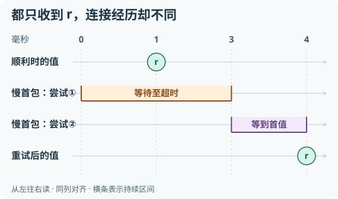

# 14｜给断线的现场做离线回放

迁移后的控制台收到一条故障报告。附件上只有一行 r，值班员记得它来得很慢。上一章能对着两份实现比较连接次数；这次没有旧程序可以重跑，只剩现场留下的记录。同一行 r 至少有两段说得通的来历。

[](../figures/book-14.svg)

## 接收记录前面少了一次连接

图的上半段里，第一次打开就收到了 r。下半段也只显示 r，第一条连接却完全没有送来数据。若在 retry 后面监听错误，那次超时已由 retry 处理，最后只会记下一次成功结束。把记录点放在它重订阅的工厂里，日志就不同了。

[回放实验](../labs/14.ts) 的 marks 保存了后一段历史。运行 `npm run lab -- 14` 可以核对两次连接；在 `assert.deepEqual(marks.map(...))` 前加 `console.table(marks)`，能看到明细。

| at | attempt | kind | value |
|---:|---:|---|---|
| 0 | 1 | open | |
| 3 | 1 | timeout | |
| 3 | 2 | open | |
| 4 | 2 | next | r |
| 5 | 2 | complete | |

帧 3 有两条记录，先是编号 1 的超时，接着编号 2 打开。用户并没有再点一次按钮；第一次请求原定在帧 5 才送出 x，首包期限却只给 3 帧。retry 收到错误，又订阅了一次 defer，工厂才分配第二个编号。帧 4 的 r 属于它，实际只等了 1 帧。

## 让记录重新经过超时判断

一台新的播放器不连接服务器，改从记录里找本次尝试对应的输入。尝试 1 没有远端发值，也没有远端完成。帧 3 的 timeout 是控制台当时作出的判断，如果直接当成服务器错误重播，就算删掉本地的超时代码，也能靠这条伪造的输入触发重试。

尝试 2 有一个 next 和一个 complete。它们在事故时钟上是 4、5，播放器接到第二次订阅时已经是 3，所以从现在算起只需再等 1、2 帧。实验里调度回调的部分可以简写成：

```ts
for (const event of events) {
  const delay = event.at - open.at;
  if (event.kind === 'next') pending.add(clock.schedule(() => sink.next(event.value), delay));
  if (event.kind === 'complete') pending.add(clock.schedule(() => sink.complete(), delay));
}
```

在实验中把 `event.at - open.at` 暂改成 `event.at`，差别会出现在第二次尝试。第一段从 0 开始，怎么算都一样；第二段从 3 开始，又等 4 帧就变成 7，帧 6 的首包期限反而先到。保留相对延迟时，两台播放器都在 4 给出 r，在 5 完成。

播放器也有关闭按钮。另一段三行附件在帧 1、3、5 发送 0、?、2，帧 4 停播时，只读到前两行。观察者退出后本来就收不到第三行，光看画面还不知道播放器有没有继续跑。实验在调度的回调里增加 deliveries，同时把每个待办动作加进 pending。

```ts
const pending = new Subscription();
for (const row of tape) {
  pending.add(clock.schedule(() => {
    deliveries++;                 // 记录生产端实际执行
    sink.next(row.value);
  }, row.at));
}
pending.add(clock.schedule(() => sink.complete(), 6));
return pending;                   // new Observable 的订阅函数返回它
```

返回 pending 使面板退订时能逐一撤掉尚未执行的动作。若删除 return，帧 5 的回调照样运行：画面仍只有两行，deliveries 却从 2 变成 3。这里的计数器和上一章的 opens 放在相同一侧，都记录实际做了多少工作。

## 回放时只响当时的铃

值班员打开详情页想看刚才那行错误。详情补到了 E1，却不该因此再惊动一次值班室。现场大屏已经在听，先收到 E1；详情加入后，两块屏又同时收到 E2。回看缓存和新到的通知穿过不同的代码位置：

<a id="重播一行日志要不要再响一次铃"></a>

```ts
const liveView = liveErrors.pipe(
  tap(id => ring(id)),
  shareReplay({ bufferSize: 1, refCount: true })
)
```

在 shareReplay 前记录，来源实际送来的是 E1、E2。若在共享之后响铃，详情补看的 E1 也响，E2 还会随两块屏各响一次。拿录像检查告警时，可以把 ring 换成记录编号的函数；当晚究竟该响几次仍能算出来，今天的扬声器不必参与。

<details>
<summary>一次重连补发了旧行</summary>

现场若有补发，只靠把响铃挪到共享前面还不够。实验让第一次连接送 41、42，第二次又送 41。把已接纳的编号留在同一次播放里，重连时便能认出先前的 41；整段重新播放才清空。

```ts
const totals = defer(() => {
  const accepted = new Set<number>();
  return openAttempts().pipe(
    retry(1),
    filter(id => !accepted.has(id)),
    tap(id => accepted.add(id)),
    scan((total) => total + 1, 0)
  );
});
```

这里 openAttempts() 表示订阅时才开连接的来源。若把 Set 放在连接工厂里面，第二次连接又从空集合开始，会多算一次。若存成模块级变量，重新播放同一卷反而没有新行。假如当时只保存两个「+1」而没记事件编号，重发和两条恰好同值的新记录就无法区分。

</details>

能重现事故的附件里有值、时间、连接编号，也有值班员停播的位置。下一步是从控制台选出要交接的记录，写进一份文件。播放器关掉就能退出，而导出可能还在等附件，这两项工作要分别处理。

[继续读第 15 章 · 让第二次导出等第一份写完](15.md)

<a id="发散练习"></a>

<details>
<summary>配套练习 · 哪些记录足以重演现场</summary>

<a id="transfer-a"></a>

[给一段合成器二重奏校时](../练习/14.md#transfer-a)

<a id="transfer-b"></a>

[从半幅拼布续读动作谱](../练习/14.md#transfer-b)

</details>

<details>
<summary>回看前面学过的用法</summary>

<a id="practice-1"></a>

**1.** 把数组回放与自定义可取消回放源接入同一播放器；中途停止，证明确实终止后续投递，而不只是隐藏输出。

<a id="practice-2"></a>

**2.** 从录像重建错误计数；用一条合法的零值与一条非法记录检验投影、筛选与累积各自的结果。

<a id="practice-3"></a>

**3.** 回放 A→A→B 的频道选择与一次清空命令；让面板中途加入，分别断言当前频道、重复选择和历史命令的可见性。

<a id="practice-4"></a>

**4.** 把先超时、重试成功的故障录成虚拟冷源；断言恢复结果与两段订阅区间，区别于第 12 章的最终失败。

<a id="practice-5"></a>

**5.** 用回放的点击和网络状态重建发送记录；故意交换首个状态与首个点击的顺序，解释哪些点击没有生成请求、哪些状态更新不应重复发送。

</details>

## 章末附录 · 本章 RxJS API 速查

<details>
<summary>展开 API 与用法</summary>

重播同一行错误可能要重画两次，现场告警只需响一次。对照 tap 在共享前后的位置，再检查播放器退订时收走了哪些动作。

**接入来源与订阅**

| API | 用法 |
|---|---|
| [`Observable`](../RxJS-7.8.2-API清单.md#api-114) | 描述一次可订阅的执行，可以交付零个或多个值，随后完成、报错或继续等待。 |
| [`Subscription`](../RxJS-7.8.2-API清单.md#api-180) | 一次执行的句柄，可集中登记清理动作并用 unsubscribe 释放。 |
| [`of`](../RxJS-7.8.2-API清单.md#api-125) | 按参数逐个同步交付后完成；传一个数组会把整份数组作为一个值。 |
| [`from`](../RxJS-7.8.2-API清单.md#api-73) | 将数组、Promise、可迭代对象等转成流；数组逐项交付，Promise 兑现后交付其结果。 |
| [`defer`](../RxJS-7.8.2-API清单.md#api-44) | 每次订阅才调用工厂，适合重新创建请求或读取当时的状态。 |

**变换、筛选与累计**

| API | 用法 |
|---|---|
| [`map`](../RxJS-7.8.2-API清单.md#api-91) | 对每个输入执行投影，交付一个对应结果；第二个参数是这一段订阅内的序号。 |
| [`filter`](../RxJS-7.8.2-API清单.md#api-65) | 逐项检查谓词，只放行满足条件的值；类型谓词还可收窄下游类型。 |
| [`pipe`](../RxJS-7.8.2-API清单.md#api-134) | 按从左到右的顺序组合操作；流的 pipe 方法把这些操作应用到当前来源。 |
| [`tap`](../RxJS-7.8.2-API清单.md#api-191) | 记录经过这一段的通知。把响铃放在直播的共享点之前，同一条直播错误只响一次。 |
| [`distinctUntilChanged`](../RxJS-7.8.2-API清单.md#api-49) | 首项通过，以后与上次放行的值比较，只交付变化。 |
| [`scan`](../RxJS-7.8.2-API清单.md#api-157) | 保存本次订阅的累计状态，每处理一个值就交出新状态；种子本身不会单独发出。 |

**时间与调度**

| API | 用法 |
|---|---|
| [`VirtualTimeScheduler`](../RxJS-7.8.2-API清单.md#api-219) | 用逻辑帧替代宿主时间，调用 flush 推进已排定动作。 |
| [`rxjs/testing · TestScheduler`](../RxJS-7.8.2-API清单.md#api-245) | 用虚拟帧建立来源，断言通知时刻与订阅区间。 |

**组合来源与在途工作**

| API | 用法 |
|---|---|
| [`combineLatest`](../RxJS-7.8.2-API清单.md#api-23) | 各来源都有首值后，任一路更新就组合各路最新值。 |
| [`withLatestFrom`](../RxJS-7.8.2-API清单.md#api-225) | 由主流发值触发，附带其他来源的最新值；配套来源须先各发过一项。 |

**共享、批次与分组**

| API | 用法 |
|---|---|
| [`Subject`](../RxJS-7.8.2-API清单.md#api-174) | 既能接收通知，也能把通知同步广播给当前观察者。 |
| [`BehaviorSubject`](../RxJS-7.8.2-API清单.md#api-13) | 保存当前值；仍活跃时，新订阅者立即收到它，包括构造时给定的初值。 |
| [`shareReplay`](../RxJS-7.8.2-API清单.md#api-166) | 共享上游并回放最近值；refCount 控制无人订阅时是否释放仍在运行的上游。 |

**网络、错误与终止**

| API | 用法 |
|---|---|
| [`catchError`](../RxJS-7.8.2-API清单.md#api-21) | 截住上游错误，改订阅返回的替代来源；摆放位置决定哪层读取被替换。 |
| [`retry`](../RxJS-7.8.2-API清单.md#api-152) | 来源报错后重新订阅，可限制重试次数并安排等待。 |
| [`timeout`](../RxJS-7.8.2-API清单.md#api-201) | 检查等首项或后续项的期限，超时后报错或切换到配置的替代来源。 |

**方法、属性与测试助手**

| 成员 | 用法 |
|---|---|
| `subscribe()` | 登记观察者、接入一次执行，返回控制该次订阅的句柄。 |
| `next(value)` | 交付一个值；Subject 会把这次通知发给当前观察者。 |
| `error()` | 以错误终止当前序列并释放订阅资源。 |
| `complete()` | 通知正常结束，随后释放资源；主动退订不会给观察者补发 complete。 |
| `unsubscribe()` | 主动结束本次订阅并触发清理；不能据此判断远端写入是否成功。 |
| `add()` | 把子订阅或清理函数挂到父订阅；父订阅已关闭时会立即执行清理。 |
| `now()` | 读取当前调度器的时间，在虚拟实验里对应逻辑帧。 |
| `schedule(work, delay?)` | 安排一项可取消的动作，可给延时及随动作传入的状态。 |
| `VirtualTimeScheduler.frame` | 读取虚拟时钟当前所在的帧。 |
| `flush()` | 推进虚拟时钟并执行待办动作；在 run 内可提前结算已安排的断言。 |
| `TestScheduler.run()` | 在 TestScheduler 的虚拟时间环境中执行回调，提供建源和验收工具。 |
| `hot(marbles)` | 在全局帧上建立热测试源，晚订阅者会错过已发生的通知。 |
| `cold(marbles)` | 创建冷测试源，弹珠时间线从每次订阅起点重新计算。 |
| `expectObservable()` | 记录给定订阅区间内的通知，用弹珠图检验值、错误和完成时刻。 |
| `expectSubscriptions()` | 检查一个或多个订阅区间，用来证明何时启动和释放资源。 |
| `subscriptions` | 冷、热测试源保存的订阅记录，可交给 expectSubscriptions 检查。 |
| `toBe(...)` | 给出期望的弹珠序列或订阅区间，可额外映射符号对应的值和错误。 |
| `shareReplay({ refCount })` | 配置字段。为 true 时，最后一位读者退出会释放仍活跃的上游订阅。 |

</details>

[上一章](13.md) · [本章实验](../labs/14.ts) · [目录](../README.md) · [下一章](15.md)
