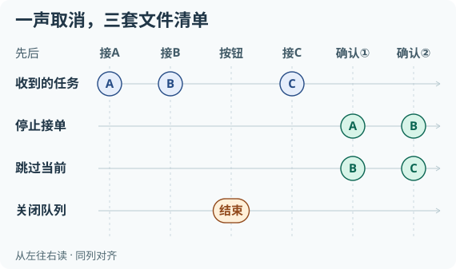

# 15｜导出中心：慢磁盘、慢网络与重复点击

值班员从事故记录里选了三行，要给同事导出 CSV。文件还在生成，他又缩小范围，只留一行，改选 JSON，再点一次导出。同事需要的是两份文件，各自保留点击时的选择。若磁盘空闲时才回表单里找参数，两次读取都可能只看到最后那一行。

实验用字符串 ID 代表选中的记录。rows 和 format 都有初值，任一方变化都会改变预览；按钮只在点击时才把此刻的组合交给队列。

```ts
const params = combineLatest({ rows, format });
const jobs = fromEvent(button, 'export').pipe(
  withLatestFrom(params),
  map(([, p]) => ({ format: p.format, rows: [...p.rows] }))
);
```

按实验的估算方式，CSV 每行占 2 单位，JSON 每行占 5 单位，大小预览依次为 6、15、5。若订阅 jobs，看到的却只有两份参数：一次 csv 配三个 ID，一次 json 配一个 ID。表单中途的变化没有多生成文件。数组展开在这里足够，因为 ID 是字符串；若要保存随时可能被原地改写的行文本，点击时也要把 text 字段读出来。

## 文件按点击排队，附件可以同时读

第一份 CSV 的三条记录各带一个附件。slow、medium、fast 各需 6、3、1 帧读完，最多同时开两个读取。第一轮分给 slow 和 medium，帧 3 就能把 medium 空出的位置给 fast。

| 附件 | 原始位置 | 开始读 | 读完 |
|---|---:|---:|---:|
| slow | 0 | 0 | 6 |
| medium | 1 | 0 | 3 |
| fast | 2 | 3 | 4 |

因此第一个回来的偏偏是第二行。读取结果带上在所选列表里的 index，才能在写入时归位。下面的 read、write 分别代表实验中的附件读取与落盘。

```ts
const files = jobs.pipe(concatMap(job =>
  from(job.rows).pipe(
    mergeMap((id, index) => read(id).pipe(map(data => ({ index, data }))), 2),
    toArray(),
    map(parts => parts.sort((a, b) => a.index - b.index).map(p => p.data)),
    concatMap(ordered => write(job.format, ordered))
  )
));
```

`npm run lab -- 15` 会分别打印读完顺序和写入内容。如果在 [labs/15.ts](../labs/15.ts) 的 `parts.sort(...).map(p => p.id)` 中暂去掉 sort，第一份会变成 `csv:medium,fast,slow`，第二份仍是 `json:fast`。文件顺序正确，变的是文件里的三行。恢复排序后，慢附件在 6 到齐，写入还要两帧；外层 concatMap 等到 8 才让下一份开读。若自行另开一个 subscribe 去写，外层只能等到「开始写」，便可能提早放行。

## 把「取消」按钮交给哪一层？

两份文件排好以后，值班员发现选错了 A。此刻 A 在写，B 还没动，稍后还可能提交 C。原来只有一个「取消」按钮，究竟会留下哪些文件，取决于按钮接进哪个订阅。这里的磁盘替身只在收到写入确认时才把文件加入已完成名单。

| 按钮的承诺 | 信号放在哪里 | A、B、C 的去向 |
|---|---|---|
| 停止收新单，让已收的写完 | `jobs.pipe(takeUntil(stop), concatMap(write))` | A 写完，再写 B；C 进不了队列 |
| 跳过当前文件，继续营业 | `jobs.pipe(concatMap(job => write(job).pipe(takeUntil(skip))))` | A 取消，B 随即开写，稍后的 C 也能排队 |
| 关闭整个导出器，放弃余单 | `jobs.pipe(concatMap(write), takeUntil(close))` | A 取消，B 工厂不启动，C 无人接收 |

[](../figures/book-15.svg)

中间一行最容易误读。按钮是普通 Subject，只通知按下时已经订阅它的人。A 的写入因此退出，concatMap 随即让 B 开始。B 接入按钮时，那一声取消已经过去，所以 B 还能写完。三种接法在同一组输入下分别留下 AB、BC、空。若外部服务早已提交 A，只差给页面发回执，末行能取消的是本地观察，不能据此从账本上抹掉 A。

<details>
<summary>零行文件与只读到一半的文件</summary>

如果筛选确实得到零行，一份带表头的空 CSV 也有用。from([]) 会完成，toArray() 交出 []，写入器因此有机会运行。如果用户读到第一行 a 时按了取消，含 a 的半份报表却不该按成功提交。

```ts
parts.pipe(takeUntil(cancel), toArray())
parts.pipe(toArray(), takeUntil(cancel))
```

第一行把取消转成了完成，收集器会交出 [a]。第二行让收集器本身退订，暂存数组随之丢弃。附件报错又是另一条路径：在单份文件内部 catchError 并返回失败回执，队里的下一份仍会开工。若整个 jobs 在外面被 catchError 替换，排队的 B 就没有人接了。

</details>

浏览器里的成品按钮导出 JSON，CSV 切换属于本章实验。这个导出器最难从界面看出来的故障，是文件没有多一份，后台却多读了一次。值班时常见的同类情况出现在日志面板：屏上每行都对，服务端的请求数却翻了倍。

[继续读第 16 章 · 排查多出来的请求](16.md)

<a id="发散练习"></a>

<details>
<summary>配套练习 · 点击时该把什么留给队列</summary>

<a id="transfer-a"></a>

[合唱排练室的三间音舱](../练习/15.md#transfer-a)

<a id="transfer-b"></a>

[桌面排版师的三条字位刻线](../练习/15.md#transfer-b)

</details>

<details>
<summary>回看前面学过的用法</summary>

<a id="practice-1"></a>

**1.** 用点击创建导出任务，把选中记录数组展开；延后启动文件生成，证明取消排队任务不会提前生成文件。

<a id="practice-2"></a>

**2.** 分别对文件写入与附件读取限流；让首份附件最慢，测量峰值并发数和落盘顺序。

<a id="practice-3"></a>

**3.** 让预计大小随筛选和格式变化；点击时冻结导出参数。导出途中再改格式，断言预览变化但当前文件不变。

<a id="practice-4"></a>

**4.** 模拟用户在同一帧取消导出和准备下一批数据；给出订阅顺序，再把取消信号提前一帧，用两条区间断言解释差异。

</details>

## 章末附录 · 本章 RxJS API 速查

<details>
<summary>展开 API 与用法</summary>

导出的行和格式在点击时锁定。withLatestFrom 取样，concatMap 安排文件先后，takeUntil 所在的位置决定按取消后还能写完哪些文件。

**接入来源与订阅**

| API | 用法 |
|---|---|
| [`finalize`](../RxJS-7.8.2-API清单.md#api-66) | 在完成、出错或退订时执行收尾逻辑，适合释放资源或核对清理次数。 |
| [`of`](../RxJS-7.8.2-API清单.md#api-125) | 按参数逐个同步交付后完成；传一个数组会把整份数组作为一个值。 |
| [`from`](../RxJS-7.8.2-API清单.md#api-73) | 将数组、Promise、可迭代对象等转成流；数组逐项交付，Promise 兑现后交付其结果。 |
| [`fromEvent`](../RxJS-7.8.2-API清单.md#api-74) | 订阅时为事件目标注册监听，退订时移除，用于按钮和键盘等输入。 |
| [`defer`](../RxJS-7.8.2-API清单.md#api-44) | 每次订阅才调用工厂，适合重新创建请求或读取当时的状态。 |

**变换、筛选与累计**

| API | 用法 |
|---|---|
| [`map`](../RxJS-7.8.2-API清单.md#api-91) | 对每个输入执行投影，交付一个对应结果；第二个参数是这一段订阅内的序号。 |
| [`pipe`](../RxJS-7.8.2-API清单.md#api-134) | 按从左到右的顺序组合操作；流的 pipe 方法把这些操作应用到当前来源。 |
| [`tap`](../RxJS-7.8.2-API清单.md#api-191) | 在通知经过时执行观察或记录动作，正常返回时继续转发原通知。 |
| [`toArray`](../RxJS-7.8.2-API清单.md#api-210) | 收集本次订阅的所有值，在正常完成时交出一个数组。 |
| [`take`](../RxJS-7.8.2-API清单.md#api-187) | 只交付前 n 项，取够后完成并退出上游。 |
| [`takeUntil`](../RxJS-7.8.2-API清单.md#api-189) | 通知源第一次发值时完成输出并解除来源订阅。 |

**时间与调度**

| API | 用法 |
|---|---|
| [`timer`](../RxJS-7.8.2-API清单.md#api-206) | 等到指定时刻或延时后发 0；给第二个周期参数可继续递增发值。 |
| [`VirtualTimeScheduler`](../RxJS-7.8.2-API清单.md#api-219) | 用逻辑帧替代宿主时间，调用 flush 推进已排定动作。 |
| [`rxjs/testing · TestScheduler`](../RxJS-7.8.2-API清单.md#api-245) | 用虚拟帧建立来源，断言通知时刻与订阅区间。 |

**组合来源与在途工作**

| API | 用法 |
|---|---|
| [`switchMap`](../RxJS-7.8.2-API清单.md#api-183) | 把输入映射成内部流，新输入到达时退订旧内部流，只转发当前一条。 |
| [`concatMap`](../RxJS-7.8.2-API清单.md#api-30) | 按点击次序写文件，上一份结束才启动下一份；等待中的文件使用点击时采样的参数。 |
| [`mergeMap`](../RxJS-7.8.2-API清单.md#api-97) | 把输入映射成可同时工作的内部流，结果按抵达顺序交付，可限制并发数。 |
| [`combineLatest`](../RxJS-7.8.2-API清单.md#api-23) | 各来源都有首值后，任一路更新就组合各路最新值。 |
| [`withLatestFrom`](../RxJS-7.8.2-API清单.md#api-225) | 由主流发值触发，附带其他来源的最新值；配套来源须先各发过一项。 |

**共享、批次与分组**

| API | 用法 |
|---|---|
| [`Subject`](../RxJS-7.8.2-API清单.md#api-174) | 既能接收通知，也能把通知同步广播给当前观察者。 |
| [`BehaviorSubject`](../RxJS-7.8.2-API清单.md#api-13) | 保存当前值；仍活跃时，新订阅者立即收到它，包括构造时给定的初值。 |

**网络、错误与终止**

| API | 用法 |
|---|---|
| [`catchError`](../RxJS-7.8.2-API清单.md#api-21) | 截住上游错误，改订阅返回的替代来源；摆放位置决定哪层读取被替换。 |

**方法、属性与测试助手**

| 成员 | 用法 |
|---|---|
| `subscribe()` | 登记观察者、接入一次执行，返回控制该次订阅的句柄。 |
| `next(value)` | 交付一个值；Subject 会把这次通知发给当前观察者。 |
| `complete()` | 通知正常结束，随后释放资源；主动退订不会给观察者补发 complete。 |
| `unsubscribe()` | 主动结束本次订阅并触发清理；不能据此判断远端写入是否成功。 |
| `now()` | 读取当前调度器的时间，在虚拟实验里对应逻辑帧。 |
| `schedule(work, delay?)` | 安排一项可取消的动作，可给延时及随动作传入的状态。 |
| `flush()` | 推进虚拟时钟并执行待办动作；在 run 内可提前结算已安排的断言。 |
| `TestScheduler.run()` | 在 TestScheduler 的虚拟时间环境中执行回调，提供建源和验收工具。 |
| `hot(marbles)` | 在全局帧上建立热测试源，晚订阅者会错过已发生的通知。 |
| `cold(marbles)` | 创建冷测试源，弹珠时间线从每次订阅起点重新计算。 |
| `expectObservable()` | 记录给定订阅区间内的通知，用弹珠图检验值、错误和完成时刻。 |
| `expectSubscriptions()` | 检查一个或多个订阅区间，用来证明何时启动和释放资源。 |
| `subscriptions` | 冷、热测试源保存的订阅记录，可交给 expectSubscriptions 检查。 |
| `toBe(...)` | 给出期望的弹珠序列或订阅区间，可额外映射符号对应的值和错误。 |

</details>

[上一章](14.md) · [本章实验](../labs/15.ts) · [目录](../README.md) · [下一章](16.md)
