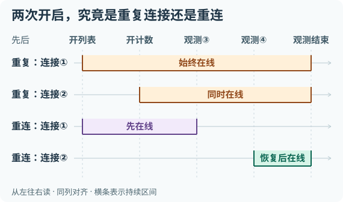

# 16｜接手值班：查出后台悄悄增加的工作

## 值班交接单（闭卷）

发布后同时开日志和计数面板，请求数翻倍，屏上每行只显示一次。另一位同事只开事件面板，也偶尔看见旧事件闪一下。请给第一种现象提出两个解释，选择成本最低的观测点，写下什么结果会推翻你的首选解释。

还有四条独立报障。先在纸上为每条选一个能抓住故障的最短用例，写出修复前后应观察到的差异。

| 故障数据 | 用户看到的症状 |
|---|---|
| 后台声称「已重试」，服务端只记一次请求 | 临时离线后总是退回缓存 |
| E → 恢复 → E | 第二次故障没有告警 |
| 昨日收尾为 1，今日首条错误到达后显示 2 | 跨会话串数 |
| 连点刷新两下，随后关面板 | 详情接口仍在工作 |

## 教师定位索引

### 一｜在创建连接处打点，再看晚到者首值

一次连接被两处独立订阅，或一次订阅经历断线重连，都可能启动两次。最低成本的探针是给上游订阅函数加开始/结束记录及会话编号，依次打开面板。若同一连接先结束才开第二个，就该查重连；若第一个还活着、第二个一打开就加一，则先查共享位置。同一组件重新渲染的次数解释不了底层两次同时启动。

```ts
const raw = new Observable<void>(() => {
  starts++;
  return () => { stops++; };
});
const feed = raw.pipe(share());
group.add(feed.subscribe());
group.add(feed.subscribe());
```

**读图 · 两次开启，究竟是重复连接还是重连**

[](../figures/book-16.svg)

比较两种故障假设。上半图检查双开时的重叠，下半图检查断线后的空档；最右只是停止观测。两份记录都可以数出两次启动。

把两个订阅交给同一 `Subscription` 管理只能一起清理；若都直接订阅 raw，底层仍启动两次。实验保留同一条 `starts === 1` 断言：旧实现必须触发 AssertionError，修复后直接通过。共享实例要在两个消费者之外创建。若每个面板都调用一遍 `raw.pipe(share())`，它们仍各有自己的连接。

现在只改变是否缓存。第一个面板保持在线，推 old，再开第二面板，推 new。判据是第二面板第一条消息：`shareReplay({ bufferSize: 1, refCount: true })` 交付 old，`share()` 交付 new。状态面板需要当前快照，事件面板要求只看新事件。减少连接数与修复旧事件闪现需要两条独立断言。

回看上题的类型判据：位置参数 `shareReplay(1)` 表达缓存一个值，7.8.2 下引用数降到零时默认不会主动断开未终止的源。对象重载要求写出 `refCount`。实验中 `keepLast` 通过类型检查，删去该字段的 `incomplete` 必须被拒绝。这个差异在永久在线的连接上能直接影响后台工作量。

### 二｜重试的是同一个结果，还是一次新请求

先猜这两行各会调用 request 几次；约定第一次失败，第二次能恢复。

```ts
from(request()).pipe(retry(1))
defer(request).pipe(retry(1))
```

上行先求值拿到 Promise，重订阅只是再次观察同一个拒绝结果。下行把创建函数交给订阅，第二次机会才会真发请求。把 `catchError(() => of('cached'))` 放在重试之后，分别应得「1 次、cached」与「2 次、live」。再让每一次新建请求都失败，应得「2 次、cached」。这第三组排除了「只要重新创建就永远能成功」的误判。

再问超时策略：2 帧没首值就结束尝试，等 3 帧后再试一次。帧 0 开始，帧 2 超时，到帧 5 才重新占用连接，帧 7 再次超时并降级。实验把 `timeout({ first: 2 })` 放在 `retry({ count: 1, delay: 3 })` 里面一侧，即每次重订阅都重装期限。冷源订阅记录必须恰为 `[0,2)`、`[5,7)`。虚拟时钟覆盖 RxJS 定时动作，原生 Promise 的微任务用单独的真实 `await` 案例验。Promise 包装的订阅结束后，底层 I/O 能否中止取决于请求适配器。

### 三｜恢复信号必须活到哪一步

把最短状态序列 E、R、E 放在 0、4、8 帧。业务要求某个码连续稳定 2 帧才告警，每段故障报一次。若先 `filter(isError)`，去重器只能看见两个相邻的 E，就吞掉了第二段故障。让去重器先见到 R，它记住的新状态才允许第二个 E 穿过。

恢复也要参与防抖。若第 0 帧 E、第 1 帧就 R，第 2 帧已经没有值得报警的故障。实验顺序为 `distinctUntilChanged() → debounceTime(2) → filter(isError)`。相同状态不重复推迟计时，恢复会替换等待中的故障。第一组应在帧 2、10 各告一次，毛刺组应完全没有告警。若需求改为「每次故障立即告警」，这段延迟应重新商定。

### 四｜谁拥有累加器

值班员重开计数面板应看到本会话的 1，第二天新会话应先出现 0。若只把标签清零而让旧 `scan` 继续订阅，下一个错误仍从旧总数加一。画出三条不同寿命：清空命令只在发出当刻有效；总数状态供晚到者立即读取；累加器在整个会话中保持一份。

实验用 `session()` 每次创建命令源、初值为 0 的状态和一份 reducer 订阅。错误发 1，清空发 0，合流后 `scan((n, cmd) => cmd === 0 ? 0 : n + 1, 0)`。状态用 `BehaviorSubject` 接收累积结果，命令用 `Subject` 广播。做一次「错、清、错」，晚到者应得到总数 1、历史命令 0 条。关闭会话时释放 reducer，新建会话由 0 加到 1。若改成只在组件挂载时才开始累计，隐藏期间发生的错误会缺失。

### 五｜找到最后一个仍持有内部订阅的人

刷新 a 在帧 1 启动一组详情 L、R，帧 2 的 b 应忽略。为了把泄漏显出来，让两个详情都永不自行结束；帧 4 关面板，帧 9 再来一次 c。先写你期望的启动和清理日志。

```ts
refresh.pipe(
  exhaustMap(batch => from(['L', 'R']).pipe(mergeMap(id => detail(batch, id), 2))),
  takeUntil(close)
)
```

组内允许两个详情并行，组外只要本组仍活跃就忽略刷新。关闭边界放在整个组合之后，向上释放时遍历当前组及其子订阅。若把关闭只放在刷新源上，刷新输入完成后，组合器仍能等已启动的内部源完成。没有更多 UI 输出不能证明关闭成功。验收直接看两个内部源的 `finalize`：aL、aR 都在帧 4 清理，b、c 从未启动。

### 六｜所有面板都关过，旧版本从哪里来

上午的连接数已经降到一。午后值班员又发来两张截图：关闭所有面板，服务端把配置版本从 v1 改到 v2，再打开面板，标题仍显示 v1。服务端在这期间没有第二次读取记录。先排除两个容易混淆的来源：浏览器可能重新取过配置但拿到了旧数据，也可能根本没执行读取函数。把计数器放在工厂入口，在这个小用例里先让每次新建读取都可靠地带回新版本。若此时仍只执行一次，才有理由沿本地共享链往下查。

注意配置读取和日志连接有不同的结尾。设读取在帧 0 启动，帧 1 交付 v1，帧 2 自然完成。第一个面板在帧 3 离开，其订阅实际上在帧 2 已经结束。帧 5 再打开一个面板，复用同一个配置流实例。使用前文的 keepLast 配置，后来者会在帧 5 同步收到 v1 和完成，工厂启动次数仍为一。把后端更新安排在帧 4 也改变不了这份记录，因为没有任何新请求观察过更新。

为什么 refCount 已经设为 true 仍是这样？引用计数数的是当前读者。最后一位读者在源仍工作时离开，才能靠引用数下降切断那次进行中的工作。对已经成功完成的读取，7.8.2 的 shareReplay 会保留最后一个值及完成状态，后来的读者可以直接重放它。想象值班室里有一份签字封好的报告：移走最后一张阅读椅，报告的日期不会因此更新。只要应用还拿着这个共享实例，就仍能找到那份报告。这里的「缓存」在内存里；刷新整个应用，创建的又是另一个实例。

用反例划出分界线。把同一条冷源的完成推迟到帧 8，第一位读者仍在帧 1 收到 v1，但在帧 3 主动离开。此刻源尚未完成，引用数归零使上游被撤下。帧 5 新读者到场就会启动第二次读取，要到帧 6 才能读到 v2。两份交接单都写着「读到了 v1，然后所有人离开」，只差一个完成时刻，第二次启动的结论就会反过来。实验把工厂编号写进值里，再查订阅区间；仅凭标签变成 v2 无法排除有人在 UI 层改过文字。

如果配置是某次事故归档的只读附件，成功结果复用到本次调查结束很合适。若按钮明确写着「重读配置」，每次重读就应创建新的读取代次，让本次的并发读者仍共用一份流。简单的做法是让会话服务持有当前实例，收到明确的失效命令时替换它，下一次打开面板取新实例。已拿走旧实例的订阅者不会自动搬家；若要求所有已开面板立即刷新，就让统一的刷新输入驱动读取，并把这条结果流共享给它们。先决定是「下次打开时生效」还是「所有开着的屏现在就变」，两个验收用例需要的刷新时刻不同。

把探针顺着缓存再挪一步。若读取失败，恢复器在共享之前发出「离线副本」然后正常完成，缓存看到的是一次成功交付的普通值。即使网络后来修好，迟到的面板仍可能拿到离线副本。一个很有迷惑性的修复是增加 retry 次数：这只能增加首次降级前的机会，一旦副本已被缓存，再次打开甚至不会经过重试工厂。若期望下一位读者重新尝试，应先让共享层看到源的错误，再在读者侧转换成可渲染的降级结果。这个版本的 shareReplay 遇到错误会重置；下一次订阅可以新建读取。要检验的时刻是降级之后第二位读者到来时，后台计数是否从一变二。

### 七｜页面关闭前，短故障突然报了警

另一位同事交来一条看似推翻第三站的记录：只有一个 E，出现不到两帧就结束，竟然收到了告警。先让对方复述「结束」是哪一种通知。值班员关掉面板，传输层发来正常结束，传输层报告错误，这三件事都可能让角落里的连接灯变灰，等待中的防抖值却有不同去向。把灯的颜色翻译成同一个 complete 会抹掉决定性的差别。

设防抖间隔为三帧，帧 1 出现 E，本应在帧 4 才交付。帧 2 如果收到 R，等待中的 E 会被 R 替换，最后的筛选挡住恢复状态，不响铃。这正是原来毛刺用例所验的那条路。把帧 2 的 R 改为源自然完成，防抖器会在完成时交付还攒着的 E，随后也完成。输出的告警和完成都在帧 2，不需要等剩余两帧。这个收尾方式适合一个收集搜索词的输入框，最后几个字仍有机会保存；对于必须确实稳定三帧的告警，它可能过早。

把同一幕搬到关闭按钮上。若先用 takeUntil(close) 截断健康流，再交给 debounceTime，上游会把帧 2 的关闭翻译成一次完成。沿着链向下读，防抖器正好在这里把挂起的 E 吐给告警面板。把关闭边界放在防抖和筛选之后，最外层收到关闭而完成，上游等待动作被退订，屏幕就只收到结束。两个版本的健康源都在帧 2 停止，甚至清理计数也一样。能推翻旧实现的是「同帧有没有一次告警回调」。实验分别断言值和完成的位置，把关闭提前到等待期内，免去和计时器抢同帧的干扰。

这项修复只改变主动关闭的路径。如果健康通道本身也可能在帧 2 自然结束，移到末尾的 takeUntil 并不会拦住来自健康通道的完成。需要和当班同事确定什么才算观察到三帧稳定。若记录结束就失去证据，可以把「通道结束」明确转换为一个离线状态，让它先替换待定故障，再让流完成，最后只让确认过的故障码触发业务铃声。若通道结束本身就是最高级告警，则应另外发出离线告警，并标明原因。不能拿一次提前交付的 E 冒充连接断开所触发的告警，排障负责人和后续动作都可能不同。

有人提出把防抖换成延迟三帧，认为只要在时钟上等够就行。沿原来的毛刺再算一次：帧 1 的 E 安排在帧 4，帧 2 的 R 安排在帧 5，两个定时都能活下来。帧 4 会为已经恢复的故障响铃。延迟能让通知变晚，无法验证等待期间没有反例。若服务只要求故障出现就记一条审计日志，那条日志完全可以立即记；稳态告警应在能同时看到故障和恢复的地方等待。给审计和响铃各保留一个观测点，才能解释为什么审计里有 E，但无人接到通知。

### 八｜算出是哪个读者在重试

将两个面板放回同一张交接单。它们同时盯着一个健康源，第一次连接失败，策略约定稍后重试。现在关闭左屏，右屏保持在线。维护者看到一次清理就认定重试已经取消。怎样证实？给「连接工厂开始」和「面板收到的终止」分别编号，再记下重试等待属于哪一层。关闭左屏只结束一个读者，若重试由两个读者仍共用的服务持有，右屏有权继续等。仅凭左屏的清理回调看不出服务的计时器是否还在走。

先算共享之前统一重试的方案。帧 0 两块屏加入同一个尚未结束的冷读取，帧 2 首次失败，服务等三帧准备再试。帧 3 左屏离开，只剩一个引用，服务在帧 5 仍启动第二次尝试。若把右屏离开也放在帧 4，引用计数归零，仍在等待的重试订阅被撤下，帧 5 就不该再启动任何工厂。这时最能揭露泄漏的观测恰恰在两个面板都离开之后。不要在关屏那一帧就停止测试，让时钟越过原订的重试时刻，再数工厂记录。

把 retry 分发给各个读者则要重新计算。两人看见同一次错误后，各自拥有一次等待；左屏离开可以取消自己的计时器，右屏的仍会触发。即使两个等待都活下来，也不能凭等待次数推出请求次数。若请求耗时且两次重订阅重叠，共享层仍可能把它们汇到同一次新连接；若第一次重订阅同步产生错误并释放了连接，另一个读者到来就可能又建一次。检查实际工厂调用时刻比在每个 UI 打印「正在重试」更能分辨这两种运行。对同一个数据服务，重试预算归属会改变不同读者能否得到不同的失败结论。

交班迁移题：把健康面板换成只在展开时读取一次的版本说明。产品经理要求「同一次发布打开十次只读一次，但换发布号必须重读；手动折叠不能制造告警」。可以从哪两条证据验收？先让发布甲的读取成功完成，折叠再展开，工厂计数保持一，迟到者立刻收到甲。随后更换发布号并打开乙，服务按发布号取得新实例，首次收到乙后计数为二。拿这组输入可以否决每次打开都重读的修复，也能否决整个应用永远只有一个缓存的修复。

另一条证据放在折叠前的一帧：人为送入一个还在等待确认的故障，折叠时应该只清理面板的观察，响铃次数保持零。若产品要求折叠后后台仍然值班，就把告警订阅归给会话服务，面板仅移走展示；再加一条在折叠后持续超过期限的故障，应仍有一条服务告警。这个变体保留了「折叠本身不制造告警」，却改变了谁能终止等待。交接时写明这项归属，下一位同事才能判断后台继续工作究竟是泄漏还是值班职责。

验收时还要防一种观测假象。假如每条告警同时更新角标、写入交班记录，关闭面板恰好卸载了角标，界面上什么都没闪，交班记录却多了一行。用一个同步收集器临时代替响铃出口，把告警帧号和原因写到数组里。把它放在业务决定发出告警的位置，离开面板后仍能检查数组；若把它挂在已经卸载的视图上，两种实现都会看似沉默。取证也有自己的生命周期，它至少应覆盖所质疑的那次副作用。

反过来，给冷源额外订阅一个「诊断专用读者」也会改变现场：原本在帧 4 应归零的引用数仍为一，帧 5 真的发生重试。更可靠的记录方法是在现有工厂里增加启动计数，或在现有链路上旁观终止，让诊断代码随原有订阅运行。比较开关诊断前后的源启动次数，若观测本身增加了工作，先移走这位额外读者再下结论。

从项目根目录运行 `node --experimental-strip-types labs/16.ts`。交接时保留最小失败输入、同一条修复后通过的断言，以及被这次观测排除的解释。回到控制台定位时，可分别在连接工厂、重试工厂和详情清理函数打点，先选择与症状对应的一处。

<a id="transfer-a"></a>
### 发散题 A｜为什么同一块矿石做了两次自我介绍

自然教室里有一只互动展柜。孩子把手放到感应区，扬声器念一遍矿石的名字，灯牌亮起。手一直在，探头可以多次报告“有手”；离开后再伸手算下一次。老师拆下灯牌带到后排再接回去，灯牌须立刻显示当前有没有手。搬灯牌不该让扬声器发声。另有一颗凸起的“再听一次”按钮，专为仍在摸标本的孩子设计，按一次允许多念一遍。

开课前已校准，感应区为空。按下表做台架检修，每格是一拍。末两拍故意保留探头电气输入，检查下课拆线后的教具反应。没有列出的动作都不发生。

| 拍 | 教室里可观察的动作 |
|---:|---|
| 0 | 开课，接上灯牌与扬声器 |
| 1 | 报有手 |
| 2 | 老师拔下灯牌 |
| 3 | 再报有手 |
| 4 | 灯牌重新接好 |
| 5 | 第一轮无人按键；第二轮只在这里按一次重听 |
| 6 | 报无手 |
| 8 | 报有手 |
| 9 | 下课，灯牌和教具的感应线路都应释放 |
| 10、11 | 依次报无手、有手 |

给老师写一张验收卡，正面分别列出灯牌真正收到的显示值和扬声器启动的拍号，背面写下从开课到下课探头读出线路建立几次、下课后还剩几位监听者。再画两张不合格教具的接线草图。一张会在第 3 拍多念，另一张只在第 4 拍多念。告诉老师只拔哪条线、保留哪条线，就能在没有原厂图纸时把这两类原因分开。交卷时也要说清你能否从这份探头数据判断第 8 拍是不是同一个孩子。

<details>
<summary>从两个可疑的发声拍号反查驱动路径</summary>

先坐到孩子的位置。第 1 拍听到一次名字，第 3 拍仍是同一次触摸。第 4 拍应该看见灯亮却无新声音，这一拍是整个检修中最有区分力的瞬间。灯确实需要知道“手还在”，重新接线本身没有让手再伸进来。第 6 拍灯灭，第 8 拍再亮，才有充分证据启动另一遍发音。称为“下一次感应”就够了，给它写上“第二个孩子来了”会加入传感器没有提供的身份信息。一人来回伸手和两人先后各伸一次在这张输入带上逐格相同。

| 观察者 | 第一轮读数 | 第二轮只按一次重听后 |
|---|---|---|
| 灯牌 | 0 灭，1 亮，4 亮，6 灭，8 亮 | 同左 |
| 扬声器启动 | 1、8 | 1、5、8 |
| 探头读出线路建立 | 一次 | 一次 |
| 下课拆完线路后的监听者 | 零 | 零 |

第 2 拍拔灯牌时无需记一个“收到灭”。灯牌的订阅此刻结束，拆掉后物理灯当然可能熄灭，但那属于供电状态。把供电变化伪装成探头报告无手，就会把一次完整触摸切成两次。第二次接上灯的时候要的是当前占用状态，因此可在教具内部保留一位持续在场的接收者，灯牌每次接回只读它的当前状态。这位接收者在灯牌搬走期间仍由开课会话持有，正好符合老师继续上课的情境。若整堂课都结束，还留它在那里就是另一件事了。

把检修分两步做。先不给灯牌通电，只让扬声器听探头，保持手不动，制造两份连续的“有手”读数。若第二份也触发播放，说明从原始读数到“新一次触摸”的变换没有挡住重复输入。实验在真实接入处增加 `reads`，然后让两个用途从同一个已经识别变化的入口分出。数的是读出线路开始工作多少次，给灯牌绘图多少次另算。

```ts
const wire = defer(() => {
  reads++;
  return contact;
}).pipe(distinctUntilChanged(), share());
owner.add(wire.subscribe(near => light.next(near)));
owner.add(wire.subscribe(near => {
  if (near) sounds.push(clock.now());
}));
```

初始已经校准为空，本例只要听到第一次真值就能断定刚出现一次触摸。第 3 拍两个读数都是 true，重复项止于比较处，因而状态保管者和扬声器都不再拿到这个值。若把比较去掉，只留 `if (near)`，第 1 和第 3 拍都会播放。此时灯牌恰好不在，第 3 拍多出来的声音仍然能听见，这个小操作排除了“只有重接灯牌才可能多播”的解释。若设备启动时区域是否为空尚未校准，第一次真值也可能是一只早已停在那里的手，开机是否朗读须另行规定。

再用一根线模拟另一种错误接法。让每次装上灯牌时都用如下处理函数驱动，而其他条件保持不变。初次接线时读到假，房间安静；有手时灯牌和原有的独立扬声支路都会说话。为了单独隔离第 4 拍的故障，做这项对照时应断开原扬声支路，让灯牌兼任唯一的播放入口。这样第 1、8 拍都只有一个播放源，第 3 拍无灯牌，第 4 拍的多播只能来自重新挂载。

```ts
// 错接示意。用它替代独立的播放支路，作为每次灯牌挂载时的处理。
const mountWrong = () => light.subscribe(near => {
  lamps.push(clock.now() + '/' + Number(near));
  if (near) sounds.push(clock.now());
});
```

如果移除所有第 2、4 拍的拆装，只保留手的动作，这个错误接法在基准轮可能完全正常。因此仅仅让孩子多试几次不会增加多少判断力，保持手不动且只拆装灯牌更重要。正确的灯牌入口只改显示，发音入口由课时持有。灯牌在第 4 拍收到 true 是一条必须保留的成功证据。如果为了消灭多播把它也屏蔽了，扬声器轨迹恢复正确，老师拿回的灯牌却要等到第 6 拍才知道情况。

```ts
const indicator = () => light.subscribe(near =>
  lamps.push(clock.now() + '/' + Number(near))
);
let display = indicator();
clock.schedule(() => display.unsubscribe(), 2);
clock.schedule(() => { display = indicator(); }, 4);
```

拿两条线分别追一次 `true`。感应线上首次变为真，可以开音门。显示线上首次订阅读到真，只够点亮灯。如果试图在显示入口一律丢弃首值，第 0 拍的“已确认空”也会丢掉；将来装上一块刚从别处拿来且仍亮着的灯牌，初始显示就错。相反，若给所有新接入的扬声器补放最近一次语音，即使那次触摸已经结束，重插音箱也可能在空教室念名字。设计每一条接线时不妨写出“现在接上，立即要得到什么”，再决定是否需要保存最近的值。

**谁有权让它再说一次？** 第 5 拍的按钮不代表探头再次读到有手。它是一条有访问条件的指令，只在仍有手时成立。实验从按钮处理读取当下占用事实，向发音入口提交一次新动作。若把它偷偷写回感应线为 true，与前一个 true 重复，会在变化识别处被吃掉；若为了它专门撤掉去重，第 3 拍的误播又回来了。两条原因不同的播放动作可以共用实际扬声部件，接入点应保留来源，便于检修员解释某次额外发声是否获得了孩子的同意。

```ts
if (pressLate) clock.schedule(() => {
  if (light.value) sounds.push(clock.now());
}, 5);
assert.deepEqual(cabinet(false).sounds, [1,8]);
assert.deepEqual(cabinet(true).sounds, [1,5,8]);
```

这里的两条断言各自重新开课。若第二轮沿用第一轮未拆干净的扬声支路，第 1 拍会再多一次声音，很难分辨是重听键造成还是上一次检修留下了线头。配套实验在每轮内创建占用状态和订阅容器，在第 9 拍释放显示与会话。第 10、11 拍输入真实发生，输出仍静默；同时再看 `contact.observed`，此时应为假。只把所有喇叭音量调零固然也会安静，但并未卸掉探头读出者。这个读数能查到实验内部的监听关系，若探头是接在串口上的真设备，还须在驱动释放串口时记一笔，才能宣称硬件也停工。

**一段声音很长时怎么办？** 本实验中 `sounds.push` 只代表启动播放。它没有记录声音的结束，也没有承诺第 5 拍按键时第 1 拍的语音已经念完。若矿石名换成长段讲解，第 5 拍可能落在朗读中间。老师可以要求从头重念、排在当前段之后，或忙时用灯表示“稍等”。把语音时长设为六拍，在第 1 拍启动、第 5 拍按键，就能分别写出第 5 拍立刻重新起音、第 7 拍再起音、或全程只有一次起音。确认要的是哪种，再让音频部件报告“本段完成”或“已停止”；仅数感应区出现多少真值没法验收这些差异。

若现场只带回一段手机录音，其中同一个名字听起来响了两遍，还存在另一种解释：扬声器只启动一次，素材本身录了两遍。将测试替身换为每次只响一声的短音，同时记录驱动入口和音频输出。入口一项而听见两声，先检查音轨或回声；入口两项且时刻恰在重接灯牌，就回到接线调查。诊断时给已存在的驱动加计数即可，额外装一个“监听用播放器”也会制造声音，不能拿它来证明原教具有双重启动。

</details>

<a id="transfer-b"></a>
### 发散题 B｜自动浇花台把一段潮土叫成了干旱

园艺课的育苗台旁边有一只提示铃，提醒学生检查滴灌。铃只作提示，不直接开阀。土壤湿度以整数读数表示。低于 30 算干，达到 40 算湿，30 到 39 之间沿用前一判断。上电时还不知道干湿；探头一旦明确报无效，先前的判断失效，必须重新取得足够低或足够高的读数。两次报告之间暂按上一次判断持续，这一题没有额外的失联期限。

一段连续的干燥状态满三分钟响一次，持续干燥不重复响；中途转湿或失去依据就放弃那一段。老师拆下铃时一并结束监测，余下的等待也要撤掉。若新读数与满三分钟的时刻相同，本台架约定先处理已经排定的新读数，再裁决响铃。下表中的问号是“探头明确报无效”，空着的分钟则是“没有新报告”。

| 分钟 | 0 | 1 | 2 | 3 | 4 | 5 | 6 | 7 | 9 | 10 | 11 |
|---|---|---|---|---|---|---|---|---|---|---|---|
| 探头 | 55 | 28 | 33 | ? | 34 | 29 | 30 | 32 | 28 | 40 | 29 |

在第 13 分钟拆铃。请画三条对齐的线，第一条画每次土壤判断发生变化的时刻，第二条画每次候铃从何时开始、何时终止，第三条只画真的敲铃。再把拆铃改到第 15 分钟重画，只圈出不同处。学生报告一个现象：“越是频繁测这盆干土，铃反而越不响。”请给一段最短的复演来区分土真的恢复了与读数到达得太勤这两种解释。可另外选择一枚恰在边界上的读数说明端点如何处理。

<details>
<summary>把迟滞判定、持续时间和撤铃分开验算</summary>

把第一张纸当作一块三面挂牌，写上湿、干、未知。拿到 55 直接翻为湿。第 1 分钟 28 低到足够翻为干，于是预约第 4 分钟敲铃。第 2 分钟虽然到了一个新数 33，却落在两阈值中间，牌仍朝干，候铃继续。第 3 分钟探头明确报无效，把牌翻为未知，同时划掉第 4 分钟的铃。第 4 分钟来的 34 不能决定是哪一面，它只能沿用未知，不能从已丢弃的 28 借依据。若把“未知”直接画成“湿”，这次的铃碰巧也不会响，但会向学生报告一次从未测得的恢复。

| 连续区间 | 挂牌 | 入段原因 | 本段候铃结果 |
|---|---|---|---|
| [0,1) | 湿 | 55 | 无 |
| [1,3) | 干 | 28 | 原定 4，在 3 撤销 |
| [3,5) | 未知 | 无效，随后 34 | 无 |
| [5,10) | 干 | 29 | 第 8 分钟响一次 |
| [10,11) | 湿 | 40 | 无 |
| [11,13) | 干 | 29 | 原定 14，在 13 拆铃 |
| 若改在 15 拆 | 第 11 分钟开始的干持续 | 同一枚 29 | 第 14 分钟再响一次 |

先写一段完全不看钟的 TypeScript。它只回答“读过这一个样本后牌朝哪面”。把 `null` 单列出来，免得 JavaScript 把它拿去与数字比较。若误写 `if (!value)`，一份合法的零湿度读数也会被当成探头故障。若把 30 误并入干区，前一次是湿、这一次为 30 就会误翻。可用同一个 35 连做两次纸上调用，第一次以前一状态干作输入，第二次以前一状态湿作输入，得到不同答案才表示实现了这种回差。若只拿一个数就声称能判 35 的干湿，函数签名本身已漏了必要的记忆。

```ts
type Moisture = 'unknown' | 'dry' | 'wet';
function moisture(previous: Moisture, value: number | null): Moisture {
  if (value === null) return 'unknown';
  if (value < 30) return 'dry';
  if (value >= 40) return 'wet';
  return previous;
}
```

沿着第二段长干期再算一次。第 5 分钟的 29 翻为干。第 6 分钟 30 正好在保留区，第 7 分钟 32 也在那里。到第 8 分钟没有新读数，湿度判断照约定仍为干，所以时间本身就足以让铃响。第 9 分钟 28 更低，仍沿用已经通知过的那一段；“这一刻读到干”不能算成第二次“进入干期”。只有第 10 分钟的 40 才让土进入湿段。把第 9 分钟换成 27，铃声时刻应该完全不变，这个小变式能识别先按原始数字去重、再用每次不同数字重装计时的错误。

实现第二条纸带时，先让每份样本更新挂牌，再只把**牌面变化**交给候铃器。若牌面为干，就装备一个三分钟后仅敲一次的动作。换到别的牌面时撤走旧动作，留在干面时不重新预约。代码里观察转换写在新等待建立的位置，第 7 分钟虽然有采样却不应出现一次转换记录。三分钟用同一只可控时钟计量，因此无需拨快一台真设备，输入与候铃可以精确放到同一分钟。

```ts
const monitoring = probe.pipe(
  scan(moisture, 'unknown' as Moisture),
  distinctUntilChanged(),
  switchMap(state => {
    transitions.push(clock.now() + '/' + state);
    return state === 'dry' ? timer(3, clock).pipe(map(() => clock.now())) : EMPTY;
  })
).subscribe(at => alarms.push(at));
```

尝试只删掉中间的 `distinctUntilChanged()`。第 5 分钟原定的第 8 分钟铃会被第 6、7 分钟连续重设；第 9 分钟又得到一个干的判断，原来第 10 分钟才会响的铃也被推迟。等真的到第 10 分钟翻湿，整段都没响。这样的错误正好符合学生“勤测反而不响”的描述。给他更短的输入也行：开课时给 29，在第 2 分钟给 28，到第 4 分钟拆铃。正确版本第 3 分钟敲，重新计时的版本要等到第 5 分钟却已拆掉。为了排除土真的恢复，只改第二个数为 40，这次两版第 3 分钟都不该响。两份输入只有一格不同，学生不用看代码也能裁决哪一种原因成立。

另一个很诱人的改动是先丢掉所有无效样本，让后面只处理“好数据”。题里的问号一旦消失，第 1 分钟起的干得以穿过第 3 分钟；第 4 分钟的 34 沿用旧干，铃便可能在第 4 分钟误响。若现场人员只看当前土盆，发现数值在两阈值之间，根本解释不了为什么有人把它算干。这时翻看第一张挂牌变化表，看有没有“3/unknown”，比调整三分钟的数字更快。若一只探头完全停止上报，实验又有不同含义：表中不会自动多出问号，原来的干可以在无新样本时触发铃。产品若要检测失联，必须另订“多久没有读数算失联”，并把失联也变成挂牌输入。

**让同一分钟的冲突能在台架上重现。** 开始时 29，第 2 分钟读 39，均判干；第 3 分钟读 40，恰是第一次候铃到期。台架在推进时钟以前先把已知的采样动作排好，到处理第 0 分钟时才登记第 3 分钟的计时动作，同刻采样在先。于是先翻为湿并撤掉动作，铃声为空。把 40 改到第 4 分钟，第 3 分钟会先敲。把新读数改成同刻的 39 又是另一种反证，采样虽然在先，状态却没有翻动，铃应照常响。下面三份判据中既有可恢复的湿，也有只保持原状的中间值。把每一格的结论归因到阈值或动作次序，别把“刚好同一分钟”当作自动覆盖的魔法。

```ts
assert.deepEqual(watchBed([[0,29],[2,40],[3,30]], 6).alarms, []);
assert.deepEqual(watchBed([[0,29],[2,39],[3,40]], 6).alarms, []);
assert.deepEqual(watchBed([[0,30],[1,29],[2,39]], 6).alarms, [4]);
```

第一行的 30 若误写为干，新的候铃会在第 6 分钟到期，恰好又遇到拆铃。仅看这一行的空数组未必抓得到这个错。第三行另从未知起步，在 30 时应仍未知，第 1 分钟的 29 才是真正进入干，所以铃要到 4。把边界写错便会提前到 3。这是为何保留两张起点不同的答卷。同样的错误在某一张图上碰巧被另一个动作遮住，不能由此推断端点处理正确。把首次偏离写在“状态”一列，可以在被拆铃掩盖以前就看见它。

**下课不是一次湿度采样。** 拆铃时把干燥状态强行改成湿，可以让候铃被撤，表面看也没多响。但如果把这段挂牌历史交给种植小组复盘，他们会误以为土壤在第 13 分钟恢复了。实验直接撤掉监测关系，时钟继续走过候铃原来的截止点，才比较真正敲过的时刻。把拆铃改到第 15 分钟，其他样本都保留，第 14 分钟的第二声就成了正对照。有它才能知道“13 分钟撤掉后没听见”确实发生在一只原本有机会响的铃上。

```ts
clock.schedule(() => monitoring.unsubscribe(), closeAt);
// flush 会走过仍登记着的动作，返回后才核对铃声。
clock.flush();
```

给这个模型再加一张验收便条，区分敲铃、学生到场和真的开阀。实验只在提醒出口记录时刻。若滴灌装置需要人确认才开始放水，敲过铃并不能证明花已经喝到水；要检查漏水还要看阀门或流量计。反过来，把“开阀”直接接在每一条干燥读数上，即使铃声只有一次也可能反复放水。先用一位学生模拟阀门，分别由牌面变化、铃声和确认键指挥他举手，你会得到三种不同的动作清单。这份小台架适合验证何时提醒，并给下一个负责执行的人留下明确的交界。

</details>

在项目根目录运行 `node labs/transfer/16.ts`。打开[展柜与育苗台的检修实验](../labs/transfer/16.ts)，可以先遮住输出，按第一处多余声音的拍号去找改变它的那次输入。

---

## 两个控件互相写回，应该在哪儿截断循环？

值班员想把任务选择同时放在下拉框和地址栏里。选择 B 时地址要变，浏览器按后退时下拉框也要跟着变。一个实现订阅下拉框去写地址，又订阅路由去设置下拉框。假定写路由会通知路由监听者，控件适配器也会把程序设置的新值重新广播。用手指沿着「选择 B → 写地址 B → 写控件 B → 写地址 B」走一圈。即便每个函数单独看都做对了一件事，这个环也没有自然的停止点。原生 DOM 给 select 的 value 赋值通常不会自动派发 change；排查前先确认你的控件适配器是否真的会把写回变成新输入。

一种修法是分别给两边加相邻去重。对只有字符串 A、B 的演示通常有效。现在规定旧网址里的 `task=b` 和下拉框的 `B` 都代表同一任务。直接比较字符串，两边可能各记着一种拼法。再加一个「重新加载 B」按钮，如果什么输入都按 B 去重，手动重载也会被吞掉。问题到这里已经足够具体：一次**选择变化**、同一次选择的**两种显示**和一次**重新读取命令**要能区分。

可以先把用户选择与路由输入解析成同一种任务标识，再把这两路意图汇入当前选择。只在规范化后的任务确实变化时切换读取；渲染控件时只更新显示；下拉框发起导航前再比对目标地址是否已经指向该任务。后退操作沿路由入口更新选择，处理这条输入时不再追加导航历史。重载则使用单独的命令入口，采样当前选择后执行一次读取。维护者读到这里可以逐个回答：谁有权修改当前任务，谁有权写浏览历史，同一个 B 第二次出现时有无业务含义。

用三步验收这个方案。初始 A，手动选 B，预期新增一个历史项并开始一次 B 读取；按后退，回到 A，历史项增加数为零；点击重新加载 A，当前选择仍是 A，但读取次数加一。只数屏幕变化会漏掉多写的历史项，只数不同任务又会漏掉合法的重载。若要定位真实控件里的循环，在输入适配器和写入路由的边界分别记下来源、规范化后的值与写入次数。第一轮没有用户动作却产生的新命令，就是该追的那条边。

## 隔章自测｜不看解法再做一次

<a id="practice-1"></a>

**1.** 从两次上游启动与一次旧状态闪现两种症状入手；分别测量底层连接数和新订阅者首值，区分重复订阅与错误回放。

<a id="practice-2"></a>

**2.** 复现重连复用了同一个失败 Promise 的故障；虚拟冷源检验超时与重试窗口，另用真实 Promise 的集成测试检验每次尝试是否重新创建请求、最后是否降级。

<a id="practice-3"></a>

**3.** 相同错误码在恢复后重新出现却没有告警；构造含恢复信号的最短时间线，检查过滤、去重、防抖顺序，给出能通过的输出断言。

<a id="practice-4"></a>

**4.** 跨会话错误计数不归零；分别追踪清空命令、当前状态和累加器生命周期，用晚加入的订阅者验证修复。

<a id="practice-5"></a>

**5.** 连续刷新再关闭面板：让重复刷新被忽略，但已启动的一组详情请求必须全部停止；记录各内部源的清理时刻。

先把自己的预期写到纸上，再回到本章实验比较。保留一项故意不同的输入，说明哪条断言会改、哪条仍应成立。

[上一章](15.md) · [本章实验](../labs/16.ts) · [目录](../README.md) · [下一章](17.md)
