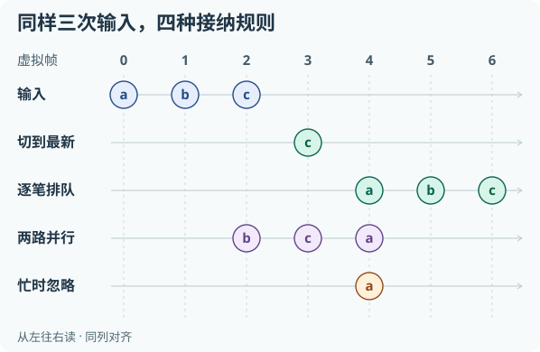

# 17｜结业：从控制台故障演练到展览馆预约

控制台关掉后，未开始的重连应当取消；预约页关掉时，一笔已经提交的预约却还要有人核对结果。这一章换成展馆，是因为关窗这个动作没有变，它能结束的工作变了。两道独立练习的完整需求在[结业大纲](../RxJS-教程大纲.md#结业用一次故障演练贯穿全书)。

## 最后一条控制台记录

先沿用上一章的打开记录。值班员从 A 切到 B，隐藏计数面板，最后才离开会话。这次演练约定切任务清零，隐藏面板期间仍计数，并且每次读取最多重试一次。成品控制台的实时连接会持续尝试重连，实验特意收紧这个上限，好观察耗尽后的行为。

| 帧 | 操作与连接 | 计数与显示 |
|---:|---|---|
| 0、1 | 选 A，连接发 Ae | 两块面板共用这次读取，计数从 0 到 1 |
| 2、3 | 切 B，释放 A；随后 B 发 Be | 切换时清零并隐藏计数面板，会话仍将 Be 计为 1 |
| 6、7 | B 沉默满三帧，开始等待重连 | 重开计数面板立即看到 1，旧清空命令没有重放 |
| 8 | 离开会话 | 撤掉原定帧 10 放行的等待，此后没有第三次连接 |

帧 7 两块屏重新聚在一起时，还没有新的网络连接。计数器之所以能立刻显示 1，是因为会话自己一直订着计数流：帧 2 的 clear 归零后，B 在 3 送来的错误已经算进去了。真正的清理落在帧 8，释放会话的那次 unsubscribe。实验记下 `rows = ['Ae','Be']`、`opens = 2`，以及等候重试的区间 [6,8)；如果面板消失后仍会重连，最后一项不会在 8 结束。[能单独运行的控制台与预约实验](../labs/17.ts)

## B-10 的余票和 B-10 的预约

展馆查询余票时可以照搬控制台的读取方式。帧 0 查 A 日，1 改选 B 日，A 的旧结果原定 4 才返回。switchMap 在 1 退出 A，屏上帧 2 只看到 B 的 y；帧 5 离开后，余票读取也可以停了。

但访客还在帧 2 点了「确认 B-10」，3 又点了一下，4 改选 B-16。若在 5 离开，而馆方已经接受 B-10，这一次没有回消息可能只是回执丢了。此时页面既不能宣布失败，也没有理由用 B-16 再替他订一份。

实验把馆方账本和应用收到的消息分开存，`submit` 的工厂只做三件事：

```ts
attempts.push(key);
if (!ledger.has(key)) ledger.set(key, snapshot);
return attempts.length === 1
  ? cold<string>('----#')
  : cold('-(v|)', { v: ledger.get(key)! });
```

帧 2 的第一行留下键 intent-1，第二行在账本中写入 B-10。最后一行的冷源四帧后才出错；失败发生在回执这边，已经写过的账本不会因回调报错而还原。应用有个 pending 表，把这一笔留作「待核对」。

```text
帧 2   第一次发送 intent-1   馆方账本新增 B-10     应用保留待核对键
帧 5   离开页面             馆方账本仍有 B-10     页面停止收新点击
帧 6   回执丢失，以原键再发   已有 intent-1，跳过写入
帧 7   收到 B-10 回执                            应用移除待核对键
```

这张时间表需要馆方支持按键去重并返回原结果。实验用 Map 模拟；实际服务要能原子地保存这个键和受理结果。如果服务只收场次不认意图键，客户端就没有证据判定重发一次是否会再占一席。

帧 3 的连点该不该记进 pending？馆方还在处理第一笔，应用只需要跟踪已经接纳的点击。这里用 `exhaustMap(project)`：project 是收到点击后才调用的函数，返回这笔工作的流。前一笔还没完成时，exhaustMap 会跳过这次调用。因此读取当前场次、查旧键、登记待核对都放在函数里面。

```ts
const receiptSub = confirm.pipe(
  takeUntil(left),
  exhaustMap(() => {
    const snapshot = slot.value;
    const prior = [...pending].find(([, bookedSlot]) => bookedSlot === snapshot);
    const key = prior?.[0] ?? newIntentKey();
    pending.set(key, snapshot);
    return submit(key, snapshot).pipe(
      retry(1), tap(() => pending.delete(key)), catchError(() => EMPTY)
    );
  })
).subscribe();
```

在 exhaustMap 前的 tap 里记下点击时刻，会得到 `[2, 3]`。把同一条记录移到 `const snapshot` 之前，就只剩 `[2]`。所以帧 4 改选 B-16 时，这笔预约已经保存了 B-10。若改成每次点击都在上游的 tap 里申请新键、写入 pending，第二次点击也会留下待核对项，馆方却没有对应的预约。

应用会话持有 receiptSub。帧 5 离页触发 takeUntil，让 confirm 入口完成；exhaustMap 收到完成通知时仍会等已接纳的工作收尾。6 的重试用回原参数，7 得到 B-10 回执才删除 pending。若组件在卸载时直接调用 `receiptSub.unsubscribe()`，就没有人把回执带回应用。整个应用都可能退出的话，待核对键还要能在下次打开时恢复。

要重现重复占座，可以在 submit 的 defer 工厂里、`attempts.push(key)` 前临时加一行 `key = 'attempt-' + (attempts.length + 1)`，再运行 `npm run lab -- 17`。两次传输分别拿到 attempt-1、attempt-2，馆方于是记了两笔。帧 3 的连点一直都被挡住；第二笔是帧 6 的重试制造的。把键留在工厂外，同一组点击只占一席。

<details>
<summary>同样三次点击，查询与确认留下不同结果</summary>

实验还让 a、b、c 在 0、1、2 帧依次到达，a 需四帧，其余各一帧。把它们当作三次查询，后来的会替换先前的，最后只显示 c；把它们当作首次确认和两次连点，同一时刻却只该接纳 a。下图另画了逐笔保存和限制并发的情形，便于对照每次开工和结束的时刻。

[](../figures/book-17.svg)

</details>

<details>
<summary>馆方允许两个不同场次同时待核对</summary>

同场仍只许留一笔，不同场次最多两笔，满额时立刻提示「稍后再试」。按 A、A、B、C 的顺序点，结果应是接纳 A、拒绝重复 A、接纳 B、当场拒绝 C。旧版全局忙标志会把 B 也挡掉，光把并发数改成 2 又会把 C 排队。

实验的 admit 先看该场次是否在待核对表，再看表里是否已有两笔，通过才同步占位并发请求。B 收到明确回执时释放名额，早先被拒的 C 不会自行启动。用户重按 C 才产生一次新的接纳。

</details>

<details>
<summary>先收到撤销，后收到旧回执</summary>

如果馆方还支持撤销，同键只能辨认「这是哪一笔」，不能判断哪一版状态较新。现场推送先说 A/3 已撤销，补取历史随后才说 A/2 已确认。按到达顺序覆盖，撤销的预约会暂时复活。每个预约各存自己的最新版本即可判定这两份完整状态。

```ts
const previous = byKey.get(report.key);
if (previous && previous.revision >= report.revision) return byKey;
return new Map(byKey).set(report.key, report);
```

实验在 A/3 后还插入 B/1，它必须被保存。若整张页面共用一个最大版本号，A 的 3 会误挡 B 的 1。这里馆方每次都交付完整状态；如果消息只是「释放一席」这样的增量，还得先补齐缺少的更新才能续算。

</details>

<a id="加一条业务规则为什么要重画队列"></a>

<details>
<summary>保存场次说明时，各场次分别排队</summary>

管理员依次保存 A1、A2、B1，点击发生在 0、1、2 帧，耗时分别为 8、1、1 帧。同一场次的两次修改必须按录入顺序，B 却没有理由等 A。这批键来自有限的场次列表，每个保存流在馆方确认写入时才完成。

```ts
const receipts = clicks.pipe(
  groupBy(edit => edit.slotId),
  mergeMap(slot => slot.pipe(concatMap(edit => save(edit))))
)
```

A1、A2 在 8、9 依次确认；B1 从 2 开始，3 就能确认。若把 concatMap 放在两组合并之后，B 要等到 10。这个队列只约束当前应用发出的写入，其他客户端同时修改仍需服务端按版本处理。

</details>

同一次离页，在控制台留下的是一段已经结束的等待，在预约页留下的是一笔仍待核对的申请。两边都能沿记录解释清楚：哪个订阅退出，谁还持有工作，以及用户下次打开时能找回什么。

[继续读第 18 章 · 独立完成十道练习](18.md)

<a id="发散练习"></a>

<details>
<summary>配套练习 · 重复输入和迟到结果该如何处理</summary>

<a id="transfer-a"></a>

[山谷定向赛，裁判什么时候可以盖完赛章？](../练习/17.md#transfer-a)

<a id="transfer-b"></a>

[逐格皮影，两张一模一样的底片要不要算两帧？](../练习/17.md#transfer-b)

</details>

<details>
<summary>回看前面学过的用法</summary>

<a id="practice-1"></a>

**1.** 不提供候选操作符，为切任务、逐笔存备注、限并发补详情和防连点刷新各选策略；用乱序返回验证每个决定。

<a id="practice-2"></a>

**2.** 模拟断网、重连等待中关闭所有面板；证明既没有错误冒泡杀死无关面板，也没有后台重试。

<a id="practice-3"></a>

**3.** 让错误计数面板关闭后重新打开；先写下它该拿到的状态和不该重放的事件，再用连接次数和首条消息验收。

</details>

## 章末附录 · 本章 RxJS API 速查

<details>
<summary>展开 API 与用法</summary>

同样的三次输入，用在看详情、逐笔保存、并发补齐和防止连点时，允许的输出顺序不同。先画时间线，再对照四种展开操作。

**接入来源与订阅**

| API | 用法 |
|---|---|
| [`Observable`](../RxJS-7.8.2-API清单.md#api-114) | 描述一次可订阅的执行，可以交付零个或多个值，随后完成、报错或继续等待。 |
| [`Subscription`](../RxJS-7.8.2-API清单.md#api-180) | 一次执行的句柄，可集中登记清理动作并用 unsubscribe 释放。 |
| [`EMPTY`](../RxJS-7.8.2-API清单.md#api-53) | 不交付任何值，订阅后立即正常完成。 |
| [`of`](../RxJS-7.8.2-API清单.md#api-125) | 按参数逐个同步交付后完成；传一个数组会把整份数组作为一个值。 |
| [`defer`](../RxJS-7.8.2-API清单.md#api-44) | 每次订阅才调用工厂，适合重新创建请求或读取当时的状态。 |

**变换、筛选与累计**

| API | 用法 |
|---|---|
| [`map`](../RxJS-7.8.2-API清单.md#api-91) | 对每个输入执行投影，交付一个对应结果；第二个参数是这一段订阅内的序号。 |
| [`filter`](../RxJS-7.8.2-API清单.md#api-65) | 逐项检查谓词，只放行满足条件的值；类型谓词还可收窄下游类型。 |
| [`pipe`](../RxJS-7.8.2-API清单.md#api-134) | 按从左到右的顺序组合操作；流的 pipe 方法把这些操作应用到当前来源。 |
| [`tap`](../RxJS-7.8.2-API清单.md#api-191) | 在通知经过时执行观察或记录动作，正常返回时继续转发原通知。 |
| [`distinctUntilChanged`](../RxJS-7.8.2-API清单.md#api-49) | 首项通过，以后与上次放行的值比较，只交付变化。 |
| [`scan`](../RxJS-7.8.2-API清单.md#api-157) | 保存本次订阅的累计状态，每处理一个值就交出新状态；种子本身不会单独发出。 |
| [`takeUntil`](../RxJS-7.8.2-API清单.md#api-189) | 通知源第一次发值时完成输出并解除来源订阅。 |
| [`startWith`](../RxJS-7.8.2-API清单.md#api-173) | 订阅时先发给定的初始值，然后订阅原来源。 |

**时间与调度**

| API | 用法 |
|---|---|
| [`rxjs/testing · TestScheduler`](../RxJS-7.8.2-API清单.md#api-245) | 用虚拟帧建立来源，断言通知时刻与订阅区间。 |

**组合来源与在途工作**

| API | 用法 |
|---|---|
| [`switchMap`](../RxJS-7.8.2-API清单.md#api-183) | 把输入映射成内部流，新输入到达时退订旧内部流，只转发当前一条。 |
| [`concatMap`](../RxJS-7.8.2-API清单.md#api-30) | 逐个启动内部流，上一条正常完成后才处理下一项排队输入。 |
| [`mergeMap`](../RxJS-7.8.2-API清单.md#api-97) | 把输入映射成可同时工作的内部流，结果按抵达顺序交付，可限制并发数。 |
| [`exhaustMap`](../RxJS-7.8.2-API清单.md#api-61) | 一个内部流运行期间忽略新的外部输入，空闲后才接下一项。 |
| [`withLatestFrom`](../RxJS-7.8.2-API清单.md#api-225) | 由主流发值触发，附带其他来源的最新值；配套来源须先各发过一项。 |
| [`merge`](../RxJS-7.8.2-API清单.md#api-95) | 同时接入多个来源，按实际抵达顺序转发各路输入。 |

**共享、批次与分组**

| API | 用法 |
|---|---|
| [`Subject`](../RxJS-7.8.2-API清单.md#api-174) | 既能接收通知，也能把通知同步广播给当前观察者。 |
| [`BehaviorSubject`](../RxJS-7.8.2-API清单.md#api-13) | 保存当前值；仍活跃时，新订阅者立即收到它，包括构造时给定的初值。 |
| [`share`](../RxJS-7.8.2-API清单.md#api-164) | 让订阅者共同使用一个上游订阅；默认随首位接入、末位退出而开关仍在运行的来源。 |
| [`shareReplay`](../RxJS-7.8.2-API清单.md#api-166) | 共享上游并回放最近值；refCount 控制无人订阅时是否释放仍在运行的上游。 |
| [`groupBy`](../RxJS-7.8.2-API清单.md#api-78) | 按场次把修改分到各自的子流，再在组内串行保存；慢的 A 不会堵住 B。 |

**网络、错误与终止**

| API | 用法 |
|---|---|
| [`catchError`](../RxJS-7.8.2-API清单.md#api-21) | 截住上游错误，改订阅返回的替代来源；摆放位置决定哪层读取被替换。 |
| [`retry`](../RxJS-7.8.2-API清单.md#api-152) | 来源报错后重新订阅，可限制重试次数并安排等待。 |
| [`timeout`](../RxJS-7.8.2-API清单.md#api-201) | 检查等首项或后续项的期限，超时后报错或切换到配置的替代来源。 |

**方法、属性与测试助手**

| 成员 | 用法 |
|---|---|
| `subscribe()` | 登记观察者、接入一次执行，返回控制该次订阅的句柄。 |
| `next(value)` | 交付一个值；Subject 会把这次通知发给当前观察者。 |
| `error()` | 以错误终止当前序列并释放订阅资源。 |
| `complete()` | 通知正常结束，随后释放资源；主动退订不会给观察者补发 complete。 |
| `unsubscribe()` | 主动结束本次订阅并触发清理；不能据此判断远端写入是否成功。 |
| `add()` | 把子订阅或清理函数挂到父订阅；父订阅已关闭时会立即执行清理。 |
| `BehaviorSubject.value` | 通过属性读取当前值，读取行为与 getValue() 一致。 |
| `schedule(work, delay?)` | 安排一项可取消的动作，可给延时及随动作传入的状态。 |
| `flush()` | 推进虚拟时钟并执行待办动作；在 run 内可提前结算已安排的断言。 |
| `TestScheduler.run()` | 在 TestScheduler 的虚拟时间环境中执行回调，提供建源和验收工具。 |
| `hot(marbles)` | 在全局帧上建立热测试源，晚订阅者会错过已发生的通知。 |
| `cold(marbles)` | 创建冷测试源，弹珠时间线从每次订阅起点重新计算。 |
| `expectObservable()` | 记录给定订阅区间内的通知，用弹珠图检验值、错误和完成时刻。 |
| `expectSubscriptions()` | 检查一个或多个订阅区间，用来证明何时启动和释放资源。 |
| `subscriptions` | 冷、热测试源保存的订阅记录，可交给 expectSubscriptions 检查。 |
| `toBe(...)` | 给出期望的弹珠序列或订阅区间，可额外映射符号对应的值和错误。 |
| `shareReplay({ refCount })` | 配置字段。为 true 时，最后一位读者退出会释放仍活跃的上游订阅。 |

</details>

[上一章](16.md) · [本章实验](../labs/17.ts) · [目录](../README.md) · [回到覆盖索引](../API-正文索引.md) · [下一章：十道独立练习](18.md)
