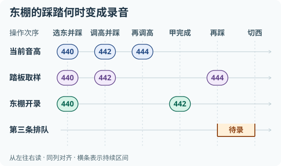

# 18｜独立练习：从一次开册到两间录音棚

前面在日志控制台里，一个旧请求有没有停下来，可以看连接记录。第 5 题把同一件事换成发音任务：翻页以后，耳机里已经没声了，旧页的朗读是不是还在后台继续？这十道题各自独立，可以从自己想试的一题开始。

[答题文件](../labs/18/practice.ts)给每道题留了一个方法。以第 2 题为例，把 `rises(samples)` 的注释换成实现，返回读数流；测试会订阅它并送入一组水位。

```sh
node labs/18.ts 02 mine       # 运行自己的第 2 题
node labs/18.ts 02 reference  # 同一组输入交给参考解
npm run check                # 检查方法签名
```

[测试](../labs/18.ts)列出了输入和预期结果；[参考实现](../labs/18/answers.ts)可以用同一组输入运行。十题一起跑的命令是 `node labs/18.ts all mine`。

## 01｜印两本小册，页码要从哪里开始？

实现 `booklet(open)`。印坊交来一个函数，每调用一次才开一批稿件。创建排版方案时不取稿；每有人订阅，就单独开一批，从 1 编页码，输出形如 `1/甲` 的字符串。

```ts
let edition = 0;
const pages = booklet(() => ['甲', String(++edition)]);
// 在这里读 edition，再让两位客户依次订阅同一个 pages。
```

两份小册各自从第 1 页开始。两次拿到的文字即使完全相同，`edition` 也能区分印坊究竟开了一批稿还是两批。

## 02｜缺一笔读数，能认定水位刚越线吗？

实现 `rises(samples)`。水位尺每次给出一个数或 `null`。只有**紧邻的两次采样**都有效，且前一次小于 10、本次大于等于 10，才播报本次数值。记录开始时不知道前一刻的水位。

```ts
const samples = of(12, 9, null, 11, 8, 10, 12, 7, 13);
```

有个实现先滤掉 `null`，再比较相邻两笔。把样本缩成 `9, null, 11`：水尺报告了 11，却没有报告上一笔有效水位。这三个输入就够写出一条防止误报的断言。

<details>
<summary>我的结果里多了一个 11</summary>

保留原始位置后，相邻的两对是 `[9, null]` 和 `[null, 11]`，两组都缺读数。先删空值则会造出一组原本不相邻的 `[9, 11]`。只有在取得一对之后，才能判断这对读数能不能用于越线判定。

</details>

## 03｜换印泥会不会在证书上多盖一枚章？

实现 `seals(press, ink)`。印泥罐可能迟于第一次按压到场。未选颜色时按压无效；有颜色后每次按压都产生一个颜色字符串。两次连续按压可以得到相同颜色。保存过的印记不会跟着罐子变色。

```ts
press.next();
ink.next(jar);                  // 此时 jar.color 是“青”
press.next(); press.next();
jar.color = '朱'; ink.next(jar); // 工人重复使用同一个对象
// 此刻先清点印记，再按一次
press.next();
```

连续两次按压盖在两张不同的证书上。检查换成朱色后、第三次有效按压前那份清单：旧印记还在吗？这次换色有没有凭空添出一枚？

## 04｜三件装一盘，剩下的一件该交给谁？

实现 `trays(pieces, abort)`，每满三件立即交一盘。工人自然收班会把余件作为最后一盘交出；管理员发出撤场通知则丢掉未满的盘，立即结束。仅关闭撤场按钮的通知通道时，工人继续装盘。

```ts
for (const piece of '甲乙丙丁') pieces.next(piece);
// 独立做三次，每次重新开工
// A: pieces.complete()
// B: abort.next(); pieces.complete()
// C: abort.complete(); pieces.complete()
```

三轮都送出甲、乙、丙、丁，前三件刚好装满一盘。只比较末尾：哪几轮还会收到一盘 `['丁']`？用 B 轮的输入检验你的撤场按钮。

<details>
<summary>如果轮次 B 也交出了“丁”</summary>

把撤场处理放在装盘之前，撤场会向装盘这一步发送完成通知。它遵守收班规则，把丁也交了出去。把撤场处理放在装盘之后，撤场直接结束下游，并向上退订；盘里虽有丁，却没有收到触发交盘的完成通知。轮次 C 里按钮只调用了 `complete()`，没有发过撤场值，工人随后收班时仍会正常交出丁。[对照第 12 章里关闭和防抖的先后](12.md)

</details>

## 05｜翻词卡后，上一页的发音还在工作吗？

实现 `pronunciation(pages, read)`。翻到新词卡就收回上一页的发音任务，再启动新页。测试里的发音源支持退订清理。第 1 帧翻到 A，第 3 帧翻到 B，第 9 帧词卡输入正常结束。每次启动后的相对时间如下：

```ts
const a = cold('-----o|'); // 启动后第 5 帧吐出 o，第 6 帧结束
const b = cold('--n|');    // 启动后第 2 帧吐出 n，第 3 帧结束
```

这组测试留了两份记录，耳机里出现过哪些音，以及 A 的发音任务何时退出。旧页继续播放但被静音时，只有后一份记录会出错。

<details>
<summary>我不确定从哪一帧开始数</summary>

B 在帧 3 才启动，把 `--n` 的两个格子加在 3 上，n 到达时全局时钟已是 5。A 原本在 1 + 5 = 6 发声，可你在 3 就离开了这页。所以耳朵只听到帧 5 的 n；旧任务的订阅应是 `[1, 3)`。只测 n 会让“后台还在念 A”的实现也过关。

</details>

## 06｜印刷机卡纸，下一张谱还能排进去吗？

实现 `proofs(sheets, print)`，同一台印刷机按收到的顺序逐张开工。函数 `print(name)` 一经调用就算开工；它返回一条回执流，流完成才腾出机器。每次失败交付一张 `废样/曲名`，然后处理队列里的下一张。收单员下班后仍须做完已经收到的单。

```ts
for (const sheet of 'ABCD') sheets.next(sheet);
sheets.complete();
first.next('样张/A');           // A 出了样，机器还没释放
// 在此处检查已经调用过几次 print
first.complete();               // A 释放机器
```

B 的回执流报错；C 在调用 `print('C')` 时同步抛错；D 正常返回 `of('样张/D')`。A 的流就是上面的 `first`。

运行到注释处，A 已经出了样张，却还占着机器。如果这时 `print('B')` 已经被调用，哪一步把“有回执”当成了“已结束”？再放行 A，检查后面的 D 最终有没有开工。

<details>
<summary>如果能处理 B 的卡纸，遇上 C 却丢了 D</summary>

把 `print('C').pipe(…)` 按 JavaScript 的求值顺序读一遍。先调用 `print('C')`，拿到返回值之后才有对象可供 `.pipe` 调用。C 在第一步就抛错了，写在返回值上的处理逻辑根本没装上。让队列先订阅一个工厂，再由工厂调用 `print`，同步抛错和回执流报错就都发生在这一张谱的订阅里；处理完这一张，才轮到 D。[参考实现中的 proofs](../labs/18/answers.ts)

</details>

## 07｜两块屏幕共用光谱仪，最后谁来断电？

实现 `spectrum(source)`。光谱仪在上游被订阅时开机，清理订阅时关机。原始信号在本题中一直存续。第一块屏幕打开就开机；第二块加入时立即读到这轮最近的读数。两屏都离开就关机。下一轮开机从空白开始。

```ts
// 依次执行，不存在同一时刻的操作
// 开 A → 输入 6 → 开 B → 关 A → 输入 7 → 关 B
// 开 C → 先读屏幕 → 输入 8 → 关 C
```

在开机函数和关机函数里各记一次数，分别在关 A、关 B、开 C 之后读出计数。只比较两块屏幕上的光谱，可能看不出仪器已经被启动了两次。

## 08｜首次报到和巡回报点用哪一只秒表？

实现 `beacon(source, clock)`。从订阅时起给首次报到 5 帧；到过一次以后，每次收到报点都重新给 3 帧。到期即退订原来的报点源，交出字符串“失联”并完成。源及时正常完成时照常结束。所有时间都交给传入的时钟；样例避开报点与到期同帧的争议。

```ts
const silent = cold<string>('--------'); // 持续沉默
const late = cold('----a-b----c|');       // 订阅时刻为帧 0
```

对 `late`，把每次报点后的新截止帧写在字母上方。再测一条立即正常完成的空源：它也没交出过读数，屏幕上该不该出现“失联”？

## 09｜两份声部交齐，一首曲子只开排一次

实现 `duets(parts)`。每个事件是 `{ piece, side }`，其中 `piece` 为曲号，`side` 为 `'L'` 或 `'R'`。左右齐备时立即发出一次曲号。重送同一声部无效，同一首已经开排的曲子也不能再次开排。这是一场有结束信号的有限排练，各曲可以交错交件。

```ts
// 曲号与声部，按实际到件次序
// 青L、金R、青L、灰R、金L、青R、金L、金R、收件结束
```

检查金曲开排以后再次送来的金 L、金 R。此时两份是齐的，但若金曲再次进入输出，说明你只记住了收齐的声部，没记住它已经排过。收件结束后这份记录才可以释放。

## 10｜换录音棚时，队列里还有两次踩踏

实现 `booths(rooms, pedal, pitch, record, leave)`。选棚后每踩一次踏板就登记一条录音；登记时锁定当时的音高。同棚逐条录制，上一条录音流完成才开始下一条。重复选择当前棚继续工作；换棚时取消旧棚在录的一条，同时作废旧棚排队的所有条目。离场会结束整个会话。录音源可取消，音高输入总能提供当前值，初值 440。

```ts
pedal.next();                           // 还没选棚
rooms.next('东'); pedal.next();         // 第一次实际开录
pitch.next(442); pedal.next();
pitch.next(444); rooms.next('东');
// 甲：第一条东棚录音交付“一”并完成
pedal.next(); rooms.next('西');
// 乙：让第二条东棚录音试着交付“旧”
pedal.next(); pedal.next();
// 丙：西棚在录的一条交付“二”，但还没完成
leave.next(); rooms.next('北'); pedal.next();
```

验收用例分别收集开录参数 `started`、已经收尾的录音 `stopped` 和对外发出的片段 `clips`。甲发生前看一次 `started`，切西棚时看一次 `stopped`，离场后再看 `clips`。这样能区分三种看起来都很安静的情况：一笔登记还没轮到，已经开录但被取消，以及完成后没有更多片段。

<details>
<summary>做完第 10 题后核对东棚的开录时刻</summary>

[](../figures/book-18.svg)

甲发生时，第二笔登记已经在等，录下来的应是按键时锁定的 442。于是 `record` 接到 `('东', 442)`。第三笔登记也取了音高，却没等到开录就换了棚。若你的开工名单里有第三笔东棚录音，检查换棚时究竟退订了正在录的那条流，还是连保存等待名单的那一层也退订了。

</details>

## 章末附录 · 本章 RxJS API 速查

<details>
<summary>展开本章练习和参考解用到的 API</summary>

**接入来源与订阅**

| API | 用法 |
|---|---|
| [`Observable`](../RxJS-7.8.2-API清单.md#api-114) | 描述一次可订阅的执行，可以交付零个或多个值，随后完成、报错或继续等待。 |
| [`finalize`](../RxJS-7.8.2-API清单.md#api-66) | 在完成、出错或退订时执行收尾逻辑，适合释放资源或核对清理次数。 |
| [`EMPTY`](../RxJS-7.8.2-API清单.md#api-53) | 不交付任何值，订阅后立即正常完成。 |
| [`of`](../RxJS-7.8.2-API清单.md#api-125) | 按参数逐个同步交付后完成；传一个数组会把整份数组作为一个值。 |
| [`from`](../RxJS-7.8.2-API清单.md#api-73) | 将数组、Promise、可迭代对象等转成流；数组逐项交付，Promise 兑现后交付其结果。 |
| [`defer`](../RxJS-7.8.2-API清单.md#api-44) | 每次订阅才调用工厂，适合重新创建请求或读取当时的状态。 |
| [`throwError`](../RxJS-7.8.2-API清单.md#api-197) | 订阅时以错误终止，常用工厂提供这次执行的异常。 |

**变换、筛选与累计**

| API | 用法 |
|---|---|
| [`map`](../RxJS-7.8.2-API清单.md#api-91) | 对每个输入执行投影，交付一个对应结果；第二个参数是这一段订阅内的序号。 |
| [`filter`](../RxJS-7.8.2-API清单.md#api-65) | 逐项检查谓词，只放行满足条件的值；类型谓词还可收窄下游类型。 |
| [`pipe`](../RxJS-7.8.2-API清单.md#api-134) | 按从左到右的顺序组合操作；流的 pipe 方法把这些操作应用到当前来源。 |
| [`distinctUntilChanged`](../RxJS-7.8.2-API清单.md#api-49) | 首项通过，以后与上次放行的值比较，只交付变化。 |
| [`pairwise`](../RxJS-7.8.2-API清单.md#api-131) | 给水位判定提供紧邻的两次采样，缺失读数也占一个位置。 |
| [`scan`](../RxJS-7.8.2-API清单.md#api-157) | 保存本次订阅的累计状态，每处理一个值就交出新状态；种子本身不会单独发出。 |
| [`take`](../RxJS-7.8.2-API清单.md#api-187) | 只交付前 n 项，取够后完成并退出上游。 |
| [`takeUntil`](../RxJS-7.8.2-API清单.md#api-189) | 通知源第一次发值时完成输出并解除来源订阅。 |

**时间与调度**

| API | 用法 |
|---|---|
| [`SchedulerLike`](../RxJS-7.8.2-API清单.md#api-161) | 同时提供 now 与 schedule 的调度器接口。 |
| [`rxjs/testing · TestScheduler`](../RxJS-7.8.2-API清单.md#api-245) | 用虚拟帧建立来源，断言通知时刻与订阅区间。 |

**组合来源与在途工作**

| API | 用法 |
|---|---|
| [`switchMap`](../RxJS-7.8.2-API清单.md#api-183) | 把输入映射成内部流，新输入到达时退订旧内部流，只转发当前一条。 |
| [`concatMap`](../RxJS-7.8.2-API清单.md#api-30) | 逐个启动内部流，上一条正常完成后才处理下一项排队输入。 |
| [`mergeMap`](../RxJS-7.8.2-API清单.md#api-97) | 把输入映射成可同时工作的内部流，结果按抵达顺序交付，可限制并发数。 |
| [`withLatestFrom`](../RxJS-7.8.2-API清单.md#api-225) | 由主流发值触发，附带其他来源的最新值；配套来源须先各发过一项。 |

**共享、批次与分组**

| API | 用法 |
|---|---|
| [`Subject`](../RxJS-7.8.2-API清单.md#api-174) | 既能接收通知，也能把通知同步广播给当前观察者。 |
| [`BehaviorSubject`](../RxJS-7.8.2-API清单.md#api-13) | 保存当前值；仍活跃时，新订阅者立即收到它，包括构造时给定的初值。 |
| [`shareReplay`](../RxJS-7.8.2-API清单.md#api-166) | 共享上游并回放最近值；refCount 控制无人订阅时是否释放仍在运行的上游。 |
| [`bufferCount`](../RxJS-7.8.2-API清单.md#api-17) | 按项数收集成数组，可用第二个参数决定每隔多少项开新批。 |
| [`groupBy`](../RxJS-7.8.2-API清单.md#api-78) | 按键拆成多个带 key 的子流，同键输入进入同一活跃分组。 |

**网络、错误与终止**

| API | 用法 |
|---|---|
| [`catchError`](../RxJS-7.8.2-API清单.md#api-21) | 截住上游错误，改订阅返回的替代来源；摆放位置决定哪层读取被替换。 |
| [`timeout`](../RxJS-7.8.2-API清单.md#api-201) | 检查等首项或后续项的期限，超时后报错或切换到配置的替代来源。 |

**方法、属性与测试助手**

| 成员 | 用法 |
|---|---|
| `subscribe()` | 登记观察者、接入一次执行，返回控制该次订阅的句柄。 |
| `next(value)` | 交付一个值；Subject 会把这次通知发给当前观察者。 |
| `complete()` | 通知正常结束，随后释放资源；主动退订不会给观察者补发 complete。 |
| `unsubscribe()` | 主动结束本次订阅并触发清理；不能据此判断远端写入是否成功。 |
| `GroupedObservable.key` | 分组流上的键，标识当前子流属于哪一组。 |
| `TestScheduler.run()` | 在 TestScheduler 的虚拟时间环境中执行回调，提供建源和验收工具。 |
| `hot(marbles)` | 在全局帧上建立热测试源，晚订阅者会错过已发生的通知。 |
| `cold(marbles)` | 创建冷测试源，弹珠时间线从每次订阅起点重新计算。 |
| `expectObservable()` | 记录给定订阅区间内的通知，用弹珠图检验值、错误和完成时刻。 |
| `expectSubscriptions()` | 检查一个或多个订阅区间，用来证明何时启动和释放资源。 |
| `subscriptions` | 冷、热测试源保存的订阅记录，可交给 expectSubscriptions 检查。 |
| `toBe(...)` | 给出期望的弹珠序列或订阅区间，可额外映射符号对应的值和错误。 |

</details>

[实战篇 · 用这些规则做一个接星星游戏](../game/README.md)
