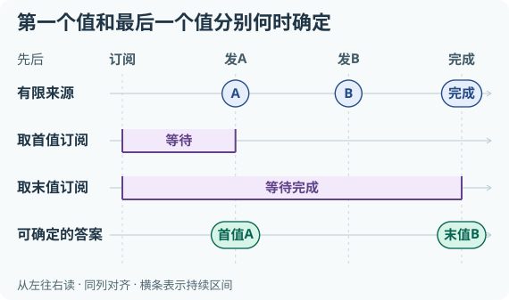

# 附录｜如何从声明推出一个能验证的行为

任务详情要显示第一条日志的编号。历史为空时显示“暂无日志”，服务器断线时则要显示错误。给 `firstValueFrom` 加一个默认值，可以处理其中哪一种情况？

详情页原来写的是 `const id = await loadFirstId()`，现在日志来源换成了 Observable。直接写 `await source.subscribe(...)` 行不通：订阅返回的是关闭这次读取的句柄，`await` 拿到的仍是它。要把这段读取交给只接受 Promise 的代码，还得明确用**哪一条通知**来兑现 Promise。这就是 `firstValueFrom` 需要替你做的选择。

## 在签名里代入自己的类型

在编辑器里跳到 `firstValueFrom` 的定义，找到带 config 的那一行。下面把配置对象里唯一的字段展开了：

```ts
function firstValueFrom<T, D>(
  source: Observable<T>,
  config: { defaultValue: D }
): Promise<T | D>
```

假设 `source` 每次发一个数字，默认值是字符串。把 T 换成 number，把 D 换成 string，剩下的是 `Promise<number | string>`。于是 `await` 后不能直接调 `toFixed(2)`，得先分辨拿到的是哪一种值。这一行签名管的是 **Promise 兑现以后值的类型**。一个以错误拒绝的 Promise 根本没有兑现值，类型里的竖线没有回答开头那个问题。

在项目根目录运行 `node`。分别喂它一笔值、一份空批次、一次故障，看看什么时候真的会返回默认值：

```js
const { firstValueFrom, of, EMPTY, throwError } = await import('rxjs')
const read = source => firstValueFrom(source, { defaultValue: '暂无日志' })

await read(of(0))                              // 0
await read(EMPTY)                              // '暂无日志'
await read(throwError(() => Error('offline')))  // 抛出 offline
```

再试 `await read(of(undefined))`，结果是 `undefined`。虽然它在控制台里看起来像“什么也没有”，但来源确实发过一次值。默认值只在收到完成通知、此前一次值都没有时使用。若来源一直沉默也不完成，这个 Promise 就得一直等。

这也解释了 `firstValueFrom` 与直接调用 `subscribe` 的区别。它替调用方订阅，在第一笔值到达时兑现 Promise 并退订。此后页码再更新，兑现的结果也不会变。若面板需要持续显示最新编号，留下订阅就能逐次更新，也能在关窗时提前退出。

`lastValueFrom` 面临另一条时间限制。第一笔抵达，就足以兑现 `firstValueFrom`；即使第二笔已经抵达，也还可能有第三笔，所以末值必须等到完成才知道。旧 `toPromise()` 在空完成时会兑现为 undefined；迁移成未设默认值的 `lastValueFrom(EMPTY)` 则以 `EmptyError` 拒绝。

[](../figures/book-声明也要会用.svg)

在项目根目录运行 `node labs/contracts.ts` 可以核对这些行为。`npm run check` 则验证[实验源码](../labs/contracts.ts)里的类型断言。

## 回调里有 await，外面在等谁？

`source.forEach(callback)` 返回 Promise，`async` 回调也返回 Promise。下面特意把写入挂起，好看清两者何时结束。在项目根目录新开一次 `node`，逐段运行下面的 JavaScript。

```js
const { of } = await import('rxjs')

const gate = Promise.withResolvers()
const finished = Promise.withResolvers()
let writes = 0

await of(0).forEach(async () => {
  await gate.promise
  writes++
  finished.resolve()
})
console.log(writes)       // 0
gate.resolve()
await finished.promise
console.log(writes)       // 1
```

`of(0)` 发值，启动一次回调。回调遇到第一个 `await` 就把控制权交还给来源。`forEach` 的回调位置接受返回 `void` 的函数，调用方可以忽略返回值，TypeScript 也允许传入这个 async 函数。于是源继续发出完成通知，外面的第一个 `await` 恢复，写入仍卡在闸门上。

如果“导出成功”要求所有行依次写完，可以用 `source.pipe(concatMap(row => write(row)))`，其中 `write` 返回写入的 Promise。上一笔兑现后，队列才能启动下一笔；全部写完后，才在这条管道的完成回调里报告成功。

## 哪些错误编译器看得见？

`combineLatest([of(1), of('A')] as const)` 交出的位置依次是数字和字符串。实验用 `ObservedValueOf<typeof tuple>` 取出这个值类型，故意给它赋 `['A', 1]`，并在那一行上方写了 `@ts-expect-error`。把值改成 `[1, 'A']` 再跑类型检查，编译器反而会报告“没有预期中的错误”。改用 `forkJoin({id: of(1), task: of('A')})` 时，结果可以按字段名读取。字段类型可以在编译时检查；源是否都会完成，还得看实际通知。

换到网络边界，情况就不同了。给历史请求标上 `Observable<Row[]>` 后，编辑器允许你读取 `row.id`。但服务端若发来 `{"id":"3","task":"A"}`，画面会照样显示 3；把字符串当游标，之后比较两个字符串时，`"10" > "3"` 就成了 false。

在实验里找 `isWireRow`。它接收 `unknown`，先排除 null 和非对象，再要求 task 是字符串、id 是正的安全整数。给它 null、字符串编号、数字编号 3、小数编号 1.2，只有数字 3 那行留下。类型谓词告诉编译器通过之后可以怎样使用这行记录，**谓词自身是否判断对了**靠这组输入检验。通过校验的 B/3 仍然不能推进 A 的游标；这一步由模型核对任务名。若业务要求整份快照完整，发现坏行还要报告整批失败，单独滤掉坏行会掩盖缺失。

## 在声明里容易读漏的几个条件

| 要决定的事 | 最短的验证 |
|---|---|
| 把清理函数从父订阅 `remove` 会执行它吗？ | 先 `add(fn)` 再 `remove(fn)`，此时没有调用。关闭父订阅也不会再找到它。反过来，在已经关闭的父订阅上 `add(fn)`，它会立刻执行。 |
| 完成后重开页面能看到旧值吗？ | 给 `BehaviorSubject` 写 1 再完成，`getValue()` 仍是 1，新订阅却只收到完成。换成 `ReplaySubject(1)`，晚订阅者先读到缓存再收到完成。`asObservable()` 只收起写入接口。 |
| `timeout({first: 4, each: 2})` 的第二次期限从哪里算？ | 第 1 帧收到首值，计时从该帧重新开始。若继续沉默，第 3 帧超时。有 `with` 就切换到它返回的来源，可以从 `info.seen` 读到 1；默认则发出 `TimeoutError`。 |
| 回放多久，和连接多久，是同一项配置吗？ | `shareReplay({bufferSize: 1, refCount: true})` 在最后一位读者退出时释放仍活跃的上游；`shareReplay(1)` 默认会继续订阅。成功完成的缓存可以留给晚来的读者。`windowTime` 限制旧值还能回放多久，值过期本身不会重新发请求。 |

需要查某个重载时，可以从[公开声明清单](../RxJS-7.8.2-API清单.md)跳到对应签名。旧重载上的弃用标记只适用于它标注的那种调用方式。

## 章末附录 · 本章 RxJS API 速查

<details>
<summary>查看用法和 7.8.2 声明</summary>

**接入来源与订阅**

| API | 用法 |
|---|---|
| [`Observable`](../RxJS-7.8.2-API清单.md#api-114) | 描述一次可订阅的执行，可以交付零个或多个值，随后完成、报错或继续等待。 |
| [`Subscription`](../RxJS-7.8.2-API清单.md#api-180) | 一次执行的句柄，可集中登记清理动作并用 unsubscribe 释放。 |
| [`EMPTY`](../RxJS-7.8.2-API清单.md#api-53) | 不交付任何值，订阅后立即正常完成。 |
| [`of`](../RxJS-7.8.2-API清单.md#api-125) | 按参数逐个同步交付后完成；传一个数组会把整份数组作为一个值。 |
| [`throwError`](../RxJS-7.8.2-API清单.md#api-197) | 订阅时以错误终止，常用工厂提供这次执行的异常。 |

**变换、筛选与累计**

| API | 用法 |
|---|---|
| [`pipe`](../RxJS-7.8.2-API清单.md#api-134) | 按从左到右的顺序组合操作；流的 pipe 方法把这些操作应用到当前来源。 |
| [`firstValueFrom`](../RxJS-7.8.2-API清单.md#api-70) | 首值即兑现；空完成可用默认值，实际发出 undefined 时则保留该值。 |
| [`lastValueFrom`](../RxJS-7.8.2-API清单.md#api-90) | 返回 Promise，正常完成时用末值兑现；空完成时用配置的默认值或拒绝。 |
| [`EmptyError`](../RxJS-7.8.2-API清单.md#api-54) | 需要一个值却遇到空序列时使用的错误。 |

**时间与调度**

| API | 用法 |
|---|---|
| [`rxjs/testing · TestScheduler`](../RxJS-7.8.2-API清单.md#api-245) | 用虚拟帧建立来源，断言通知时刻与订阅区间。 |

**组合来源与在途工作**

| API | 用法 |
|---|---|
| [`concatMap`](../RxJS-7.8.2-API清单.md#api-30) | 逐个启动内部流，上一条正常完成后才处理下一项排队输入。 |
| [`combineLatest`](../RxJS-7.8.2-API清单.md#api-23) | 各来源都有首值后，任一路更新就组合各路最新值。 |
| [`forkJoin`](../RxJS-7.8.2-API清单.md#api-72) | 各路都给过值并正常完成后，一次性交付它们的末值组合。 |
| [`ObservedValueOf`](../RxJS-7.8.2-API清单.md#api-119) | 提取 ObservableInput 会交付的元素类型。 |

**共享、批次与分组**

| API | 用法 |
|---|---|
| [`Subject`](../RxJS-7.8.2-API清单.md#api-174) | 既能接收通知，也能把通知同步广播给当前观察者。 |
| [`BehaviorSubject`](../RxJS-7.8.2-API清单.md#api-13) | 保存当前值；仍活跃时，新订阅者立即收到它，包括构造时给定的初值。 |
| [`ReplaySubject`](../RxJS-7.8.2-API清单.md#api-151) | 按条数或时长保留已发值，向晚到者补发仍在缓冲内的值。 |
| [`shareReplay`](../RxJS-7.8.2-API清单.md#api-166) | 共享上游并回放最近值；refCount 控制无人订阅时是否释放仍在运行的上游。 |
| [`ShareReplayConfig`](../RxJS-7.8.2-API清单.md#api-167) | 设置回放容量、保留时长和引用计数等共享参数。 |

**网络、错误与终止**

| API | 用法 |
|---|---|
| [`catchError`](../RxJS-7.8.2-API清单.md#api-21) | 截住上游错误，改订阅返回的替代来源；摆放位置决定哪层读取被替换。 |
| [`timeout`](../RxJS-7.8.2-API清单.md#api-201) | 检查等首项或后续项的期限，超时后报错或切换到配置的替代来源。 |
| [`TimeoutError`](../RxJS-7.8.2-API清单.md#api-203) | 表示等待通知超过指定期限，默认由 timeout 报告。 |
| [`TimeoutInfo`](../RxJS-7.8.2-API清单.md#api-204) | 提供超时时已收到的项数、最近值和自定义元数据。 |
| [`Notification`](../RxJS-7.8.2-API清单.md#api-110) | 可表示三种通知的旧类，能用于保存和重放事件。 |

**方法、属性与测试助手**

| 成员 | 用法 |
|---|---|
| `subscribe()` | 登记观察者、接入一次执行，返回控制该次订阅的句柄。 |
| `next(value)` | 交付一个值；Subject 会把这次通知发给当前观察者。 |
| `complete()` | 通知正常结束，随后释放资源；主动退订不会给观察者补发 complete。 |
| `unsubscribe()` | 主动结束本次订阅并触发清理；不能据此判断远端写入是否成功。 |
| `closed` | 读取订阅是否已关闭，可用于让同步生产循环尽早退出。 |
| `add()` | 把子订阅或清理函数挂到父订阅；父订阅已关闭时会立即执行清理。 |
| `remove()` | 将清理项移出父订阅，移除本身不会调用它。 |
| `Subscription.EMPTY` | 一个已经关闭的空订阅，可用作无需清理的句柄。 |
| `asObservable()` | 只暴露订阅接口，让消费方不能通过这个入口向 Subject 写入。 |
| `getValue()` | 同步读取 BehaviorSubject 当前值；若已出错会抛出保存的错误。 |
| `forEach()` | 逐项调用回调，返回表示遍历结束的 Promise；不会等待每个回调返回的 Promise。 |
| `toPromise()` | 旧转换方法，正常完成时兑现末值；空完成可能兑现 undefined。 |
| `TestScheduler.run()` | 在 TestScheduler 的虚拟时间环境中执行回调，提供建源和验收工具。 |
| `cold(marbles)` | 创建冷测试源，弹珠时间线从每次订阅起点重新计算。 |
| `expectObservable()` | 记录给定订阅区间内的通知，用弹珠图检验值、错误和完成时刻。 |
| `toBe(...)` | 给出期望的弹珠序列或订阅区间，可额外映射符号对应的值和错误。 |
| `Notification.createNext` | 构造保存普通值的通知对象。 |
| `Notification.createComplete` | 构造表示正常完成的通知对象。 |
| `Notification.kind` | 用 N、E、C 区分值、错误和完成。 |
| `Notification.hasValue` | 表示通知是否属于 next，包括实际交付 undefined 的情况。 |
| `toObservable()` | 把一个 Notification 还原为发值、出错或完成的来源。 |
| `shareReplay({ refCount })` | 配置字段。为 true 时，最后一位读者退出会释放仍活跃的上游订阅。 |
| `shareReplay({ windowTime })` | 配置字段。控制已缓存的值可以回放多久；过期本身不会重新发起读取。 |

</details>
