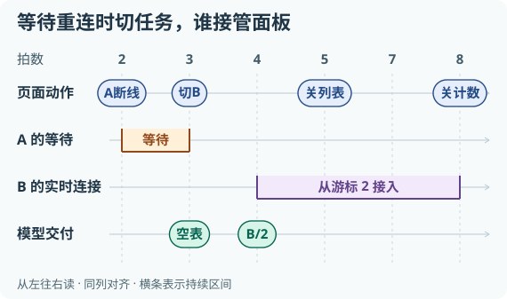

# 把章节装回同一个控制台

运行 `npm start`，打开终端打印的地址。页面上有两块能单独关闭的区域：日志列表和错误计数。它们都在读任务 A。等第一行日志出现，点「检查服务端」会看到一条活跃连接。关掉列表，稍后再查。计数器还在读 A，所以服务端仍有一条连接。关掉计数器再检查，才会变成零。

在 [main.ts](../app/main.ts) 搜索两处 `panel('`。每块区域打开时，`mount()` 返回它自己的订阅，关掉时由 `active?.unsubscribe()` 收回。顺着两处订阅往上找，列表经过 `view`，计数器直接读 `rows`，最终都来到同一个 [consoleModel](../app/model.ts)。

## 先读懂模型的返回值

`consoleModel` 接收任务选择、读历史和接实时日志的函数，最后返回 `Observable<Row[]>`。尖括号里是一整个列表：每次 `next`，画面收到一份可以立即渲染的行数组。这里曾有过三种很像的东西。顺着一条历史记录走一遍，就能分清它们。

1. `history(task)` 返回 `Observable<Row[]>`。请求成功时交出**一份数组**。即使数组里有一百行，接收方也只被调用一次。
2. 回调拿到数组 `rows` 后，`from(rows)` 把它逐行送出。此时历史和实时连接交出的都是 `Row`，所以 `concat` 可以先读尽历史，再接上实时，两种行共用下面的编号检查。
3. `scan` 收到一行，就用这行和上一份列表算出下一份列表。类型又回到 `Observable<Row[]>`，这次的意思是**一份份更新中的数组**。列表和计数器都可以订阅它。

如果模型在内部 `subscribe`，再把那次订阅的返回值交给页面，页面拿到的会是一个能关闭读取的 `Subscription`，无法从中取到列表。把 `subscribe` 留给 `mount`，页面就既能选择怎样显示每一份数组，也能决定这块区域要读多久。[完整函数](../app/model.ts)

## 从一次断线推导整张订阅图

A 断线时，模型会稍后再连。如果用户在这段等待里选了 B，就应该一直停在 B，连一次 A 的尝试都不该再有。一个容易写错的版本是把 `setTimeout(() => connect('A'), wait)` 放到断线回调里。切任务时旧 socket 虽然关了，回调留下的定时器却还能唤醒 A。画面一直显示 B，这个错误也可以在后台发生。

直接在连接工厂里打印任务名，就能看到后台有没有重连 A。下面用控制台自己的 `consoleModel`，只把服务器换成两个可以手工发消息的来源。代码可以在项目根目录的 `node` 提示符里连续运行。

```js
const { BehaviorSubject, Subject, of, finalize } = await import('rxjs')
const { consoleModel } = await import('./app/model.ts')
const task = new BehaviorSubject('A')
const wire = { A: new Subject(), B: new Subject() }
const row = (task, id) => ({ task, id, level: 'info', text: '日志 ' + id })

const rows = consoleModel(
  task,
  name => of([row(name, name === 'A' ? 16 : 2)]),
  (name, after) => {
    console.log('接线', name, after)
    return wire[name].pipe(finalize(() => console.log('拆线', name)))
  },
  () => {},
  20
)
```

这里的历史函数只发一份快照。A 的快照末行是 16，B 的是 2。实时连接什么时候打开，什么时候才会打印「接线」。最后的 20 是重试等待的毫秒数。先打开两块面板：

```js
const list = rows.subscribe(items => console.log('列表', items.map(r => r.id)))
const counter = rows.subscribe()
```

列表先收到空数组，再收到 `[16]`。随后打印 `接线 A 16`。第二次订阅没有第二次「接线」：模型先算好当前任务的行列表，再用 `shareReplay` 让两位读者共用它。这儿把计数器的显示函数省掉了，一个没有显示函数的订阅仍然会占用连接。

把下面几行**作为一段一起执行**，让 A 在出错的同一轮 JavaScript 调用中就切到 B：

```js
{
  wire.A.next(row('A', 17))
  wire.A.error(Error('离线'))
  task.next('B')
  list.unsubscribe()
  await new Promise(done => setTimeout(done, 40))
  counter.unsubscribe()
}
```

中间的输出依次是列表 `[16, 17]`、`拆线 A`、列表 `[]`、列表 `[2]`、`接线 B 2`。列表关掉后 B 仍在为计数器工作。四十毫秒已超过重试期限，中间并没有 `接线 A 17`。最后关计数器才有 `拆线 B`。

沿着[模型](../app/model.ts)的括号找这两个时刻。A 出错时，`retry` 订阅了 `resume` 返回的定时器，A 的整个任务分支还活着。下一行 `task.next('B')` 触发外层 `switchMap`，退订 A 的整个分支，等待中的定时器也归这次订阅管。进入 B 的分支时，函数体里的 `let cursor = 0` 重新执行，所以 B 可以接纳自己的第 2 行。

如果用户留在 A，重试就要接着 17 读。`cursor` 因此留在任务 A 的分支里，每次打开连接时才由 `defer(() => live(task, cursor))` 读取。把参数提前固定在第一次连接的 16，断线后就会再要一遍已经读过的行。单看屏幕很难察觉，因为后面的编号检查会把重复行挡住。运行 `node --test tests/model.test.ts`，“推送中断后从最后确认的游标恢复”那条用例直接记录了连接工厂每次用的编号。

[](../figures/book-控制台装配.svg)

## 快照正在路上，新写入的一行去哪儿了？

设服务器取历史快照时末行是 100。服务器又写下 101，浏览器才收到那份快照。此时新开一条只发送未来消息的连接，101 就落在两次读取之间了。

本项目在 [server.mjs](../app/server.mjs) 的 `handleUpgrade` 回调里处理这个间隙。浏览器带上 `after=100`；服务端先遍历该任务保留的历史，把编号大于 100 的行补发到这条连接，随后新行也从同一条连接发出。每个任务只保留最近 200 行，离线过久时，早已被淘汰的行就补不回来了。A 和 B 共用编号序列，单看 A 的两个编号相隔多少也算不出漏了几行。

## 哪些编号能推进游标？

服务端按游标补发，传错这个数就会永久跳过一段记录。模型测试里，A 最后读到了 205，随后故意塞进一条 B/800 和一条重发的 A/204。断线前，二者都会经过同一处检查：

```ts
if (row.task !== task || row.id <= cursor) return rows;
cursor = row.id;
```

B/800 在任务检查处返回，A/204 在编号检查处返回，游标仍是 205。如果先记最大编号再检查任务，下次就会要求从 800 接起，错过 A/206。运行 `node --test tests/model.test.ts`。第一项测试把两次连接的游标存进数组，断言它等于 `[205, 205]`。只看屏幕上有没有 B 行，发现不了这种跳读。

这个测试还保留了接收 206 之前的数组。旧数组仍装着 6 至 205，新数组是 7 至 206。拒收 B/800 时，`scan` 也会发出一次结果，只是返回原数组。统计有效行数要看内容，测绘制频率则要看渲染回调；单数 `next` 的次数会把拒收也算进去。

如果改接其他服务，先查它是否允许用同一编号修订旧行。只要允许修订，`row.id <= cursor` 就可能挡住一条合法更正，此时续读位置和行的修订版本需要分别记录。

## 搜索框和导出按钮读的是哪一刻？

清空搜索框，等到列表有内容。粘贴一个匹配不到的词，紧接着点「导出当前视图 JSON」。输入框已经显示新词，文件里却可能仍有行。等列表显示「暂无匹配记录」再点一次，这次文件里是 `[]`。

沿 [main.ts](../app/main.ts) 里的 `query → view → snapshot` 走一次。假定最初的快照有四行，这期间没有新日志：

| 时刻 | 输入框 | 生效的筛选 | 点击导出会保存 |
|---|---|---|---|
| 0 毫秒 | 空串 | 空串 | 四行 |
| 1 毫秒，粘贴新词 | 新词 | 空串，180 毫秒计时刚开始 | 四行 |
| 20 毫秒 | 新词 | 空串 | 四行 |
| 181 毫秒，期间没再输入 | 新词 | 新词 | 空数组 |

按钮用 `withLatestFrom(snapshot)` 读取最近一次算好的列表。绘制还要等 150 毫秒批次结束，而且最多画 12 行。若产品要求“只保存屏幕上已经画出的行”，就应保留上次绘制的那一片；若要求“立刻按框里的字搜索并导出”，就要用框里的草稿重新筛原始列表。从已经筛窄的结果出发，再放宽搜索条件，找不回先前被滤掉的行。

## 在源码里找到这几步

| 页面上的动作 | 代码位置 |
|---|---|
| 切任务、断线后续读 | [model.ts 的 consoleModel](../app/model.ts) 管当前任务、最近 200 行和重连游标。[模型测试](../tests/model.test.ts)记录连接工厂收到的参数。 |
| 收到一份历史，再补上快照之后的新行 | [server.mjs](../app/server.mjs) 的 `/history` 保存快照；实时连接从 `after` 之后开始补发服务端仍保留的行。 |
| 关列表、改搜索词、导出、保存备注 | [main.ts](../app/main.ts) 的 `panel` 管列表和计数器各自的开关。搜索和导出读取筛选后的快照；备注在点击时取出任务名和文字，再排队保存。 |

前九章的[逐步装配实验](../labs/checkpoint.ts)可以重放同一组输入。运行 `npm run stage -- 5` 时，第 7 帧虽然选了 B，面板还在读 A；改用 `npm run stage -- 6`，这次会看到 B 的历史。从第 10 章起，`npm start` 启动的本机服务提供真实的 HTTP 和 WebSocket 连接。

## 章末附录 · 本章 RxJS API 速查

<details>
<summary>查看用法和 7.8.2 声明</summary>

**接入来源与订阅**

| API | 用法 |
|---|---|
| [`Observable`](../RxJS-7.8.2-API清单.md#api-114) | 描述一次可订阅的执行，可以交付零个或多个值，随后完成、报错或继续等待。 |
| [`Subscription`](../RxJS-7.8.2-API清单.md#api-180) | 一次执行的句柄，可集中登记清理动作并用 unsubscribe 释放。 |
| [`EMPTY`](../RxJS-7.8.2-API清单.md#api-53) | 不交付任何值，订阅后立即正常完成。 |
| [`of`](../RxJS-7.8.2-API清单.md#api-125) | 按参数逐个同步交付后完成；传一个数组会把整份数组作为一个值。 |
| [`from`](../RxJS-7.8.2-API清单.md#api-73) | 将数组、Promise、可迭代对象等转成流；数组逐项交付，Promise 兑现后交付其结果。 |
| [`fromEvent`](../RxJS-7.8.2-API清单.md#api-74) | 订阅时为事件目标注册监听，退订时移除，用于按钮和键盘等输入。 |
| [`defer`](../RxJS-7.8.2-API清单.md#api-44) | 重连时再读取当前游标，让新连接从最近确认过的行之后接续。 |
| [`throwError`](../RxJS-7.8.2-API清单.md#api-197) | 订阅时以错误终止，常用工厂提供这次执行的异常。 |

**变换、筛选与累计**

| API | 用法 |
|---|---|
| [`map`](../RxJS-7.8.2-API清单.md#api-91) | 对每个输入执行投影，交付一个对应结果；第二个参数是这一段订阅内的序号。 |
| [`filter`](../RxJS-7.8.2-API清单.md#api-65) | 逐项检查谓词，只放行满足条件的值；类型谓词还可收窄下游类型。 |
| [`pipe`](../RxJS-7.8.2-API清单.md#api-134) | 按从左到右的顺序组合操作；流的 pipe 方法把这些操作应用到当前来源。 |
| [`tap`](../RxJS-7.8.2-API清单.md#api-191) | 在通知经过时执行观察或记录动作，正常返回时继续转发原通知。 |
| [`distinctUntilChanged`](../RxJS-7.8.2-API清单.md#api-49) | 首项通过，以后与上次放行的值比较，只交付变化。 |
| [`scan`](../RxJS-7.8.2-API清单.md#api-157) | 保存本次订阅的累计状态，每处理一个值就交出新状态；种子本身不会单独发出。 |
| [`startWith`](../RxJS-7.8.2-API清单.md#api-173) | 订阅时先发给定的初始值，然后订阅原来源。 |

**时间与调度**

| API | 用法 |
|---|---|
| [`timer`](../RxJS-7.8.2-API清单.md#api-206) | 等到指定时刻或延时后发 0；给第二个周期参数可继续递增发值。 |
| [`debounceTime`](../RxJS-7.8.2-API清单.md#api-42) | 每次新输入重置静默计时，安静满指定时长才交付最近一项，正常完成会冲出待发值。 |
| [`rxjs/testing · TestScheduler`](../RxJS-7.8.2-API清单.md#api-245) | 用虚拟帧建立来源，断言通知时刻与订阅区间。 |

**组合来源与在途工作**

| API | 用法 |
|---|---|
| [`switchMap`](../RxJS-7.8.2-API清单.md#api-183) | 把输入映射成内部流，新输入到达时退订旧内部流，只转发当前一条。 |
| [`concatMap`](../RxJS-7.8.2-API清单.md#api-30) | 逐个启动内部流，上一条正常完成后才处理下一项排队输入。 |
| [`combineLatest`](../RxJS-7.8.2-API清单.md#api-23) | 各来源都有首值后，任一路更新就组合各路最新值。 |
| [`withLatestFrom`](../RxJS-7.8.2-API清单.md#api-225) | 由主流发值触发，附带其他来源的最新值；配套来源须先各发过一项。 |
| [`concat`](../RxJS-7.8.2-API清单.md#api-28) | 依次订阅多个来源，上一条正常完成才进入下一条。 |
| [`merge`](../RxJS-7.8.2-API清单.md#api-95) | 同时接入多个来源，按实际抵达顺序转发各路输入。 |

**共享、批次与分组**

| API | 用法 |
|---|---|
| [`Subject`](../RxJS-7.8.2-API清单.md#api-174) | 既能接收通知，也能把通知同步广播给当前观察者。 |
| [`BehaviorSubject`](../RxJS-7.8.2-API清单.md#api-13) | 保存当前值；仍活跃时，新订阅者立即收到它，包括构造时给定的初值。 |
| [`shareReplay`](../RxJS-7.8.2-API清单.md#api-166) | 共享上游并回放最近值；refCount 控制无人订阅时是否释放仍在运行的上游。 |
| [`bufferTime`](../RxJS-7.8.2-API清单.md#api-18) | 按时间窗口收集为数组，可设置开批间隔和批次容量。 |

**网络、错误与终止**

| API | 用法 |
|---|---|
| [`rxjs/fetch · fromFetch`](../RxJS-7.8.2-API清单.md#api-236) | 用 Fetch 发起可订阅的读取；用 selector 包住读体，可以让退订覆盖读取正文阶段。 |
| [`rxjs/webSocket · webSocket`](../RxJS-7.8.2-API清单.md#api-246) | 创建双向 WebSocket 流，通过订阅读消息、通过 next 送消息。 |
| [`catchError`](../RxJS-7.8.2-API清单.md#api-21) | 截住上游错误，改订阅返回的替代来源；摆放位置决定哪层读取被替换。 |
| [`retry`](../RxJS-7.8.2-API清单.md#api-152) | 来源报错后重新订阅，可限制重试次数并安排等待。 |
| [`repeat`](../RxJS-7.8.2-API清单.md#api-148) | 来源正常完成后重新订阅，可控制总轮数和轮间等待。 |

**方法、属性与测试助手**

| 成员 | 用法 |
|---|---|
| `subscribe()` | 登记观察者、接入一次执行，返回控制该次订阅的句柄。 |
| `next(value)` | 交付一个值；Subject 会把这次通知发给当前观察者。 |
| `error()` | 以错误终止当前序列并释放订阅资源。 |
| `complete()` | 通知正常结束，随后释放资源；主动退订不会给观察者补发 complete。 |
| `unsubscribe()` | 主动结束本次订阅并触发清理；不能据此判断远端写入是否成功。 |
| `add()` | 把子订阅或清理函数挂到父订阅；父订阅已关闭时会立即执行清理。 |
| `BehaviorSubject.value` | 通过属性读取当前值，读取行为与 getValue() 一致。 |
| `schedule(work, delay?)` | 安排一项可取消的动作，可给延时及随动作传入的状态。 |
| `VirtualTimeScheduler.frame` | 读取虚拟时钟当前所在的帧。 |
| `flush()` | 推进虚拟时钟并执行待办动作；在 run 内可提前结算已安排的断言。 |
| `TestScheduler.run()` | 在 TestScheduler 的虚拟时间环境中执行回调，提供建源和验收工具。 |
| `cold(marbles)` | 创建冷测试源，弹珠时间线从每次订阅起点重新计算。 |

</details>
