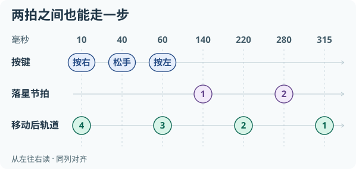

# 一 · 让接收器动起来

选择「移动接收器」。在第三轨轻点右键，接收器会滑到第四轨。再试试按住左键，从第四轨连续滑到第一轨。即使轻点的按下和松开都发生在两次落星节拍之间，这次输入也能换一轨。

### 从按键到换轨

在 [main.ts](main.ts) 找到 `direction$`。`fromEvent` 接入键盘和屏幕按钮事件，`scan` 按按下顺序保存仍被按住的键。最近按下的方向优先，释放它后，之前仍按住的方向接管；全部松开时输出 0。窗口失焦也会清空方向。`distinctUntilChanged` 让相同方向的连续通知共用一次连移。

下面从第三轨出发，假设游戏在 0 毫秒时开始，落星时钟每 140 毫秒发一次通知。表中轨道是游戏用于碰撞判定的目标位置，画面用 90 毫秒滑向这个位置。

| 时刻 | 事件 | 轨道 | 落星节拍 |
|---:|---|---:|---:|
| 10 毫秒 | 按下右键 | 4 | 0 |
| 40 毫秒 | 松手 | 4 | 0 |
| 60 毫秒 | 按下左键并保持 | 3 | 0 |
| 140 毫秒 | 星星下落 | 3 | 1 |
| 220 毫秒 | 持续按住满 160 毫秒，第一次连移 | 2 | 1 |
| 280 毫秒 | 星星下落 | 2 | 2 |
| 315 毫秒 | 又过 95 毫秒，第二次连移 | 1 | 2 |

**读图 · 两拍之间也能走一步**

从第三轨出发，右键在第一拍之前就松开了，第四轨仍留下了一次移动。持续按左从 60 毫秒算起，等 160 毫秒才在 220 毫秒触发第一次连移。

**动手做。** 已知方向值为 −1、0、+1，怎样做到轻点立即走一步，长按才连走？在 [game.ts](game.ts) 的 `moves$` 里，`startWith(action)` 同步发出第一步，`timer(160, 95)` 安排后续步子。方向改变时，`switchMap` 退订旧计时器。方向为 0 时切到 `EMPTY`，就此停止连移。外层 `merge` 再把移动和落星送进同一个状态流；只有落星行动会增加节拍。

**验收。** 去掉上表中的左键输入，分别让右键在第 169 和第 171 毫秒松开，预测两次各能走几轨。再按住右键，加按左键，松开左键；观察两个换向时刻。用 `node --test --test-name-pattern='短按|长按' game/game.test.ts` 检查短按、长按和暂停时的订阅行为。
