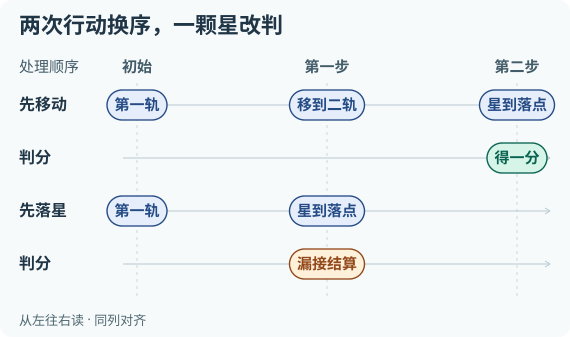

# 二 · 接住第一颗星

选择「第一颗星」。星星固定从左起第二轨落下，接收器从第三轨出发。先站着不动玩一次，再重开，提前移到第二轨。观察结算时的得分和漏接数。两次都只有一颗星，因此你可以追踪它的一生。

### 写出一拍的顺序

源码把落点记作第 20 行。一颗星起始在第 0 行，每拍向下移一行。假设上一拍结束时，接收器在第一轨，星在第二轨第 19 行。下一拍到来前轻点右键。先写下你认为应该显示的得分，再到 [game.ts](game.ts) 的 `move` 和 `step` 核对顺序：

1. 按键行动立即把接收器的目标位置更新到第二轨，限制在五条轨道内。
2. 落星节拍到来，星从第 19 行到达落点。两者轨道相同，得分加一。
3. 下一帧的星列表中已经没有它。继续运行多拍也只能结算它一次。

**动手做。** 用一张纸保存上一帧的 `lane`、`stars`、`score`、`misses`。按上述规则写一个函数返回下一帧。先脱离浏览器对它传入具体值，再读 `step` 的实现。若比较碰撞时取的是旧位置，刚才的压线移动就会算成漏接。用 `node --test --test-name-pattern=落点前 game/game.test.ts` 检查这个反例。

### 按键和落星为什么要排进同一条行动序列？

设想让按键回调直接移动屏幕上的接收器，让时钟回调自己保存一份轨道号。压线时就有两个问题要分别回答：玩家看见接收器在哪，判分读到的轨道又是哪一条？游戏里更容易推演的约定是，每次收到行动，就用**上一份状态和这次行动**算出下一份状态。按键交付「向右」，时钟交付「过一拍」。两者都能改变画面，只有后者有权让星下降。

沿用第 19 行的局面，只调换两次行动的到达顺序。先右移再过一拍，过拍时读到第二轨，得 1 分；先过一拍再右移，判分时还在第一轨，漏接 1 次。第二关在漏接时已经结算，后来的移动也不会改判。这样只凭初始状态和收到的行动，就能在纸上重演这次碰撞。

在 [game.ts](game.ts) 里，`merge` 把移动和节拍按实际交付顺序送往同一个入口，`scan` 为这一局保留上一份状态。`move` 和 `step` 只接收普通参数，所以检验「压线算不算接住」时可以直接调用它们。若游戏另有规则，要求同一帧里的所有按键都先于落星处理，就得先收集这一帧的行动再排序；单靠合并两条流不会得到这种优先级。

**读图 · 两次行动换序，一颗星改判**

星在第二轨第 19 行。沿上半图，碰撞读取移动后的第二轨；沿下半图，星先到落点，单星关已经结算，之后的移动没有改判机会。

### 一颗星怎样拥有历史

时钟只会告诉我们「又过了一拍」。星在哪一行，要从上一帧推算。把初始帧交给 `scan`，每次收到节拍就调用一次 `step`，它的返回值既交给画面，也成为下一次计算的输入。第二关在首次得分或漏接时结束。读 [game.ts](game.ts) 的 `takeWhile(predicate, true)`，预测删掉第二个参数后，玩家还能否看到最后的分数。这个参数让首次不满足继续条件的结算帧也到达画面。
