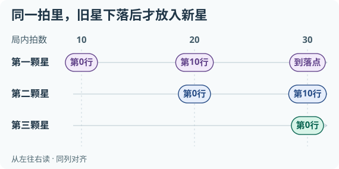

# 三 · 让一局游戏成立

「完整一局」每 10 拍生成一颗星，漏掉第三颗时结束。第 10 拍先更新场上已有的星，随后把新星放入第 0 行。第 11 拍它才第一次下落；因此第 20 拍有两颗星，一颗在第 10 行，一颗还在第 0 行。第一颗到达落点要等到第 30 拍。

[](../figures/game-03.svg)

### 同一局能不能重演，取决于记录了什么

玩家说「第 30 拍我明明接住了」。先把接收器固定在中间轨。从相同的初始状态重走 30 拍，只改变第 10 拍抽中的轨道：抽中间轨，得 1 分；抽相邻轨，漏接 1 次。只把玩家的按键录下来，重放时重新抽签，同一场争议就能得到两个判决。

第 10 拍抽中的轨道究竟该记在哪里？在项目根目录新开 `node`，用游戏自己的 `step` 重走这半局。后两颗星都固定在最左轨，唯一会改变的输入是第一颗星的轨道。

```js
const { initial, step } = await import('./game/game.ts')
function firstLanding(firstLane) {
  let state = initial(3)
  for (let tick = 1; tick <= 30; tick++) {
    let lane
    if (tick === 10) lane = firstLane
    if (tick === 20 || tick === 30) lane = 0
    state = step(state, 3, lane)
  }
  return [state.score, state.misses]
}
firstLanding(2)  // [1, 0]
firstLanding(1)  // [0, 1]
```

浏览器里的抽签发生在调用 `step` 之前。回查碰撞时，把那次抽中的数字记下来，重放时直接作为第三个参数传回去，就能让同一颗星落在原处。若争议是「我轻点却走了两步」，已经算好的两次移动都太晚了：要回到按下、松开和连移计时器那一段去查。

### 一颗星，两块显示区域

画布读星的位置，计分牌读分数。[main.ts](main.ts) 里两者各有一次 `states$.subscribe`。假如它们各自启动一局，第 10 拍就会调用两次 `pickLane`。画布那局抽中间轨，计分牌那局抽边轨，玩家眼看着接住星，分数却没涨。即使两边碰巧抽中相同的轨道，这份代码还是开了两局。

因此共享点放在选轨和算分之后。`shareReplay({bufferSize: 1, refCount: true})` 让两块区域拿到同一帧；晚加入的区域立即拿最近一帧，最后一位读者离开时仍活跃的上游会释放。浏览器在等待第一次「开始游戏」点击的外层也做了共享。

打开[「第八拍暂停」用例](game.test.ts)，找 `draws++`。测试订阅两次，到第 10 拍直接数抽签次数。两局碰巧得到同样的分数也瞒不过这一行。

## 章末附录 · 本章 RxJS API 速查

<details>
<summary>查看本节用到的 API</summary>

**变换、筛选与累计**

| API | 用法 |
|---|---|
| [`pipe`](../RxJS-7.8.2-API清单.md#api-134) | 按从左到右的顺序组合操作；流的 pipe 方法把这些操作应用到当前来源。 |
| [`scan`](../RxJS-7.8.2-API清单.md#api-157) | 保存本次订阅的累计状态，每处理一个值就交出新状态；种子本身不会单独发出。 |
| [`take`](../RxJS-7.8.2-API清单.md#api-187) | 只交付前 n 项，取够后完成并退出上游。 |
| [`takeWhile`](../RxJS-7.8.2-API清单.md#api-190) | 连续放行满足条件的前缀；inclusive 为 true 时也交付首个不满足条件的值。 |

**时间与调度**

| API | 用法 |
|---|---|
| [`interval`](../RxJS-7.8.2-API清单.md#api-86) | 按固定周期从 0 起递增发值，第一次发值要等一个周期。 |

**组合来源与在途工作**

| API | 用法 |
|---|---|
| [`switchMap`](../RxJS-7.8.2-API清单.md#api-183) | 把输入映射成内部流，新输入到达时退订旧内部流，只转发当前一条。 |

**共享、批次与分组**

| API | 用法 |
|---|---|
| [`shareReplay`](../RxJS-7.8.2-API清单.md#api-166) | 两块视图共用一局的选轨与计分，晚到的视图可立即拿到最近一帧。 |

**方法、属性与测试助手**

| 成员 | 用法 |
|---|---|
| `subscribe()` | 登记观察者、接入一次执行，返回控制该次订阅的句柄。 |
| `shareReplay({ refCount })` | 配置字段。为 true 时，最后一位读者退出会释放仍活跃的上游订阅。 |

</details>

[下一节 · 暂停、继续、再来一局](04-lifetime.md)
