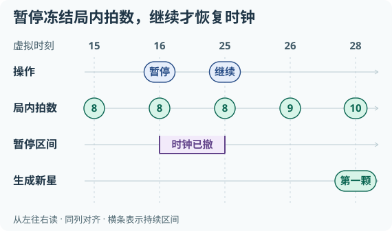

# 四 · 暂停、继续、再来一局

在「暂停与重开」一关，等画面上有两颗星时按空格。等几秒，再按空格，星从原处接着落。再试一次，这回在暂停中点「重新开始」，星消失，接收器回到中间。

把两只按钮分别接在什么位置，会决定哪块状态能留下来。先只考虑暂停。最小的一局只数拍数，时钟交出一个值就加一。在项目根目录运行 `node`，用手动的 `beat.next()` 代替等 140 毫秒。这样可以把暂停准确地插在两拍之间。

```js
const { BehaviorSubject, Subject, EMPTY, scan, switchMap } = await import('rxjs')
const playing = new BehaviorSubject(true)
const beat = new Subject()
const ticks = playing.pipe(
  switchMap(on => on ? beat : EMPTY),
  scan(n => n + 1, 0)
)
const screen = ticks.subscribe(n => console.log('第', n, '拍'))
beat.next()          // 第 1 拍
playing.next(false)
beat.next()          // 暂停中，没人向 scan 交这一拍
playing.next(true)
beat.next()          // 第 2 拍
screen.unsubscribe()
```

`playing` 从 false 变回 true 时，`switchMap` 会重新订阅 `beat`。外面的计数器一直在，所以从 1 接着数。把上面两步合并成 `switchMap(on => on ? beat.pipe(scan(n => n + 1, 0)) : EMPTY)` 再做一次，每次恢复都会新建计数器，终端会两次打出「第 1 拍」。

成品把这个数换成整份游戏状态。暂停会撤掉落星时钟和连移监听，并发一次暂停行动给外面的 `scan`，这样就能同时画出暂停按钮、保留场上的星。继续后，新的时钟要重新等满 140 毫秒，第一拍会把旧的 8 推到 9，第二拍到 10 才生成星。**重开**才需要丢开整份状态，所以它的 `switchMap` 包在计数器外面，一并撤掉时钟和本局的 `scan`。[gameStates 的实现](game.ts)

[](../figures/game-04.svg)

`node --test --test-name-pattern=第八拍 game/game.test.ts` 同时检查两件事：暂停期间时钟有没有退订，以及恢复后第二拍有没有生成星。仅仅让绘制函数暂时不画，后台节拍仍会前进，过不了这组测试。

## 章末附录 · 本章 RxJS API 速查

<details>
<summary>查看本节用到的 API</summary>

**接入来源与订阅**

| API | 用法 |
|---|---|
| [`EMPTY`](../RxJS-7.8.2-API清单.md#api-53) | 不交付任何值，订阅后立即正常完成。 |
| [`of`](../RxJS-7.8.2-API清单.md#api-125) | 按参数逐个同步交付后完成；传一个数组会把整份数组作为一个值。 |

**变换、筛选与累计**

| API | 用法 |
|---|---|
| [`map`](../RxJS-7.8.2-API清单.md#api-91) | 对每个输入执行投影，交付一个对应结果；第二个参数是这一段订阅内的序号。 |
| [`pipe`](../RxJS-7.8.2-API清单.md#api-134) | 按从左到右的顺序组合操作；流的 pipe 方法把这些操作应用到当前来源。 |
| [`scan`](../RxJS-7.8.2-API清单.md#api-157) | 保存本次订阅的累计状态，每处理一个值就交出新状态；种子本身不会单独发出。 |
| [`takeWhile`](../RxJS-7.8.2-API清单.md#api-190) | 连续放行满足条件的前缀；inclusive 为 true 时也交付首个不满足条件的值。 |
| [`startWith`](../RxJS-7.8.2-API清单.md#api-173) | 订阅时先发给定的初始值，然后订阅原来源。 |

**时间与调度**

| API | 用法 |
|---|---|
| [`timer`](../RxJS-7.8.2-API清单.md#api-206) | 等到指定时刻或延时后发 0；给第二个周期参数可继续递增发值。 |

**组合来源与在途工作**

| API | 用法 |
|---|---|
| [`switchMap`](../RxJS-7.8.2-API清单.md#api-183) | 外层重开时替换整局，内层暂停时只替换输入和时钟；两次切换控制不同寿命。 |
| [`concat`](../RxJS-7.8.2-API清单.md#api-28) | 依次订阅多个来源，上一条正常完成才进入下一条。 |
| [`merge`](../RxJS-7.8.2-API清单.md#api-95) | 同时接入多个来源，按实际抵达顺序转发各路输入。 |

</details>

[下一节 · 用虚拟时间验收](05-time.md)
