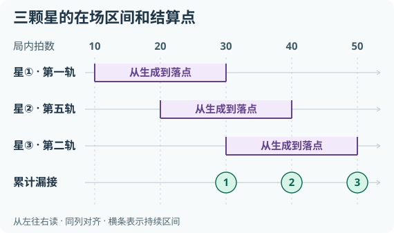

# 五 · 用虚拟时间验收

选择「固定轨道验收」，开始后保持居中。这关沿用完整玩法，只把生成轨道换为循环的 1、5、2、4、3。请先写下前三次漏接所在的节拍和最终得分，再玩一局核对。

| 星 | 生成 | 到达落点 | 接收器在第三轨时 |
|---|---:|---:|---|
| 第一颗 · 第一轨 | 10 | 30 | 漏接一次 |
| 第二颗 · 第五轨 | 20 | 40 | 漏接两次 |
| 第三颗 · 第二轨 | 30 | 50 | 漏接三次，本局结束 |

**读图 · 三颗星的在场区间和结算点**

图中只追踪最早的三颗星，玩家始终居中。第 30 拍第一颗落地，同时第三颗生成。第 50 拍达到第三次漏接，当拍交出结算帧并释放时钟。

最后一帧应停在第 50 拍，得分 0。你还可以改变一个输入：提前移动到第一轨并停住。第一颗会被接住，原先的第 50 拍结算断言应当失败。将这个变体写进测试时，记得为开局提供方向初值，并在只走两轨后送出松手事件。

### 把秒表换成可推进的时间

在项目根目录运行 `node --test game/game.test.ts`。读其中「无输入的固定路线」一题：`TestScheduler.run` 让测试使用虚拟时间。`cold` 建立一个每次订阅都从头发值的时钟，`of(0)` 提供居中静止所需的方向初值，`NEVER` 代表玩家一直没有点击。用 `flush()` 推进所有已安排的事件，无需等待真实的 7 秒。

跟着「第八拍暂停」用例读一次时间轴。测试时钟是 `-t-t-t-…`，订阅后第 1 个虚拟时间单位发第一拍，随后每隔 2 个单位发一拍。暂停按钮用 `hot` 表示，点击发生在整条测试时间线的固定位置。

| 虚拟时刻 | 输入 | 局内节拍 | 星数 |
|---:|---|---:|---:|
| 15 | 第八个时钟通知 | 8 | 0 |
| 16 | 暂停，第一段时钟退订 | 8 | 0 |
| 25 | 继续，第二段时钟订阅 | 8 | 0 |
| 26 | 恢复后的第一拍 | 9 | 0 |
| 28 | 恢复后的第二拍 | 10 | 1 |

**动手做。** 在测试里找出两条互补的证据。状态记录回答「第几拍生成了星」，而 `expectSubscriptions(clock.subscriptions)` 里的 `^` 表示开始订阅，`!` 表示退订。即使某个实现恰好画对了星，只要它在暂停期间仍让时钟工作，订阅区间的断言就会失败。「重开两次」用例同样检查前两局的时钟分别在哪一刻被替换。

### 迁移题 · 切换标签页

在自己的练习版本中接入 `visibilitychange`：页面进入后台自动暂停，回到前台后，由玩家按「继续」恢复。先画出「手动暂停 → 页面隐藏 → 页面可见」的时间线，写下每一步应有的暂停状态。若将三次操作都映射成同一种“翻转”通知，哪一步可能意外启动时钟？

交卷条件：已经暂停时再次收到隐藏通知仍保持暂停；可见通知不会恢复；手动继续后从原节拍推进；结算后切换标签页也不会启动新时钟。先给 [game.test.ts](game.test.ts) 添加一条虚拟时间线，再将真实浏览器事件接入相同的入口。
